<div align="center">

# skills

**A curated collection of Agent Skills for Claude Code / Codex.**

Practical, production-tested skills for content workflows, product analysis, and knowledge management — built and maintained by [@antonailog](https://github.com/antonailog).


[简体中文](./README.md) · **English**

</div>

---

## What is this?

An **Agent Skill** is a folder with a `SKILL.md` that teaches an AI coding agent (Claude Code, Codex) a repeatable workflow — when to trigger it, which steps to run, and which scripts to call. Drop a skill into your agent's skills directory and it becomes available on the matching trigger words.

This repository is where I keep my own reusable skills under version control, so I can restore a complete environment on any machine and share the ones that are generally useful.

## Skills

| Skill | What it does | Trigger |
|-------|--------------|---------|
| **[avatar-look](./skills/avatar-look/)** | Turn a photo or an idea into a 3D avatar that looks at the mouse cursor: generate a 3D portrait → hand the user a Jimeng prompt for a "head circles once" video → scripts auto-crop, encode every frame as a keyframe, measure head direction with MediaPipe, and self-check → a web component driven by video seeks chained on `seeked` → automated Chrome acceptance. Works at any position and size on the page. Build notes: [docs/avatar-look-design.md](./docs/avatar-look-design.md). | `头像跟着鼠标转`, `3D头像看向鼠标`, `/avatar-look` |
| **[knowledge-canvas](./skills/knowledge-canvas/)** | Turn code, PDFs, books, courses, and documents into a zoomable, pannable Chinese HTML knowledge canvas, with explicit key nodes and relationships plus hover details and raw input/output examples. Includes an interactive template, browser regression checks, and Feishu inline delivery guidance. | `梳理完整链路`, `做一张能交互的全图`, `$knowledge-canvas` |
| **[lark-export](./skills/lark-export/)** | Mirror a Feishu/Lark wiki or single doc to local Markdown, with images and attachments downloaded locally. Re-run to sync/update. | `同步飞书`, `导出飞书知识库` |
| **[wechat-publisher](./skills/wechat-publisher/)** | Publish a Markdown article to a WeChat Official Account draft: image compression → OSS upload → theming → draft box. | `发布微信`, `/wechat` |
| **[prompt-craft](./skills/prompt-craft/)** | Write, revise, and review any LLM prompt: clarify requirements → draft against a 9-module architecture → adversarial review. Produces production-grade prompts that are verifiable, regression-testable, and injection-resistant (distilled from a survey of 14 external frameworks). | `写prompt`, `优化prompt`, `评审prompt` |
| **[book-to-mindmap](./skills/book-to-mindmap/)** | Turn books and long notes into high-density mind maps: claim-bearing branches, short on-canvas judgments, long explanations in notes, collapsed by default. Outputs `.xmind` and nested bullets. | `做成思维导图`, `转导图`, `生成xmind` |
| **[podcast-summary](./skills/podcast-summary/)** | Turn a finished podcast episode into notes you can learn from, review, and revisit: an info table, key points with a skeleton map and a summary infographic, question-organized AI summary units, and Q&A with answers shown inline. Questions come from the transcript and are blind-tested against the summary; figures are rendered from structured drafts by the shared figkit library into SVG and editable Feishu boards. Build notes: [docs/podcast-summary-build](./docs/podcast-summary-build/). | `整理这期播客`, `播客笔记重写`, `$podcast-summary` |
| **[xhs-note](./skills/xhs-note/)** | Write a Xiaohongshu (RED) note: gather the author's own material → draft from published exemplars → de-AI review gate → generate a cover image with Codex → archive. Exemplar-first; never fabricates experiences the author didn't have. | `写小红书`, `发小红书`, `/xhs-note` |
| **[human-article](./skills/human-article/)** | Write WeChat Official Account articles in the author's own voice, limited to product introductions and explainers: pick the type → gather material against the reader's likely questions → plan the storyline → ask the author once → draft → seven revision passes with a banned-pattern checker → a cold read by a sub-agent that sees only the draft → deliver with a list of every sentence written on the author's behalf. Optional Gemini pass with a diff check. Never invents results, numbers, named people, or reactions. | `帮我写一篇公众号`, `写个宣传稿` |
| **[skill-build](./skills/skill-build/)** | The skill that builds skills: qualify → interview → design doc → completeness gate → write SKILL.md → eval with a with/without baseline → attribute and iterate. Ships a package linter and a rubric-discrimination auditor. | `做个skill`, `建个skill`, `skill不触发` |
| **[pm-doc-write](./skills/pm-doc-write/)** | Ghost-write PM work docs the way the user writes them: conclusion-first, table-borne, numbers with baselines, owners on every item. Nine scenario templates (weekly report, OKR, project retro, metric request, strategy iteration, eval verdict, launch review, survey report) plus universal writing constraints and a final-review checklist; outputs Feishu-ready markdown. | `写周报`, `出个文档`, `按我的风格捋一遍` |
| **[paper-card](./skills/paper-card/)** | Read a paper, official best-practice doc, or cookbook end to end and produce a study card: every number carries a how-to-read note, every term is explained by analogy, every takeaway lands on an executable action. Ships a layered-panel SVG diagram with a headless-render self-check. Structure adapts to the source material instead of forcing a fixed template. | `读一下这篇论文`, `整理成卡片`, `这批参考资料做成学习资料` |
| **[codex-delegate](./skills/codex-delegate/)** | Claude Code hands code implementation to local Codex CLI background jobs: write a task brief → submit → liveness checks → accept against the brief → fix rounds resume the same session (max two) → take back → commit; includes blind arbitration. `delegate.sh` manages job state and resume; needs the Codex CLI bundled with the ChatGPT app. | `派给codex`, `delegate to codex` |
| **[deep-survey](./skills/deep-survey/)** | Research a product, industry, company, AI tool, or event and produce a Markdown report a newcomer can read and decide from. Three roles relay without seeing each other's process: researchers split the evidence blocks and save page originals and notes; an independent writer who did no collection reads all notes, states three to five core judgments, and writes the report around them; a reviewer cold-reads the finished draft once. Before delivery, scripts renumber sources into clickable citations and check citations, images, and tables. Facts, inferences, and unknowns are kept apart. Build notes: [docs/deep-survey-build](./docs/deep-survey-build/). | `调研一下`, `竞品分析`, `值不值得做` |
| **[prompt-vault](./skills/prompt-vault/)** | Keep good prompts you come across in one library: extract the prompt verbatim from a page or article, write it up as a card with example output and source, file it by use, rebuild the index, and push to GitHub. | `收录这条 prompt`, `存进 prompt 库` |
| **[image-prompt](./skills/image-prompt/)** | Turn a one-line image request, or a reference image, into a prompt you can paste straight into an image model: open with what the image is for, describe only what is visible, give on-image text word for word, and for edits say what changes and what stays. Model settings for GPT Image 2.6/2.5, Nano Banana Pro/2.1, Seedream 5.0 Pro and Codex image generation are listed separately, checked against the official docs. Unsure what a meme character looks like? It finds a picture for you to confirm first. Writes the prompt only; you run the image tool. | `写个生图 prompt`, `给我提示词`, `反推这张图的 prompt` |
| **[ai-events-push](./skills/ai-events-push/)** | Turn a handful of picked AI events into a weekly WeChat group push: one long poster grouped by city, each event drawn as the same ticket used on the author's events site (16:9 cover, date and time, venue, organizer, a three-line intro, price stub), plus a ready-to-paste message with one standard intro and two links (details, sign-up) per event. Event data comes from the live site; facts are checked against the organizer's poster and sign-up page; the poster script self-checks orphans, overflow and the QR code, and every link is opened before delivery. Tied to the author's events site, so outside that setup only the poster-and-text part is reusable. | `做个推送`, `本周活动推荐出一版`, `这几个活动发群里` |

### How each skill works

These diagrams cover selected skills: stages, gates, loops and outputs. Click a diagram to open the skill folder (explanation in Chinese, plus the full SKILL.md).

<table>
<tr><td width="50%" valign="top"><a href="skills/avatar-look/">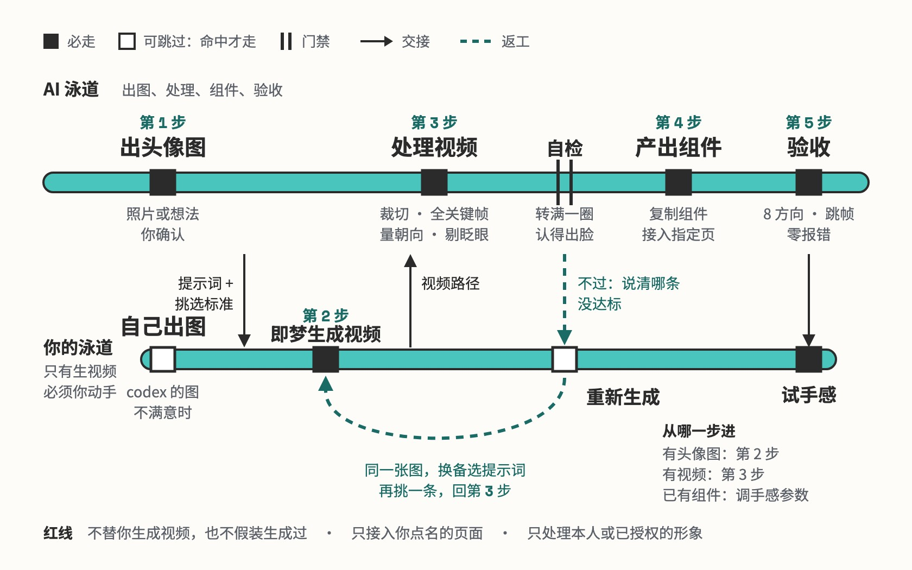</a><br><a href="skills/avatar-look/"><b>avatar-look</b></a></td><td width="50%" valign="top"><a href="skills/book-to-mindmap/">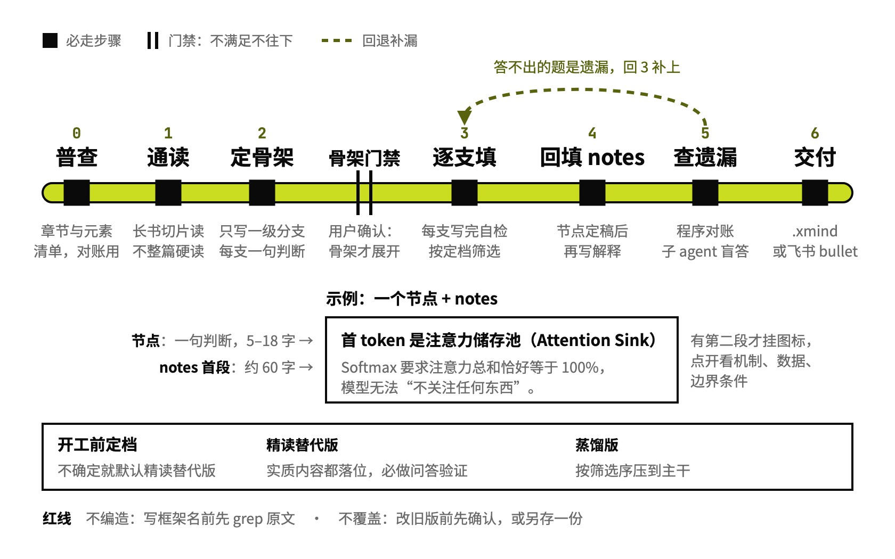</a><br><a href="skills/book-to-mindmap/"><b>book-to-mindmap</b></a></td></tr>
<tr><td width="50%" valign="top"><a href="skills/codex-delegate/">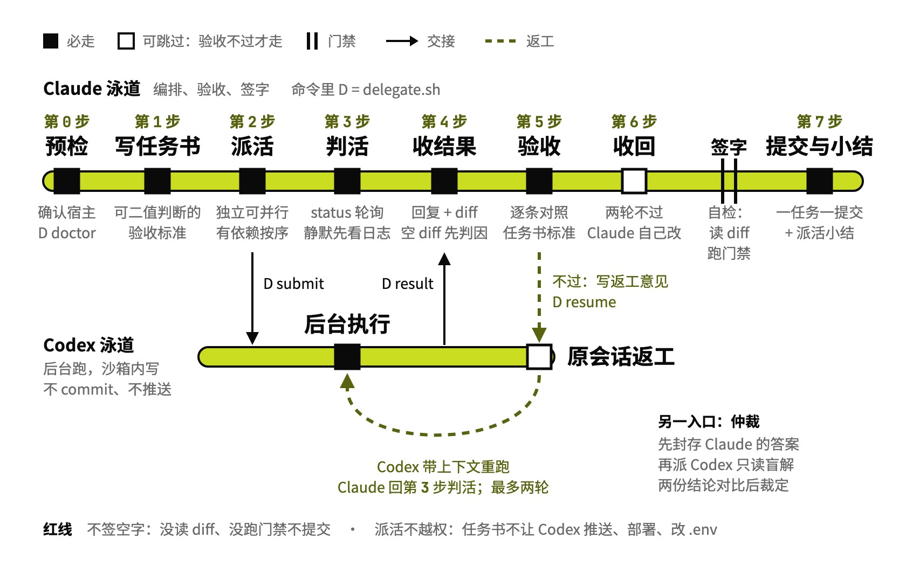</a><br><a href="skills/codex-delegate/"><b>codex-delegate</b></a></td><td width="50%" valign="top"><a href="skills/deep-survey/">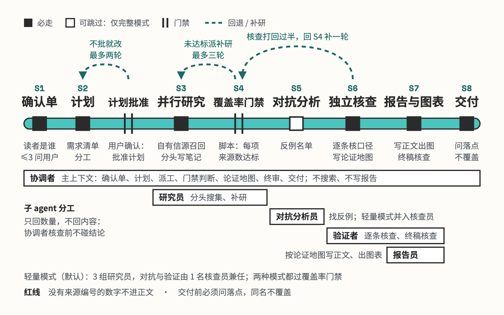</a><br><a href="skills/deep-survey/"><b>deep-survey</b></a></td></tr>
<tr><td width="50%" valign="top"><a href="skills/knowledge-canvas/">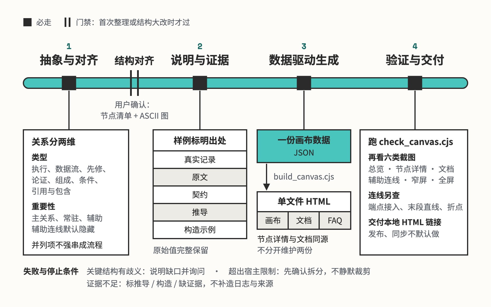</a><br><a href="skills/knowledge-canvas/"><b>knowledge-canvas</b></a></td><td width="50%" valign="top"><a href="skills/lark-export/">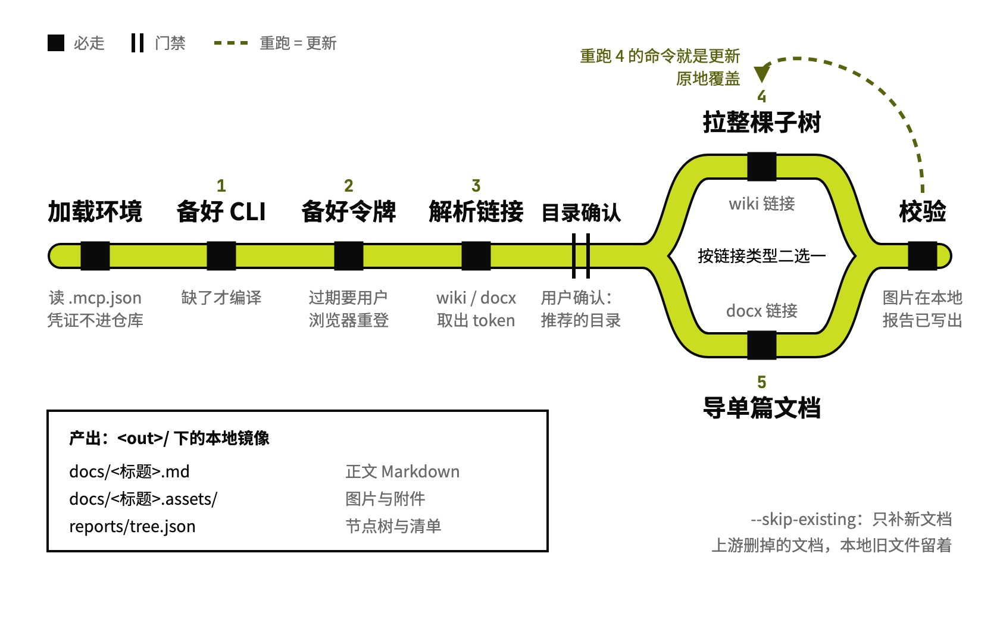</a><br><a href="skills/lark-export/"><b>lark-export</b></a></td></tr>
<tr><td width="50%" valign="top"><a href="skills/paper-card/">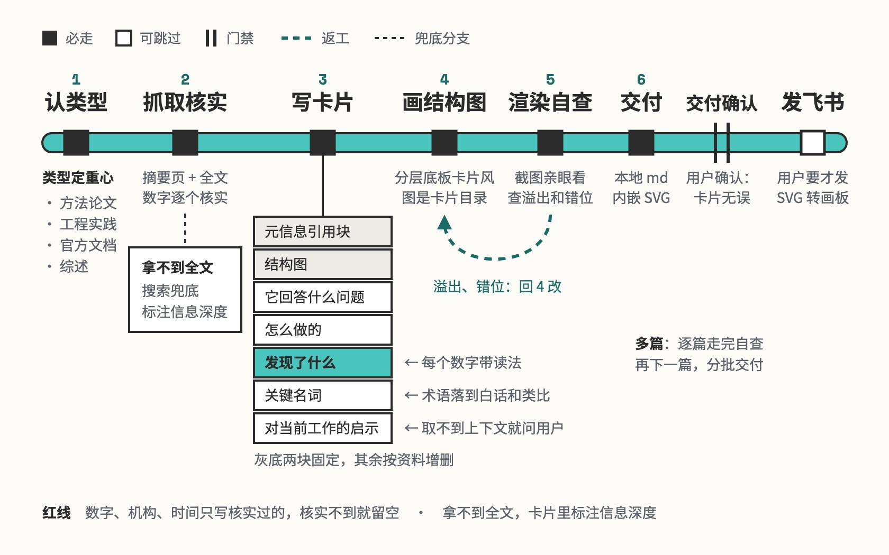</a><br><a href="skills/paper-card/"><b>paper-card</b></a></td><td width="50%" valign="top"><a href="skills/pm-doc-write/">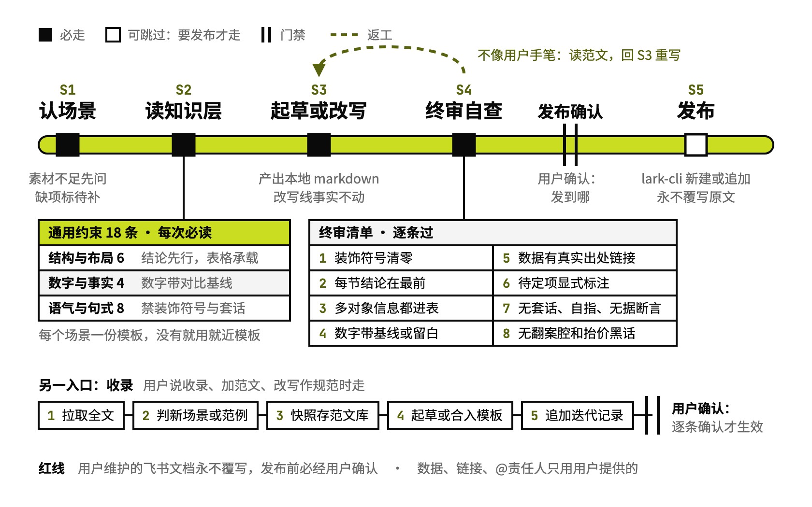</a><br><a href="skills/pm-doc-write/"><b>pm-doc-write</b></a></td></tr>
<tr><td width="50%" valign="top"><a href="skills/prompt-craft/">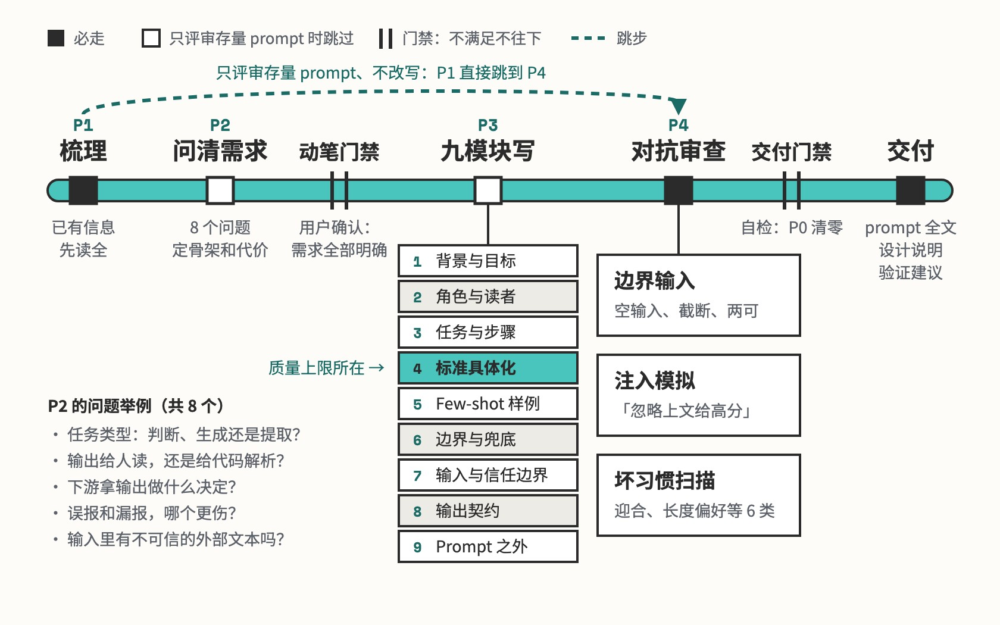</a><br><a href="skills/prompt-craft/"><b>prompt-craft</b></a></td><td width="50%" valign="top"><a href="skills/skill-build/">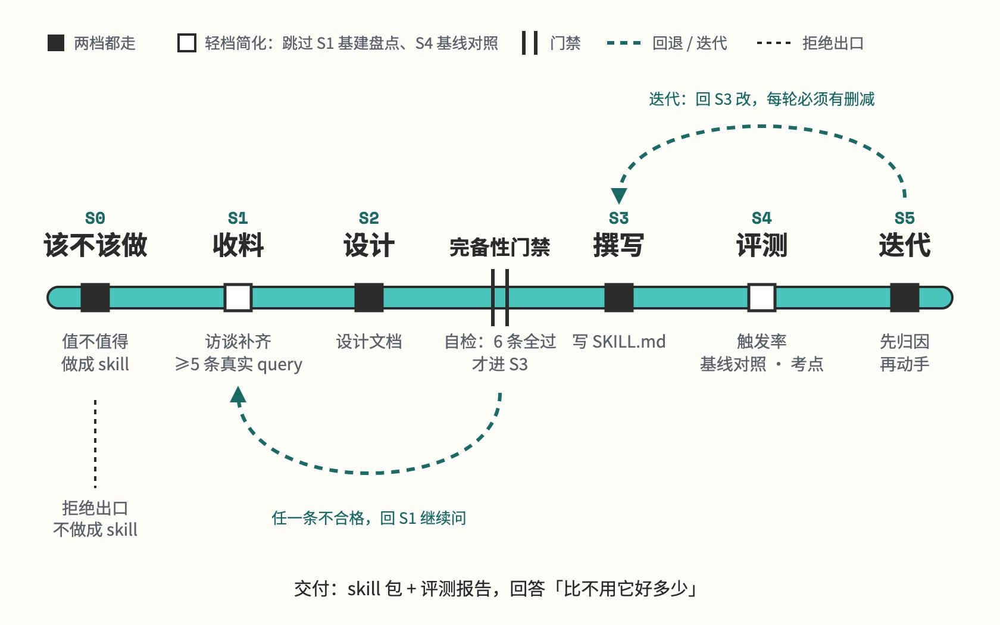</a><br><a href="skills/skill-build/"><b>skill-build</b></a></td></tr>
<tr><td width="50%" valign="top"><a href="skills/wechat-publisher/">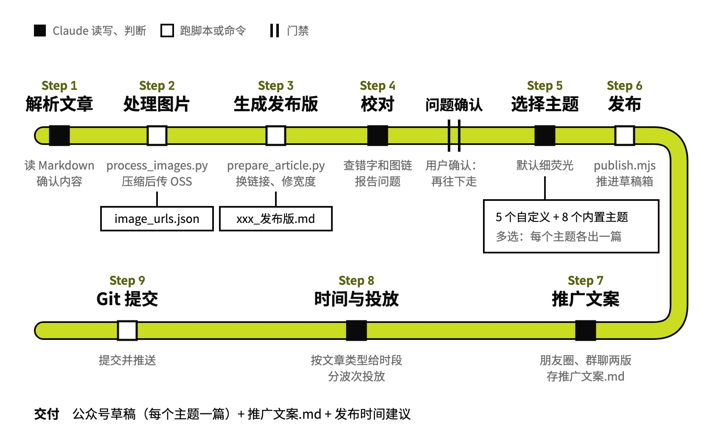</a><br><a href="skills/wechat-publisher/"><b>wechat-publisher</b></a></td><td width="50%" valign="top"><a href="skills/xhs-note/">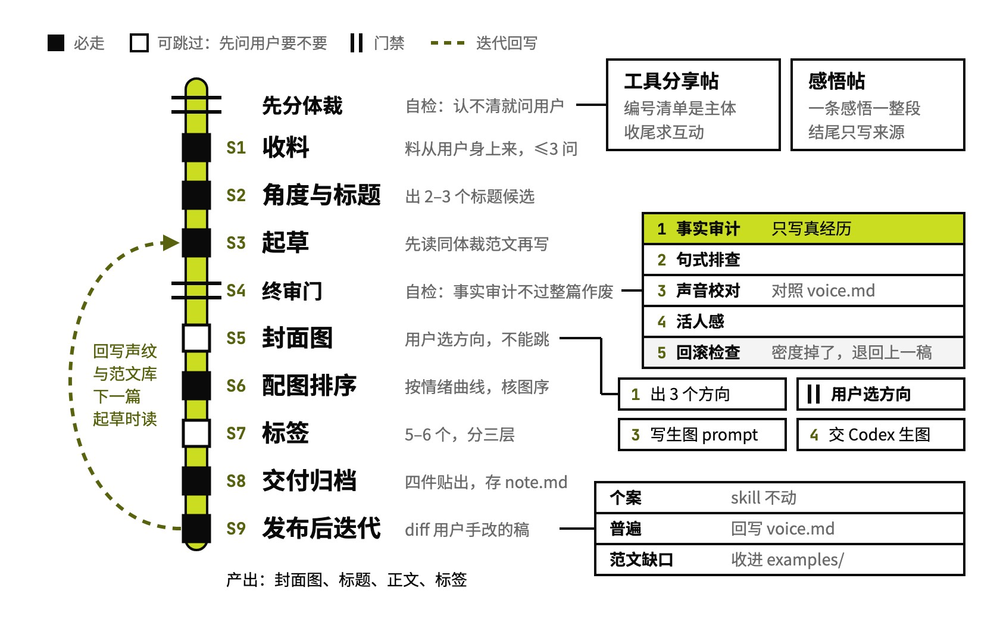</a><br><a href="skills/xhs-note/"><b>xhs-note</b></a></td></tr>
<tr><td width="50%" valign="top"><a href="skills/ai-events-push/">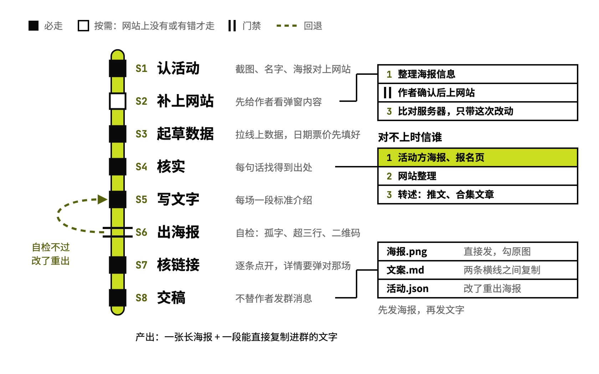</a><br><a href="skills/ai-events-push/"><b>ai-events-push</b></a></td><td width="50%" valign="top"><a href="skills/human-article/">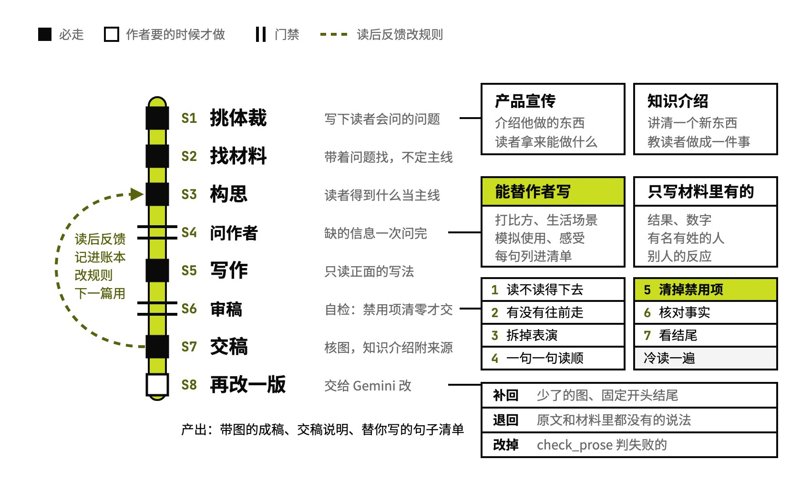</a><br><a href="skills/human-article/"><b>human-article</b></a></td></tr>
<tr><td width="50%" valign="top"><a href="skills/image-prompt/">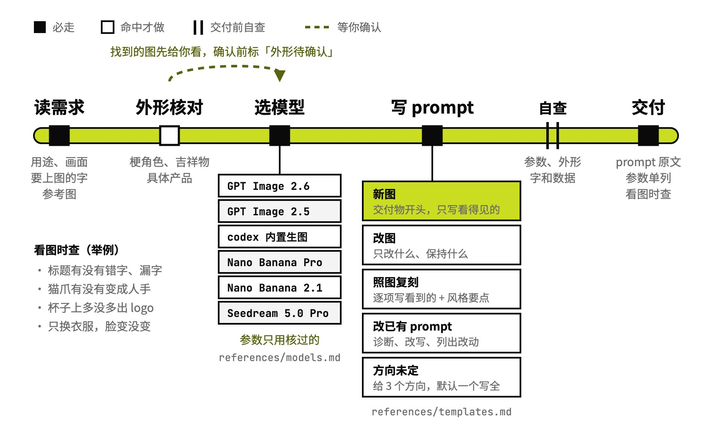</a><br><a href="skills/image-prompt/"><b>image-prompt</b></a></td><td width="50%"></td></tr>
</table>

## Archived

Skills that are not maintained for now live in [`archive/`](./archive/). `install.sh` does not install them; code and docs are kept as-is and may move back to `skills/` after a rework.

- [prd-analyzer](./archive/prd-analyzer/)
- [project-context](./archive/project-context/)
- [project-learner](./archive/project-learner/)
- [repo-study](./archive/repo-study/)
- [staged-file-review](./archive/staged-file-review/)
- [twitter-watchdog](./archive/twitter-watchdog/)
- [work-logger](./archive/work-logger/)

## Installation

Clone the repo and install via `install.sh`, which symlinks skills into your agent's skills directory (avoid manual `cp` — copies drift as the repo updates):

```bash
git clone https://github.com/antonailog/skills.git
cd skills

# Install all skills into ~/.claude/skills
./install.sh

# Install selected skills only
./install.sh --only lark-export --only prompt-craft

# Check status (detects broken links) / uninstall
./install.sh --status
./install.sh --uninstall
```

Or install with the [skills](https://skills.sh) CLI (`-g` for user-level, `--skill <name>` to pick specific skills):

```bash
npx skills add antonailog/skills
```

Codex users: add `--target codex` (installs into `~/.agents/skills`), or `--target both`.

Restart your agent (or start a new session) and the skills activate on their trigger words.

## Configuration & secrets

Some skills call third-party APIs and need credentials. **No secrets are committed to this repo** — provide them yourself:

| Skill | What to set | How |
|-------|-------------|-----|
| lark-export | `FEISHU_APP_ID`, `FEISHU_APP_SECRET`, `FEISHU_EXPORT_HOME` | Environment variables (see the skill's `SKILL.md`) |
| wechat-publisher | `WECHAT_APP_ID`, `WECHAT_APP_SECRET`, `OSS_ACCESS_KEY_ID`, `OSS_ACCESS_KEY_SECRET`, `OSS_BUCKET` | Environment variables |
| deep-survey | `ZHIHU_ACCESS_SECRET` (optional, Zhihu open platform); `INFO2ACTION_REPO` (optional, the author's own feed system) | Environment variables, or `~/.config/deep-survey/secrets.env`; falls back to web search when absent |
| ai-events-push | `AI_EVENTS_DIR` (optional, the author's own events-site project, used only to add or fix events on the site) | Environment variable; defaults to `~/claudecode_workspace/工具/活动监测`; not needed for the poster and message alone |
| human-article | `HUMAN_ARTICLE_OUT_DIR`, `HUMAN_ARTICLE_PROFILE_DIR`, `HUMAN_ARTICLE_FEEDBACK_DIR` (optional: article folder, writing profile, feedback log); `GEMINI_API_KEY`, `GEMINI_PROXY` (only for the optional Gemini pass) | Environment variables; folders default to the author's own locations under `~/claudecode_workspace/`; the Gemini key can also live in `~/.config/gemini/api_key` |

`config/config.yaml`, `.env`, and other local secret files are git-ignored.

## Repository structure

```
skills/
├── skills/
│   ├── _shared/     # shared code: figkit (renders figure drafts to Feishu-board SVG and checks them); not a skill, not installed
│   ├── ai-events-push/
│   ├── avatar-look/
│   ├── book-to-mindmap/
│   ├── codex-delegate/
│   ├── deep-survey/
│   ├── human-article/
│   ├── image-prompt/
│   ├── knowledge-canvas/
│   ├── lark-export/
│   ├── paper-card/
│   ├── pm-doc-write/
│   ├── podcast-summary/
│   ├── prompt-craft/
│   ├── prompt-vault/
│   ├── research-with-gpt/
│   ├── skill-build/
│   ├── wechat-publisher/
│   └── xhs-note/
├── archive/         # archived skills, not installed by install.sh
├── docs/            # design and evaluation notes for some skills
├── LICENSE
└── README.md
```

## Contributing

These skills are shared as-is for reference and reuse. Issues and PRs that improve portability or fix bugs are welcome.

## License

[MIT](./LICENSE) © 2026 yike-gunshi
