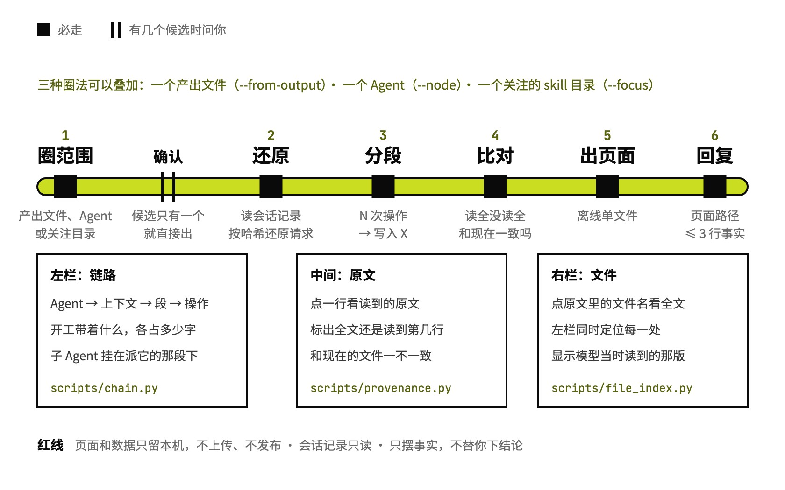

# agent-context-trace

看清一次运行读了什么、先后做了什么

## 要解决的问题

调一个 skill 或 prompt，结果不对，原因多半出在两处：模型当时手里有什么，它按什么顺序做的。可这些都埋在会话记录里，一次运行就是几万行 JSON。改过的 SKILL.md 读到没有、读的是不是新版，参考文件读全了没有，派给子 agent 的 prompt 原文是什么，写这一段之前它读过哪些文件，光看对话界面都看不出来，只能凭感觉猜着改。

## 运行方式



先圈范围：指定一个产出文件、一个 Agent，或一个关注的 skill 目录。脚本从本机的会话记录里还原这一段链路上每个 Agent 的上下文和每一次操作，打包成一个离线 HTML。圈出好几个说得通的候选时，它会先问你要哪个，不会自己猜一个出页面。页面和回复只摆事实，不下「该怎么改」的结论。

## 关键设计

trace 页面要同时做到两件事：按时间看清每次写入之前做过什么，点开任何一个文件都能看到模型当时读到的那一版。agent-context-trace 用 Python 脚本还原数据，一个页面模板打包成单文件；左栏是链路，中间是原文，右栏是文件全文。

- **按「N 次操作 → 写入 X」分段**：`scripts/chain.py` 把两次写入文档之间的所有操作归到结尾那次写入下面；调用子 Agent 的那段直接挂着子 Agent，连着的命令和代码文件读写折成一行。
- **读取标清读了多少、是不是现在这版**：`scripts/provenance.py` 标出每次读取是全文还是一部分，和现在磁盘上的文件一致不一致。用 Skill 工具加载的 SKILL.md 也记成一次读取。
- **开工带着什么一项项列出来**：`scripts/records.py` 按哈希还原每次请求，`scripts/model.py` 把上下文分成系统提示词、工具定义、注入内容（CLAUDE.md、记忆、skill 列表）、任务提示词，各占多少字符。
- **原文里的文件名能点开**：`scripts/file_index.py` 按五级顺序把原文里写的文件名解析成链接，找到唯一一个才做成链接；点开在右栏看全文，左栏同时定位它在链路里出现的每一处。
- **页面只留本机**：`scripts/html_page.py` 把 `assets/` 的模板和数据打包成一个离线文件。页面里有 CLAUDE.md、记忆原文，可能还有命令里的密钥，SKILL.md 的红线是不上传、不发布。

```text
agent-context-trace/
├── SKILL.md                定范围、出页面、回复格式、红线
├── assets/
│   ├── viewer.html         三栏页面的骨架
│   ├── viewer.js           链路树、原文、右栏、右键菜单
│   ├── viewer.css          页面样式
│   └── vendor/             内联的 markdown-it、OverlayScrollbars（MIT）
├── scripts/
│   ├── trace.py            入口：list、find、data、build
│   ├── records.py          读会话记录，按哈希还原请求
│   ├── model.py            上下文分组，识别读写操作
│   ├── chain.py            事件、分段、总览
│   ├── shell.py            解析执行的命令里读写了哪些文件
│   ├── file_index.py       文件引用解析和右栏内容
│   ├── provenance.py       读取范围、和现在的文件比对
│   ├── html_page.py        打包成单文件页面
│   ├── verify.py           校验还原出的请求
│   ├── finder-handler/     「在 Finder 中显示」的本机小程序
│   └── test_*              测试
└── examples/
    └── cafe-poster-trace/  例子：追踪一次写海报 prompt 的运行
```

## 其他

- 不处理：token 和花费统计、会话复盘（交给 forge-fupan）、改 skill 本身（交给 skill-build）
- 前提：只认 Claude Code 带完整请求的会话记录（VS Code 扩展 2.1.301 起）；Python 3。Command+点击在 Finder 里显示文件要装一次 `scripts/finder-handler/install.sh`
- 注意：页面默认存在 `~/claude-context-trace/`，存到 git 仓库里时它会先问一句，免得私人内容被顺手提交；公开示范前要像例子里的 `redact.py` 那样先脱敏

---

完整指令见 [SKILL.md](SKILL.md)；安装方法见仓库首页的 [README](../../README.md)。
