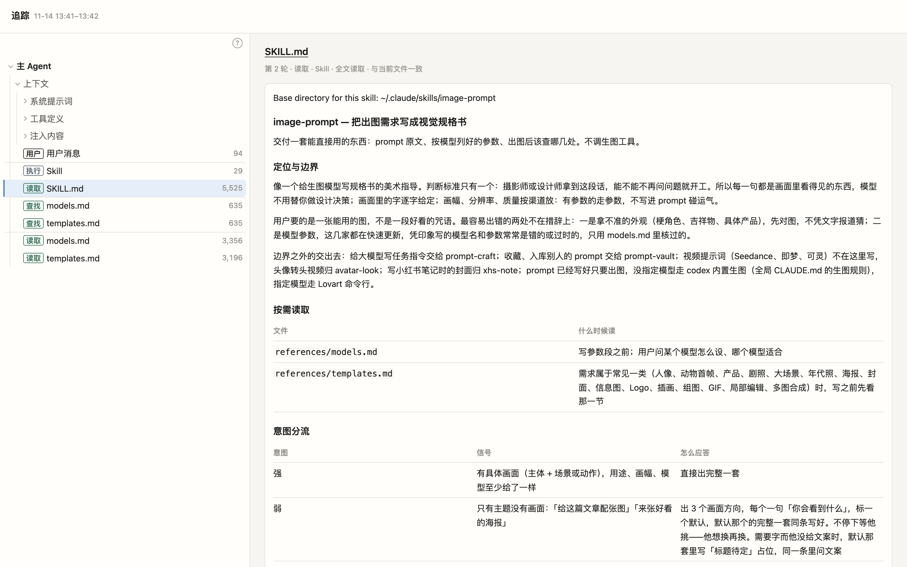

# 示范：一次 skill 运行 → 一张看得清「读了什么、按什么顺序」的 trace 页面

日期：2026-11-14 · 使用的 Skill：agent-context-trace（被追踪的是 image-prompt 的一次运行）

## 给了什么

一次 Claude Code 的无界面运行。在一个空的临时目录里，把 image-prompt 例子的那句需求原样发给 Claude（原文见 [input/需求.md](input/需求.md)）：

> 我家楼下的社区咖啡店秋天要上新品桂花拿铁，想做一张竖版海报贴在店门口。标题写「秋天的第一杯桂花拿铁」，下面一行小字「11月15日起 每天限量 50 杯」。帮我把生图的描述写好，我拿去出图。

模型是 claude-opus-5-5，跑了 6 轮、37 秒。它自己调起 image-prompt，最后交出一段生图 prompt（全文见 [output/回复.md](output/回复.md)），没有写文件。

想知道的是：这次运行到底加载了什么？SKILL.md 读到了没有、是不是现在这一版？两份参考文件读全了没有？

## 怎么调用的

运行结束后，拿这次会话的记录出 trace：

```bash
python3 -I ~/.claude/skills/agent-context-trace/scripts/trace.py build \
  --node ~/.claude/projects/<这个临时目录对应的项目>/<会话 id>.jsonl \
  --focus ~/.claude/skills/image-prompt \
  -o ~/claude-context-trace/cafe-poster.html
```

`--focus` 指向 image-prompt 的目录：页面里会多一张表，列出这个目录下每个文件在这次运行里出没出现过。

平时出的页面只留在本机，因为里面有系统提示词、你的 CLAUDE.md、记忆和 skill 列表的原文。这个例子要公开，所以先用 `trace.py data` 导出数据，过一遍 [redact.py](redact.py) 再打包成页面：系统提示词、全局 CLAUDE.md、账号、skill 列表、MCP 说明、延后加载的工具，这几段原文换成「【已省略：…，约 N 字符】」，长度照旧显示；本机路径换成 `~`、`/tmp/scratchpad`；CLAUDE.md 里提到的几份私人文件从页面里删掉。这次是空目录，没有记忆注入。

## 交出了什么

一个离线的单文件页面 [output/trace.html](output/trace.html)（下载后用浏览器打开），和同一结构的文字版 [output/tree.txt](output/tree.txt)：

```
主 Agent
  上下文 · 系统提示词 1 · 工具定义 16 · 注入内容 10
  第 1 轮  用户 用户消息 · 94 字符
  第 2 轮  执行 Skill · 29 字符
  第 2 轮  读取 SKILL.md · 5,525 字符
  第 3 轮  查找 models.md · 635 字符
  第 3 轮  查找 templates.md · 635 字符
  第 4 轮  读取 models.md · 3,356 字符
  第 4 轮  读取 templates.md · 3,196 字符
```



从页面上能直接读出来的：

| 问题 | 在页面哪里看 | 这次的答案 |
|---|---|---|
| SKILL.md 读到没有、是不是现在这版 | 点「读取 SKILL.md」，标题行 | 第 2 轮由 Skill 工具整篇加载，「全文读取 · 与当前文件一致」 |
| 参考文件读全了没有 | 点「读取 models.md」「读取 templates.md」 | 都只读了开头一段：models.md 读到第 68 行（共 143 行），templates.md 读到第 123 行（共 264 行）。之前一轮先 grep 了两份文件的标题，按目录挑着读 |
| 开工时上下文里已经有什么 | 点「上下文」 | 系统提示词 8,906、工具定义 71,610、注入内容 35,020 字符；其中 skill 列表一项就有 23,805 字符 |
| 回复里的某句话从哪来 | 点「上下文 → 注入内容」 | 回复写「按你的默认出图方式写的」，因为全局 CLAUDE.md 里写了默认用 codex 出图；页面上能看到这一项在开工时就注入了（原文已省略） |
| 最后交了什么 | 点第 4 轮的任一行，最下面是这一轮模型说的话 | 那段生图 prompt |

页面上点原文里的文件名（比如 SKILL.md 里写的 `references/models.md`），右栏打开文件全文，左栏同时高亮它在链路里出现的每一处。
