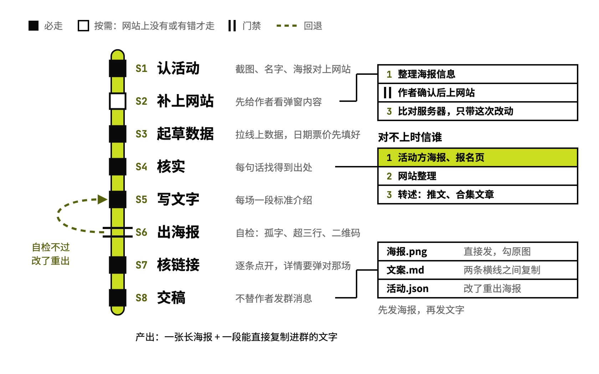

# ai-events-push

本周 AI 活动推荐的海报和群消息

## 要解决的问题

每周往微信群推几场 AI 活动，手工做一次要一场场查时间、地点、票价和讲者，排一张群里看得清的图，再写一段能转发的文字、挂上报名链接。图上少了地点或价格，群里的人还得去翻文字；文字和图对不上、详情链接点开是另一场，照着去报名的人就会白跑。好活动常常只有一张别人转来的海报，网站上还没有这一场，详情链接都没处指。

## 运行方式



从作者挑的几场开始：网站截图、活动名或一张海报都行，先在「国内AI活动追踪」网站上对上是哪一场。网站上没有、或者信息有错的，先把弹窗要放的内容给作者看，确认后才改网站。出海报时脚本自检，有孤字、介绍超过三行、二维码扫不出，就回到写文字那一步改了重出；交稿到文件为止，发群由作者自己来。

## 关键设计

一次群推送要同时做到：图本身信息完整、一眼看懂，文字整段复制就能发，里面每个时间、价格、嘉宾都找得到出处。ai-events-push 把固定的活交给四个脚本（拉数据、读报名页、出海报、核链接），版式定在一份模板里，模型负责认活动、核实和写介绍。

- **数据从网站来，事实按来源排先后**：`fetch_events.py` 从网站的构建产物里取出活动列表，日期、钟点、地点、票价、宣传图先填进海报数据草稿，连同网站存下的活动原文一起导出。核实时活动方海报和报名页排第一，网站整理第二，推文和合集里的转述第三；要跑 JS 才显示内容的报名页由 `read_page.py` 在浏览器里打开再读。对不上以活动方为准，网站上的错按 `references/新活动上网站.md` 另外修。
- **版式写在模板里，每次只换数据**：`assets/poster.html` 用网站电脑版门票的样式：左边 16:9 宣传图，右边日期钟点、名称、地点、主办方和三行介绍，副券写价格；按城市分区，背景是网站顶栏的七彩压淡，底部是网站二维码。每次推送只改 `活动.json`。
- **出图后先自检，不过就改了重出**：`make_poster.py` 截完长图，查名称和介绍最后一行是不是孤字、介绍有没有超过三行、价格是不是太长、宣传图下没下载下来、底部二维码能不能扫出网站地址；活动方只给了长竖海报的，自动截顶上一块当宣传图。
- **发出去的链接逐条打开核对**：`check_links.py` 在浏览器里逐条打开「详情」链接，看弹出的是不是这一场；报名这类外部链接查能不能打开，遇到跳转就标出来，请作者在手机上点一下；微信文章要在微信里打开，脚本跳过。
- **文字用标准活动介绍的写法**：`references/文案写法.md` 定了每场一段的顺序（是什么、谁主办 → 规模和形式 → 嘉宾和亮点 → 参加要求）和一段样例；票面介绍是同一批事实压到 60 字左右。

```text
ai-events-push/
├── SKILL.md                         流程、定过的版式、红线
├── references/
│   ├── 文案写法.md                  文字稿和票面介绍的写法、样例
│   └── 新活动上网站.md              网站上没有或写错时怎么加、怎么修
├── scripts/
│   ├── fetch_events.py              拉网站活动数据和原文，起海报数据草稿
│   ├── read_page.py                 在浏览器里打开报名页，读正文和链接
│   ├── make_poster.py               填模板、截长图、自检
│   └── check_links.py               逐条打开详情和报名链接
├── assets/
│   ├── poster.html                  海报模板：按城市分区的门票
│   ├── qrcode.min.js                生成底部的网站二维码
│   ├── THIRD-PARTY.md               二维码库和字体的来源、许可
│   └── fonts/
│       └── geist-latin-wght-normal.woff2  海报里数字和英文的字体
└── examples/
    └── next-week-ai-events/         例子：一周五场 AI 活动的群推送
```

## 其他

- 前提：python3 带 playwright（先装 Chromium：`playwright install chromium`）、Pillow，opencv 可选（用来自检二维码，没有就跳过）；node（解析网站数据）；能访问 antonailog.com 和 cdn.jsdelivr.net（海报的中文字体从这里加载）
- 注意：活动数据取自作者的「国内AI活动追踪」网站（antonailog.com/more/ai-events/）；加新活动、修网站信息要用到这个网站项目自己的发布脚本，项目目录由环境变量 `AI_EVENTS_DIR` 指定，换人用只能做出海报和文字这一段

---

完整指令见 [SKILL.md](SKILL.md)；安装方法见仓库首页的 [README](../../README.md)。
