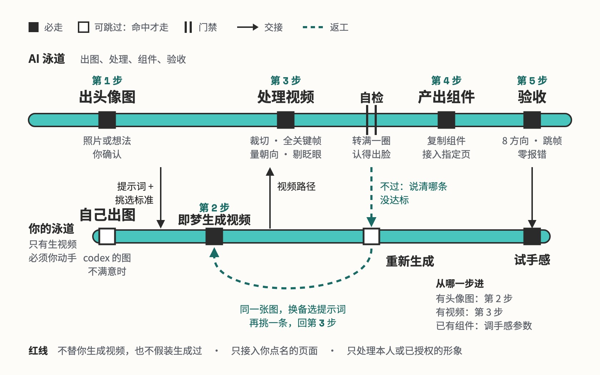

# avatar-look

会看向鼠标的 3D 头像组件

## 要解决的问题

想在个人网站上放一个会看向鼠标的 3D 卡通头像，手上只有一张照片或一个想法。没有这个 Skill 时，要自己在 Three.js、眼神网格图、视频之间选方案，自己给视频模型写提示词，再临时写脚本裁视频、算朝向、写跟随代码。作者第一次做时返工了三轮：按姿态挑帧转起来一顿一顿，帧图混合在快速转头时有重影，最后才定在「视频 + seeked 串联」。

## 运行方式

AI 先出 3D 头像图，再把即梦的设置、提示词和挑选标准交给你；生成视频是唯一必须你动手的一步。视频交回后，脚本自动裁切、量朝向并自检：头没转满一圈或认不出脸，就说清哪条没达标、让你换备选提示词重生成。最后复制组件、接入你点名的页面，自动验收后由你亲手试手感。手上已有头像图或视频，可以从第 2、3 步直接进。

## 关键设计

- **不做真 3D，做一段头绕一圈的视频**：图片转 3D 模型后长相和质感都会掉，眼睛画在贴图上转不了；视频模型出来的画面本身就是那个人
- **播放头沿时间轴连续走，不按姿态直接挑帧**：鼠标方向换算成时间轴上的目标位置，播放头按最短路径追过去、途经每一帧；直接挑「姿态最近」的帧，帧在时间上不相邻，转起来一顿一顿
- **视频 + seeked 串联，每帧都是关键帧**：上一次跳转没完成时只记最新目标，等 seeked 再跳，浏览器不会丢弃中途的跳转；全关键帧编码让跳到任意一帧都只解一帧。并排对比时它比帧图混合更清楚
- **自检不过就回去重生成视频，不靠调参硬救**：转满一圈、认得出脸是脚本能判断的；视频里某个方向没拍到，后面怎么调都补不回来
- **视频转多了、低头了，脚本自己处理**：视频模型常多转一段，脚本裁成正好一圈，接缝挑首尾最像的两帧，不然转到起点附近头会抢跑再弹回；低头时眼皮下垂不算眨眼，转到下方会真的低头。验收除了 8 个方向，还让鼠标慢转一圈，看头有没有一路跟住
- **只算相对头像中心的方向**：头像放在页面哪里、显示多大都不用改代码

## 其他

- 前提：ffmpeg、uv（脚本用 Python 3.12 临时环境装 MediaPipe）、playwright + 本机 Chrome（验收）；生图默认走本机 Codex 的 image_gen，没有就给提示词自己出
- 注意：转动幅度只跟方向走，不随鼠标远近变化；只在 Chrome 实测过，Safari 未验证

---

完整指令见 [SKILL.md](SKILL.md)；安装方法见仓库首页的 [README](../../README.md)。
