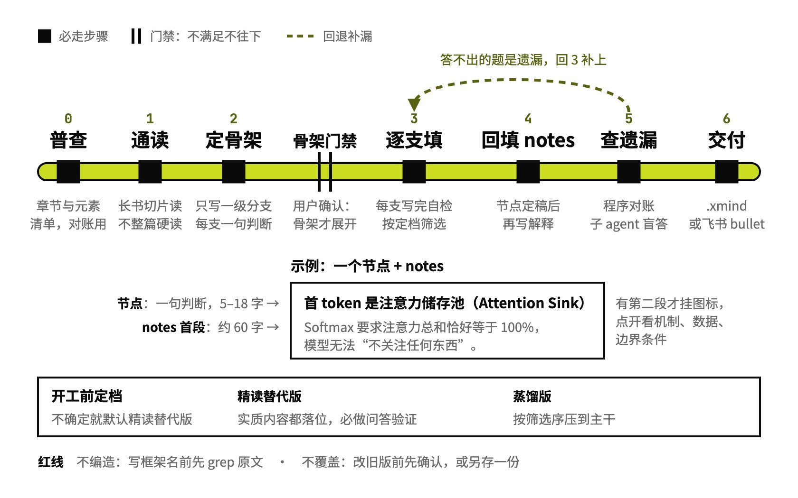

# book-to-mindmap

书和长文转思维导图

## 要解决的问题

把一本书转成思维导图，常见做法是照目录拆、每个节点放一个关键词，看完只记得有哪些话题，记不住结论，意思还得自己拼。把解释整句塞进节点，导图又被撑得很宽；删掉解释，读者就得回原文。

## 运行方式



开工前先定覆盖档：用户没读过原书、或拿不准时，按精读替代版做，章节里的实质内容都要有位置。骨架要用户确认：只写一级分支和枝干，用户点头后才往下填。精读替代版查遗漏时，每章从原文出 8—12 个问题，交给只看得到导图、看不到原文的子 agent 回答，答不上的回头补。

## 关键设计

一张导图要同时做到两件事：只扫折叠后的骨架就能掌握全章主张，点开能读懂机制和数据。book-to-mindmap 把每条知识分成两层放，节点上写一句短判断，备注里写解释；内容只写在一份多级列表的 Markdown 里，.xmind 由脚本从它生成，一章一张画布。

- **节点写一句能判真假的判断**：节点限 5—18 字，枝干也写成判断，例如「注意力：模型偏向两端，忽略中间」，措辞的正反例对照在 `references/writing-rules.md`。`mindmap-lint.py` 检查节点长度和句末标点，并提示兄弟节点句式雷同、只带一个子节点的父节点过多。
- **解释写进备注，首段直接显示在节点里**：机制、数据和边界条件写进备注，`md2xmind.py` 把备注第一段以灰字渲染进节点，第一段控制在 60 字上下，用 `inline_stats.py` 按生成器的切分逻辑量长度。灰字颜色、节点限宽这些样式常量和实机验证过的渲染规则记在 `references/xmind-style.md`。
- **骨架优先用书自带的框架**：一级分支先用书里现成的框架（四要素、五阶段、N 条法则），没有就按读者的问题重组，作者结构本身层层收束时才照章节走；根节点下也挂一句全章主张。这套顺序的依据和优秀案例在 `references/methodology.md`。
- **每句话都能回到原文出处**：写下框架名之前先回原文搜一次；每个一级分支挂 § 溯源标签，标明对应原文哪一节，原文没印小节号时只标到第几个大节。标签和标记的写法在 `SKILL.md`。
- **覆盖度按原文的元素清单对账**：`book_survey.py` 在转换前切章节，数出公式、代码、表格、图表、实验、习题各有多少，交付前逐项核对导图落了几个；这些元素各放进节点还是备注见 `references/non-narrative.md`，从程序对账到逐块复核的三层查漏办法在 `references/coverage-check.md`。

```text
book-to-mindmap/
├── SKILL.md                两层分工、骨架、措辞、覆盖分档、流程
├── references/
│   ├── writing-rules.md    节点措辞的正反例对照
│   ├── long-book.md        整本书怎么切片读、进度怎么落盘
│   ├── non-narrative.md    公式、代码、表格、实验、习题放哪
│   ├── coverage-check.md   三层查遗漏：对账、问答、逐块复核
│   ├── xmind-style.md      样式常量和实机验证过的渲染规则
│   └── methodology.md      规则的依据：金字塔原理、认知科学、案例
├── scripts/
│   ├── book_survey.py      转换前普查章节和各类元素
│   ├── mindmap-lint.py     查节点长度、句末标点、句式雷同
│   ├── inline_stats.py     量节点内灰字的长度分布
│   ├── md2xmind.py         从 Markdown 稿生成 .xmind
│   ├── combine.py          多章合成一个文件，一章一张画布
│   └── xmind_markers.py    XMind 标记 ID 清单，生成前校验
└── examples/
    └── sunzi-art-of-war/   例子：《孙子兵法》全文做成一张导图
```

## 其他

- 前提：Python 3 生成 .xmind，脚本只用标准库；要发飞书时用 lark-cli 发多级列表版
- 注意：整本书逐章做时，一章一张画布，合成一个 .xmind 文件，打开默认只展开到第 2 层
- 注意：XMind 不会重载已经打开的文件，看新版要换个文件名
- 注意：分章派给子 agent 时，它报的长度数字要用 `inline_stats.py` 自己重跑一遍再信

---

完整指令见 [SKILL.md](SKILL.md)；安装方法见仓库首页的 [README](../../README.md)。
