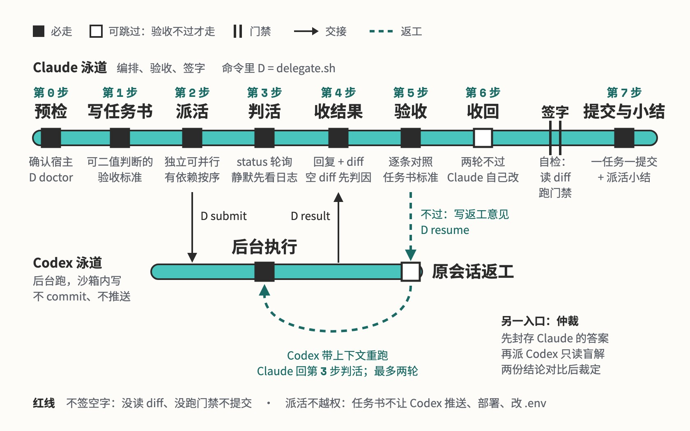

# codex-delegate

派活给 Codex，Claude 验收

## 要解决的问题

作者的分工是代码交给 Codex 写，Claude 负责编排和验收。没有这个 Skill 时，每次派活都要手拼二进制路径、代理和 stdin 参数，靠翻会话文件判断 Codex 还活着没有；返工要重开会话，让 Codex 从头读一遍仓库。验收只能靠 Claude 自觉，只看 diff 就会漏掉根本没做的任务。

## 运行方式

Claude 写好任务书，用 `delegate.sh` 把活交给后台的 Codex；Codex 只在沙箱里改文件，不提交、不推送。验收不过就写返工意见发回原会话，Codex 带着上一轮的上下文改，最多两轮，还不过由 Claude 收回自己改，通过后由 Claude 提交。另有一个只读入口用于仲裁：结论有争议时，Claude 先封存自己的答案，再让 Codex 盲解同一道题，两份对比后裁定。

## 关键设计

- **Codex 的产出要 Claude 签字才算数，签字的标准是任务书**：逐条对照验收标准、读完整 diff、亲自跑门禁；只看 diff，规格会被偷换成「改了的部分没毛病」
- **写不出可验证的验收标准，就退回重拆**：模糊的活交给 Codex，它只能猜
- **返工接回原会话，两轮不过就收回**：resume 省掉重读仓库；第三轮的收益通常已经低于 Claude 直接动手，问题往往出在任务书本身
- **作业显示完成但没有改动时，先判原因再返工**：可能是沙箱拦了写入、Codex 认为已经满足，或者它只给了方案，三种处理完全不同，让它「再试一次」只会白烧一轮
- **运行中静默先看日志，不见静默就杀，也不因超时降档**：高推理档在第一条输出前本来就可能静默很久

## 其他

- 前提：宿主是 Claude Code；本机装有 Codex CLI，默认找 ChatGPT 桌面版自带的那份，可用 `CODEX_DELEGATE_BIN` 指定；任务在 git worktree 里做
- 注意：脚本默认让 Codex 走本机代理，网络环境不同要设 `CODEX_DELEGATE_PROXY`；每个会话第一次派活前先跑 `delegate.sh doctor`
- 注意：任务书里写明不推送、不部署、不改 `.env`、不连生产库；Codex 跑在 `approval_policy=never` 下，没有人会拦它

---

完整指令见 [SKILL.md](SKILL.md)；安装方法见仓库首页的 [README](../../README.md)。
