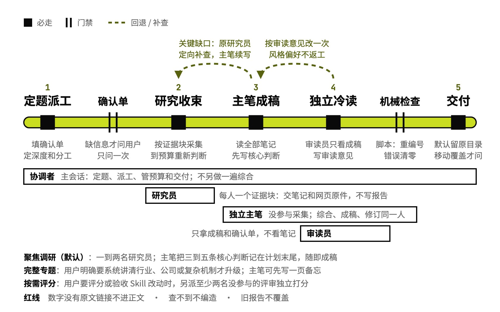

# deep-survey

带来源的深度调研报告

## 要解决的问题

想摸清一个陌生赛道，通用的 deep research 能搜能写，但开工前不问读者是谁、要做什么决定，写完没人核查，查不到的也不交代。交出来的报告常常正文没有来源编号，推算出来的数字以事实的样子进了表格。读者拿到这样的报告，分不清哪句查过、哪句是估的。

## 运行方式



协调者先按用户给的材料填确认单，缺的信息会改变范围或判断时才集中问用户一次，计划和大纲不另等批准；报告默认留在计划里的目录，要移动或覆盖才再问用户。主笔发现会改变主要判断的证据缺口，退回原研究员定向补查，补完仍由同一主笔续写；审读意见只改一次，纯风格偏好不返工。检索用到预算时重新判断，只有会改变结论的缺口才继续查。

## 关键设计

一份调研报告要同时做到两件事：判断来自全部证据，结论经得起外人检验。deep-survey 把调研拆成找证据、下判断、挑毛病三步，交给三个互相看不到对方过程的角色接力完成，每一步都落成文件交给下一步。

- **找证据的人不下结论，下结论的人读全部证据**：研究员按证据块分工，只交笔记和网页原件，不写报告（`references/researcher.md`）。主笔没参与采集，先读完全部笔记，写下三到五条核心判断，再按论点组织报告（`references/writer.md`）。
- **每个说法都能回到原文**：`fetch_page.py` 抓网页时保存原件和抓取状态；`build_source_table.py` 把笔记里的来源汇成一张表；交付前 `renumber_sources.py` 把编号排成 1 到 N，并生成点开就是原文的引用；`check_report.py` 检查引用、图片、表格这些机械项。
- **读者先拿到答案，再看依据**：标题写结论，开头一屏回答读者的问题，每个问题都有正面回答；事实、推断和还不知道的分开写，结论带适用条件和放弃线。写法在 `references/writer.md`；审读员只拿成稿和确认单，按 `references/report-quality-policy.md` 的质量原则冷读（`references/reviewer.md`），主笔按意见改一次。
- **投入跟问题的大小匹配**：默认「聚焦调研」，一两名研究员；要讲透一个行业或复杂机制才升级成「完整专题」，两档的事实和来源标准一样。每个课题有检索预算，用完时判断剩下的缺口会不会改变结论，不会就收手，查不到的写进「还不知道的」。

```text
deep-survey/
├── SKILL.md                       总流程：定题派工 → 研究与收束 → 主笔成稿 → 冷读 → 检查交付
├── references/                    各角色开工前读自己那份
│   ├── researcher.md              研究员：负责一个证据块，存原件、写笔记
│   ├── writer.md                  主笔：读懂全部笔记，定论点、写报告
│   ├── reviewer.md                审读员：只看成稿，冷读挑问题
│   ├── report-quality-policy.md   好报告的标准，审读和评分都照它
│   ├── fetching.md                网页怎么抓、原件怎么存
│   └── what-to-look-for.md        产品、行业、公司、AI 工具各该查哪些角度
├── scripts/
│   ├── fetch_page.py              抓网页，保存原件和缺失状态
│   ├── fetch_article.py           取一篇网页全文，绕开常抓不到的站点
│   ├── own_feed_recall.py         可选：先从作者自己的信息流里找原文
│   ├── zhihu_search.py            可选：知乎官方搜索接口
│   ├── build_source_table.py      汇总笔记里的来源，建来源表
│   ├── renumber_sources.py        交付前统一编号，生成可点击引用
│   ├── check_report.py            检查引用、图片、表格
│   ├── make_chart.py              数据图
│   ├── make_guide.py              报告开头的导引图
│   ├── render_visual.py           结构图、网页截图
│   ├── render_table.py            对比表
│   └── measure_run.py             统计一次运行的用量
├── assets/
│   └── chart-themes.json          图表配色主题
└── examples/
    └── which-ai-assistant/        例子：普通人该用哪个 AI 助手（输入、报告、过程）
```

## 其他

- 前提：能联网搜索和抓取网页，搜索不可用时只抓已知来源；要能派后台子 agent，没有时研究和写作串行完成，不算独立主笔和独立冷读；出图才要 matplotlib 和 Playwright；`ZHIHU_ACCESS_SECRET`（知乎）、`INFO2ACTION_REPO`（作者自用的信息流）可选，缺了就退回网页搜索
- 注意：说了「深度调研」不会自动升级成完整专题；要系统讲清行业、公司或复杂机制，得明确提出
- 注意：一次只做一个课题，对比对象不超过六个；企业工商、司法类信息查不到，会写进「还不知道的」

---

完整指令见 [SKILL.md](SKILL.md)；安装方法见仓库首页的 [README](../../README.md)。
