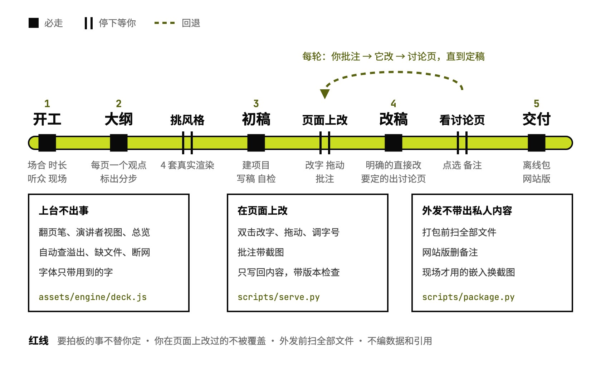

# html-deck

能上台、能在页面上改的 HTML 演示稿

## 要解决的问题

要上台讲一个东西，做幻灯片时大半时间花在排版上；改一个字，要在对话里描述「第几页左边那个」。嵌网页和视频、现场没网、换一台电脑放，都容易出事。稿子要外发或公开时，备注和嵌进去的本机页面会一起被带出去。

## 运行方式



从一句「要讲什么」开始。先问清场合、时长和听众，排出每页一句观点的大纲，再用你的内容渲染 4 套风格给你挑。初稿写好后，你在页面上直接改字、拖动、批注；它读批注改稿，要你拍板的事做成讨论页。定稿后打离线包，要公开再出一版网站版。

## 关键设计

一份演示稿要同时做到三件事：上台不出事，改起来像改文档，外发不带出私人内容。html-deck 把放映引擎、编辑模式、交付脚本拆开：讲稿只写内容，引擎和 4 套风格每份稿各拷一份，编辑和打包都是单独的脚本。

- **功能固定、外观可换**：`assets/engine/deck.js` 管翻页、分步、翻页笔、演讲者视图、总览、动效、图表和二维码；4 套风格只改颜色、字体和线条，换风格改一行。
- **在页面上改**：`scripts/serve.py` 打开讲稿时才注入编辑脚本，改字、拖动、调字号、批注都写回文件；只替换内容那一段，文件在别处改过就拒绝保存。
- **要拍板的出讨论页**：`scripts/discussion.py` 把要定的事做成能点选的页面，排版问题放真实渲染的几种排法；`references/revise.md` 写清哪些直接改、哪些要问。
- **上台前自动检查**：`scripts/check.py` 逐页查溢出和截断、缺文件、脚本报错和断网；`scripts/fontpack.py` 只下载用到的字，换电脑显示一样。
- **外发前扫全部文件**：`scripts/package.py` 和 `scripts/website.py` 对要装进去的每个文件跑 `privacy_scan.py`；网站版删掉备注，现场才用的嵌入换成截图。

```text
html-deck/
├── SKILL.md                  六步流程、分流、红线、出问题怎么办
├── references/
│   ├── components.md         组件清单、每页骨架、什么时候分步
│   ├── themes.md             4 套风格、怎么挑、怎么微调
│   ├── revise.md             改稿循环：读批注、讨论页、保护手改
│   ├── deliver.md            离线包、网站版、隐私扫描
│   └── presenting.md         按键、翻页笔、演讲者视图、动效
├── scripts/
│   ├── scaffold.py           建项目，拷一份引擎和风格
│   ├── serve.py              编辑模式服务，只写回内容段
│   ├── check.py              逐页查溢出、缺文件、报错、断网
│   ├── render_styles.py      用你的内容渲染 4 套风格
│   ├── discussion.py         生成能点选的讨论页
│   ├── fontpack.py           按用到的字下载字体子集
│   ├── privacy_scan.py       扫全部文件里不该外发的内容
│   ├── deliver.py            打包和网站版共用的部分
│   ├── package.py            离线播放包
│   └── website.py            能公开的网站版
├── assets/
│   ├── engine/               放映引擎、编辑脚本、4 套风格、二维码库
│   ├── components.html       所有组件的样张
│   ├── template.html         新稿模板
│   └── discussion.html       讨论页模板
└── examples/
    └── weekly-meeting/       例子：一份 15 页的周会分享稿
```

## 其他

- 不处理：要 .pptx 文件、单页图解和流程图、把讲稿改写成文章、海报
- 前提：Python 3；自动检查和风格渲染要 Playwright；打包时下载字体要能访问 Google Fonts（可以走 `HTTPS_PROXY`）
- 注意：演讲者视图会开一个新窗口，浏览器拦了弹窗要允许；扫描看不到图片里的内容，截图要自己过目

---

完整指令见 [SKILL.md](SKILL.md)；安装方法见仓库首页的 [README](../../README.md)。
