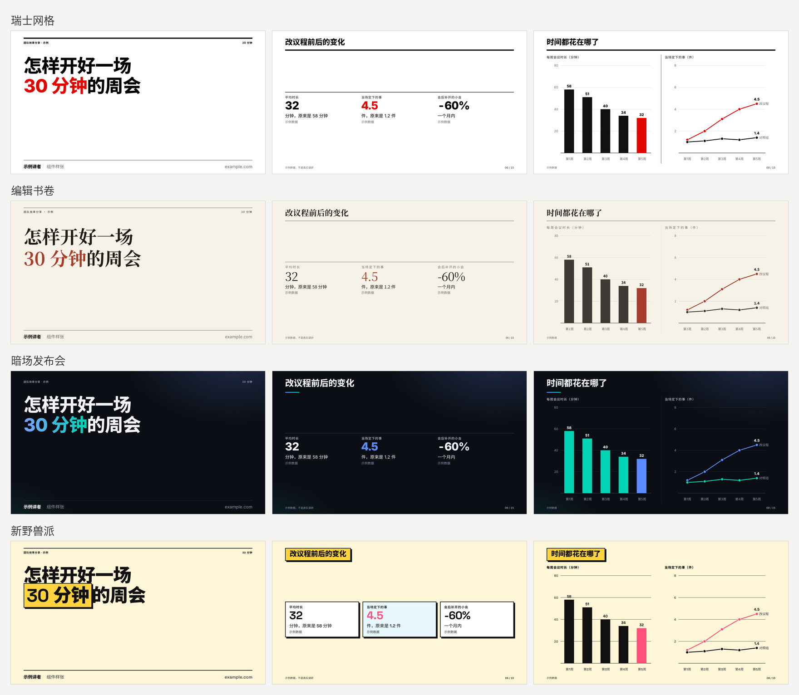

# 示范：「怎样开好一场 30 分钟的周会」组件样张

日期：2026-11-23 · 使用的 Skill：html-deck

## 这份样张是什么

一份 15 页的演示稿，把 html-deck 的组件全用了一遍：封面、目录、三段箭头、大数字、对比卡、柱状图、折线、环形、横条、表格、页签、嵌入网页、二维码、结尾。它就是 skill 里的 [assets/components.html](../../assets/components.html)，建 skill 时和引擎一起写的，用来给写稿的 agent 照着用，也用来验收 4 套风格。

它不是从一句需求完整跑出来的：没有经过开工提问、大纲确认、讨论页这几步，数据也是编的示例数据（页面上标了「示例数据」）。想看真实的一轮，用你自己的题目跑一次。

## 怎么看

用 Chrome 或 Edge 直接打开 `assets/components.html`，不用起服务：

- → / 空格 / PageDown 下一步，← 上一步；有分步的页先一条条出来，再翻页
- O 看全部页的缩略图，点哪页跳哪页
- P 开演讲者视图（当前页、下一页、备注、计时），在演讲者窗口按 Esc 关掉
- B 黑屏、W 白屏，再按翻页键恢复
- 网址后面加 `?theme=keynote`（或 `swiss`、`editorial`、`brutal`）换风格

想试编辑模式（在页面上改字、拖动、批注），先建一个项目，把样张放进去再开服务：

```bash
python3 <SKILL_DIR>/scripts/scaffold.py ~/demo-deck --title 周会 --theme swiss
sed 's#"engine/#"deck/#g' <SKILL_DIR>/assets/components.html > ~/demo-deck/讲稿/index.html
cp -r <SKILL_DIR>/assets/shots ~/demo-deck/讲稿/
python3 <SKILL_DIR>/scripts/serve.py ~/demo-deck/讲稿
```

## 4 套风格

[shots/themes.png](shots/themes.png) 是 `render_styles.py --pages 1,6,8` 渲染出来的：同样三页内容（封面、大数字、图表），分别套瑞士网格、编辑书卷、暗场发布会、新野兽派。第 3 步挑风格时，用户看到的就是这样一张用自己内容渲染的对比，外加一个能点选的讨论页。



## 交付跑出来的结果

用上面建好的项目，按第 6 步跑了一遍：

| 步骤 | 结果 |
|---|---|
| `check.py` | 15 页没有溢出，文件都在，联网和断网都没报错；第 14 页的在线网页断网时换成备用截图 |
| `package.py` | 离线包 24 个文件、0.6 MB，其中字体只抽了用到的字，482 KB；隐私扫描没发现问题，列出 1 张截图请人过目 |
| `website.py` | 网站版 11 个文件，备注全删，按 N、P 没有反应 |

离线包解压后再跑一次 `check.py`，联网、断网都通过。
