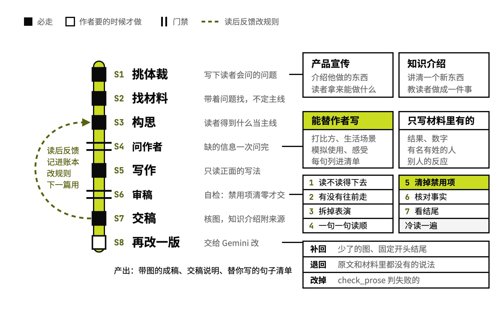

# human-article

以作者本人的身份写公众号的产品宣传和知识介绍

## 要解决的问题

让 AI 写公众号，写出来的常常读两段就知道是 AI：开头预告全文结构，满篇三连排比、破折号和「说白了」，结尾再拔高一遍。它还会替作者编出没发生过的数字、用户反馈和亲身经历，文章发出去就收不回来。读者多半天天刷 AI 资讯，这种稿子划一下就过去了。

## 运行方式



先按读者为什么点开，分成产品宣传或知识介绍，在 `材料笔记.md` 开头写下读者会问的几个问题，带着问题读项目、看线上、截图。构思在心里完成：把读者读完能得到什么当主线，顺着读者心里的下一个问题往下排，或者拿作者经历的一件事从头讲到尾；开头每一篇重新想，从冲突、感受、分享、小事或者结果里挑最抓人的进来。缺的信息攒到第四步，一次问完作者。写完按改稿规则从头改七遍，`check_prose.py` 把禁用写法清零，脚本把图和二维码放进成稿，连同交稿说明和「替你写的」句子清单一起交。作者要的时候，再交给 Gemini 改一版，对照两版差异后两版一起交。

## 关键设计

一篇公众号要同时做到：读者从头读到尾，读得出对面是作者本人在说话，写进去的事实都站得住。human-article 把这三件事拆到不同的文件里管：体裁和写法管读者，现实与边界管事实，改稿和脚本管 AI 味。

- **只写两种文章**：产品宣传和知识介绍，每种写清读者为什么点开、文章怎么走、问作者时可以问什么，附一个例子和一篇范文（`references/体裁.md`）。
- **读者在前，作者带路**：文章主体是读者想知道的事，作者只在他做过的、看到的、判断的地方出来说一两句（`references/写作.md`）。规则顶住时，先保主线清晰和段落通顺，再保读者得到什么和活人感（`SKILL.md`「规则冲突时的先后」）。
- **分清哪些能替作者写**：打比方、普通人都有的生活场景、模拟一次使用、感受和洞见可以替作者写，每一句都列进 `替你写的.md` 给他审；产品带来的结果、数字、有名有姓的人和别人的反应，只写材料里有的（`references/现实与边界.md`）。
- **只问一次作者**：找材料和构思时缺的信息攒到第四步一次问完，重点问作者和这件事实际发生过什么，哪个瞬间、数字、动作或原话最让他在意。作者说「先写一版」，就跳过提问，按能替写的范围补。
- **改稿分七遍，硬禁令交给脚本**：读者读不读得下去、文章有没有往前走、拆掉表演出来的地方、一句一句读顺、清掉绝对不能出现的、核对事实、看结尾，最后忘掉规则冷读一遍（`references/改稿.md`）。翻案腔、三项以上的同构排比、破折号、洞察路标、商业黑话由 `scripts/check_prose.py` 查，清零才交稿；`scripts/check_repeats.py` 查作者以前改掉不止一次的说法。
- **Gemini 改完逐处核对**：第八步把改稿交给 Gemini，`scripts/compare_revision.py` 列出少了的图、新冒出来的数字、名字和程度词。只把这几类修回去，其余保留 Gemini 的说法，两版一起交给作者挑。

```text
human-article/
├── SKILL.md                       定位、红线、规则冲突时的先后、八个步骤
├── references/
│   ├── 体裁.md                    产品宣传、知识介绍各怎么走，问作者时可以问什么
│   ├── 材料.md                    去哪找材料、材料笔记记什么、怎么问作者
│   ├── 现实与边界.md               哪些能替作者写、哪些只写材料里有的
│   ├── 写作.md                    读者在前、句子、用词、段落、结尾、公众号格式
│   ├── 配图.md                    要什么样的图，截图、录屏、写代码画三种做法
│   ├── 改稿.md                    写完从头改七遍，再冷读一遍
│   ├── gemini改稿.md              发给 Gemini 的改稿 prompt
│   └── 范文/README.md             两篇范文的原文链接，全文不随仓库发布
├── scripts/
│   ├── check_prose.py             查禁用写法
│   ├── check_repeats.py           查作者改掉过不止一次的说法
│   ├── embed_images.py            把图、视频和二维码放进成稿
│   ├── make_gif.sh                录屏转动图
│   ├── gemini_revise.py           调 Gemini 改稿
│   └── compare_revision.py        对照两版差在哪
├── LICENSE-human-writing          上游 KKKKhazix/human-writing 的 MIT 许可
└── examples/
    └── ai-assistant-article/      例子：把一份 AI 助手调研报告写成公众号
```

## 其他

- 来源：定位、问作者和改稿的不少写法来自 [KKKKhazix/human-writing](https://github.com/KKKKhazix/human-writing)（MIT 许可），原许可见 `LICENSE-human-writing`
- 前提：写作档案里要有 `公众号固定开头结尾.md` 和 `素材/公众号二维码.jpg`，目录用环境变量 `HUMAN_ARTICLE_PROFILE_DIR` 指定；文章默认写在 `HUMAN_ARTICLE_OUT_DIR` 下；反馈账本和改规则的说明放在 `HUMAN_ARTICLE_FEEDBACK_DIR`，没有这个目录就记进当篇工作目录的 `反馈.md`
- 注意：定位里的作者是一个二三十岁的 AI 行业独立开发者，读者关注 AI；`references/gemini改稿.md` 写了开头「大家好，我是阿東。」。换人用要改这两处，范文也换成自己挑的
- 注意：`check_repeats.py` 的词表来自作者本人的改稿记录，换人用可以清空
- 注意：第八步要 Gemini API key（`GEMINI_API_KEY` 或 `~/.config/gemini/api_key`），默认走 `http://127.0.0.1:7897` 代理，用 `GEMINI_PROXY` 改，设成空字符串就直连

---

完整指令见 [SKILL.md](SKILL.md)；安装方法见仓库首页的 [README](../../README.md)。
