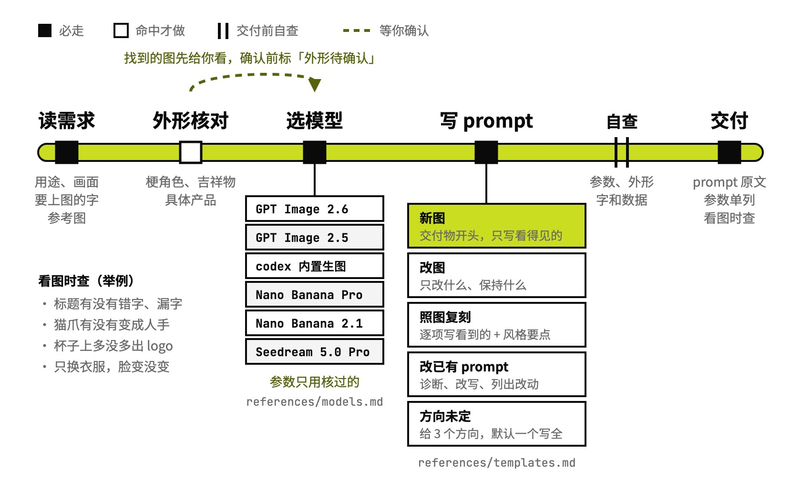

# image-prompt

把出图需求写成生图 prompt

## 要解决的问题

让 AI 出一张图，常见写法是一句「高级感海报，8K，大师作品」：画面里的字常常写错，版式全靠模型猜，想改件衣服，脸也跟着变了。各家生图模型的参数又不一样，GPT Image 有 quality 和 complexity，Nano Banana 的比例走接口字段，Seedream 的中文提示词最好不超过 300 字，记错一个就白跑一次。网上的梗角色、吉祥物凭印象去写，画出来常常是另一个样子。

## 运行方式



从一句出图需求或一张参考图开始。需求里有梗角色、吉祥物这类拿不准长相的，先找图给你确认。选定模型后照它的参数卡写 prompt，交付前对一遍参数、外形、文字。只交 prompt 和参数，出图用你自己的生图工具。

## 关键设计

一段生图 prompt 要同时做到：摄影师或设计师拿到就能开工，放到指定的模型上参数不出错，出图后知道该查哪里。image-prompt 把写法和交付格式放在 SKILL.md，各模型的参数、各类场景的骨架分成两份参考文件，用到时才读。

- **只写画面里看得见的**：`SKILL.md` 规定按交付物、主体、场景、构图、光线、材质、画面文字的顺序写。「高级感」写成具体的材质和光，要上图的字逐字放进引号，写清位置和字体，最后一句排除多余的字。
- **参数只用核过的**：`references/models.md` 列出 GPT Image 2.6 / 2.5、Nano Banana Pro / 2.1、Seedream 5.0 Pro 和 codex 内置生图的模型名、参数取值和限制，附官方来源和核实日期。参数卡里没有的模型照样写 prompt，参数一栏写「没核过」。
- **拿不准的长相先对图**：梗角色、吉祥物、具体产品，先找一两张图请你确认，同时写出打算用的外形描述。确认之前，prompt 最前面标「外形待确认」。
- **改图写清改什么、留什么**：`references/templates.md` 第 14、15 节分两种情况。构图不变、只换背景或衣服，当编辑来写，列出脸、姿势、机位哪些不动；要换姿势、换景别，才当一张新图来写。一次要改好几处时拆成几轮。
- **照参考图复刻**：给一张图，它逐项写出看到的媒介、构图、光线、材质，画面里的字逐字抄下来，再另列三到五条风格要点。想换个主体画同一种感觉时，留下这几条，换掉主体那几句。

```text
image-prompt/
├── SKILL.md                 写法、交付格式、交付前自查
├── references/
│   ├── models.md            各模型的参数、限制和官方来源
│   └── templates.md         15 类场景的 prompt 骨架
└── examples/
    └── autumn-cafe-poster/  例子：社区咖啡店的秋季新品海报
```

## 其他

- 不处理：给大模型写任务指令（交给 prompt-craft）、收藏别人的 prompt（交给 prompt-vault）、视频提示词
- 前提：出图用你自己的工具，ChatGPT、各家 API、codex 内置生图都可以，这个 Skill 只写 prompt 和参数
- 注意：参数卡核实于 2026-11-06，生图模型更新很快，用到新版本时先对一下官方文档

---

完整指令见 [SKILL.md](SKILL.md)；安装方法见仓库首页的 [README](../../README.md)。
