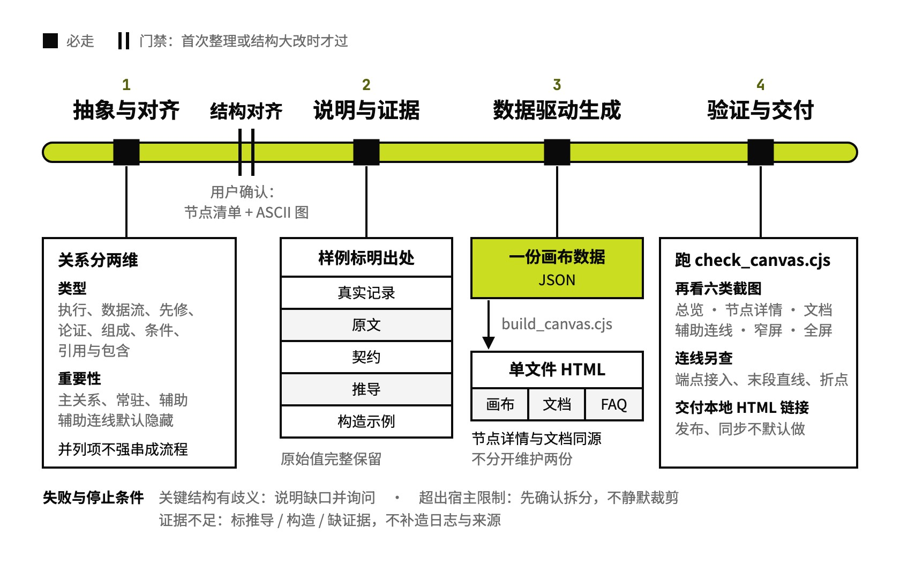

# knowledge-canvas

资料整理成可缩放的知识画布

## 要解决的问题

想把一个代码仓库、一本书或一门课讲清楚，图上只放得下名字和箭头，解释和原始样例只能另写一篇文档，两份各自维护，改了一处另一处就对不上。画图时还容易为了版面整齐，把并列的模块串成流程、把章节顺序当成执行顺序，或者把没验证过的能力写成不支持。

## 运行方式



第一次整理或结构大改时，先给用户看节点清单、ASCII 草图和一个代表节点的「说明 + 样例」，认可后才生成。之后所有内容写进一份 JSON 数据，由 `build_canvas.cjs` 生成不联网也能打开的单文件 HTML。交付前跑 `check_canvas.cjs`，再看总览、详情、窄屏、全屏等截图，连线单独查。

## 关键设计

一张知识画布要同时做到三件事：图上看得清结构，点开节点读得到解释和原始样例，图、文档和 FAQ 始终对得上。knowledge-canvas 把全部内容写进一份 JSON 数据（分组、节点、关系、样例、FAQ），生成脚本校验后把它套进自带交互的模板，画布、节点详情、文档和 FAQ 都从这份数据渲染出来。

- **结构跟着材料和读者的问题走**：`references/structure.md` 按材料特点选骨架：真实处理过程画主线、分支和汇合，主题与子概念用分层容器，先修与推导画依赖图，同级方法在容器内平铺。容器表示归属，容器里的条目各自独立，真有流转时才画顺序。
- **关系的类型和重要性分开标**：每条关系标一个类型（执行、数据流、先修、组成、条件、回路、引用）和一个重要性（主线、常驻、辅助），两项独立判断，教材里的先修依赖也可以是主线；只有辅助关系默认隐藏，由「显示全部依赖」开关整体显现。字段定义在 `references/data-model.md`。
- **画布、详情、文档和 FAQ 出自同一份数据**：`build_canvas.cjs` 校验数据后把它嵌进 `assets/canvas-template.html`，生成不联网也能打开的单文件 HTML；文档按分组和节点说明自动生成，FAQ 只引用已有节点，改一处数据，几处一起变。
- **样例按来源分开标，原文完整保留**：每个节点独立选样例，标明是真实记录、原文、契约、推导还是构造示例；选中的原始值完整保留，长内容滚动阅读，复制拿到的就是原文，缺证据时标推导、构造或写明缺口。规则在 `references/structure.md`。
- **连线几何交给脚本，结构内容交给人看**：`route_geometry.cjs` 检查连线端点贴边、沿法向进出、首尾留够直线、折点不过密，生成时不过就拒绝；`check_canvas.cjs` 在浏览器里查重叠、说明与样例是否一致和各种交互状态。关系准不准、材料有没有漏读，留给人工审查和用户验收。

```text
knowledge-canvas/
├── SKILL.md                      对齐、说明与证据、生成、验证四步
├── references/
│   ├── structure.md              选骨架、划节点、两维关系、留证据
│   ├── presentation.md           写法、布局连线、动效和交互默认值
│   ├── faq.md                    FAQ 怎么答、怎么联动画布节点
│   ├── data-model.md             画布数据的字段和生成检查规则
│   └── feishu.md                 发到飞书正文：HTML 要求和精确更新
├── scripts/
│   ├── build_canvas.cjs          校验数据，生成单文件 HTML
│   ├── check_canvas.cjs          在浏览器里查布局、一致性和交互
│   ├── route_geometry.cjs        连线几何检查：端点、方向、折点
│   └── test_route_geometry.cjs   连线检查的正反例测试
├── assets/
│   ├── canvas-template.html      带交互的画布模板，内含流程型示例
│   └── concept-example.json      概念型画布的数据示例
├── agents/
│   └── openai.yaml               Codex 界面的显示名和默认提示词
└── examples/
    └── nanogpt/                  例子：一个从零训练小型 GPT 的代码仓库
```

## 其他

- 不处理：只要一段文字摘要、解释单个术语、单纯修代码
- 前提：Node.js 生成画布；检查脚本要 Playwright，动效检查另需 pngjs；发到飞书正文需要 lark-cli，并由用户本人授权
- 注意：飞书正文的 HTML 块目前上限 500KB，原始样例多时会超；先保留本地完整文件，再和用户确认怎么拆，不静默裁剪

---

完整指令见 [SKILL.md](SKILL.md)；安装方法见仓库首页的 [README](../../README.md)。
