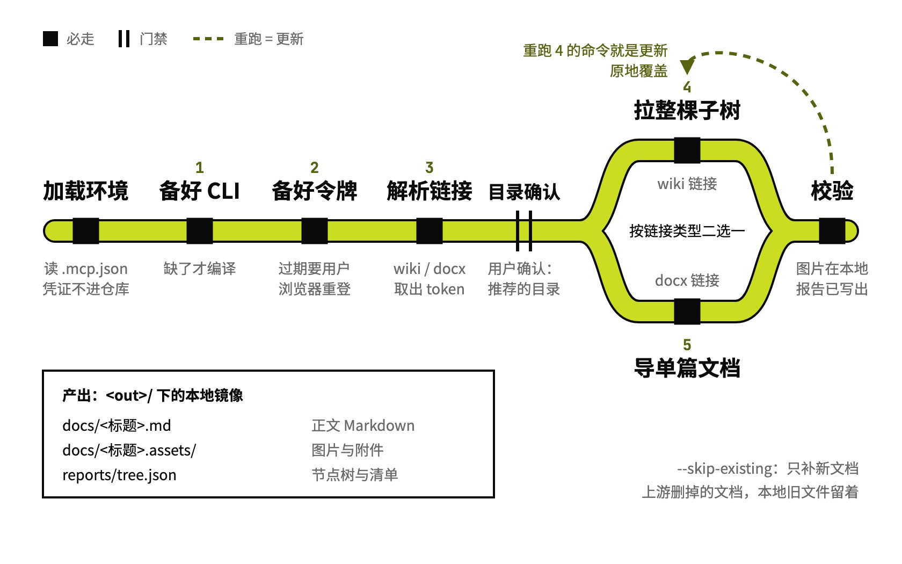

# lark-export

飞书 wiki 镜像到本地 Markdown

## 要解决的问题

飞书知识库里的内容想放进本地仓库，能 grep、能离线看。常见的导出结果是正文转成了 Markdown，图片还是 `feishu://media/…` 这样的引用，图片和附件没真正下载下来，离开飞书就看不到。

## 运行方式



先从本机已有的 `.mcp.json` 里读出飞书应用凭证；User Token 过期时，要用户在浏览器里重新登录一次。没指定输出目录时，先按项目结构推荐一个，用户确认后再拉。给的是知识库链接就按节点树导出整棵子树，给的是单篇文档就单独导出；更新和首次拉取是同一条命令，重跑即原地覆盖。

## 关键设计

把飞书知识库搬到本地，要同时做到三件事：正文转成本地 Markdown，图片和附件真正下载下来，凭证不跟着 Skill 进仓库。lark-export 只做驱动：导出交给打过补丁的 feishu-cli 和遍历知识库的批量脚本，Skill 负责载入环境、检查令牌，按链接是知识库还是单篇文档拼出对应的命令。

- **本地是一份按节点树排好的只读镜像**：父节点导出成「标题__节点号」目录，叶子文档导出成同名 .md 和放图片的 .assets 目录，附件保留原文件，多维表格导出成 .xlsx。本地文件不手改，重跑整体覆盖才安全；只想补新文档时切到只新增、不动已有文件的模式。目录结构写在 `SKILL.md`。
- **整棵导出都留一份可核对的清单**：输出目录下的 reports 里写着完整节点树和每个节点的清单、导出条数和耗时；交付前核对文档数不为零、图片引用指向本地文件、文件头带原文链接，核对项列在 `SKILL.md`。
- **凭证在运行时从本机 MCP 配置里读**：`feishu_env.py` 从最近的 .mcp.json 里取出飞书 MCP 启动参数中的应用 ID 和密钥，再找到含 feishu-cli 的工具链目录，输出成环境变量；检查模式只显示打码后的值。Skill 目录里不存凭证，打包、公开都不会带出去。
- **应用令牌读结构，用户令牌下资源**：应用令牌读知识库和文档的结构；用户令牌负责下载图片和附件、执行文件导出，`SKILL.md` 列出它要带的五项权限，以及常见报错怎么处理。

```text
lark-export/
├── SKILL.md                         同步模型、令牌、整棵和单篇导出命令
├── scripts/
│   └── feishu_env.py                找工具链，从 MCP 配置读凭证
└── examples/
    └── manus-context-engineering/   例子：一篇带图的飞书文档导出到本地
```

## 其他

- 不处理：在会话里读、引用、总结单篇飞书文档（直接用飞书 MCP）；写回或发布到飞书（用 lark-cli）
- 前提：打过补丁的 feishu-cli 工具链目录（`FEISHU_EXPORT_HOME`，缺二进制时用 Go 编译）；`FEISHU_APP_ID`、`FEISHU_APP_SECRET`；User Token 要带导出和媒体下载权限，飞书应用的回调白名单里要加本地回调地址
- 注意：补丁版 feishu-cli 和批量导出脚本不在本仓库里，Skill 只负责驱动它们
- 注意：上游改名或删除的文档，本地旧文件会留着，目前没有清理步骤

---

完整指令见 [SKILL.md](SKILL.md)；安装方法见仓库首页的 [README](../../README.md)。
