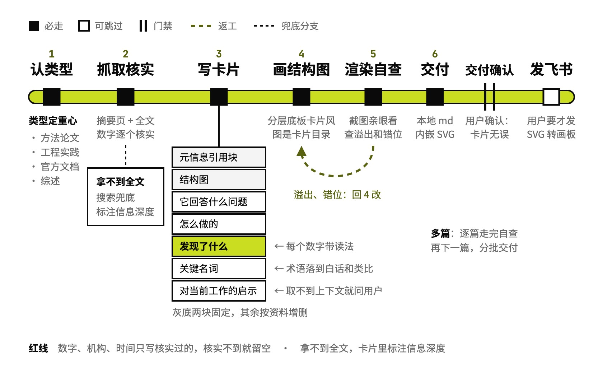

# paper-card

一篇论文读成一张学习卡片

## 要解决的问题

产品经理读论文、官方最佳实践和 cookbook，常卡在两处：术语看不懂，数字不知道算高算低、在跟谁比。常见的摘要把行话换个说法重述一遍，数字照抄，读完还是讲不清这篇工作怎么做的、适用到哪。编错的数字一旦进了学习资料，之后会被当真反复引用。

## 运行方式



先认资料类型，方法论文、工程实践、官方文档、综述的卡片重心各不相同。拿不到全文就用搜索兜底，并在卡片里写明只读到了摘要。结构图画完要用无头浏览器截图亲眼看，文字溢出或箭头错位就回去改图，卡片交用户确认后才算完成。

## 关键设计

一张论文卡片要同时做到两件事：读者不读原文也能复述这篇工作的机制、关键数字和适用边界，卡片里的每个事实又能回到原文核对。paper-card 只固定两样，开头的元信息引用块和一张结构图，正文怎么分块随资料形态定。

- **只看卡片就能复述这篇工作**：这是卡片唯一的判据，每写一块就问读者能不能听懂、听懂后知道拿它做什么。正文默认五块：它回答什么问题、怎么做的、发现了什么、关键名词、对当前工作的启示；综述换成领域地图，数据集加真实样例，官方文档写成建议加理由。规范和定稿范例在 `references/card-template.md`。
- **数字带读法，术语用类比讲透**：每个数字写清量级、和谁比、差距算不算大，例如「相对提升 31%」要说明是基线分乘 1.31；术语用类比讲，例如消融实验就是怀疑汤里某味调料多余，做一锅不放它的汤对比。写法在 `references/card-template.md`。
- **每个事实都能指回出处**：元信息引用块写标题链接、机构、时间、信息深度和关联位置；数字只写抓到的或用户给的，每个都能指出在原文哪里，机构拿不到就填占位符。模板在 `references/card-template.md`，核实规则在 `SKILL.md`。
- **结构图是卡片的可视化目录**：图上的分组底板和正文板块一一对应，数字带着读法进图，图离开正文也能读懂；全图只有一处浅黄高亮，留给最值得记住的一件事。箭头用 path 手绘，转成飞书画板时能保留，规格在 `references/svg-guide.md`。
- **启示落到用户手上的具体工作**：启示一块从会话和项目上下文里取用户正在做的事，写成可执行的动作或可对标的数字；上下文里取不到，就先问一句用户想关联什么工作。规则在 `SKILL.md`。

```text
paper-card/
├── SKILL.md                         输入核实、六步流程、启示取材、红线
├── references/
│   ├── card-template.md             写作判据、默认五块、按类型调整、范例
│   └── svg-guide.md                 结构图视觉规格、截图自查、转飞书画板
└── examples/
    └── attention-is-all-you-need/   例子：Transformer 论文做成一张学习卡片
```

## 其他

- 前提：结构图自查用 Chrome 无头模式截图；发飞书需要 lark-cli，SVG 以画板形式插入
- 注意：结构图的箭头要用 path 手绘，SVG marker 会被飞书画板丢掉
- 注意：一次处理多篇时逐篇走完自查再做下一篇，分批交付，前几张的反馈能修正后面的写法

---

完整指令见 [SKILL.md](SKILL.md)；安装方法见仓库首页的 [README](../../README.md)。
