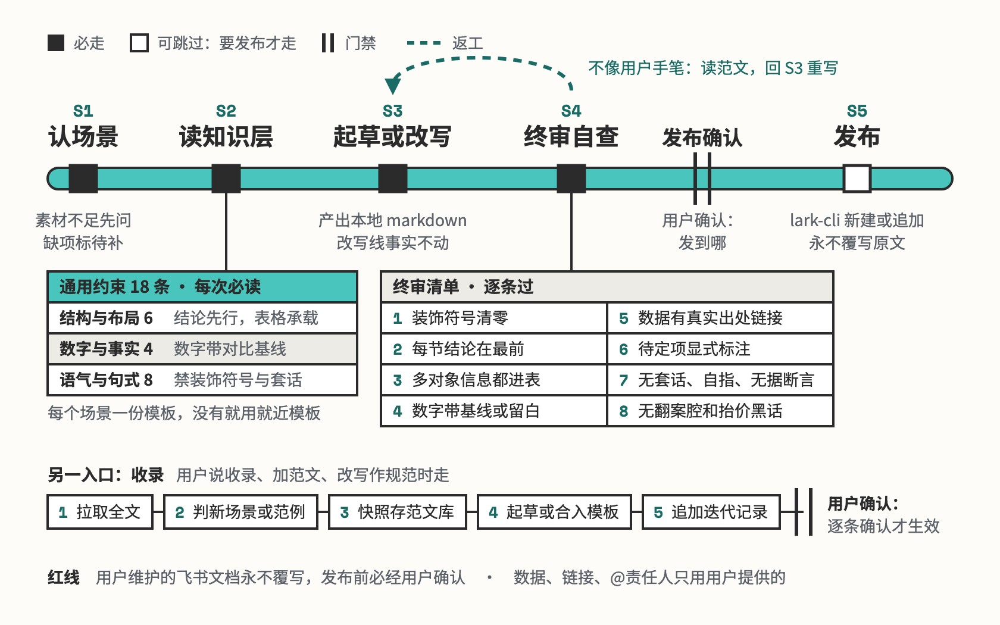

# pm-doc-write

按本人写法写周报、OKR、项目总结

## 要解决的问题

工作文档的读者是老板和协作方，要在 30 秒内扫到结论和下一步。没有约束时，起草出来的文档容易过程先行、把多对象的信息写成长段落、数字不带对比基线，语气是名词化的汇报腔，读着不像作者本人的手笔。

## 运行方式

认准场景后，先读通用约束和对应的场景模板，再起草本地 Markdown，逐条过终审清单；读着不像本人手笔，就回范文库重读模板指定的段落重写。发布是可选的最后一步：说清发到哪、用户确认后，才用 lark-cli 新建文档或块级追加。用户说要收录一篇文档时另走收录流程，新写法合进模板，逐条确认后才生效。

## 关键设计

- **约束来自作者 8 篇认可范文的跨篇分析，每条都写明原因**：模板没覆盖的情况，按原因推断
- **结论先行，多对象多属性的信息一律进表**：段落只写单线叙述，过程和原始数据沉到附录或外链
- **数字带对比基线，目标未定就留白占位**：写成 3%→7% 这样的变化，不写孤立数字，也不空着或编一个
- **正文不用角括号、方头括号、长破折号做强调**：这些符号会打断阅读，改成标题、分级列表和冒号加子项
- **数据、链接、责任人只用用户给的，缺了标待补充**：编造的数字和链接流进汇报，纠正成本远大于当场问一句

## 其他

- 前提：发布和收录需要 lark-cli
- 注意：范文库是使用者本地的资产，不随仓库发布；换人用要先收录自己的范文，成稿才像自己
- 注意：飞书上维护中的文档只新建或追加，从不覆写，覆掉的内容找不回来

---

完整指令见 [SKILL.md](SKILL.md)；安装方法见仓库首页的 [README](../../README.md)。
