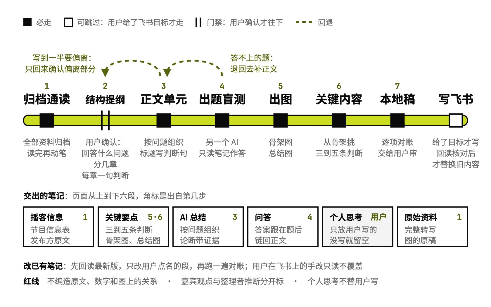

# podcast-summary

一期播客整理成图文笔记，带问答

## 要解决的问题

听完一期长播客，过几天只记得一两句，想复习只能重听。常见的整理照着节目的章节和时间戳复述，标题写成「政策信息」这类话题词，读完知道聊过哪些话题，想不起结论和数字。一份笔记要同时管三件事：第一次读能学会，几周后一屏能复习，几个月后翻出来还分得清哪句是嘉宾说的、哪句是整理者推的；一段摘要顾不全。

## 运行方式



从一期节目的链接或完整文字稿开始：转写、Shownotes 和原图先全部归档，从头读完再动笔。要用户拍板的是结构提纲：这期回答什么问题、分几章、每章一句判断，确认前不展开正文；写到一半发现要偏离，只回来确认偏离的那部分。出完题让另一个只读过笔记的 AI 作答，答不上的题退回去补正文；飞书只在用户给了目标时才写，先交本地稿，回读核对过才替换旧内容。

## 关键设计

一期播客整理成一份笔记，要同时服务三种用法：第一次学、几周后复习、几个月后回顾。podcast-summary 把笔记分成从短到长的几层，短层从长层里抽出来、逐项对得上，再用出题盲测检查长层有没有漏。

- **分层，每层单独读得懂**：成品固定几段：播客信息、关键要点（三到五条核心判断、骨架图、总结图）、按问题组织的正文、带答案的问答、个人思考、原始资料。各段怎么写在 `references/content-and-document.md`，新笔记照 `assets/note-template.md` 起稿。
- **上层从下层抽出来，逐项对得上**：骨架图的节点就是正文单元的标题原句，关键内容从骨架里挑，总结图上的每个数字都能在正文找到。`SKILL.md` 里有一张对账表，交付前逐项核一遍。
- **内容按听众会问的问题组织**：节目自带清楚的框架就沿用；没有就按听众最想知道的几个问题重组，每章标题写成一句判断。先照 `assets/outline.md` 写结构提纲给用户确认，再展开正文。
- **站在读者的位置查漏**：出题的只看转写和提纲，答题的只看笔记、没听过节目；答不上来的地方就是笔记漏掉的，补进正文。
- **图和文字出自同一份理解**：每张图先从正文抽出图稿，再用 `make_figure.sh` 渲染成 SVG 并检查版式；SVG 是可编辑的原稿，发到飞书时由 `write_boards.py` 写成能改的画板。

```text
podcast-summary/
├── SKILL.md                      总流程、成品结构、各段之间的对账表
├── references/
│   ├── content-and-document.md   各段怎么写，强调怎么分级
│   ├── visuals.md                什么时候画图，骨架图 / 总结图 / 单元图怎么画
│   ├── tools-and-storage.md      怎么取资料、建目录归档
│   └── feishu-update.md          怎么更新飞书页、回读核对
├── assets/
│   ├── outline.md                结构提纲模板
│   └── note-template.md          新笔记模板
├── scripts/
│   ├── fetch_episode.py          取单集转写、Shownotes 和原图，归档
│   ├── source_manifest.py        给原始资料建清单，交付前核对没变
│   ├── make_figure.sh            图稿渲染成 SVG 并检查版式
│   ├── md_to_feishu_xml.py       本地笔记转成飞书页
│   ├── write_boards.py           SVG 写成飞书画板
│   ├── link_and_check.py         问答挂回正文锚点，回读核对
│   └── audit_document.py         更新后比对飞书页有没有被改坏
└── examples/
    └── dwarkesh-karpathy/        例子：一期 AI 播客的完整笔记、骨架图、总结图和盲测过程
```

## 其他

- 前提：Python 3；取单集用 Podwise 官方 CLI（要先登录），也可以直接给完整文字稿；出图校验通过 npx 调 `@larksuite/whiteboard-cli`，要有 Node.js；发飞书要 lark-cli 和飞书登录
- 注意：出图脚本按相对路径调用同仓库的 `skills/_shared/figkit`，只复制 podcast-summary 一个目录会缺渲染库
- 注意：Podwise 上还没处理过的单集要先跑 `process`，可能计费，Skill 不会自己启动；只拿到摘要、没拿到全文时，只交局部草稿
- 注意：个人思考一栏只放用户自己写的，没写就留空；飞书页上的手改不会自动回写本地稿，下次更新先回读合并

---

完整指令见 [SKILL.md](SKILL.md)；安装方法见仓库首页的 [README](../../README.md)。
