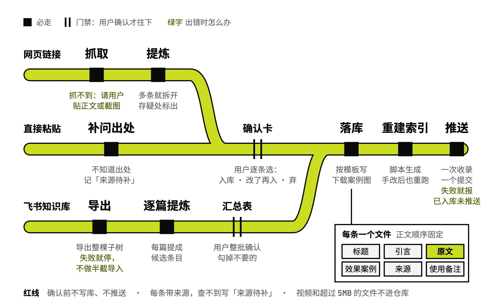

# prompt-vault

看到的好 prompt 收进个人库

## 要解决的问题

看到好用的 prompt，常见做法是收藏整篇文章、截图，或者贴进备忘录。要用时得先想起存在哪，再从整篇文章里找出 prompt 那一段，效果图和出处多半已经丢了。从网页里摘 prompt 还容易剪错边界，剪掉的那几句事后很难发现。用户自己写在飞书知识库里的 prompt，同样散在各篇文档里。

## 运行方式



按来源分三条线：网页链接、飞书知识库、直接粘贴的文本。网页里摘出和直接粘贴的每条 prompt 先出一张确认卡（拟定标题、分类、标签、原文全文、案例图张数、来源），用户选「入库 / 改了再入 / 弃」；飞书里是用户自己写的内容，整批列一张汇总表，确认一次。确认后按模板写文件、下载案例图、用脚本重建总索引，一次收录一个提交并推送；网页抓不到就请用户贴正文或截图，推送失败就报「已入库未推送」，不强推。

## 关键设计

一条 prompt 进库后要同时做到：扫一眼总目录能找到，点进去能一键复制，效果图和出处都在。prompt-vault 把库排成一层分类目录，一条 prompt 一个文件、照同一份模板写，总目录由脚本从每个文件开头的字段生成。

- **一条 prompt 一个文件，格式照模板**：文件开头的字段记标题、一句话说明、分类、标签、适用模型、来源、收录日期和案例图张数；正文依次是引言、原文、效果案例、来源、使用备注，原文放进代码块，复制时一次拿全（`assets/prompt-doc-template.md`）。
- **目录只有一层，按收录先后编号**：每个分类一个目录，文件名是两位序号加中文名，序号按收录时间递增，目录列表自然按时间排；原生英文的 prompt 保留英文名。新增分类先问用户，加了就同步更新索引脚本里的分类表（`SKILL.md`）。
- **仓库首页的总目录只由脚本生成**：`build_index.py` 扫描各分类目录，读每条开头的标题、说明、标签、适用模型和案例数，按分类分节写成仓库首页，收录和手改文件后都重跑它。文件缺开头字段、或缺标题和说明，就报错退出，修好文件再跑。
- **案例图跟着 prompt 存进仓库**：案例图放在所属分类的 assets 文件夹，文件名以条目序号开头，正文用相对路径内嵌。`save_media.py` 带浏览器标识和来源页地址下载，按实际内容类型纠正扩展名，超过 5MB 的文件拒绝保存。
- **宁可少收一条，收进来的都抽得准**：一篇文章含多条 prompt 就拆成多条，各配各的案例图；边界拿不准的段落原样保留，在确认卡里标「存疑」交用户裁决（`SKILL.md`）。

```text
prompt-vault/
├── SKILL.md                        库的目录结构、三条收录线、红线
├── scripts/
│   ├── build_index.py              从各条开头的字段重建总目录
│   └── save_media.py               下载案例图，过防盗链，限 5MB
├── assets/
│   └── prompt-doc-template.md      单条 prompt 文档的模板
└── examples/
    └── anthropic-prompt-library/   例子：从提示词网页收三条 prompt
```

## 其他

- 前提：Python 3 跑索引脚本 `build_index.py` 和下载案例图的 `save_media.py`，两个都只用标准库；git 和 gh，能推送到自己的 GitHub 仓库；飞书线要先装好 lark-export
- 注意：库的位置写在 SKILL.md 的仓库一节：真源是一个 GitHub 公开仓，本地工作副本放在固定路径；自己用先改成自己的仓库和本地路径
- 注意：每条都要带来源一节，出处确定不了就写「来源待补」并当面提醒；库是公开的，别人的内容匿名放进去，被 fork 之后收不回来
- 注意：微信文章的图片地址在 `data-src` 里，不在 `src`；`save_media.py` 带浏览器标识和来源页地址去下载，能过防盗链，仍被拒就保留原图链接，在文档里写明图没下载下来
- 注意：视频和超过 5MB 的文件不进 git，只存封面帧和原视频链接；进了提交历史，仓库就永久变大

---

完整指令见 [SKILL.md](SKILL.md)；安装方法见仓库首页的 [README](../../README.md)。
