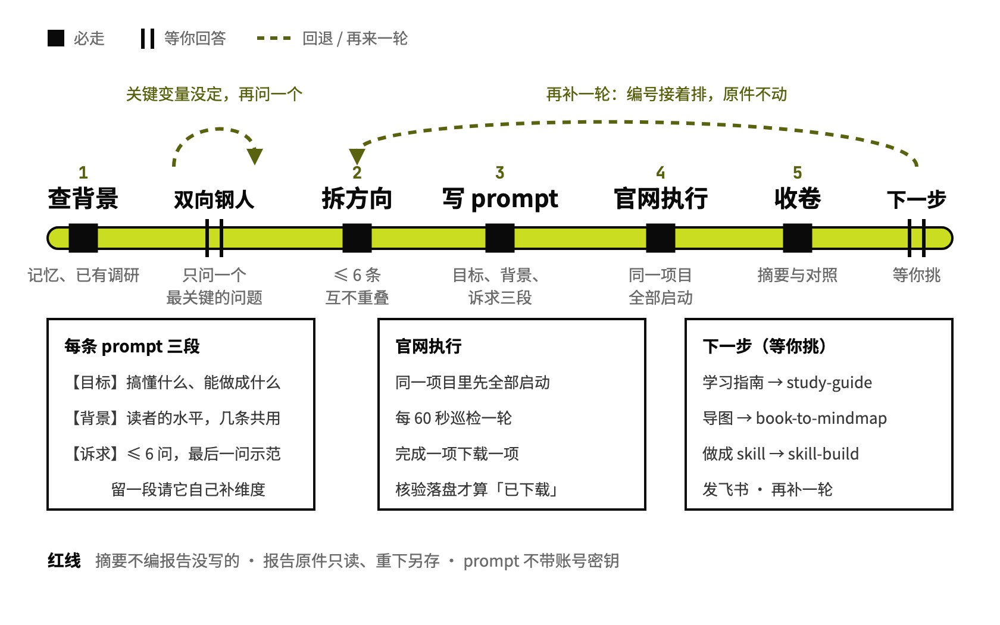

# research-with-gpt

拆好 Deep Research 的题，在官网跑完收回

## 要解决的问题

拿 ChatGPT Deep Research 调研一个陌生领域，常见做法是把一句话直接丢进去：问题太大，跑回来的报告泛泛而谈；分几次问，几份报告又各讲各的、互相重复；背景没交代，报告不是太浅，就是在讲你已经知道的。一次研究要跑几十分钟，额度也有限，方向错了整轮白跑。跑完还得一条条开对话、盯进度、手动下载。

## 运行方式



从一句想调研的话开始。它先查已有的调研，用双向钢人问清你真正想搞懂什么，只问一个最关键的问题；拆成不超过 6 条、写好 prompt 存进主题文件夹后，接着打开 ChatGPT 官网，在同一个项目里把这几项研究全部启动，定时检查、完成一项下载一项；报告回来写摘要和对照，下一步做什么等你挑。

## 关键设计

一组 Deep Research prompt 要同时做到三件事：每条单独跑也有完整背景，合起来覆盖真问题又互不重叠，还给研究模型留出自己搭框架的空间。research-with-gpt 把出题、官网执行、收卷三段写在一个 `SKILL.md` 里，用主题文件夹里的 0-说明.md 串起来，报告隔几天回来，下个会话读它就能接上。

- **拆题之前先问清**：`SKILL.md` 用双向钢人：重述你真正想解决的问题，给出支持和反对的最强论证，只问一个最可能改变方向的问题；关键变量没定就再来一轮。
- **背景写读者的水平**：每条 prompt 分【目标】【背景】【诉求】三段。背景写现在的年月、对这个领域懂到哪、哪些已经调研过，不写你的身份和项目；猜测的答案和报告格式也不写，免得把研究范围框小。
- **给研究模型留空间**：【诉求】不超过 6 个问题，学东西的主题最后一问是「拿一个常见场景从头示范一遍」；问题之后再请 Deep Research 自己想还缺哪些维度，补进框架并说明理由。
- **先全部启动，再定时收**：在同一个 ChatGPT 项目里把几项研究都启动，不等前一项跑完；每 60 秒巡检一轮，完成一项下载一项。文件落盘、主题对得上、来源还在，才登记「已下载」。
- **摘要只写报告里有的**：收卷时每份写核心结论和最有用的几条（附报告里的来源链接），再写共识、矛盾、只有一份提到的；自己的判断单独标「我的看法」。

```text
research-with-gpt/
├── SKILL.md                    出题、官网执行、收卷三段，主题文件夹约定
└── examples/
    └── visual-design-basics/   例子：零基础想系统学视觉设计
```

## 其他

- 不处理：要 AI 自己联网查完出报告（交给 deep-survey）、给模型写任务指令（交给 prompt-craft）、把报告合成学习指南（交给 study-guide）
- 前提：ChatGPT 账号能用 Deep Research；自动启动和下载需要当前环境有能操作浏览器的工具，登录和人机验证由你在浏览器里完成。只想要 prompt 时说「只要 prompt」，它停在出题
- 注意：官网导出的 Markdown 可能残留内部引用标记、点不开来源，需要可核查的来源时优先下载 Word

---

完整指令见 [SKILL.md](SKILL.md)；安装方法见仓库首页的 [README](../../README.md)。
