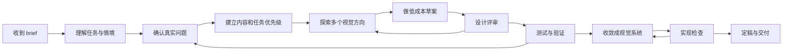
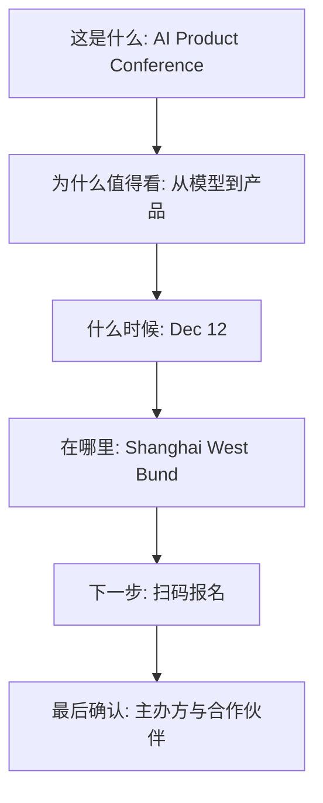

# 视觉传达与界面设计师如何观察、思考、评价和修改一个画面

iturn766866image1

## 执行摘要

视觉传达与界面设计可以被理解为一种**有目的的信息组织与行为引导活动**。它面对的核心问题通常包含四层：要让谁理解什么，要让信息以什么顺序被看到，要让人形成什么判断或情绪，要让人接下来做什么。Design Council 将设计概括为利用创造力解决问题的活动，AIGA 的视觉传播材料则把受众、目的和情境列为视觉沟通的基本起点。由此看，视觉设计的评价标准天然超出“看起来舒服”这一层。citeturn336500search4turn336500search5

“好看”仍然重要。人机交互研究反复发现，视觉美感会影响人对可用性、专业度和可信度的主观判断，这通常被称为 aesthetic usability effect。Tractinsky 等人的实验显示，感知美感与感知可用性之间存在很强的相关关系；Kurosu 与 Kashimura 的早期研究也发现，人会把视觉吸引力投射到对易用性的判断上。这个效应说明视觉质量具有实际价值，同时也提醒评审者：**感到顺眼，不能证明任务真的容易完成。** citeturn336500search1turn336500search0

专业设计师通常不会从“我要用什么颜色、圆角、字体”开始。更常见的顺序是：先理解 brief 与真实问题，再识别受众和限制，建立信息与任务优先级，生成若干方向，制作低成本方案，评审和测试，逐步收敛，最后检查实现与交付。Design Council 的 Double Diamond 将这一过程概括为 Discover、Define、Develop、Deliver，并特别强调发散与收敛交替发生，流程也会反复迭代。Google 的设计评审实践进一步区分了问题、解决方案、实现三个层次，说明不同阶段需要讨论不同的问题。citeturn992096search0turn992096search2turn442273search0

对非设计专业的读者，最值得形成的能力并非背下一组视觉规则，而是建立一条稳定的推理链：

**目标 → 受众与情境 → 信息优先级 → 阅读或操作路径 → 视觉关系 → 细节一致性 → 验证。**

这条链可以用于网页、卡片和海报。载体不同，判断权重会变化，但“先判断设计有没有解决正确的问题，再讨论表现手法”这一原则相当稳定。Google 的设计评审指南明确建议先让团队对要解决的问题达成一致，再讨论界面表现；Nielsen Norman Group 对 critique 的定义也以“设计是否达到目标”为核心。citeturn442273search0turn992096search7

本报告用三类标签区分论述性质：

| 标签 | 含义 |
|---|---|
| **证据较强** | 有原始研究、正式标准、权威机构方法论或长期行业实践支持 |
| **流派主张** | 有明确作者或设计传统来源，影响很大，但包含价值判断 |
| **本文综合判断** | 根据多项来源整理出的实务框架，方便团队使用，不宣称为唯一标准 |

## 设计究竟解决什么问题

### 设计的对象其实是“关系”

从视觉传播角度看，一个画面至少同时处理五组关系：信息与受众的关系，信息之间的主次关系，元素之间的结构关系，媒介与使用情境的关系，以及信息与下一步行为的关系。AIGA 关于视觉修辞的教学材料把 audience、purpose、context 视为视觉传播的基本变量，并指出这些变量会直接影响版面、图像、色彩等表现决策。citeturn336500search5

Massimo Vignelli 用另一套语言表达类似观点。他把设计的重要方面概括为 semantics、syntactics、pragmatics。Semantics 关注“这个项目到底意味着什么”，包括公司、产品、受众、竞争、情境等；syntactics 关注视觉语言内部各元素之间能否形成一致关系；pragmatics 关注最终结果能否被人理解。他明确提出，作品如果无法被理解，传播就失败了。citeturn487359view0

这套划分对网页、海报和信息卡片都非常好用：

| 层次 | 设计师在问什么 | 常见失败 |
|---|---|---|
| 语义 | 这件东西到底要说什么，给谁看，为什么现在说 | 内容全部正确，却没有核心观点 |
| 结构 | 信息之间是什么关系，阅读顺序是什么 | 每块都很醒目，结果没有重点 |
| 表达 | 用什么视觉语言让关系被感知 | 气质和主题冲突，信息密度失衡 |
| 使用 | 人能否理解、找到、判断、行动 | CTA 看不到，状态不明确，入口难识别 |
| 情境 | 在哪里、什么距离、什么设备、什么时间看到 | 电脑上漂亮，手机上无法扫读；海报近看成立，远看失效 |

其中前三层与 Vignelli 的语义、句法、语用思想相近，后两层是本文为了数字界面与传播场景加入的实务扩展。Vignelli 自己也强调“appropriateness”，即解决方案必须适合特定问题、媒介、尺度与表达条件。citeturn487359view0turn840764view0

### 优秀设计和“好看”的关系

可以把“好看”理解为设计质量中的一个变量。Dieter Rams 的十项原则中同时包含“good design is aesthetic”“makes a product useful”“makes a product understandable”“is honest”“is thorough”等要求。他的论点很清楚：审美质量有价值，但它需要与用途、理解、诚实和细节一起成立。citeturn720108search0turn720108search1

实验研究则补充了另一面：视觉愉悦能够提高人们对产品的主观评价，甚至影响人对易用性的感觉；这说明美感具有认知和情绪效应。研究没有证明视觉漂亮足以补偿严重的任务问题。NN/g 在解释 aesthetic usability effect 时也特别提醒，研究者应观察用户实际做了什么，而不能只听用户说“这个页面很好看”。citeturn336500search0turn336500search1

因此，在评审会上，“我觉得不够好看”通常信息量很低。更专业的表达方式是把感受翻译成**目标与关系**：

| 模糊表达 | 可讨论的设计表达 |
|---|---|
| 感觉有点乱 | 目前有四个元素使用了相近强度的视觉强调，第一阅读入口不明确 |
| 太空了 | 主信息与辅助信息之间缺少中间层级，页面在关键区域形成了语义断裂 |
| 不够高级 | 品牌希望表达克制与专业，但当前高饱和装饰、多个视觉中心和密集边框同时争夺注意 |
| 按钮不明显 | 主 CTA 与次级信息的视觉显著性接近，用户扫读时难以判断首要动作 |
| 看起来很普通 | 结构清楚，但缺少能够表达活动独特性的视觉命题，品牌识别主要依赖文字 |

这里有一个很重要的职业习惯：

**设计师看到的首先是关系失衡，其次才是某个元素“丑”。**

这句话属于本文综合判断，但与 Vignelli 对整体关系和一致性的强调、Material Design 对层级与重点的强调，以及 W3C 对清晰页面结构的要求相吻合。citeturn487359view0turn442273search25turn924986search2

## 从 brief 到定稿：典型工作流

设计流程不存在唯一标准。Design Council 的 Double Diamond、Stanford d.school 的设计思维模式，以及实际企业团队的工作流程名称各有不同，但它们都包含理解问题、定义问题、产生方案、制作原型、反馈与迭代这些重复出现的活动。citeturn992096search0turn992096search3turn303972search10



Double Diamond 的价值之一，是提醒团队不要从一个模糊 brief 直接跳到解决方案。Design Council 对 Define 阶段的描述明确指出，发现阶段得到的洞察需要被综合成清晰 challenge 和 design brief，然后才进入方案发展。citeturn303972search0turn303972search36

### 一套适合网页、卡片、海报的工作版本

| 阶段 | 主要活动 | 核心判断 | 典型产物 |
|---|---|---|---|
| 理解 brief | 读需求，问目的、受众、情境、限制、成功标准 | 需求写的是解决方案，还是问题 | 标注后的 brief |
| 重构问题 | 查资料、看竞品、理解内容与真实使用场景 | 最重要的问题是什么 | 一句话问题定义 |
| 排优先级 | 列出所有信息和动作 | 用户第一眼、第二眼、第三眼应该获得什么 | 内容层级表 |
| 探索方向 | 快速尝试若干概念 | 各方案是否真的代表不同思路 | 方向草图 |
| 建结构 | 安排信息组、阅读路径、交互关系 | 在没有装饰时是否仍然清楚 | 线框或灰度稿 |
| 建视觉系统 | 形成一致的强调、弱化、分组和识别规则 | 每个视觉决定是否有角色 | 高保真稿 |
| 评审 | 对照 brief 和阶段目标讨论 | 问题位于目标、结构还是表现层 | 评审记录 |
| 验证 | 走查任务、真实尺寸检查、用户测试 | 用户看到的是否符合预期 | 测试结果 |
| 收敛 | 删除无效变化，完善一致性 | 是否仍有互相竞争的规则 | 定稿 |
| 实现核对 | 在真实设备或成品环境检查 | 设计意图有没有在实现中损失 | QA 清单 |

Google 的设计评审经验提供了一个非常实用的阶段观：早期重点评审问题定义，中期重点评审解决方案，后期重点评审实现质量。过早讨论像素和颜色，会让团队把时间花在尚未确定的方向上；到了实现阶段仍然争论产品要解决谁的问题，同样意味着前面的决策没有真正完成。citeturn442273search0

### 每一步真正发生的判断

专业设计流程里，“做图”只占一部分时间。大量工作发生在判断与取舍中。

例如收到“做一张科技大会海报，要年轻、未来感、酷一点”这样的 brief，设计师通常会继续追问：

1. 这张海报首要任务是建立活动认知、让人记住日期，还是直接让人报名？
2. 受众是专业开发者、大学生、投资人，还是公众？
3. 海报在哪里被看到，地铁灯箱、朋友圈、小红书封面还是会场入口？
4. “未来感”解决了什么传播问题，它是活动定位的一部分，还是提出需求者偏爱的风格词？
5. 用户看完后，最希望他说出哪一句话？
6. 哪些信息一定出现，哪些可以进入第二层或二维码落地页？
7. 是否已有品牌系统、合作方规则、无障碍要求或生产限制？

这种追问与设计领域长期强调的“problem framing”一致。Design Council 明确把发现阶段描述为理解问题而非假设问题，d.school 也强调 Define 模式的作用是重新表述挑战。citeturn992096search0turn992096search3

## 如何评审：观察顺序、评价维度和会议清单

设计评审最容易失败的原因之一，是所有人同时评论不同层级的问题。有人在谈商业目标，有人在谈信息架构，有人在谈颜色，有人在谈个人审美。这些意见彼此并不真正冲突，却会在会议里听起来像冲突。

NN/g 将 design critique 定义为分析设计是否达到目标，其目的在于改进设计；Google 的设计评审指南同样要求团队先确认问题，再评估解决方案和实现。citeturn992096search7turn442273search0

### 推荐的观察顺序

**本文综合框架：目标 → 信息 → 路径 → 关系 → 表达 → 一致性 → 风险。**

这个顺序有一个实际好处：越靠前的问题，修改成本和影响范围通常越大。

| 层级 | 先问什么 | 看到问题后通常怎么改 |
|---|---|---|
| 目标 | 这个画面要完成什么 | 改 brief 或重新确定重点 |
| 信息 | 用户必须知道什么 | 删、并、重排内容 |
| 路径 | 眼睛或操作应该怎么走 | 调整首屏、入口、CTA、顺序 |
| 关系 | 哪些属于一组，谁比谁重要 | 重建层级、分组和空间关系 |
| 表达 | 当前气质是否适合主题与受众 | 调整视觉语言 |
| 一致性 | 同一种意义是否用同一种形式 | 收敛样式和组件规则 |
| 风险 | 可读性、可访问性、实现、文化语义有没有问题 | 修正规则或增加验证 |

W3C 的认知无障碍指南也强调清晰结构、逻辑分区、视觉层级、分组关系和一致布局，这些原则尤其适用于网页与信息密集的卡片。citeturn924986search2turn924986search3

### 网页评审需要额外检查“行为”

静态海报没有交互状态，网页则有。Nielsen 的十项可用性启发式包含系统状态可见、与现实世界匹配、一致性与标准、识别优于回忆、错误恢复、帮助等维度。启发式评估的优点是可以较早发现明显界面问题，NN/g 同时强调它无法替代真实用户研究。citeturn924986search0turn992096search6

因此评网页时，可以在视觉评审之后加一层：

**状态 → 操作 → 反馈 → 容错 → 可访问性。**

W3C WCAG 2.2 还要求关注焦点可见、焦点不被遮挡、非文本对比、目标尺寸等问题，因此视觉完整度不能只用截图判断。citeturn924986search4turn924986search6

### 可直接带进评审会的问题清单

下面这份清单是本文综合版本，来源基础包括 Google 的阶段评审法、NN/g 的 critique 与 heuristic evaluation、W3C 的页面结构与可访问性原则。citeturn442273search0turn992096search7turn924986search0turn924986search2

**开会前先写在屏幕顶端：**

> 目标用户：________  
> 使用场景：________  
> 这版设计最主要要解决：________  
> 当前阶段：概念 / 结构 / 视觉 / 实现  
> 今天需要做出的决定：________

**评审问题：**

1. **目标**
   * 这个方案最主要在解决什么？
   * 如果用户只看五秒，他应该记住什么？
   * 这个目标和 brief 一致吗？

2. **受众与情境**
   * 这个视觉语言是在和谁说话？
   * 用户看到它时在做什么？
   * 在真实尺寸、真实设备、真实距离上成立吗？

3. **信息层级**
   * 第一眼看到了什么？
   * 第二眼去了哪里？
   * 最重要的信息是否真的最容易被看到？
   * 是否有两个以上元素在竞争第一优先级？

4. **分组与关系**
   * 哪些内容应该被理解为一组？
   * 视觉上的距离、边界、背景和重复是否表达了这种关系？
   * 有没有逻辑上相关、视觉上却被拆开的内容？

5. **行动**
   * 用户接下来应该做什么？
   * 主行动和次行动能否区分？
   * 按钮、链接或二维码是否在需要它的时候出现？

6. **表达**
   * 设计传达的是活动或产品真实的性格吗？
   * 当前视觉手法有没有抢走内容本身的注意力？
   * 哪些视觉元素拥有明确作用，哪些只是“因为画面空所以加上去”？

7. **一致性**
   * 相同意义是否使用相同样式？
   * 相似样式是否表达了相似意义？
   * 有没有局部看起来很好，却破坏整体规则的元素？

8. **验证**
   * 哪一项判断目前只靠团队猜测？
   * 哪一项可以通过用户测试、真实尺寸查看或数据验证？
   * 当前最大风险是什么？

### 评语的推荐句式

最有效的 critique 通常包含三部分：

**观察到的现象 + 对目标的影响 + 修改方向。**

例如：

> “报名按钮和主办方 Logo 的视觉重量接近。当前目标是提高报名转化，这会让主动作在扫读阶段被削弱。建议先让 CTA 成为第二视觉中心，再处理合作方信息。”

这种反馈比“按钮再大一点”更有效，因为设计师仍然拥有解决问题的空间。NN/g 对设计 critique 的定义强调目标与改进，Stanford d.school 的反馈材料也将 constructive feedback 视为帮助创意继续发展的能力。citeturn992096search7turn442273search26

其他可直接使用的评语包括：

> “我现在第一眼读到的是背景图，活动名称进入第二层。若活动认知优先，视觉顺序需要交换。”

> “这两组信息逻辑上属于同一个报名动作，但目前被放在两个视觉区域，用户需要自己建立关系。”

> “这个装饰元素很醒目，目前没有承担信息、品牌或路径功能，可以先移除，看核心结构是否更清楚。”

> “这个方案的视觉性格很明确，但和面向企业技术负责人的活动定位存在张力。需要决定这种张力是策略，还是偏离。”

> “我现在无法判断问题来自视觉层级还是内容过多。建议先做一个只保留必需信息的版本，再比较。”

## “设计思维”的多重含义，以及它和做好一个画面的关系

“Design Thinking”在设计领域并没有单一、稳定的定义。学术综述发现，设计研究语境中的 designerly thinking 与商业管理语境中的 Design Thinking 存在不同传统，而且管理领域的版本通常经过明显简化。Johansson-Sköldberg、Woodilla 与 Çetinkaya 的综述区分了多种 designerly thinking 与管理型 Design Thinking 话语；Lucy Kimbell 则把主要理解归纳为认知风格、一般设计理论、组织资源等几类。citeturn388681search0turn388681search1

### “设计思维”至少有三种常见含义

**第一种，是设计师特有的认知与实践方式。**

Nigel Cross 在 1982 年提出“designerly ways of knowing”，试图说明设计拥有自己的知识与探索方式。他把设计活动和 modelling、pattern formation、synthesis 等方式联系起来。这个传统关注的是设计师如何通过制作、建模、综合和迭代来认识问题。citeturn388681search2turn388681search7

**第二种，是处理复杂开放问题的一般设计活动。**

Richard Buchanan 将设计与 wicked problems 联系起来，认为设计活动涉及开放、复杂、边界会变化的问题，设计也逐渐扩展到符号、物、行动与复杂系统等领域。citeturn388681search3turn388681search4

**第三种，是被组织和创新领域产品化的一套方法。**

Stanford d.school 常用 Empathize、Define、Ideate、Prototype、Test 五个模式教学，并明确指出可以从不同模式进入，过程具有迭代性。IDEO 现在将 Design Thinking 描述为在 desirability、feasibility、viability 之间寻找平衡，并通过观察、综合、构想、原型和测试推进创新。citeturn992096search3turn992096search4

### 它和视觉设计是什么关系

Design Thinking 对视觉项目最有用的地方主要出现在三个阶段。

第一，它能帮助团队避免直接把客户给出的解决方案当成问题本身。比如“首页需要一个更大的 Banner”仍然只是一个方案假设，设计研究可能发现真正问题是用户无法理解产品价值。Double Diamond 的 Discover 和 Define 正是在处理这种问题重构。citeturn992096search0turn303972search0

第二，它鼓励把抽象判断变成可测试的东西。草图、线框、原型、不同海报版本都可以承担这一功能。IDEO 与 d.school 都把 prototype 和 test 视为学习机制。citeturn992096search3turn992096search4

第三，它让跨职能团队拥有共同语言。产品、开发、运营和设计可以围绕“用户需要、假设、原型、测试结果”讨论，减少纯审美争论。Google 的设计评审实践体现了类似思想。citeturn442273search0

### 它解决不了什么

Design Thinking 不等于视觉能力训练。一个人会访谈、画 journey map、做 prototype，并不会自动拥有成熟的层级控制、视觉判断、构图敏感度或形式语言。Kimbell 对“design thinking”的批评之一，就是过度一般化会忽略设计实践的情境性、身体性和专业差异。citeturn388681search1

它也没有被证实为一种在所有情境中稳定产生创新结果的万能算法。对 Design Thinking 文献的系统研究指出，概念长期存在定义模糊与经验验证不足的问题；2023 年对设计方法有效性的系统综述也发现，相关研究虽然提供了多种证据，但还缺乏贯穿整个证据链的统一高质量验证。citeturn527321search2turn527321search3

对五家大型企业的实证研究还发现，Design Thinking 在企业落地中会遇到组织文化、流程、角色与实施层面的阻力。citeturn527321search10turn527321search15

因此，对视觉和界面设计师更准确的理解是：

**Design Thinking 主要帮助你决定“解决什么问题、怎么探索和验证”，视觉设计专业能力主要决定“如何把答案转化为清晰、有力、合适的形式”。**

这是本文综合判断。

## 影响深远的设计主张，以及到 2026 年如何看

下面选取的主张刻意避开纯风格流派，重点放在今天做网页、卡片和视觉传播仍经常遇到的判断问题。

| 主张 | 提出者与来源 | 核心论点 | 2026 年判断 |
|---|---|---|---|
| Form ever follows function | Louis Sullivan，1896 | 形式应从事物的功能与内在性质生长出来 | **原则仍成立，字面解释需要谨慎** |
| Semantics, Syntactics, Pragmatics | Massimo Vignelli | 设计要同时解决意义、形式关系和理解结果 | **非常适合视觉评审** |
| Less, but better | Dieter Rams | 去除非必要内容，让设计服务用途、理解和长期价值 | **仍成立，但极简视觉并非唯一答案** |
| Provide signifiers | Don Norman | 用户需要线索来理解什么可操作、会发生什么 | **对数字界面仍高度有效** |
| Design has social responsibility | Victor Papanek | 设计师需要考虑真实需求、社会和环境后果 | **重要性进一步上升** |

### Sullivan：形式追随功能

Louis Sullivan 在 1896 年《The Tall Office Building Artistically Considered》中写下“form ever follows function”。原文讨论的是高层办公建筑，主张建筑的外在形式应表达它的功能与生命结构。citeturn163692search0turn163692search27

这个命题后来经常被简化为“功能第一，所以装饰应该消失”。这种解释比 Sullivan 原文更激进。Sullivan 自己的建筑并没有拒绝装饰，他真正反对的是形式与事物内在逻辑脱节。citeturn163692search3turn163692search12

**2026 判断：仍成立，但应读成“形式需要有理由”。**

今天的界面设计同样要求视觉表现支持任务与理解。Google 在 Material 3 Expressive 的研究中仍强调，表现力不能牺牲核心功能和清晰度。citeturn442273search1turn442273search6

边界在于，“功能”不能只理解成按钮能不能点。品牌识别、情绪、文化意义、信任、愉悦同样可能属于设计功能的一部分。

### Vignelli：语义、句法、语用

Vignelli 在《The Vignelli Canon》中明确写道，他开始设计任务时首先寻找意义，包括公司、产品、市场、竞争者、使用者和使用情境；之后处理结构和形式语言的一致关系；最终必须确认作品是否真正被理解。citeturn487359view0

这套体系的优势是它能直接转化为评审问题：

**它说对了吗？结构一致吗？人看懂了吗？**

Vignelli 同时强调 appropriateness，认为解决方案应适合特定问题、媒介、尺度和表达需求。citeturn840764view0

**2026 判断：仍然非常强。**

其局限主要来自现代产品复杂度。动态界面还需要补充交互状态、反馈、可访问性和系统行为，而这些已经超出传统平面设计语境。W3C 和 Nielsen 的界面原则可以补上这一层。citeturn924986search0turn924986search5

### Rams：Less, but better

Dieter Rams 在 1970 年代逐渐形成十项“good design”原则，包括创新、实用、美感、易理解、克制、诚实、耐久、细节完整、环境友好，以及“as little design as possible”。Vitsœ 至今仍公开维护这套原则。citeturn720108search0turn720108search1

Rams 1976 年的演讲也把设计描述为产品整体配置，并强调设计不应该成为最后阶段的装饰包装。citeturn720108search6

**2026 判断：原则成立，视觉极简主义不需要被神化。**

“Less”最有价值的含义是减少无目的竞争，集中注意到真正重要的部分。Nielsen 的“aesthetic and minimalist design”启发式也指出，无关信息会和重要信息竞争可见性。citeturn924986search1

Google 近年的 Material 3 Expressive 研究则提供了很好的当代修正：具有表现力的色彩、形状和尺度可以增强关注和情感体验，只要核心功能、清晰度和可访问性仍然成立。citeturn442273search1

所以“少”是一种优先级纪律，不必变成某种固定视觉风格。

### Norman：给用户可感知的线索

Don Norman 后来特别澄清了“affordance”在界面设计中的滥用。他指出，屏幕设计更应该关注用户能否感知某个动作有意义，并提出 signifier 这个概念，用来描述向用户提供行为线索的可感知提示。citeturn720108search2turn720108search3

例如，一个文本能不能点击，物理层面并没有问题，真正的问题是用户能否看出它是链接。按钮的形状、标签、位置、状态变化都可能承担 signifier 的作用。

**2026 判断：高度成立。**

W3C 同样要求控件用途、结构、状态和焦点需要清楚可辨，并建议使用熟悉、一致的设计模式。citeturn924986search3turn924986search4

边界是：过度依赖既有 convention 会压缩探索空间。有意识地违反惯例并非禁区，但需要承担额外学习成本。

### Papanek：设计具有社会后果

Victor Papanek 在《Design for the Real World》中猛烈批评只服务消费刺激和商业包装的设计，并要求设计师承担社会、道德与生态责任。Papanek Foundation 将这本 1971 年著作视为其设计社会责任思想的重要代表。citeturn720108search4turn720108search8

**2026 判断：问题意识更加重要。**

Design Council 当前已经把设计的讨论从 user centred 扩展到 planet centred，强调设计需要考虑社会和环境后果。citeturn336500search9turn303972search27

它的边界在于，道德目标不能自动产生好的形式。一个社会目标正确的项目，仍然可能有糟糕的信息结构、糟糕的界面和无法理解的视觉传播。

## 贯穿示范：设计师如何诊断一张活动海报

下面的案例为**假设案例**，用于展示思考方法。

### 初稿设定

活动名称：**NEXT / AI Product Conference 2026**

副标题：从模型到产品，AI 产品团队的一天

时间：2026 年 12 月 12 日，10:00 至 18:00

地点：上海西岸艺术中心

主视觉：一张生成式抽象 3D 金属球体图

主办方：Future Product Lab

合作方：6 个 Logo

CTA：扫码报名

传播环境：朋友圈、社交媒体信息流、A3 线下海报

**假设初稿：**

```text
┌────────────────────────────┐
│  FUTURE PRODUCT LAB         │
│                            │
│       [ 巨大 3D 球体 ]      │
│                            │
│     NEXT / AI              │
│  PRODUCT CONFERENCE        │
│          2026              │
│                            │
│ 从模型到产品 AI 产品团队的一天 │
│                            │
│ 12/12  上海西岸艺术中心      │
│                            │
│ [二维码]   扫码报名           │
│                            │
│ logo logo logo logo logo   │
└────────────────────────────┘
```

假设它视觉上完成度不低：字体整齐，颜色统一，3D 图很漂亮，没有明显“丑”的地方。

### 设计师的第一轮观察

专业评审不会立即问“球体该换什么颜色”。

首先确认目标：

> 海报的第一任务，是让目标受众在信息流中停下来，并在很短时间内识别“这是 AI 产品大会”；第二任务是记住日期；第三任务是进入报名。

这是本文对案例的假设。

接着做一个“五秒测试”的预测：

当前第一眼可能看到：**3D 球体**

第二眼：**NEXT / AI**

第三眼：**2026**

再往后才发现日期、地点和报名入口。

这里出现第一个问题：

> **主视觉获得了最大的视觉权重，但它携带的信息量最低。**

问题描述的重点在“视觉权重和传播价值不匹配”。

### 第二轮：判断层级

把所有内容按传播优先级重新排列：

| 优先级 | 内容 | 理由 |
|---|---|---|
| A | AI Product Conference | 识别活动是什么 |
| A | 12 月 12 日 | 决定是否继续关注 |
| B | 从模型到产品 | 解释活动价值 |
| B | 扫码报名 | 形成行动 |
| C | 上海西岸艺术中心 | 行动所需信息 |
| D | 主办方 | 信任信息 |
| E | 合作方 Logo | 背书信息 |

然后和视觉稿比较。

发现当前稿中：

* 3D 球体是最高视觉层级；
* “2026”和活动名称接近同等强度；
* 日期只在一个小行中出现；
* CTA 与普通说明文字接近；
* 六个 Logo 在底部形成新的高密度区域。

这时设计师会得出一个更准确的诊断：

> 当前问题主要来自**信息优先级与视觉优先级错位**，局部美术细节不是主要矛盾。

### 第三轮：检查关系

再看分组。

“12/12”和“上海西岸艺术中心”被排在同一行，这并没有错，但日期对决策的价值高于地址。

“二维码”和“扫码报名”靠在一起，关系清楚，但它们距离活动核心信息太远，整个画面需要用户完成一次长距离跳跃。

合作方 Logo 彼此大小不一，导致底部视觉噪声上升。

此时可能出现这样的评语：

> “日期和地点目前被做成同一等级，但用户判断能不能参加时先需要日期。建议把日期提升一级，地点保留为支持信息。”

> “CTA 本身没有识别问题，问题在于它和核心信息之间距离太远。用户读完主题以后需要再次寻找下一步。”

### 第四轮：判断主视觉的作用

现在才轮到讨论 3D 球体。

问题可以这样问：

**这个球体在传达什么？**

如果答案只是“AI、科技、未来感”，它的语义很宽泛。大量技术活动都可以使用类似视觉。

于是有三个方向可以选择：

| 方向 | 修改思路 |
|---|---|
| 保留图像 | 缩小球体，让它服务文字层级 |
| 改造图像 | 让它和“模型到产品”的概念产生关系 |
| 去掉图像 | 用活动名称和信息结构本身形成视觉记忆点 |

这里没有天然正确答案。

设计师真正需要判断的是：

> **视觉是否在表达活动独特命题，还是只在表达行业类别。**

这和 Vignelli 所说的 semantics 很接近，先寻找项目具体意义，再决定形式。citeturn487359view0

### 第五轮：确定修改优先级

如果时间只够修改三个地方，我会按下面的顺序处理。这部分属于本文判断。

**P0：重新建立信息层级**

让活动名称成为第一视觉中心，日期成为明确的第二识别点。

**P1：重新连接信息与 CTA**

让用户从“这是什么”自然走到“什么时候”再走到“我要报名”。

**P2：降低非核心元素竞争**

缩减主视觉占比，收敛合作方 Logo 的存在感。

此时仍然不会优先处理阴影、圆角、渐变、纹理等细节，因为这些变化不会解决当前最主要的问题。

### 修改后的结构

```text
┌────────────────────────────┐
│ FUTURE PRODUCT LAB          │
│                            │
│ NEXT /                     │
│ AI PRODUCT                 │
│ CONFERENCE                 │
│                            │
│ 从模型到产品                │
│ AI 产品团队的一天            │
│                            │
│ ┌──────────────┐           │
│ │  DEC 12      │  SHANGHAI │
│ │  10:00       │  WEST BUND│
│ └──────────────┘           │
│                            │
│      [缩小后的概念主视觉]     │
│                            │
│ 扫码报名  [二维码]            │
│                            │
│ 主办方       合作伙伴          │
└────────────────────────────┘
```

修改后画面的理想阅读路径是：



### 修改前后的判断差异

| 项目 | 初稿 | 修改稿 |
|---|---|---|
| 第一视觉中心 | 抽象主视觉 | 活动名称 |
| 第二视觉中心 | 年份 | 日期 |
| 主视觉角色 | 主角 | 概念支持 |
| 信息路径 | 图像 → 名称 → 年份 → 到处寻找 | 活动 → 价值 → 日期地点 → 报名 |
| CTA | 页面底部附属元素 | 信息路径的结束点 |
| Logo | 形成第二个高密度区域 | 降低权重 |
| 设计评价 | 漂亮但传播效率弱 | 信息和形式关系更一致 |

### 评审会上可以怎样完整地说

一段成熟的评语可以是：

> “这版的视觉完成度已经比较统一。我觉得现在最需要处理的是信息权重。第一眼最强的是 3D 图，但我们的传播目标是让用户快速识别 AI Product Conference 和 12 月 12 日，所以视觉权重和传播优先级有些错位。建议先把活动名提升为第一中心，把日期单独提升一层，再把主视觉缩成支持元素。二维码本身足够清楚，可以把它移动到信息路径结束的位置。这样改完以后，再判断球体还需要多强的表现力。”

这段话有四个特点：

* 先描述现象；
* 说明它为什么影响目标；
* 指出问题层级；
* 给出方向，同时给设计师保留具体解法空间。

它符合 Google 强调的“围绕问题与阶段进行 design review”的方法，也符合 NN/g 将 critique 定义为判断设计是否达到目标的基本原则。citeturn442273search0turn992096search7

如果把整份报告压缩成一个可以长期使用的心智模型，可以记成：

> **先问设计要完成什么，再看用户会先看到什么；先判断信息关系，再判断视觉形式；先改影响目标的大问题，再改局部细节；对主观感受继续追问，直到它能被表达成一个可讨论、可修改、最好还能被验证的问题。**

这套思路适用于网页、信息卡片和海报。网页还需要额外检查交互、状态、反馈与无障碍；海报更依赖瞬时注意与阅读距离；卡片更依赖单位面积中的信息取舍。具体的构图、网格、色彩、字体和图像方法可以分别学习，它们最终都服务于同一个目标：**让正确的信息，以合适的关系，在合适的情境里，被正确的人理解和使用。** Design Council、Vignelli、Nielsen、W3C 以及当代数字设计系统虽然使用不同术语，都持续强调目的、理解、层级、一致性和使用情境这些核心问题。citeturn336500search4turn487359view0turn924986search0turn924986search2turn442273search1