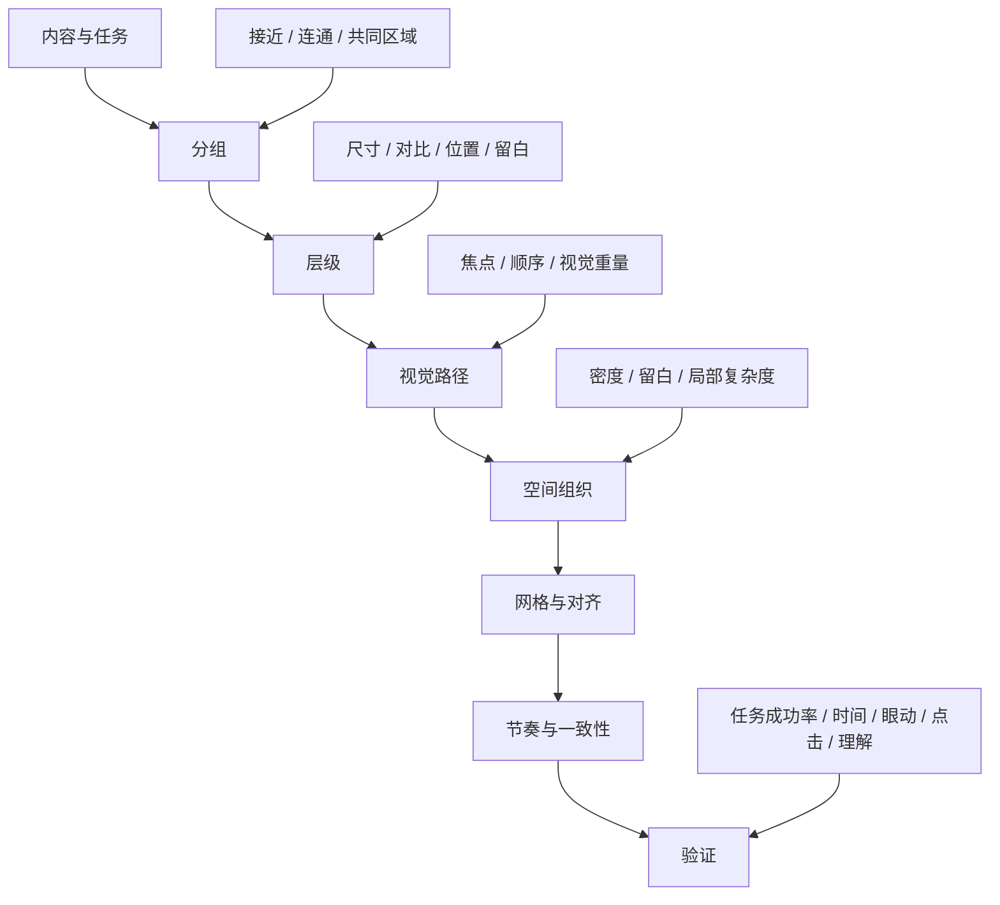
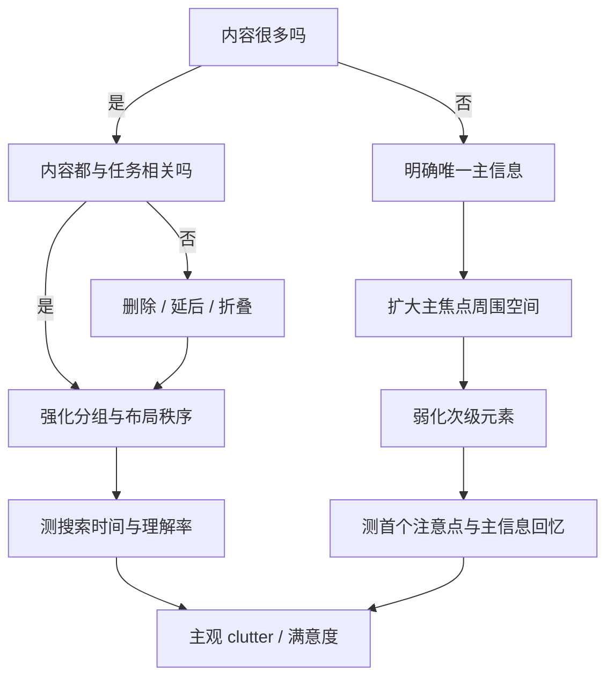

# 视觉布局判断与改进的基本原则：从感知机制到可执行 CSS

## 执行摘要与知识框架

视觉布局的核心任务，可以压缩成一句话：**让观看者以尽可能低的搜索成本，快速识别“什么属于一起、什么最重要、接下来该看哪里、该做什么”。** 这一定义与视觉注意、感知分组、视觉搜索和 HCI 可用性研究相吻合。注意并不单纯由颜色、尺寸等视觉刺激决定，用户当前目标、既往经验和页面语义都会共同影响注意优先级，因此任何“眼睛一定先看这里”的固定布局口诀都应谨慎使用。citeturn692387search0turn692387search1turn692387search4

对实际做网页、卡片和海报的人，最有用的知识框架是：



这套关系有一个重要含义：**网格、留白、对齐都属于手段，层级和分组才是它们服务的目标。** CSS Grid 可以提供稳定的二维坐标和间距系统，却不会自动产生好的信息层级。W3C 将 Grid 定义为由水平与垂直网格线建立的二维定位系统，研究则显示，即使信息量不减少，只要布局的组织秩序提高，视觉搜索表现也可能改善。citeturn942619search0turn549670search1

从改版优先顺序看，可以采用以下实务排序。它是基于感知与 HCI 证据整理出的**诊断优先级**，并非心理学界存在一套公认的“设计原则排行榜”。最先解决的是错误分组和错误层级，其次处理对齐、空间和路径，最后才处理节奏、精细一致性和装饰。视觉复杂度研究表明，复杂度上升通常会降低搜索效率和信息回忆，但用户偏好、任务和布局秩序会调节这种效应。citeturn225642search1turn834337search32turn549670search3

## 排布原则与诊断优先级

下面这张表可以直接当成页面检查表使用。证据等级采用本文统一标准：**强**表示有经典实验、现代综述或多种方法的收敛证据；**中**表示有受控实验或眼动研究支持，但适用范围受任务和刺激材料影响；**经验**表示主要来自专业设计体系和行业实践，直接因果实验有限。

| 原则 | 它解决的问题 | 建议优先级 | 页面症状 | 典型修正 | 证据 |
|---|---|---:|---|---|---|
| **层级 Hierarchy** | 用户不知道先看什么 | 极高 | 标题、卖点、按钮、说明都一样抢眼 | 先定义一级、二级、三级信息，再让视觉差异匹配信息差异 | 注意由显著性、任务目标和经验共同决定，强证据。citeturn692387search0turn692387search4 |
| **接近与群组 Proximity / Grouping** | 用户无法判断哪些元素属于一起 | 极高 | 标题离自己的正文和下一块内容一样近 | 组内间距小，组间间距明显更大；必要时使用容器或边界 | 接近、共同区域和连通性均有实验支持，强证据。citeturn768409search1turn768409search0turn768409search2 |
| **对比 Contrast** | 所有内容都处于同一重要度 | 极高 | 每块都大、粗、亮、带背景 | 把强对比留给最重要元素，弱化支持内容 | 显著刺激可提高注意优先级，但捕获程度受目标影响，强证据。citeturn692387search7turn692387search8 |
| **对齐 Alignment** | 页面看起来松散、元素关系不明确 | 高 | 卡片、文字、按钮存在大量近似对齐 | 减少可见起始线数量，让相关内容共享轴线 | 布局秩序影响搜索行为，CSS Grid 提供明确二维坐标；直接设计因果证据为中等。citeturn549670search1turn942619search0 |
| **留白 Whitespace** | 信息粘连、缺少分区和喘息空间 | 高 | 每处空隙接近相同，局部密度很高 | 先用留白表达层次，再考虑边框和底色 | 对局部密度和分组有支持，单纯“越空越好”缺乏支持，中等证据。citeturn549670search5turn834337search7 |
| **视觉重量 Visual Weight** | 左右或上下存在不必要的竞争 | 高 | 一个巨大次要图形压过主信息 | 调整面积、对比、孤立程度和位置 | 可由显著性研究解释一部分，但“视觉重量”本身主要是设计语言，有限直接证据。citeturn692387search5turn549670search2 |
| **焦点与路径 Focus / Path** | 看完第一眼后不知道下一步 | 高 | 多个 CTA、多块大标题同时争夺注意 | 建立主焦点，再安排第二停留点和行动点 | 眼动研究显示视线受任务、位置和显著性共同塑造，中到强证据。citeturn549670search2turn271762search19 |
| **重复与一致性 Repetition / Consistency** | 用户每到新区块都要重新学习规则 | 中高 | 同级卡片的标题、间距、结构各不相同 | 同级元素共享布局与组件规则 | ISO 及 HCI 实务长期强调符合用户预期和一致性，行业与标准支持较强。citeturn849385search0turn849385search5 |
| **节奏 Rhythm** | 页面缺乏连续感，或者机械重复 | 中 | 每段高度随机，或每段完全一样 | 形成重复节拍，同时允许关键段落产生变化 | 主要属于设计实践概念，可部分由分组、重复和视觉路径研究解释，直接证据有限。citeturn768409search2 |
| **网格 Grid** | 对齐和响应式关系难以维护 | 中高 | 页面出现很多任意宽度和任意间距 | 建立列、沟槽、边距和响应规则 | 网格作为实现与系统方法证据充分，对“美感提升”的因果证据较有限。citeturn942619search0turn942619search10 |

最容易出现的误区，是把原则理解成“加东西”。例如层级差，经常通过再加颜色、阴影和字号解决，结果产生更多竞争；群组差，经常给每块套一个卡片，结果页面出现几十个边界；留白差，经常统一增加 `padding`，结果组内和组间距离一起变大，关系依旧模糊。格式塔研究说明，感知分组依赖**元素之间的相对关系**，共同区域和连通甚至可以压过接近和相似，因此修布局时应先改变关系，再添加视觉装饰。citeturn768409search0turn768409search1

一个非常实用的诊断句式是：

> **问题位置 + 观察到的视觉现象 + 被破坏的原则 + 用户可能产生的行为成本 + 可执行修改 + 验证指标。**

例如：“首屏价格、促销标签、四个功能徽章和两个按钮都具有高对比，导致主 CTA 缺少独占焦点。保留一个高权重按钮，降低徽章和次级操作显著度。验证首个 CTA 的首次注视时间、任务完成时间和点击比例。”眼动数据需要谨慎解释，因为较长注视既可能代表兴趣，也可能代表理解困难，应与任务表现和定性观察一起使用。citeturn271762search22turn271762search38

## 视觉层级、视觉重量与视线移动

**视觉层级本质上是“感知优先级”和“信息优先级”的匹配。** 设计师先决定内容上谁更重要，再使用尺寸、局部对比、位置、孤立程度、空间、重复关系等信号让它获得更高注意优先级。现代注意研究越来越倾向于使用“priority map”解释选择行为，即视觉显著性、用户目标、选择历史以及场景知识共同作用于注意分配。citeturn692387search4turn692387search14

建立层级时，可把元素放进三档，而非给每一个元素创建独立等级：

**一级信息**回答“这是什么、为什么值得我继续看、下一步是什么”。产品页中通常是产品名、核心价值主张、核心视觉与主要行动。**二级信息**负责建立理由，例如三项核心能力、价格信息或关键指标。**三级信息**承担证明和细节，例如技术说明、脚注、次级链接。研究显示，视觉复杂度上升会影响搜索和回忆，因此减少同时存在的“高显著性对象”通常比继续加强主标题有效。citeturn225642search1turn692387search7

可以把一个元素的“视觉重量”当作实务模型，而不要把它当成严格心理学公式：

\[
W \approx f(\text{面积},\ \text{局部对比},\ \text{位置},\ \text{孤立度},\ \text{语义重要性},\ \text{任务相关性})
\]

这里没有可靠的通用权重系数。眼动研究表明，不同 UI 类型存在不同位置偏差、扫描方向和显著性规律，而且任务能够明显改变扫描路线。2023 年 CHI 的 UEyes 数据集包含 62 名参与者和 1,980 个网页、桌面 UI、移动 UI 与海报截图，结果显示不同载体的注视模式并不相同。citeturn549670search2

因此，**F 模式不能当作网页布局模板。** NN/g 最初在大量网页眼动数据中观察到 F 型扫描，但其后续研究明确指出，它只是多种扫描模式之一，并且常出现在缺乏有效小标题和结构提示的文字页面。用户还会出现 spotted、layer cake 和 commitment 等模式，具体模式受任务、页面结构和内容类型影响。citeturn768409search4turn768409search5

**Z 模式的证据更弱。** 它在平面与营销设计中很常见，适合解释元素很少、左右两端存在明确锚点的首屏或海报，但很难视为稳定的人类阅读定律。现有视觉注意研究更支持“任务、显著性、位置和经验共同决定扫描路径”的模型，因此设计时应直接测试目标元素是否按希望顺序被发现。citeturn692387search1turn549670search2

引导视线时，可以优先使用以下方法：

1. **先减少竞争，再增强焦点。** 当五个元素都很醒目时，继续放大 CTA 的收益有限。显著干扰项能够延迟视觉搜索，且相对显著性会改变注意捕获与抑制。citeturn692387search2turn692387search12
2. **利用空间顺序建立阅读链。** 例如产品名和核心价值主张紧邻，随后放证明，CTA 与购买信息形成一个局部组。接近和共同区域能直接影响元素是否被看成同一单位。citeturn768409search1turn768409search2
3. **让同级信息具有相近视觉权重。** 三个同级功能点若一个巨大、两个微小，用户会自然推断它们的语义等级不同。注意研究表明显著差异能够改变选择优先级。citeturn692387search4
4. **为关键元素创造“孤立空间”。** 空间本身可以成为分组和分隔信号，局部空白通常比增加更多装饰更容易维持低复杂度。citeturn549670search5turn834337search0

验证层级时，眼动实验可以测 **time to first fixation、AOI fixation count、dwell time、scanpath**；交互页面可以测 **目标发现时间、任务成功率、完成时间、点击路径和 CTA 转化**。ISO 9241 将可用性评价放在有效性、效率和满意度的语境下，GOV.UK 的服务评估方法也将完成率和完成时间作为基本性能指标。citeturn271762search0turn271762search11

## 网格系统及何时打破网格

网格是用于建立**位置、宽度、间距和对齐关系**的坐标系统。网页常见的四类网格可以这样理解：

**列网格**解决横向结构，例如 12 列或 16 列系统；**模数网格**同时控制横向和纵向单元，适合卡片、数据面板和重复模块；**基线网格**用于让不同模块的文字与垂直节奏共享基准；**响应式网格**则随可用宽度调整列数、边距、沟槽和元素跨列数。W3C 的 CSS Grid 本身就是二维网格模型，支持固定、弹性和基于内容的轨道尺寸，也支持 gap、显式位置、自动布局与 subgrid。citeturn942619search0turn942619search2

一个可实际使用的产品页网格可以是：

```text
桌面 1440px
┌──────────────────────────────────────────────────────────────┐
│ margin │ 1 │ 2 │ 3 │ 4 │ 5 │ 6 │ 7 │ 8 │ 9 │10│11│12│ margin │
│        │         主视觉 1–7          │   产品信息 8–12       │
└──────────────────────────────────────────────────────────────┘

平板
┌──────────────────────────────────────┐
│ 1 │ 2 │ 3 │ 4 │ 5 │ 6 │ 7 │ 8 │
│       主视觉        │   产品信息     │
└──────────────────────────────────────┘

窄屏
┌──────────────────┐
│      主视觉      │
│      产品名      │
│      核心说明    │
│      CTA         │
│      证明信息    │
└──────────────────┘
```

IBM Carbon 的 2x Grid 采用 8px 基本单元并在不同断点中调整列结构，体现了设计系统中常见的做法：保持**间距比例和对齐逻辑**稳定，同时允许列宽随窗口流动。这是一种成熟的行业实现方案，但 8px 本身没有成为普适审美定律的实验依据。citeturn942619search10turn942619search27

CSS 实现可以很简单：

```css
:root {
  --space-1: 8px;
  --space-2: 16px;
  --space-3: 24px;
  --space-4: 32px;
  --space-6: 48px;
  --space-8: 64px;
}

.page {
  width: min(1200px, calc(100% - 48px));
  margin-inline: auto;

  display: grid;
  grid-template-columns: repeat(12, minmax(0, 1fr));
  column-gap: 24px;
}

.product-media {
  grid-column: 1 / span 7;
}

.product-info {
  grid-column: 8 / -1;
}

@media (max-width: 800px) {
  .page {
    width: min(100% - 32px, 720px);
    grid-template-columns: 1fr;
  }

  .product-media,
  .product-info {
    grid-column: 1;
  }
}
```

这种代码利用了 CSS Grid 的轨道、gap 和响应式重排能力。MDN 也推荐使用 `minmax()`、`auto-fit` 等机制构建自适应网格。视觉顺序和 DOM 顺序仍应保持合理，因为视觉重排可能造成可访问性和键盘导航顺序问题。citeturn942619search7turn942619search9

**破格有价值的条件，是它明确服务于层级。** 例如一个产品主图跨出 12 列网格半个 gutter，可以制造焦点；一个引用数字跨两列，可以打断机械节奏；海报中的标题可以故意偏离主轴以制造张力。风险控制原则是：**局部破格，整体仍有参考系。** 如果标题、图片、按钮、正文和标签同时采用不同轴线，破格便失去了对比对象。布局秩序研究说明，高复杂度界面中，更有秩序的布局能够减轻视觉搜索负担，这支持“先建立秩序，再选择性打破”的实践策略。citeturn549670search1

## 感知规律、证据强度与留白密度

经典格式塔理论对设计最有用的部分，是把“看起来属于一起”转化为可操作条件。现代综述指出，格式塔现象确实存在丰富实验支持，但早期“视觉系统先在二维图像上自动完成所有分组”的简单版本已经被修正。深度、表面属性和更高层感知都会影响分组。citeturn768409search2turn768409search3

| 感知规律 | 对布局的意义 | 证据强度 |
|---|---|---|
| **接近 Proximity** | 距离较近的元素更容易形成组 | 强，经典与现代实验均支持。citeturn768409search2 |
| **相似 Similarity** | 相似形状、属性和表现容易被归类 | 强，但会与任务、位置等因素共同作用。citeturn768409search2 |
| **共同区域 Common Region** | 同一容器里的元素容易被看成一组 | 强，Palmer 的实验发现它可压过接近与相似。citeturn768409search1 |
| **连通性 Uniform Connectedness** | 被线、区域或连续表面连接的元素具有强组关系 | 强，Palmer 与 Rock 提供了系统实验与理论。citeturn768409search0 |
| **图形与背景 Figure Ground** | 用户需要知道哪个区域是对象、哪个区域是背景 | 强，长期实验研究支持，但具体线索效应受情境影响。citeturn768409search2 |
| **连续 Continuity** | 连续轴线容易被看成一个结构 | 中到强，属于经典分组现象，具体设计表现依赖上下文。citeturn768409search2 |
| **闭合 Closure** | 不完整轮廓仍可能形成整体 | 中到强，实验支持存在，但直接转译成 UI 法则需谨慎。citeturn768409search9 |
| **“视觉重量平衡”** | 通过面积和显著性控制视觉竞争 | 有相关注意研究支持，作为独立设计定律证据有限。citeturn692387search5 |
| **F 型扫描** | 某些文字型网页会产生顶部和左侧偏重的扫描 | 中，眼动证据明确，但高度依赖任务和页面结构。citeturn768409search4turn271762search19 |
| **Z 型扫描** | 元素少的营销画面可用作构图启发 | 行业经验，缺少与 F 模式同等级的大规模眼动证据。citeturn549670search2 |

**留白的关键指标应看“关系”，不只看空白面积。** 可测量的代理指标包括页面总元素数量、局部元素密度、white space ratio、边缘密度、信息熵、布局规律程度和用户主观 clutter 评分。2026 年一项网站和地图研究比较 feature congestion、subband entropy 和 edge density，发现不同指标对搜索时间和眼动行为的预测能力依场景而异，其中 feature congestion 与网站搜索时间存在稳定关联。由此可见，没有单一“页面复杂度分数”可以替代用户测试。citeturn549670search3

2024 年 Lewis 与 Sauro 提出的网页感知杂乱量表进一步区分了**内容杂乱**和**设计杂乱**：前者对应不必要的内容，后者对应必要内容组织不良。这个区分对设计修改非常实用，因为两种问题的处理方式不同。前者应删减或延后信息，后者应重组、分组和提升布局规律。citeturn549670search0turn549670search5

高密度内容页与低密度海报的处理目标明显不同：

**高密度内容页**应保留信息量，同时降低局部搜索成本。适合使用稳定列、强分组、重复结构、较小组内距离和较大组间距离。2024 年 dashboard 眼动实验显示，高复杂度条件下，较高的布局秩序可以改善视觉搜索表现。citeturn549670search1

**低密度海报或营销首屏**通常只有一两个核心任务，过多均匀分布的元素会稀释主焦点。这类画面可以使用更大的负空间、更明显的不对称和较少的视觉锚点。UEyes 研究发现海报和网页的注视分布存在系统差异，因此不能把网页的信息密度策略原样搬到海报。citeturn549670search2

一个实用决策流程如下：



验证密度设计时，不要只问“好不好看”。更稳妥的指标是任务成功率、目标发现时间、完成时间、信息回忆或理解率，再配合主观满意度与 clutter 评分。ISO 对可用性的定义本身就强调有效性、效率和满意度；GOV.UK 的可用性基准实践同样使用完成率和完成时间。citeturn271762search0turn271762search1

## 产品介绍页从混乱到清晰的完整改版

假设有一个 SaaS 产品介绍首屏，初稿包含 Logo、导航、促销标签、标题、三段产品说明、五个功能徽章、价格、两个按钮、一张产品截图、客户 Logo 和评分。所有元素都挤在首屏，标题、价格、促销标签和 CTA 均采用高对比处理。

**修改前结构：**

```text
┌───────────────────────────────────────────────────┐
│ Logo   产品 功能 价格 资源        登录   免费试用 │
│                                                   │
│ [新品]   🚀 最强项目管理平台   [限时优惠]          │
│ 全能协作平台，让团队效率提升……                    │
│ 自动化  AI助手  报表  权限  模板                  │
│                                                   │
│ ¥99/月     [立即开始]   [查看演示]                 │
│                                                   │
│ ┌───────────────────────────────────────────────┐ │
│ │              产品截图                        │ │
│ └───────────────────────────────────────────────┘ │
│ ★★★★★ 4.9    公司A 公司B 公司C 公司D              │
└───────────────────────────────────────────────────┘
```

此页面首先存在**层级竞争**。新品标签、标题、促销标签、价格和两个按钮同时具有高显著性，相当于给注意系统多个候选目标。视觉注意研究显示，高显著刺激能够产生优先信号，而多个无关显著项会增加视觉搜索竞争。citeturn692387search0turn692387search2

第二个问题是**语义群组模糊**。五个功能徽章夹在价值主张和价格之间，与购买组之间缺少明显空间分界。根据接近、共同区域和连通性研究，距离与区域边界会直接影响用户如何推断元素关系。citeturn768409search0turn768409search1

第三个问题是**布局轴线太多**。正文、徽章、价格、CTA、截图和客户证明没有共享稳定起始线。dashboard 的眼动研究表明，布局秩序会影响搜索效率，高复杂度页面尤其受益于更稳定的组织。citeturn549670search1

**改版第一步：先重新定义信息等级。**

一级只保留产品类别、核心价值、主 CTA 和主视觉。价格与演示按钮进入二级；功能点和客户证明进入下一屏或首屏底部。这样减少同时竞争的显著元素，预期效果是用户在短时间内更容易回答“它是什么”和“我该做什么”。视觉复杂度研究显示，低复杂度通常有利于搜索效率和信息回忆，但应结合目标用户偏好验证。citeturn834337search0

```html
<section class="hero">
  <div class="hero-copy">
    <p class="eyebrow">团队项目管理</p>
    <h1>把计划、协作和进度放在一个工作空间</h1>
    <p class="summary">
      面向 10 到 100 人团队的项目协作平台。
    </p>

    <div class="actions">
      <a class="button-primary" href="#">免费开始</a>
      <a class="button-secondary" href="#">查看演示</a>
    </div>
  </div>

  <div class="hero-media">
    
  </div>
</section>
```

**改版第二步：重新建立群组。**

让 eyebrow、标题、说明构成“理解组”，两个按钮构成“行动组”，产品截图形成独立视觉对象。组内使用较小间距，组间使用明显更大间距。这里最重要的是距离的**比例差异**。例如组内 8 到 16px，组间 32 到 48px，只是一套可实施的起点，并非心理学固定阈值。接近效应有实验支持，具体像素值属于设计系统决策。citeturn768409search2turn942619search10

```css
.hero-copy {
  display: flex;
  flex-direction: column;
}

.hero-copy .eyebrow {
  margin-block-end: 12px;
}

.hero-copy h1 {
  margin: 0;
}

.hero-copy .summary {
  margin-block-start: 20px;
}

.actions {
  display: flex;
  gap: 12px;
  margin-block-start: 36px;
}
```

**改版第三步：给页面一个稳定网格。**

```css
.hero {
  width: min(1200px, calc(100% - 48px));
  margin-inline: auto;
  padding-block: 72px;

  display: grid;
  grid-template-columns: repeat(12, minmax(0, 1fr));
  gap: 24px;
  align-items: center;
}

.hero-copy {
  grid-column: 1 / span 5;
}

.hero-media {
  grid-column: 7 / -1;
}

.hero-media img {
  display: block;
  width: 100%;
}

@media (max-width: 760px) {
  .hero {
    grid-template-columns: 1fr;
    padding-block: 40px;
  }

  .hero-copy,
  .hero-media {
    grid-column: 1;
  }

  .hero-media {
    margin-block-start: 32px;
  }
}
```

W3C Grid 规范明确支持二维轨道、gap、弹性尺寸和显式放置，因此这种结构可以直接把视觉网格映射到代码结构。citeturn942619search0

**改版第四步：控制视觉重量。**

主 CTA 保持最高行动显著性，次按钮弱一个等级；截图可以占更大面积，因为它承担产品实物证明，但避免在截图周围再堆高对比徽章。视觉注意研究表明，物理显著性和用户目标共同作用，因此购买任务中的高显著 CTA 有机会获得注意，但无关高显著装饰也可能成为干扰。citeturn692387search1turn692387search7

**改版第五步：把证明信息放到自然的第二停留区。**

```html
<section class="proof">
  <p>被 2,000+ 个团队使用</p>
  <div class="logo-row">
    <!-- customer logos -->
  </div>
</section>
```

让证明信息与核心首屏之间存在较大垂直间隔，同时内部保持紧凑。这样用户容易把它感知为独立内容组。共同区域和接近均能强化这种关系。citeturn768409search1turn768409search2

**修改后结构：**

```text
┌───────────────────────────────────────────────────────────┐
│ Logo       产品 解决方案 价格                         登录 │
│                                                           │
│  团队项目管理                                             │
│                                                           │
│  把计划、协作和进度         ┌─────────────────────────┐   │
│  放在一个工作空间           │                         │   │
│                             │       产品界面          │   │
│  面向团队的项目协作平台     │                         │   │
│                             └─────────────────────────┘   │
│  [免费开始]  查看演示                                     │
│                                                           │
├───────────────────────────────────────────────────────────┤
│                  被 2,000+ 个团队使用                     │
│          公司A    公司B    公司C    公司D                  │
└───────────────────────────────────────────────────────────┘
```

| 维度 | 修改前 | 修改后 | 验证方式 |
|---|---|---|---|
| 层级 | 约五个高权重焦点 | 一个主信息组，一个主 CTA | 5 秒后询问产品用途与主行动；眼动首次注视 |
| 群组 | 功能、价格、按钮混在一起 | 理解、行动、产品视觉、证明分组 | 首屏信息分类测试；观察误解 |
| 对齐 | 多个随机轴线 | 左文右图共享 12 列系统 | 设计检查与响应式截图比较 |
| 密度 | 首屏承载全部信息 | 次级功能延后 | 任务完成时间、理解率 |
| 视觉路径 | 多点竞争 | 核心价值 → CTA → 产品视觉 → 社会证明 | scanpath、AOI 首次到达时间 |
| 一致性 | 徽章、标签、按钮规则不同 | 同级元素共享组件规则 | 组件审查、用户误点击 |
| 可维护性 | 大量绝对宽度与局部偏移 | Grid、gap 和间距 token | 多断点自动截图测试 |

验证时建议至少准备 A/B 两版，给用户一个具体任务，例如“判断这个产品是否适合 20 人团队，并找到开始试用的方法”。记录完成率、完成时间、错误点击和主要信息回忆。流量足够的真实产品可以继续做线上 A/B 测试；小规模研究则可以通过任务测试和眼动解释产生差异的原因。ISO 与政府数字服务实践均建议把实际任务、有效性、效率和满意度结合评估。citeturn271762search2turn271762search9

判断改版是否真正成功，可采用一组非常具体的目标，例如：**主 CTA 的发现时间下降、核心产品用途回忆率提高、错误点击减少、任务完成时间下降，同时主观 clutter 评分改善。** 不建议把“注视次数增加”单独作为成功指标，因为反复注视也可能意味着用户找不到或理解困难。citeturn271762search29turn549670search0

## 可直接使用的布局诊断流程

面对任何一个“感觉不太对”的页面，可以按下面顺序检查：

1. **先问任务。** 用户来到这个画面，最主要要知道什么、做什么。没有这个答案，就无法判断层级是否合理。注意分配高度受任务影响。citeturn271762search19turn692387search1
2. **圈出前三个最醒目的元素。** 看它们是否恰好对应最重要的信息。如果第四、第五重要的信息反而最醒目，先降权。citeturn692387search4
3. **画出所有视觉群组。** 如果你和另一位观察者对哪些元素属于一起意见很不一致，通常说明接近、共同区域或连通关系存在问题。citeturn768409search0turn768409search1
4. **数轴线。** 同一内容区域中存在大量相差几像素的左边线、卡片宽度和按钮位置时，优先合并对齐规则。更有秩序的布局有助于复杂界面的视觉搜索。citeturn549670search1
5. **看局部密度。** 识别哪里出现大量边缘、标签、线框和紧密文本，而不是只看整页空白比例。复杂度指标对不同场景的预测力不同，应结合实际任务。citeturn549670search3
6. **检查视觉路径。** 首个焦点之后是否有清晰第二步。不要预设 F 或 Z，直接根据任务和页面结构验证。citeturn768409search5turn549670search2
7. **最后才处理细节节奏。** 前面的结构问题没有解决时，统一 8px 间距或微调圆角通常不会产生根本改善。这是行业实践判断，与布局秩序、群组和复杂度研究相符。citeturn549670search1turn549670search5

长期来看，最值得培养的能力，是把“我觉得这里有点乱”转译成可以检验的陈述。例如：“这里同时存在四个高显著元素”“标题和对应说明的距离大于标题和下一模块的距离”“同一信息层级有三种卡片规则”“CTA 周围没有独立空间”“页面有七条近似左对齐线”。一旦问题能够这样描述，修改方法通常就会变得明确。

## 来源与证据说明

本文优先采用原始实验、同行评议综述、CHI 等 HCI 会议论文、ISO、W3C 和成熟设计系统资料。经典格式塔与注意研究年代较早，因为相关基本现象的关键原始实验集中在这一时期；2020 至 2026 年资料主要用于补充视觉复杂度、注意控制、眼动、UI 显著性和现代布局验证。

关键研究包括 Palmer 的 **Common Region** 原始论文，它通过实验提出共同区域作为独立分组原则。citeturn768409search1 Palmer 与 Rock 的 **Uniform Connectedness** 工作进一步说明连通性可以形成强感知单位。citeturn768409search0 Wagemans 等人的 Gestalt 百年综述系统回顾了经典原则及其现代修正。citeturn768409search2

视觉注意方面，Luck 等人在 2021 年总结了 attentional capture 的长期争论，并提出显著性、目标和抑制机制需要共同考虑。citeturn692387search0 2024 年的注意控制综述进一步使用目标驱动、刺激驱动和选择历史三类因素描述注意竞争。citeturn692387search1

现代 UI 方面，2023 年 CHI 的 UEyes 是目前很有价值的界面眼动数据集之一，包含网页、桌面 UI、移动 UI 和海报，可用于理解不同载体的显著性与扫描差异。citeturn549670search2 2020 年 CHI 的网站复杂度实验显示，较高视觉复杂度会降低搜索效率和信息回忆，同时用户偏好会调节这一结果。citeturn225642search1

2024 年 dashboard 眼动实验表明，布局秩序能够调节复杂度对视觉搜索的影响，这对“内容多时靠组织解决问题”提供了较直接的实验支持。citeturn549670search1 2024 年的 Perceived Clutter of Websites 研究则提供了内容杂乱与设计杂乱的可测量区分。citeturn549670search0 2026 年最新的 display clutter 研究提醒设计师，不同计算复杂度指标在不同场景中的预测能力并不一致。citeturn549670search3

工程实现方面，CSS Grid 的结构、轨道、gap、显式定位和 subgrid 以 W3C 2025 Candidate Recommendation 为准。citeturn942619search0turn942619search2 Carbon 的 2x Grid 可以作为成熟响应式网格的行业参考，但其具体 8px 单位应理解为设计系统选择。citeturn942619search10

最后需要明确证据边界：**格式塔分组、视觉搜索、显著性与任务驱动注意具有较强实验基础；网格、节奏、视觉重量、具体 spacing token、Z 型构图等更接近专业实践模型。** 这些实践模型通常有合理的感知机制解释，却很少存在“采用某一精确数值即可普遍提升设计”的实验结论。真正可靠的判断仍应回到具体用户、具体任务，以及有效性、效率和满意度的联合验证。citeturn271762search0turn849385search1