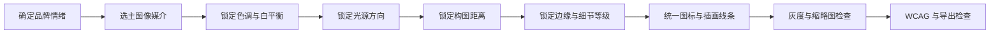

# 面向零基础但懂 HTML/CSS 读者的可操作视觉元素搭配研究

iturn170988image2turn170988image6turn170988image7turn170988image9

## 执行摘要

视觉元素搭配可以压缩成一条决策链：先确定信息优先级与情绪，再选择一个主导视觉语言，用色彩承担层级，用字体承担人格，用图像承担语义，用质感承担空间与触觉暗示，最后以可读性和一致性检查收口。传统色轮与 Itten 的对比理论仍适合帮助初学者理解“为什么两种颜色看起来有张力”，但数字设计还需要补上现代色彩科学，因为 HSV 很适合操作，却并非感知均匀空间，同样增加 10 个 V 或 S，人眼感受到的变化并不恒定；CIECAM16 等现代模型专门处理观看条件和感知属性。citeturn563509search3turn313829search1turn313829search3

在实际项目中，主色、辅色、强调色的“60/30/10”只能当启动模板，界面应优先按语义角色和对比要求分配颜色。WCAG 2.2 的关键硬标准是普通文本至少 4.5:1、大文本至少 3:1、重要图形及 UI 边界至少 3:1；AAA 文本标准进一步提高到 7:1 和 4.5:1。citeturn137649search0turn137649search2turn651347search12

字体、摄影、插画、图标和纹理也可以用类似方法判断：先问它承担“信息、识别、情绪还是装饰”，再控制同类元素共享相同的笔画、光源、边缘、色调和细节密度。字体确实会改变读者对内容气质的即时判断，研究发现字体人格与内容人格匹配时，会影响读者对页面情绪的感知。citeturn744962search0turn744962search1

对于零基础设计者，最稳妥的工作方式是先建立小型 token 系统，再开始画具体页面。Google Material 3 也采用 color roles 和 design tokens，把颜色绑定到 primary、surface、outline、on-primary 等角色，并强调只能按经过验证的配对关系组合。citeturn137649search5turn988768search8

## 色彩原理与常见配色关系

### HSV 应该怎样理解

HSV 源自早期计算机图形学中的 RGB 变换模型，它把 RGB 立方体转换成更接近设计操作语言的三个维度：Hue、Saturation、Value。它非常适合在 Photoshop、Figma、CSS 颜色工具里“调颜色”，但没有保证视觉感知上的等距性，因此用 HSV 做初选很方便，用 WCAG 对比度或现代感知色彩模型验证会更可靠。citeturn313829search8turn313829search1

| 维度 | 你肉眼最容易观察到的变化 | 信息作用 | 初学者常见错误 | 决策方法 |
|---|---|---|---|---|
| H 色相 | 红、黄、绿、蓝等“是哪一种颜色” | 区分类别、建立品牌识别、制造冷暖关系 | 同时启用过多色相，导致每个颜色都在抢注意力 | 【经验】一个普通卡片先限制在 1 个主色相和 1 个强调色相 |
| S 饱和度 | 鲜艳程度 | 高饱和更容易成为视觉焦点，低饱和更适合大面积背景 | 整个页面都用高饱和色 | 【经验】大面积色通常先降低饱和度，把最高饱和度留给 CTA 或少量强调 |
| V 明度 | 看起来更亮或更暗 | 最直接影响层级和可读性 | 只换色相，没有拉开明度 | 【经验】先把画面截图转灰度，如果层级消失，通常说明明度结构不足 |

Itten 把色彩训练建立在色相、明暗、冷暖、互补、同时、饱和度和面积等七类对比上，这一点对今天依旧有价值，因为它提醒设计者，色彩差异远不只有色相差异。Getty 对 Bauhaus 色彩课程的档案说明也显示，Itten 的色星同时呈现色相和明暗极性。citeturn563509search0turn563509search3

### 常见配色关系

下面的 HEX 是可直接复制的教学色板，属于【经验示例】，用来演示关系，并非行业标准色。

| 配色关系 | 示例 HEX | 适合场景 | 优点 | 风险 | 常见行业使用 |
|---|---|---|---|---|---|
| 单色 Monochromatic | `#173B57` `#2E668B` `#79A9C3` `#E4F0F5` | 金融、B2B、数据产品 | 极易统一，层级清楚 | 容易单调 | 金融、SaaS、专业服务 |
| 类似色 Analogous | `#215B4A` `#3F8060` `#A0B85B` | 自然、健康、生活方式 | 平静、连续 | 相邻色对比可能不足 | 健康、食品、环保 |
| 互补 Complementary | `#2457A6` `#F28A30` | 活动、体育、促销 | 张力强，焦点明确 | 大面积并列会刺眼 | 体育、零售、娱乐 |
| 分裂互补 Split complementary | `#2754A6` `#E36D54` `#D7A52F` | 品牌活动、内容卡片 | 比纯互补柔和，同时保留活力 | 三色面积失衡时会杂 | 消费品牌、文化活动 |
| 三分 Triadic | `#3159B7` `#D14F55` `#D3AA31` | 多分类系统、儿童或文化活动 | 色相区别清楚 | 很容易“彩虹化” | 教育、娱乐、数据分类 |
| 高明度对比 | `#181A1F` `#F5F0E6` | 编辑、奢侈、极简 | 信息层级稳定 | 情绪容易偏冷 | 出版、时尚、建筑 |
| 渐变色板 | `#5429CC` → `#8F4FD7` → `#E66FA8` | 数字产品、活动视觉 | 有空间感和流动感 | 容易盖过内容 | 科技、音乐、创意行业 |

Adobe 的色轮工具把 monochromatic、analogous、complementary、triadic 和 split-complementary 等关系作为常见配色逻辑，并建议三分配色通常选一色为主、其他颜色承担强调。citeturn563509search6turn563509search8

对初学者最重要的修正是：色轮只能决定“色相关系”，不能自动解决可读性。例如蓝色和橙色互补，不代表橙色小字放在白底上一定可读。WCAG 衡量的是相对亮度差，而非色轮距离。citeturn137649search1turn137649search2

### 可观察案例

**对照案例 A，W3C 饼图。** W3C 的 Non-text Contrast 页面直接展示失败和通过的饼图。失败版本虽然每块颜色不同，但相邻区域的关键边界不足 3:1；通过版本给浅黄色切片增加深色边缘后，比例信息变得可识别。这个案例说明“颜色看起来不同”和“图形信息可辨认”需要分别检查。图源：W3C Figure 44 至 46。citeturn137649search3

**对照案例 B，Pentagram 的 Ben’s Best Blnz。** 该品牌有意避开大麻行业常见的绿色和叶片套路，把社会倡议放到品牌核心，用抗议图形语境的展示字体、高饱和颜色和黑人艺术家的作品建立辨识度。它适合观察“色彩服务定位”这一原则：如果直接套行业默认色，识别力反而会降低。citeturn530650search0turn530650search5

**对照案例 C，Peach Coffee Roasters。** Pentagram 明确限制 peach 色的使用，因为消费者曾误以为品牌售卖的是桃味咖啡；团队用靛蓝、森林绿和少量桃橙，同时以清晰标签和留白强调咖啡信息。这是很典型的语义优先案例。颜色既传达品牌名，又没有让“桃子”压过“咖啡”。citeturn530650search2

## 主色、辅色、强调色与 WCAG

### 从“颜色面积”升级到“颜色角色”

“60/30/10”是便于起步的【经验规则】，可以理解为：

| 角色 | 功能 | 【经验】常见面积范围 | 可变区间 |
|---|---|---:|---:|
| 主背景/基础色 | 决定整体温度和最大面积 | 55% 至 75% | 40% 至 85% |
| 主品牌/辅色 | 建立识别、分组、容器 | 20% 至 35% | 10% 至 45% |
| 强调色 | CTA、数字、状态、焦点 | 5% 至 10% | 2% 至 15% |

实际网页更推荐 Material 3 的语义角色思路，把颜色分成 surface、primary、secondary、tertiary、outline，以及对应的 on-primary、on-surface 等前景颜色。这样 CSS token 和设计文件能直接对应，且方便深浅主题切换。citeturn137649search5

```css
:root {
  --surface: #F3E9DA;
  --text-primary: #1D1A17;
  --brand-primary: #3B2417;
  --accent: #E8A85D;
  --on-accent: #1D1A17;
  --outline: #816F62;
}
```

### 深色背景与浅色背景

浅色主题通常允许大面积使用接近白色的 surface，再用深文字形成稳定对比。深色主题需要特别避免“纯黑背景加纯白大面积文字”造成强烈视觉疲劳的情况，【经验】可以从极深棕、蓝灰或炭灰开始，并保持正文前景有足够对比。Material 的颜色体系同样把 light 与 dark scheme 视为成对系统，而非简单反相。citeturn137649search5

在图片和复杂背景上使用半透明层时，应测试最亮和最暗区域。W3C 对渐变和多色图形明确要求检查最低对比区域；Apple 在其当前材料规范中也建议，clear Liquid Glass 叠在明亮媒体背景时可考虑使用约 35% 的暗化层来帮助保持可读性。citeturn137649search3turn988768search3

### WCAG 2.2 硬标准

以下属于【标准，硬性】：

| 内容 | WCAG 等级 | 最低对比度 |
|---|---|---:|
| 普通文本 | AA | **4.5:1** |
| 大文本 | AA | **3:1** |
| 普通文本 | AAA | **7:1** |
| 大文本 | AAA | **4.5:1** |
| 重要图标、图形、控件边界 | AA | **3:1** |
| logo / 品牌名称文字 | 1.4.3 例外 | 无最低要求 |
| 纯装饰、不可见或禁用 UI | 1.4.3 / 1.4.11 相关例外 | 可不适用 |

WCAG 定义的大文本约为正常字重 18pt 或粗体 14pt，对应常见 CSS 环境中约 24px 和 18.66px。重要 UI 图形和控件识别所需区域按 1.4.11 至少达到 3:1。citeturn137649search0turn333268search0turn137649search4

色彩也不能成为唯一的信息载体。例如错误状态只把输入框从灰色变成红色仍可能失败，应同时加图标、边框变化或文字提示。WCAG 1.4.1 明确规定不能只靠颜色传递状态、动作和信息。citeturn651347search0

### 对比度计算示例

WCAG 先把 sRGB 转为线性 RGB，再计算相对亮度：

`L = 0.2126R + 0.7152G + 0.0722B`

最后：

`Contrast = (Llighter + 0.05) / (Ldarker + 0.05)`

公式及 0.04045 的 sRGB 转换阈值均来自 W3C。citeturn137649search2

以咖啡方案中的铜橙 `#C85A2E` 放在白底 `#FFFFFF` 为例：

`L(#C85A2E) ≈ 0.1979`

`L(#FFFFFF) = 1`

`(1 + 0.05) / (0.1979 + 0.05) ≈ 4.24:1`

因此它对普通小文本【标准】未达到 AA 4.5:1，对大文本【标准】达到 3:1。解决方式可以保留这个品牌橙做背景块、插画或大标题，同时用深色 `#1D1A17` 承担正文。

品牌色无法满足时，推荐顺序是：保留 hue，先调 lightness；仍不足时降低或提高 chroma；再建立专用 `brand-text` 或 `on-brand` token；最后才考虑放弃该组合。Material 3 的 “on” 色角色正是为这种前景与背景成对关系建立的。citeturn137649search5

推荐工具包括 Figma 内置 Color Contrast Checker、WebAIM Contrast Checker、Chrome DevTools Inspect/CSS Overview。Figma 目前可以直接显示 AA 和 AAA 状态并进行色觉缺陷模拟，Chrome DevTools 可以显示具体元素的 contrast ratio 并定位低对比文本。citeturn333268search0turn333268search2turn333268search4turn333268search7

**对照案例 D，Material color roles。** 好的做法是 `primary` 上使用与其配对的 `on-primary`，以及 surface 上使用 `on-surface`；随意交换 token 可能直接破坏对比度。Material 文档明确要求按预定 pair 和 layering order 使用。citeturn137649search5

## 字体气质与展示字体

字体的气质并非纯主观臆想。跨语言研究表明，读者会给字体赋予 serious、elegant、friendly、humorous 等人格属性；微软研究进一步发现，字体人格与内容人格一致时会影响即时情绪判断。citeturn744962search0turn744962search1turn694654search0

可以把字体气质拆成几个可观察变量：

| 结构特征 | 常见气质倾向 | 使用建议 |
|---|---|---|
| 几何无衬线、圆形结构 | 现代、理性、科技 | 数字产品、科技活动 |
| 人文无衬线 | 友好、克制、现代 | 品牌、服务、生活方式 |
| 高对比宋体/Didone | 优雅、编辑、文化 | 海报、时尚、艺术 |
| 低对比宋体 | 稳重、人文、书卷感 | 出版、文化、食品 |
| 圆体 | 亲和、轻松 | 儿童、消费、社交 |
| 手写/楷意 | 手作、人情、文艺 | 咖啡、餐饮、文化活动 |
| 窄体、工业型展示字 | 强势、都市、运动 | 海报、音乐、赛事 |
| 等宽字体 | 技术、工具、工程 | 开发者产品、实验性品牌 |

这种关联受文化经验影响。例如 Arabic 字体研究发现，常出现在教材、报纸或正式证书中的字体，也更容易被评价为正式、学术或庄重，因此“字体人格”既来自字形结构，也来自长期接触语境。citeturn744962search1

### 标题字与展示字怎么用

【经验】海报或卡片里最容易成功的结构是“一种高辨识展示字体 + 一种克制正文/功能字体”。展示字体负责品牌人格，可以用于活动名、数字、短口号；日期、地址、按钮、辅助说明应回到稳定字体。92NY 是非常清晰的专业案例，其品牌用定制高对比 serif “92NY Didi” 建立纽约文化气质，同时用 Theinhardt sans-serif 支撑日常信息。citeturn530650search1

展示字体如果识别性过强，可以采用三种替代策略：【经验】仅保留 logo/活动名使用；只使用数字或拉丁字母子集；选择结构相近但更平静的字体作为二级标题。

### 可替换字体表

| 气质 | 免费或开源 | 商业替代 | 适合场景 |
|---|---|---|---|
| 中性现代 | 思源黑体 Source Han Sans | 方正一线天 | 科技、品牌、展览 |
| 编辑、人文 | 思源宋体 Source Han Serif | 方正润玉圆宋 | 文化、出版、食品 |
| 手作、亲和 | 霞鹜文楷 LXGW WenKai | 商业手写/楷意字体 | 咖啡、生活方式 |
| 活泼、几何 | 得意黑 Smiley Sans | 商业创意黑体 | 活动卡片、年轻品牌 |
| 稳健现代 | Source Han Sans Medium/Bold | 方正一线天 DemiBold/Bold | 企业、B2B |
| 温润高级 | Source Han Serif | 方正润玉圆宋 | 护肤、茶、精品餐饮 |

Source Han Sans 由 Adobe 以开源许可提供并覆盖简体中文等泛 CJK 字符；霞鹜文楷和得意黑也以开源项目形式持续维护。方正一线天官方描述强调“现代、稳重、自信、细腻”，润玉圆宋则被官方定位为宋体与圆体之间的调和，适合包装、书籍和海报标题。citeturn694654search2turn990394search0turn990394search7turn694654search3turn990394search21

**对照案例 E，92NY。** 如果整张海报全部使用 Didi 一类高对比展示字，视觉辨识度会很高，但信息阅读负担同步提高。Pentagram 的实际方案用展示 serif 承担品牌声量，再用 sans-serif 做支持信息，形成“人格层”和“功能层”的分工。citeturn530650search1

## 照片、插画、图标与抽象图形

四种媒介最好按“它负责什么”来分配，而非按“哪个更好看”来决定。

| 类型 | 最擅长传达 | 典型用途 | 风险 |
|---|---|---|---|
| 摄影 | 真实感、产品质感、人物情绪、现场氛围 | 食品、旅行、人物、活动 | 图片来源混杂会立刻破坏统一 |
| 插画 | 概念、隐喻、友好感、难以拍摄的场景 | 教育、品牌故事、空状态 | 风格差异比摄影更明显 |
| 图标 | 功能、动作、快速扫描 | 导航、标签、元数据 | 语义不明确时容易误读 |
| 抽象图形 | 节奏、品牌识别、空间填充 | 背景、系列视觉、品牌系统 | 容易成为无意义装饰 |

USWDS 明确区分 icon 与 illustration：图标应承担可快速识别的功能含义，如果内容需要解释概念或视觉叙事，应使用插画；对不够通用的图标，建议搭配文字。citeturn670242search1turn670242search3

### 风格统一的具体操作

可以把图像风格写成一张“约束表”，然后所有素材都通过它：



摄影建议统一五项：【经验】冷暖色调、对比度、阴影硬度、镜头距离、背景复杂度。比如同一套咖啡卡片不要把一张高调自然光俯拍和一张硬闪光夜店风产品照直接并置。

插画建议统一六项：【经验】线宽、圆角、填色数量、透视方式、人物比例、边缘处理。图标则优先直接选一套成熟 icon set，尽量避免从多个图标库拼装。Carbon 要求产品内图标尺寸保持一致，并规定 icon artboard、stroke 扩展和像素网格处理方式，USWDS 也建议同一列表使用相同视觉语言的图标。citeturn670242search0turn670242search4turn670242search3

**对照案例 F，Carbon 图标。** Carbon 的 Do/Don’t 示例要求与正文配对时保持 icon/text 比例和颜色一致。如果单个按钮图标比其他图标粗一倍，即使来源都是 SVG，整体仍会显得像临时拼接。citeturn670242search0turn670242search2

**对照案例 G，Pentagram Bottega。** Bottega 把光、阴影、反射和 perspective 作为整个品牌的共同语法，点阵图形、字形和空间材质都围绕同一物理隐喻变化，因此即使具体图形不同，仍然属于一个系统。citeturn530650search3

### 实用检查清单

同一套视觉至少检查：照片是否共享相似白平衡和阴影方向；插画是否共享笔画粗细和圆角；icon 是否来自同一视觉家族；主图和小图是否拥有相近颗粒度；人物照片与产品照片是否共享调色；蒙版边缘是否都为硬边或都为柔边；所有素材缩到 25% 后是否还能看出属于同一套系统。

## 质感、阴影、渐变与颗粒

质感显得高级，通常来自“有原因的细节”。阴影说明前后层级，颗粒模拟印刷或胶片，纹理提示物理材质，渐变制造光照或空间方向。Apple 当前材料规范把 material 定义为帮助建立深度、层级和前后关系的视觉效果，并明确建议这类材料效果克制使用。citeturn988768search3

### 建议参数

以下属于【经验建议】，可作为 HTML/CSS 和 Figma 的起点，不属于行业硬规范。

| 效果 | 推荐起点 | 较容易显廉价的情况 |
|---|---|---|
| 卡片轻阴影 | `0 4px 12px rgba(0,0,0,.08)` | 纯黑、30% 以上透明度、blur 很小 |
| 悬浮层 | `0 8px 24px rgba(0,0,0,.10)` | 所有卡片都有强阴影 |
| 弹层 | `0 12px 32px rgba(0,0,0,.12)` | 与页面其他层级完全相同 |
| 内阴影 | 1 至 3px blur，3% 至 8% opacity | 大面积凹陷效果 |
| 两色渐变 | 2 至 3 个 stop | 5 种以上高饱和色 |
| 渐变角度 | 0°、45°、90°、135° 先试 | 随机角度且无构图依据 |
| 颗粒 | 1% 至 5% 可见强度 | 噪点压过文字边缘 |
| 纸张纹理 | 2% 至 8% opacity | 纹理重复单元明显 |
| 光晕 | 20% 至 40% 大 blur，低 opacity | 小 blur + 高饱和 + 高透明度 |

这些范围与成熟设计系统的影子尺度相近。USWDS 的标准 shadow token 从 `0 1px 4px rgba(0,0,0,.1)` 到 `0 16px 32px rgba(0,0,0,.1)`，Carbon 的浮层 menu 使用约 `0 2px 6px rgba(0,0,0,.2)`；Carbon 甚至明确规定普通 tiles 留在同一平面，不使用 drop shadow。citeturn988768search0turn988768search2turn988768search6

### 什么时候会显廉价

常见问题包括：每个卡片都同时有阴影、描边、玻璃、渐变和发光；噪点大小与画布分辨率不匹配；材质纹理覆盖到文字；高饱和渐变承担大面积背景同时又放大量正文；多个阴影方向暗示互相矛盾的光源。

最有效的克制方法是建立“质感预算”。【经验】一个普通卡片最多选择一种主质感，再配一种极弱辅助效果。例如“纸张颗粒 + 无阴影”，或“柔和阴影 + 纯色面”，很少需要同时使用玻璃、颗粒、强渐变、发光和三层 shadow。

**对照案例 H，Apple materials。** Apple 对明亮媒体背景上的 clear material 建议增加约 35% dark dimming layer；对普通内容层又建议避免滥用 Liquid Glass。两组规则共同说明，透明和玻璃效果首先服务可读性与层级。citeturn988768search3

**对照案例 I，Carbon tile 与 menu。** Carbon 的普通 tile 不加阴影，因为它和内容处在同一平面；dropdown、popover 这类真正浮起的对象才获得 shadow。对于零基础设计者，这是非常实用的判断题：先问“它真的离开页面平面了吗”，再决定是否使用阴影。citeturn988768search6turn988768search2

## 咖啡品牌活动卡片完整实操

假设品牌名为 **MORNING TRACE 晨迹咖啡**，活动为周末手冲品鉴会。受众是 22 至 38 岁城市用户，卡片会投放在公众号、网页、社交媒体和门店屏幕。核心信息顺序为“品牌感受 → 活动名 → 日期地点 → CTA”。

### 方案 A：现代极简

定位关键词：安静、专业、精品、城市、明亮。

#### 色板

| Role | Light | Dark |
|---|---|---|
| Surface | `#F3E9DA` | `#1E1712` |
| Primary | `#3B2417` | `#F6EFE6` |
| Text | `#1D1A17` | `#F6EFE6` |
| Accent | `#E8A85D` | `#E8A85D` |
| Outline | `#816F62` | `#A99787` |

实测对比：

`#1D1A17 / #F3E9DA = 14.42:1`

`#3B2417 / #F3E9DA = 12.05:1`

`#F6EFE6 / #1E1712 = 15.51:1`

`#1D1A17 / #E8A85D = 8.41:1`

这些组合均超过 WCAG AA 普通文本 4.5:1，其中也满足 AAA 7:1。标准阈值依据 WCAG 2.2。citeturn137649search0turn651347search12

字体建议：标题使用 Source Han Serif Heavy 或商业高对比宋体，功能信息使用 Source Han Sans。气质来自宋体的编辑和文化感，sans-serif 负责时间、地址、按钮等功能信息。思源系列的开源许可适合网页和活动资产统一部署。citeturn694654search2

摄影规范：【经验】使用自然侧光，45° 或俯拍，背景保持浅木、米白或不锈钢，饱和度降低约 5% 至 15%，黑位不要压死；所有图片统一暖白平衡。咖啡液体、陶瓷杯和人的手可以出现，避免高饱和食物和复杂店内招牌。

图标规范：选同一套 20px 或 24px SVG outline icon，全部使用相同 stroke weight。时间、地点、座位三个 icon 可分别使用 clock、pin、users，并保留文字标签，因为单独 icon 的语义不总是稳定。USWDS 同样建议非通用图标搭配文本。citeturn670242search1

质感规范：【经验】背景可以加入 2% 至 3% monochrome grain；卡片若置于网页中使用 `0 8px 24px rgba(29,26,23,.08)`；照片自身不再额外投影；渐变仅允许 `#F3E9DA → #E8DCC9` 的极弱线性渐变。

前后处理示例说明：原照片若出现蓝白灯、亮红包装和强对比背景，先统一白平衡到暖中性，再压低红蓝饱和，适当抬高阴影，最后加与整套视觉一致的轻颗粒。处理后照片的第一识别点应是咖啡和人的动作，环境信息退到第二层。

### 方案 B：复古手工

定位关键词：社区、手作、烘焙、亲切、纸张、旧印刷。

#### 色板

| Role | Light | Dark |
|---|---|---|
| Kraft surface | `#F2E2C4` | `#2B231C` |
| Forest | `#315B4A` | `#F8EAD1` |
| Text | `#2B231C` | `#F8EAD1` |
| Brick | `#B9472A` | `#B9472A` |
| Mustard | `#D89A2B` | `#D89A2B` |

实测：

`#315B4A / #F2E2C4 = 6.04:1`

`#2B231C / #F8EAD1 = 13.00:1`

`#F8EAD1 / #315B4A = 6.49:1`

`#2B231C / #D89A2B = 6.31:1`

`#FFFFFF / #B9472A = 5.25:1`

需要特别注意 `#2B231C / #B9472A ≈ 2.94:1`，这组不适合作为重要图标或文本组合；把 brick red 作为大色块时，前景改用 `#FFFFFF` 更稳妥。WCAG 对重要非文本元素的最低要求为 3:1。citeturn137649search2turn137649search4

字体建议：标题可用得意黑或霞鹜文楷制造印刷和手作感，正文与功能信息回到 Source Han Sans。得意黑官方将自身描述为在“人文观感和几何特征”之间寻找平衡，霞鹜文楷则定位为开源中文文楷字体。citeturn990394search7turn990394search0

图像建议：【经验】优先使用轻微硬闪或自然光的手作过程照片，允许咖啡豆、手冲壶、牛皮纸、木桌进入画面；可以叠加一组 1 色或 2 色粗线插画，例如咖啡果、滤杯、烘焙机。插画边缘允许轻微不规整，但整个系列必须统一粗细和填色逻辑。

质感建议：【经验】使用 5% 左右纸纹，3% 左右颗粒，少量 misregistration 风格偏移可以出现在装饰印刷图形中，文字本体不要故意错版。阴影尽量取消，让纸张、边框和印刷色建立层级。

Pentagram 的 Peach Coffee Roasters 可以作为这一方向的实际参考，其系统把复古 fruit-crate label、gingham pattern、绿色、靛蓝和桃橙结合到咖啡包装，同时通过现代 sans-serif 标签保证信息清晰。citeturn530650search2

### 两套方案何时选择

现代极简更适合精品手冲、商务区咖啡馆、线上订阅、价格偏高和摄影质量稳定的品牌。复古手工更适合社区店、烘焙工作坊、周末市集、联名活动和需要强化“手作、人情、地方性”的场景。这一判断属于【经验决策】，最终应回到目标用户和品牌承诺验证。

### 可执行文件规范

建议建立如下 token：

```css
/* Scheme A */
--c-surface: #F3E9DA;
--c-primary: #3B2417;
--c-text: #1D1A17;
--c-accent: #E8A85D;
--c-outline: #816F62;
```

Figma 或 PSD 图层可以使用：

`00_BG`

`01_Texture`

`10_Photo`

`20_Graphics`

`30_Type_Title`

`31_Type_Meta`

`40_Icons`

`50_CTA`

`90_Export`

【经验】社交媒体主卡建议同时输出 1080×1350、1080×1080；网页图片另外准备 1x、2x；纯图标和几何图形优先 SVG，摄影和复杂纹理使用 AVIF/WebP，遇到需要透明位图且工具链限制时再使用 PNG。SVG 图标应保留 `viewBox`，颜色尽量使用 `currentColor`，方便 HTML/CSS 主题切换。USWDS 自己也采用 SVG sprite 和 `currentColor` 的 icon 工作流。citeturn670242search1

自检时应至少回答：主视觉缩成手机缩略图后第一眼看到什么；转成灰度后层级是否仍存在；强调色是否真的只强调少量重要信息；任何正文是否低于 4.5:1；重要 icon 是否低于 3:1；图片之间的光源和白平衡是否一致；是否混用了两套 icon 风格；展示字体是否侵入日期、地点、CTA 等功能信息；阴影是否对应真实层级；去掉所有纹理后设计是否仍成立。WCAG 的颜色与非文本对比标准，以及 Carbon 对图标一致性的要求，都可以直接转化为这类检查题。citeturn651347search0turn137649search4turn670242search0

评审时优先问“这个选择承担什么功能”“如果去掉它会丢失什么信息”“同类元素是否遵守同一规则”“最抢眼的元素是否也是最重要的元素”“品牌色无法通过 WCAG 时有没有 on-color 替代 token”。这类问题能把“我觉得不太好看”转化为可以修改的设计判断。

## 优先参考资料与工具

优先级最高的是 W3C 的 WCAG 2.2、Understanding Contrast Minimum、Non-text Contrast 和 Use of Color，这些资料负责确定硬标准。citeturn651347search2turn137649search1turn137649search2turn651347search0

色彩理论可把 Johannes Itten《The Art of Color》与 Getty 的 Bauhaus 色彩档案一起看，用来理解七类对比；数字设计部分再补 CIECAM16 和 Material 3，理解现代感知模型、color roles 和 token 化配色。citeturn563509search0turn563509search3turn313829search1turn137649search5

案例研究优先看 Pentagram 的 Peach Coffee Roasters、92NY、Ben’s Best Blnz 和 Bottega。这四个案例分别展示了品牌语义与色彩、展示字体与功能字体、反行业惯例的视觉识别、统一物理隐喻如何贯穿字体和图形。citeturn530650search2turn530650search1turn530650search0turn530650search3

图标和组件规范可优先参考 Carbon Design System 与 USWDS。Carbon 很适合学习 artboard、icon sizing、stroke、一致性与 elevation；USWDS 很适合学习图标语义、SVG 和可访问性。citeturn670242search0turn670242search4turn670242search1turn988768search0

对比度工具优先使用 Figma 内置 Color Contrast Checker、WebAIM Contrast Checker 和 Chrome DevTools。三者分别适合设计阶段、独立色值校验和真实网页实现后的检查。citeturn333268search4turn333268search0turn333268search3