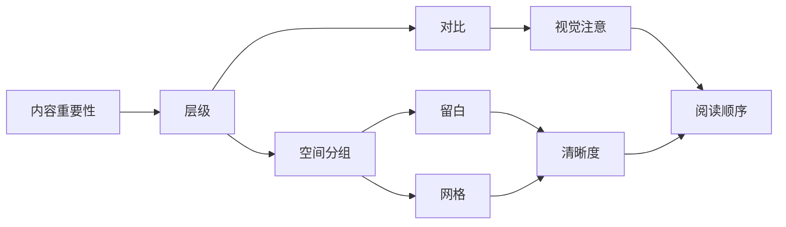

# 网页、社交媒体信息卡片与海报的独特设计规律与实操方法

## 执行摘要

网页、社交媒体信息卡片和海报虽然都使用层级、对比、留白、网格、色彩和图像，但它们面对的是三种明显不同的注意力条件。网页通常处在主动访问和连续滚动环境中，用户会扫描、点击、返回、比较，并持续建立对页面结构的理解。长期眼动研究显示，网页阅读以扫描为主，页面顶部通常获得更多注意，但用户会继续滚动，前提是页面不断提供清晰的结构线索和新的价值。citeturn531487search6turn531487search7 社交信息流中的卡片则处在高竞争、快速滚动和偶然暴露环境里，用户在同一屏上连续接触彼此无关的内容，眼动研究也发现，图像、标题和视觉丰富度会影响停留与注意分配，图文语义一致时，注意和信息记忆效果通常更好。citeturn659493search0turn659493search3turn659493search5 海报则经常首先面对远距离观看，观众会先决定“值不值得靠近”，再决定是否细读；海报眼动实验显示，口号和主图经常比正文更早获得首次注视，正文通常获得最少的视觉时间。citeturn493353search1

因此，三类载体的核心优化目标可以概括为：网页要持续建立方向感和交互信心，卡片要在极短窗口里完成识别和筛选，海报要先完成远距离识别，再支持近距离补充阅读。这个差别会直接影响信息密度。网页可以通过滚动展开复杂信息；卡片需要压缩成少数高价值单元；海报需要让最关键的信息在数米外仍能形成明确轮廓。关于海报和标识的可读性研究也说明，观看距离增加时，字高必须随之增加，字重、字宽、间距和明暗对比都会影响识别距离。citeturn493353search9turn493353search10

层级、对比、留白和网格可以理解为一套协同系统。层级回答“先看什么，再看什么”；对比制造层级，例如尺寸、粗细、明度、色相、形状和空间差异；留白用于分组、隔离和制造节奏；网格负责让这些关系重复得足够稳定，使观众能预测结构。三类载体都依赖这四者，但权重不同。网页强调可重复结构和连续节奏，卡片强调压缩后的强层级，海报强调少数极强对比和远距离轮廓。

<table>
<tr><th>维度</th><th>网页</th><th>社交卡片</th><th>海报</th></tr>
<tr><td>典型阅读</td><td>滚动、扫描、点击、返回</td><td>快速刷过、停留数秒、可能不点击</td><td>先远看，再靠近</td></tr>
<tr><td>主要任务</td><td>帮助完成目标</td><td>争取停留并传递单个核心信息</td><td>远距离识别并留下记忆点</td></tr>
<tr><td>信息容量</td><td>最高，可分段展开</td><td>较低，应强制取舍</td><td>中等，但远读层级必须极简</td></tr>
<tr><td>最重要层级</td><td>任务入口、导航、当前阶段</td><td>主视觉或主标题、核心数字、行动提示</td><td>主标题、主视觉、时间地点</td></tr>
<tr><td>留白用途</td><td>区分区块、控制滚动节奏</td><td>保护小尺寸下的清晰度</td><td>增强远距离轮廓和主焦点</td></tr>
<tr><td>网格用途</td><td>响应式布局和重复组件</td><td>在有限画布内建立稳定对齐</td><td>形成大块构图和阅读路径</td></tr>
</table>

这里有一个非常实用的判断方法：如果删掉某个元素后，用户仍能完成当前载体的核心任务，那么这个元素很可能应该降级、合并或删除。对网页，这个判断发生在每个区段；对卡片，通常需要对整张图进行一次；对海报，则需要分别用远距离和近距离各判断一次。

## 阅读场景如何决定层级、密度与视觉策略

### 网页：连续扫描，需要“持续给理由往下走”

网页的一个关键特征是内容可以延伸到屏幕之外。用户会滚动，因此“首屏必须装下全部内容”并不成立；更准确的原则是，首屏需要快速回答三个问题：这是什么，我能得到什么，我下一步能做什么。经典眼动数据表明页面顶部获得明显更多注意，但更新研究也持续发现网络阅读以扫描为主，因此首屏的价值主要在于建立正确预期和方向。citeturn531487search6turn531487search7

长页面的设计单位应该从“屏”转向“节奏段”。一个节奏段通常包含新的小标题、视觉变化、问题回答或行动入口。如果连续多个屏幕使用完全相同的密度、背景、图文比例和对齐方式，用户很容易产生“内容没有变化”的感觉。相反，每隔一段改变信息形态，例如从说明文字切换为案例、数字、图片或引用，可以重新建立视觉注意。这个做法属于经验法则，需要通过滚动深度、任务完成率或可用性测试验证。

### 卡片：竞争注意，必须在小尺寸完成第一次解释

社交媒体中的信息通常是偶然出现的。2018 年 Facebook 信息流眼动研究以及后续智能手机新闻流实验都表明，用户的注意会在来源、标题、图片、互动元素之间快速切换，而且信息流环境本身会让内容处于竞争状态。citeturn659493search0turn659493search3 2020 年一项健康传播实验还发现，当图片和文字表达一致时，参与者在帖子上的平均观看时间更长，知识回忆也更好。citeturn659493search5

因此，一张卡片最好只承担一个主要判断任务，例如“这场活动值不值得我点开”“这个数字说明了什么”“这条结论和我有什么关系”。如果一张卡同时承担品牌介绍、完整背景、三组数据、详细方法、二维码、作者介绍和四个行动入口，小画布会立即产生竞争性层级。

### 海报：首先解决“远处能不能看懂”

海报首先形成的是整体轮廓。公共信息海报眼动实验发现，观众的首次注视经常落在口号或主图上，正文通常更晚才获得注意。citeturn493353search1 标识研究同样表明，阅读距离与字高存在直接关系，字母变高后可识别距离提高；较差视力人群还需要更大的尺寸余量。citeturn493353search9

实操时，可以给海报设置三个距离测试。远距离只要求识别主题，中距离应该读到活动名称和时间地点，近距离才阅读说明、主办方、二维码等细节。不同空间条件需要现场验证，固定用某个字号并不能保证可读性。

### 四个基础概念怎样协同

可以把四个概念想成一条因果链：



层级来自内容优先级；对比让层级变得可见；网格把元素放进稳定关系；留白使不同组别不会互相干扰。对比越强，通常越要减少同级竞争。如果一页里有五个同样巨大的标题、四种强调色和三个重阴影按钮，画面看起来“很有设计感”，但层级很可能已经失效。

一个可验证的修改例子是活动卡片。修改前：标题 28 px、时间 26 px、地点 26 px、报名价 28 px、按钮 28 px，全部粗体。修改后：活动主题成为唯一最高层级，时间地点合并成一个次级信息组，价格和报名 CTA 保留一个强调色，其余文字退回中性色。评审时可以把画面缩到手机屏幕的约 25% 大小，询问测试者“第一眼看到什么，第二眼看到什么”。如果回答与预期层级不一致，就继续调整。这个缩略图测试属于行业经验方法，不是平台硬性要求。

## 网页独有的设计问题

### 响应式设计与断点

响应式设计需要解决的是内容在连续尺寸变化下如何重排。Google 的 web.dev 和 MDN 都明确建议，断点应由内容什么时候开始“放不下、过挤或结构失效”来决定，而不要围绕具体手机型号设置固定断点。citeturn531487search0turn531487search1turn531487search4

对懂 HTML 和 CSS 的初学者，比较稳妥的工作方式是先做最窄布局，让内容保持单列和正确源码顺序，再逐渐扩大 viewport。当某个组件开始出现明显问题，例如双栏卡片变得过窄、导航拥挤、图文关系失衡，就在这个宽度附近引入断点。CSS Grid、Flexbox、`minmax()`、相对单位和容器查询都能减少为了设备型号硬编码断点的需求。响应式还应考虑键盘顺序，因为 CSS 可以改变视觉位置，但键盘焦点通常仍遵循 DOM 顺序；Google 的无障碍响应式指南明确提醒测试每个断点下的键盘流程。citeturn531487search3

WCAG 2.1 和 2.2 的 Reflow 要求提供了一个很有用的底线：在相当于 320 CSS px 宽度的条件下，普通纵向内容应避免为了阅读而同时水平和垂直滚动。citeturn531487search2

### 交互状态必须被设计

平面载体通常只有一个静态状态，网页组件至少要考虑默认、悬停、焦点、按下、禁用、加载、成功、错误等状态。WCAG 2.2 要求键盘焦点必须可见，并增加了关于焦点被遮挡、焦点外观和最小目标尺寸的要求。AA 级 Target Size Minimum 要求指针目标通常至少达到 24 × 24 CSS px，或满足规定的间距例外。citeturn892282search0turn892282search1

如果悬停或键盘焦点触发额外内容，例如 tooltip、菜单或浮层，WCAG 2.1 与 2.2 的 1.4.13 要求这类内容在适用情况下能够关闭、能够被指针移入、并持续显示到用户完成操作。citeturn308063search0turn308063search5

加载状态也属于信息架构的一部分。WCAG 2.1 的状态消息要求，等待、进度、成功和错误等消息应当能被辅助技术识别，无需强迫焦点跳转。WAI 提供了 `role="status"`、live region 和 `aria-busy` 等实现方式。citeturn308063search4turn308063search10turn308063search17

### 首屏与导航

首屏应优先呈现身份、价值、行动。报名页首屏通常至少需要活动名称、核心价值、时间地点和报名入口。导航的任务是建立位置感和提供跳转路径，因此项目少时可以直接展示，项目多时才逐步收纳。设计时应检查导航在不同宽度下的名称是否仍清楚，菜单打开后焦点是否进入正确区域，关闭后焦点是否回到触发器。

网页上“首屏越满越好”通常会削弱优先级。真正值得占据首屏的大元素应该和主要任务直接相关。首屏下面最好立即提供一个可信的第二层信息，例如活动亮点、讲者、名额或用户收益，让用户有继续滚动的理由。

### 长页面节奏

长页可以用重复和变化交替。重复保证用户理解结构，变化防止注意衰减。一个简单模板是：首屏建立承诺，第二段解释收益，中段提供证据或内容，后段处理疑虑，结尾重复主要 CTA。具体顺序需要根据任务验证。

<table>
<tr><th>网页问题</th><th>设计动作</th><th>测试方式</th></tr>
<tr><td>断点</td><td>从窄屏开始，按内容失效点增加布局变化</td><td>连续拖动 viewport，不只测三台设备</td></tr>
<tr><td>焦点</td><td>所有可操作组件提供清晰 focus 状态</td><td>全程只用键盘完成任务</td></tr>
<tr><td>加载</td><td>保留布局骨架，说明进度或状态</td><td>模拟慢网与失败请求</td></tr>
<tr><td>首屏</td><td>身份、价值、时间地点、CTA 优先</td><td>5 秒测试后询问页面用途</td></tr>
<tr><td>长页面</td><td>每一到两个节奏段提供新的结构信号</td><td>观察滚动停顿点和退出点</td></tr>
</table>

无障碍方面，2026 年 11 月仍应把 WCAG 2.2 当作实际实施基线。WCAG 3.0 在 2026 年 9 月发布了新的 Working Draft，W3C 明确说明它仍是未完成草案，可能继续变化，也尚未取代 WCAG 2；W3C 当前建议仍是先满足 WCAG 2.2。citeturn892282search4turn892282search5turn892282search8 文本普通字号 AA 对比度最低 4.5:1，大号文本最低 3:1；关键 UI 组件和重要图形通常也需要至少 3:1 的非文本对比。citeturn892282search3turn892282search7

## 社交媒体信息卡片与数据卡片

### 小尺寸信息取舍

卡片的第一原则是只保留当前传播目标所需要的信息。可以先把内容分成三层。

第一层必须在不放大时就能读到，例如主结论、活动名称或关键数字。第二层支持理解，例如时间、单位、比较对象。第三层属于上下文，例如来源、脚注、二维码、品牌署名。

数据卡片尤其容易出现一种问题：把“所有数据都重要”误解成“所有数据都要同样醒目”。更好的方法是确定一个主数字，例如“62%”，再把解释“受访者表示每周至少使用一次”做成次级文字，样本量和来源放底部。这样，主数字负责吸引注意，说明文字负责避免误读，来源负责可信度。

### 平台尺寸与惯例

以下数据均以 2026 年 11 月 14 日检索结果为依据。平台规范更新频繁，发布前应重新查看对应帮助中心。表格中的“官方要求”表示来源直接来自平台文档；“常用安全尺寸”表示基于当前平台比例和行业实践的导出建议。

<table>
<tr><th>平台与场景</th><th>当前规格或惯例</th><th>性质</th><th>来源状态</th></tr>
<tr><td>LinkedIn 链接分享</td><td>官方建议 1.91:1，1200 × 627 px，最小宽度 200 px；LinkedIn 分享模块还给出最低 1200 × 627 px 的高质量建议</td><td>官方规范</td><td>LinkedIn Help，检索 2026 11 14 citeturn893146search0turn893146search1</td></tr>
<tr><td>LinkedIn 单图</td><td>横图 1200 × 628，方图 1200 × 1200，竖图推荐 4:5，720 × 900</td><td>官方广告规格</td><td>LinkedIn Marketing Solutions，检索 2026 11 14 citeturn893146search2turn893146search4</td></tr>
<tr><td>TikTok 图像轮播</td><td>横图 1200 × 628，方图 640 × 640，竖图 720 × 1280；标准 Carousel 支持 2 至 35 张</td><td>官方广告规格</td><td>TikTok for Business，检索 2026 11 14 citeturn487822search2turn487822search9</td></tr>
<tr><td>TikTok 竖屏视频</td><td>In Feed 推荐 9:16，至少 540 × 960；也支持 16:9 与 1:1</td><td>官方广告规格</td><td>TikTok Ads Manager，检索 2026 11 14 citeturn487822search3turn487822search4</td></tr>
<tr><td>Meta Messenger 模板卡片</td><td>图片可使用 1:1 或 1.91:1，两种比例均可能发生裁切</td><td>官方开发者规范</td><td>Meta Developers，检索 2026 11 14 citeturn582535search0</td></tr>
<tr><td>Facebook 链接预览</td><td>1200 × 630、约 1.91:1 仍是常见安全尺寸；Meta 旧版和现有 Graph API 对 link preview 仍存在多种渲染方式，因此发布前应使用实际分享预览验证</td><td>行业安全尺寸，平台渲染会变化</td><td>Meta API 与 2026 规格汇总交叉核对 citeturn208625search3turn208625search9</td></tr>
<tr><td>Instagram Feed</td><td>常用导出为 1080 × 1080 方图、1080 × 1350 的 4:5 竖图；当前平台还支持更高的竖向比例，但 API 与客户端规则可能不同</td><td>平台惯例，需要实机验证</td><td>Meta API 与 2026 平台规格汇总，检索 2026 11 14 citeturn582535search2turn208625search7</td></tr>
<tr><td>X 链接卡片</td><td>旧 Summary Large Image 体系常用约 2:1，300 × 157 为历史最低尺寸；X 目前旧 Cards 文档入口已重定向到新版开发者站，因此不宜把旧数值视为长期稳定硬要求</td><td>历史平台规范，当前需实测</td><td>X 官方旧链接当前重定向，检索 2026 11 14 citeturn512708view0turn512708view1；历史规格交叉核对 citeturn208625search0</td></tr>
<tr><td>小红书图文</td><td>平台当前广告帮助中心持续更新笔记和商业内容规则，但公开帮助页没有提供一个可长期适用于所有图文笔记的统一像素尺寸。实践中应以 App 当前裁切预览为准</td><td>无统一公开硬尺寸</td><td>小红书聚光帮助中心，检索 2026 11 14 citeturn682040search3turn682040search4</td></tr>
<tr><td>抖音图文</td><td>商业开放平台支持图文素材，单条可包含最多 35 张图；具体发布比例需按当前客户端和广告位测试</td><td>官方能力说明</td><td>巨量引擎商业开放平台，检索 2026 11 14 citeturn682040search1</td></tr>
</table>

对于微信，微信内的网页链接卡片、公众号封面、小程序分享卡和朋友圈素材属于不同产品面，公开规范与客户端渲染也经常变化，因此不建议把“微信图片尺寸”当成一个统一数字。发布项目应分别针对公众号后台、小程序分享预览和实际聊天分享做验证。

### 如何在小尺寸里避免拥挤

最有效的方式通常是减少层级数量。信息卡最好控制在三层以内。每一层内部可以有多个元素，但它们应该表现为一个视觉组，例如“11 月 28 日 周六 14:00”可以作为单一时间组，而不要让日期、星期、时间分别争夺注意。

留白不等于大量空白面积。卡片上的留白更重要的是“组间大于组内”。例如标题到副标题 12 个单位，副标题内部两行间距 4 个单位，副标题到底部 CTA 再用 16 个单位，这样用户会自然看到三个组。

### 常见错误与修改验证

<table>
<tr><th>问题</th><th>修改前</th><th>修改后</th><th>验证</th></tr>
<tr><td>信息过多</td><td>一张图放完整活动议程</td><td>只保留主题、时间、地点、报名动作</td><td>缩小至手机缩略图仍能复述四项信息</td></tr>
<tr><td>层级冲突</td><td>三个数字同样巨大</td><td>一个主数字，两个支持数字降级</td><td>3 秒后询问“最重要结论是什么”</td></tr>
<tr><td>图片与文字脱节</td><td>装饰性图片与结论无关</td><td>图片直接支持文字语义</td><td>遮住正文后仍能猜到主题</td></tr>
<tr><td>卡片像网页截图</td><td>保留导航、段落、多个按钮</td><td>重新编排为单一视觉命题</td><td>与真实信息流并排比较</td></tr>
</table>

## 海报的焦点、标题、层级与记忆点

### 先设计远距离轮廓

海报可以先在非常小的缩略图下设计。如果缩成手机屏幕上的一个小矩形后仍然能看出主标题和主视觉，远距离轮廓通常已经比较清楚。公共信息海报研究发现，口号和图像常常成为最早的注视区域，正文得到的平均关注时间最低。citeturn493353search1

研究型海报综述也反复发现“减少文字、突出单一信息、提高图形比例和关键结论可见度”是高频建议。citeturn493353search5 2026 年眼动研究进一步发现，中等留白、适度文本密度和结构化间距更容易获得良好的视觉注意与主观吸引力，极端拥挤或极端稀疏都可能降低效果。citeturn493353search3

### 建立一个强焦点

海报通常应该有一个最强焦点。这个焦点可以是标题、人物、物体、数字或形状。其余元素需要围绕它组织。如果标题、二维码、主办方 Logo、时间、地点和四张图片都使用最高饱和度和最大字号，远处看到的只会是一团噪声。

可以采用“一个巨物，两级支持”的构图。巨物负责记忆，两级支持负责回答实际问题。例如一场设计工作坊海报中，用巨大的“看懂版式”作为记忆点，下面只有日期和地点作为第二层，再把二维码、主办方和细节放在第三层。

### 视觉记忆如何产生

所谓“一眼记住”通常包含两个条件。第一，有明显的差异特征，例如非常独特的图形、色块或短语。第二，这个特征与内容有语义关系。单纯使用夸张装饰可能提高注意，却未必提高对活动本身的记忆。海报研究显示，口号、图像情绪和视觉显著性都会影响记忆和注视，但不同内容的效果也具有情境依赖。citeturn493353search0turn493353search1

对于活动海报，一个实用标准是：让测试者看 3 秒，移开海报，然后问三件事，“是什么活动”“什么时候”“你记住了什么画面”。如果第三个问题没有稳定答案，说明海报可能缺少记忆锚点。

## 同一份内容跨三种载体如何保持一致

跨载体应该保持的是身份和含义，例如活动名称、核心主张、主色、关键图形语言、摄影风格和语气。需要重新设计的是信息密度、比例、层级强度、CTA 和阅读顺序。

最危险的做法是从网页截图裁成卡片，再把卡片放大做海报。三个画布虽然视觉一致，却会继承错误的阅读逻辑。网页的价值在于信息展开和交互；卡片需要压缩；海报需要远距离识别。

<table>
<tr><th>要素</th><th>跨载体保持</th><th>按载体重做</th></tr>
<tr><td>活动名称</td><td>文字名称保持</td><td>字号、换行和位置重做</td></tr>
<tr><td>核心主张</td><td>语义保持</td><td>网页可完整表达，卡片缩成一句，海报缩成短语</td></tr>
<tr><td>品牌色</td><td>主色保持</td><td>面积比例和对比强度重做</td></tr>
<tr><td>主视觉</td><td>视觉概念保持</td><td>裁切和构图重做</td></tr>
<tr><td>CTA</td><td>行为目标保持</td><td>网页用按钮，卡片用文字引导，海报通常用二维码或现场方向</td></tr>
<tr><td>信息顺序</td><td>逻辑内容保持</td><td>必须重做</td></tr>
<tr><td>网格</td><td>可保持比例感和间距系统</td><td>列数、边距和模块大小重做</td></tr>
</table>

一个可执行的跨载体流程是先写“内容母版”。母版中只定义事实、主张、优先级和品牌资产，不定义画布位置。随后分别创建 Web、Feed、Poster 三个结构。这样能减少“先做一个版，再强行适配”的惯性。

## 完整示范：线下活动三种载体

### 活动假设

活动名称：**看懂版式：非设计师的视觉层级工作坊**

时间：2026 年 11 月 28 日，14:00 至 17:00

地点：新加坡 National Design Centre，Level 2

目标受众：会做网页、PPT 或社交图，但没有系统设计训练的产品、运营、开发者和独立创作者

人数：40 人

费用：S$38

报名方式：活动网页在线报名，支付后获得电子票

主讲人：林岚，独立信息设计师

核心承诺：3 小时学会用层级、对比、留白和网格诊断一个“感觉不对”的版面

### 报名网页

信息优先级：

1. 活动是什么。
2. 能学到什么。
3. 时间、地点、价格。
4. 立即报名。
5. 课程内容。
6. 适合谁。
7. 讲师可信度。
8. FAQ 和退款信息。

```mermaid
flowchart TD
A[导航: Logo 活动 FAQ] --> B[首屏]
B --> B1[看懂版式]
B --> B2[3小时学会诊断一个感觉不对的版面]
B --> B3[11月28日 14:00 | National Design Centre | S$38]
B --> B4[立即报名]
B4 --> C[你会学到什么]
C --> D[四个核心概念示例]
D --> E[现场练习与前后对比]
E --> F[适合谁]
F --> G[讲师介绍]
G --> H[FAQ]
H --> I[底部报名区]
```

建议尺寸：网页采用流式响应式布局。设计稿可以先以约 390 CSS px 窄屏和约 1440 CSS px 宽屏作为工作视图，但断点应在内容开始失效的位置建立，而不应直接绑定设备型号。citeturn531487search0turn531487search4

首屏文案示例：

**看懂版式**

3 小时学会用层级、对比、留白和网格，诊断一个“感觉不对”的画面。

2026.11.28 周六  
14:00 至 17:00  
National Design Centre  
S$38 · 限 40 人

**立即报名**

关键设计决策：首屏只使用一个主 CTA；时间地点价格合并成一个信息组；课程内容放在首屏后继续展开；宽屏可以采用两栏，把报名摘要放在右侧 sticky 区域，窄屏则保持单列。键盘焦点、悬停、按下、禁用和加载状态都要单独设计。页面需支持 320 CSS px 等效宽度下的重排，并满足基本对比和焦点可见性要求。citeturn531487search2turn892282search3turn892282search0

适配要点：窄屏将 sticky 报名栏转换成正文中的 CTA；主图保持语义完整，避免关键人物或文字被裁掉；导航减少为 Logo、活动信息、报名；报名提交后使用明确成功状态，并让辅助技术感知状态变化。citeturn308063search4turn308063search10

### 社交分享卡片

目标：让刷到的人在一两秒内知道“这是一个面向非设计师的版式工作坊”。

推荐主版本：4:5，1080 × 1350 px，适合 Instagram 等竖向 Feed 环境；同时派生 1:1、1.91:1 和 9:16 版本，用于不同平台和分享面。LinkedIn 官方支持 1.91:1、1:1、4:5 等比例，TikTok 图像广告与轮播则明确提供横、方、竖三类规格。citeturn893146search2turn487822search2

结构草图：

```text
┌──────────────────────────┐
│  非设计师视觉工作坊       │
│                          │
│        看懂              │
│        版式              │
│                          │
│  层级 · 对比 · 留白 · 网格 │
│                          │
│  11.28  14:00            │
│  National Design Centre  │
│                          │
│  3小时现场练习  S$38      │
└──────────────────────────┘
```

信息优先级：第一层“看懂版式”；第二层“非设计师视觉工作坊”和日期；第三层地点、价格和课程关键词。卡片不放详细议程，也不塞讲师简历。

文案示例：

**看懂版式**  
非设计师视觉工作坊  
层级 · 对比 · 留白 · 网格  
11.28 · Singapore  
3 小时现场练习

关键设计决策：让“看懂版式”占据约半个视觉注意权重；只保留一个强调色；底部信息形成统一信息条；不使用二维码，因为社交平台内用户通常已经能够通过帖子正文或链接进入报名页。若平台发布位置实际需要二维码，则应单独制作对应版本。

### 现场海报

目标：走廊中数米外先识别活动主题，靠近后得到时间地点和二维码。

建议尺寸：A2 作为常见现场尺寸起点，420 × 594 mm；若场地走廊宽、观看距离更远，可升级到 A1。最终字号应根据实际安装距离和打印样张测试，标识可读性研究表明字高与可读距离直接相关，不能只依据屏幕预览判断。citeturn493353search9turn493353search10

结构草图：

```text
┌──────────────────────────────┐
│                              │
│          看 懂               │
│          版 式               │
│                              │
│   非设计师视觉层级工作坊      │
│                              │
│   11.28 SAT · 14:00          │
│   National Design Centre     │
│                              │
│    ┌──────────────┐          │
│    │     QR       │  S$38    │
│    └──────────────┘          │
│                              │
│   层级 · 对比 · 留白 · 网格   │
└──────────────────────────────┘
```

信息优先级：第一层“看懂版式”；第二层“非设计师视觉层级工作坊”；第三层日期和地点；第四层二维码、价格和主办方。

海报文案示例：

**看懂版式**

非设计师视觉层级工作坊

11.28 SAT  
14:00 至 17:00  
National Design Centre

3 小时 · 40 人 · S$38

扫码报名

关键设计决策：把活动名称设计成唯一远距离焦点；二维码保持安静区域，不与标题竞争；信息分成上、中、下三个明显区域；背景图如果使用，应服务于主题并给标题留出高对比区域。公共信息海报眼动研究显示标题或口号常先于正文获得注视，因此主标题承担第一层识别是有证据支持的设计方向。citeturn493353search1

三种载体最终可以保持同一套主色、标题字形特征、几何图形和“看懂版式”这个视觉主张，但网页展开完整课程故事，卡片只做传播钩子，海报则把远距离识别放在最前面。

## 评审与可测试清单及主要参考来源

下面这份清单可以直接用于设计评审和轻量可用性测试。

### 评审清单

1. **共同层级**：3 秒后，测试者能否说出第一信息和第二信息；如果每个人回答不同，说明层级过于分散。

2. **共同对比**：删掉颜色后，层级是否仍然成立；如果完全依赖颜色区分，应增加尺寸、粗细、位置或形状差异。WCAG 也要求重要信息不能只依赖颜色。citeturn892282search7

3. **共同留白**：组间距离是否明显大于组内距离；如果一个标题距离上一组和下一组完全一样，归属关系会变模糊。

4. **共同网格**：是否有稳定对齐线；随机左边界、不同卡片宽度和不一致的内边距通常会放大“凌乱感”。

5. **网页任务**：能否在首屏理解页面用途；能否不用鼠标完成报名；焦点是否始终可见；320 CSS px 等效宽度下是否仍可使用；加载、成功、错误状态是否有文本和程序化提示。citeturn531487search2turn892282search0turn308063search4

6. **网页响应式**：从 320 px 连续拖到大屏时，是否出现某个中间宽度突然变得难用；断点应在这里解决。citeturn531487search0turn531487search4

7. **卡片缩略图**：在手机信息流的实际显示大小下，核心标题和一个关键事实是否仍能识别。

8. **卡片语义**：图片是否支持文字含义；图文一致通常比无关装饰更有利于注意和记忆。citeturn659493search5

9. **卡片裁切**：用每个平台真实预览检查 1:1、4:5、1.91:1、9:16 等派生版本，避免用一张主图强行自动裁切所有渠道。

10. **海报远距**：从预期安装距离观察，只要求回答“什么活动”；走近一半距离，再回答“什么时候、在哪里”；站在近处才看二维码和细节。

11. **海报记忆**：看 3 秒后移开，询问测试者记住了什么。若只记住“有很多字”或“颜色很亮”，说明记忆锚点需要加强。

12. **打印测试**：海报至少输出一次 100% 实际尺寸局部样张，因为屏幕上可读的字号和对比不等于现场环境下可读。标识研究证明观看距离、字高和对比共同影响可读性。citeturn493353search9turn493353search10

### 主要参考来源

W3C, **Web Content Accessibility Guidelines 2.2**，当前推荐标准与成功准则。citeturn892282search7turn892282search0

W3C, **WCAG 3.0 Working Draft**, 2026 年 9 月 10 日。当前仍为 Working Draft，W3C 明确说明它尚未取代 WCAG 2。citeturn892282search4turn892282search5turn892282search8

W3C, **Understanding Reflow**, 关于 320 CSS px 等效宽度下的内容重排。citeturn531487search2

W3C, **Content on Hover or Focus** 与 **Status Messages**，用于 hover、focus、tooltip、加载和状态反馈。citeturn308063search0turn308063search4

Google web.dev, **Responsive Web Design Basics**，关于内容驱动断点和移动优先设计。citeturn531487search0

MDN, **Responsive Web Design** 与 **Media Queries**，关于断点、Flexbox、Grid 和响应式布局。citeturn531487search1turn531487search4

Nielsen Norman Group, **Scrolling and Attention** 与 **How People Read Online**，关于网页扫描和滚动注意。citeturn531487search6turn531487search7

Sülflow, Schäfer & Winter, **Selective attention in the news feed**, New Media & Society, 2018，Facebook 信息流眼动实验。citeturn659493search0

Vraga, Bode & Troller Renfree, **Beyond Self Reports**, Communication Methods and Measures, 2016，社交内容视觉注意研究。citeturn659493search1

Ohme 等相关研究，**Headlines, Pictures, Likes**, Social Media + Society, 2024，智能手机与桌面新闻流眼动比较。citeturn659493search3

Klein 等, **When Social Media Images and Messages Don't Match**, Journal of Health Communication, 2020，图文一致性与注意、记忆实验。citeturn659493search5

Tummers 等, **Assessing Information based Policy Tools**, Policy Studies, 2020，公共信息海报眼动研究。citeturn493353search1

2026 眼动研究，**Visual attention and perceived attractiveness in scientific posters**，关于文本密度、图像比例与留白。citeturn493353search3

U.S. Access Board, **VMS Legibility Standards and Research**，关于字高、观看距离、字宽、字距与对比。citeturn493353search9

LinkedIn Help 与 Marketing Solutions，链接分享和单图规格，检索日期 2026 年 11 月 14 日。citeturn893146search0turn893146search1turn893146search4

TikTok for Business，Carousel 和 In Feed 广告规格，检索日期 2026 年 11 月 14 日。citeturn487822search2turn487822search4

Meta for Developers，Instagram Media API、Messenger 模板和 Facebook Graph API，检索日期 2026 年 11 月 14 日。citeturn582535search0turn582535search2turn208625search9

X Developer Platform，旧 Cards 文档当前重定向状态，检索日期 2026 年 11 月 14 日。citeturn512708view0turn512708view1

小红书聚光帮助中心，商业内容与笔记相关规范，检索日期 2026 年 11 月 14 日。citeturn682040search3turn682040search4

巨量引擎商业开放平台与 TikTok for Business，抖音图文素材能力和 TikTok 图像、视频广告规格，检索日期 2026 年 11 月 14 日。citeturn682040search1turn487822search2