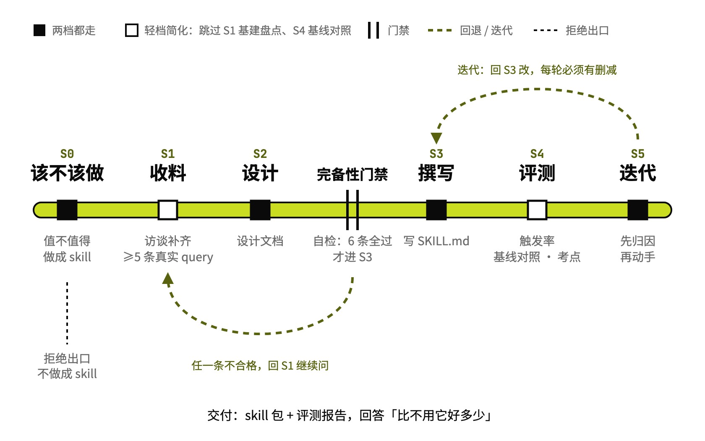

# skill-build

造 Skill：设计、评测、迭代

## 要解决的问题

做一个 Skill，写 SKILL.md 反而是最容易的一步。难的在前后两头：这件事值不值得做成 Skill、边界划在哪、会不会和隔壁的 Skill 抢活，做完还要回答它比不用它好多少。使用者多半是产品同学，知道要什么效果，不知道这些问题该怎么问。

## 运行方式



先判该不该做，一条资格都不占就给替代方案，不建包。设计文档要过六条完备性门禁，任一条不合格就回去继续访谈；写完 SKILL.md 先跑体检脚本，再造评测集测触发率、跑基线对照。拿到评测结果先归因再改，迭代回到撰写那一步，每轮都要有删减。

## 关键设计

做一个 Skill 要同时回答三个问题：值不值得做，边界划在哪，比不用它好多少。skill-build 把建包拆成六个阶段，各阶段的做法拆进几份参考文档，进到那一步才读；设计和撰写之间隔着一道完备性门禁，模板放在 assets，体检和评分交给两个脚本。

- **设计写给人看，撰写写给模型看**：S2 照 `assets/design-doc-template.md` 出设计文档，让业务方、研发和评测的人对齐边界；S3 再照 `assets/skill-md-skeleton.md` 翻成给模型读的祈使句。边界问题在设计里解决，措辞问题在撰写里解决（`references/stage-2-design.md`）。
- **边界想清楚了才开始写**：`SKILL.md` 的完备性门禁有六条，每条配一个不合格的样子，比如「能说出三个很像但不该触发的说法」，对应的不合格回答是「跟这个无关的都不该触发」。六条全过才进撰写，轻档豁免考点和工具字段两条。
- **从最轻的档做起，升档只加外围文件**：轻档只交一个 SKILL.md，手写几条说法测触发；完整档加 references、scripts、评测和各阶段产出物。升档时 SKILL.md 本体保持原来的长度，正文控制在 500 行以内（`references/stage-3-write.md`）。
- **规则写明原因，强调词和红线都从严**：`references/stage-3-write.md` 要求把全大写的 ALWAYS 和一串「最高优先级」改成解释为什么，红线只收违反了就收不回来的事，最多五条。`validate_skill.py` 查强调词密度、红线条数、正文行数和建了却没被引用的目录。
- **评测衡量的是比不用它好多少**：同一批说法分别带 Skill 和不带 Skill 跑，`score_rubric.py` 算每条考点的分差，分差落在阈值内的考点标成无区分度，对应的 SKILL.md 章节列为候选删减。触发评测给的工具集接近真实使用环境（`references/stage-4-eval.md`）。

```text
skill-build/
├── SKILL.md                           六个阶段、分档、完备性门禁、红线
├── references/                        进到哪个阶段读哪一份
│   ├── stage-0-1-intake.md            该不该做的判定和收料访谈
│   ├── stage-2-design.md              设计文档八个模块怎么写
│   ├── stage-3-write.md               触发说明和正文怎么写、怎么控长
│   ├── stage-4-eval.md                造题、触发评测、基线对照、考点审计
│   ├── stage-5-iterate.md             拿到评测结果后怎么归因和删减
│   └── antipatterns.md                不该做成 Skill 的需求和写法错误
├── scripts/
│   ├── validate_skill.py              体检：结构、行数、强调词、红线条数
│   └── score_rubric.py                汇总考点分数，标出无区分度的考点
├── assets/
│   ├── design-doc-template.md         设计文档模板，含门禁自查表
│   ├── skill-md-skeleton.md           SKILL.md 的骨架
│   ├── trigger-eval-template.json     触发评测题集模板
│   └── rubric-template.md             考点表和判分 prompt 模板
├── evals/                             本 Skill 自己的触发评测
│   ├── trigger-eval.json              触发题集：正例和近似的负例
│   └── 2026-08-02-trigger-report.md   两种工具集下的触发评测结果
└── examples/
    └── meeting-minutes/               例子：把整理会议纪要做成一个 Skill
```

## 其他

- 前提：Python 3 跑体检脚本 `validate_skill.py` 和考点评分脚本 `score_rubric.py`
- 注意：改已有 Skill 前先 `cp -r` 留快照，没有旧版就做不了对照，也回滚不了
- 注意：已发布的 Skill 不改名，改名会让所有引用和 symlink 静默指空
- 注意：新写或改过检查脚本，先拿已知健康的 Skill 跑一遍再信它的输出

---

完整指令见 [SKILL.md](SKILL.md)；安装方法见仓库首页的 [README](../../README.md)。
