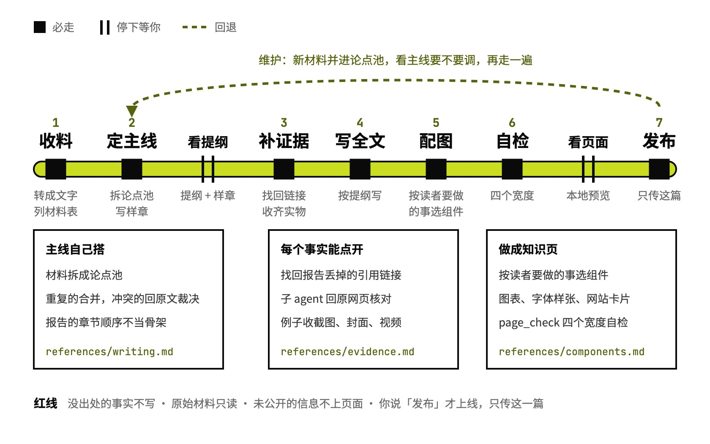

# study-guide

没读过的材料写成一篇能学的指南

## 要解决的问题

想入门一个陌生领域，手上攒了几份调研报告、论文和视频，自己一份都没读。挨个读要花好几个小时，几份之间互相重复、说法打架，读完也串不成一条线。让 AI 直接总结，常常是几份报告的缩写拼在一起：数字找不到出处，提到的网站和作品也看不到长什么样。

## 运行方式



从一个装着材料的文件夹开始。它先读完全部材料、重新搭主线，写一章样章给你看；你确认方向后，补证据、写全文、配图，构建成知识页，四个宽度自检通过再给你看一次；你说「发布」才上线。以后有新材料进来，并进原来那篇，不另起一篇。

## 关键设计

一篇学习指南要同时做到三件事：新手顺着读能学会，每个事实能点开核对，提到的例子一点就能看到。study-guide 按八步推进，中间停两次等你；写法、证据、组件、发布各有一份参考文件，正文只写在 guide.md 里，再构建成静态知识页。

- **主线重新搭**：`references/writing.md` 规定先把材料拆成论点池，重复的合并，冲突的回原文裁决，再从「读者读完要能说清什么」出发搭主线。报告原来的章节顺序不拿来当骨架。
- **每个事实能点开**：Deep Research 报告导出后常常丢了引用链接。`references/evidence.md` 的做法是：`extract_cites.py` 备料，子 agent 按材料分批找回原链接，`merge_sources.py` 合成来源表；关键论断回原网页核一遍，结果记进不上页面的 核对.md。
- **例子收实物**：文中提到的网站、作品、视频，`collect_refs.py` 截图、取封面、判断能不能嵌；`fetch_icons.py` 取来源网站的图标。拿不到就只放链接，不绕登录墙。
- **按读者要做的事选组件**：`references/components.md` 列出 guide.md 的全部写法：对照表、流程图、截图画廊、视频、自定义演示、「我的看法」。抽象原则可以画信息图，`references/infographic.md` 要求先出两张样张给你定风格。
- **上线只传这一篇**：`page_check.py` 在四个宽度查报错、坏图、溢出和挤成一字一行的列；`references/publish.md` 发布时只传这一篇的目录，传前传后都和线上比对。

```text
study-guide/
├── SKILL.md                    八步流程、两次停下、红线、出问题怎么办
├── references/
│   ├── writing.md              写作规范：读者、语气、主线怎么搭
│   ├── evidence.md             补证据、收实物、检查链接
│   ├── components.md           guide.md 的全部写法和组件
│   ├── infographic.md          高保真信息图什么时候画、怎么出
│   └── publish.md              构建、自检、发布、维护
├── scripts/
│   ├── inventory.py            扫主题文件夹，转文字，列材料表
│   ├── extract_cites.py        从报告里取出丢了链接的引用
│   ├── merge_sources.py        找回的链接合成 sources.json
│   ├── collect_refs.py         网站、作品截图和取封面
│   ├── fetch_icons.py          下载来源网站的图标
│   ├── check_links.py          逐个打开正文用到的链接
│   └── page_check.py           四个宽度的页面自检
├── assets/
│   └── guide-app/              页面模板（React + Vite），guide.md 构建成知识页
│       ├── scripts/build_guide.py  guide.md 转成页面数据，写错报行号
│       ├── src/                页面组件和样式
│       └── example/            模板自带的小示例
└── examples/
    └── visual-design-basics/   例子：6 份报告写成《视觉设计入门》
```

## 其他

- 不处理：出调研题目（交给 research-with-gpt）、AI 自己调研出决策报告（交给 deep-survey）、单期播客笔记（交给 podcast-summary）、改写成公众号文章（交给 human-article）
- 前提：Python 3、Node.js（构建页面）、能跑无头浏览器的 Playwright（截图和自检）；发布要一份本机发布配置，没有就停在本地预览
- 注意：网页搜索有额度，找回链接时分批派子 agent；第一次停下时它会问要不要写方法论，涉及「怎么做好 X」的主题建议要

---

完整指令见 [SKILL.md](SKILL.md)；安装方法见仓库首页的 [README](../../README.md)。
