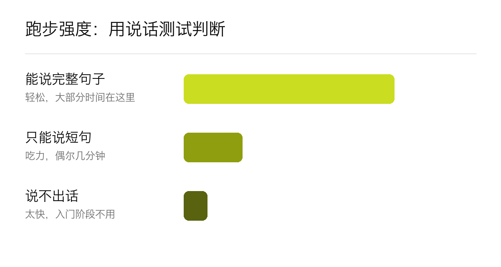
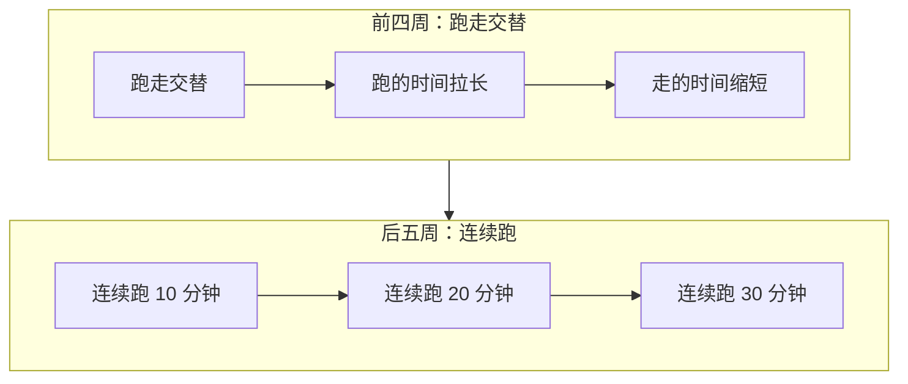

# 怎么开始跑步：从零到连续跑 30 分钟

没有运动基础、想开始跑步的人看这篇：先跑走交替、每周三次，用说话测试控制强度，九周左右能连续跑 30 分钟。最后附一份让 AI 帮你排计划的提示词。

## 一分钟看懂

- **频率**：每周跑三次，隔天跑，中间休息一天。[[c25k]]
- **强度**：==入门阶段别盯配速，盯能不能说完整句子==。能说话、但唱不了歌，就是合适的强度。[[club]]
- **目标**：九周后连续跑 30 分钟。[[c25k]]
- **够不够**：成年人每周至少要有 ++150 分钟++中等强度的身体活动，三次 30 分钟的跑步已经占了一大半。[[who]]

## 一、跑走交替的起步安排

### 从跑走交替起步的理由

新手最常见的放弃原因，是第一次就跑到喘不过气。跑一会儿、走一会儿，心肺和腿都有恢复的时间。[[c25k]]



### 九周的进阶安排



#### 一周的安排

| 天 | 安排 | 时长 |
|---|---|---|
| 周一 | 休息 | — |
| 周二 | 跑走交替 | 20–30 分钟 |
| 周三 | 休息或快走 | 20 分钟 |
| 周四 | 跑走交替 | 20–30 分钟 |
| 周五 | 休息 | — |
| 周六 | 跑走交替（可以约人一起） | 20–30 分钟 |
| 周日 | 休息 | — |

每周找一次和别人一起跑（跑团、朋友），比一个人更容易坚持下来。[[club]]

## 二、入门装备和配速

### 入门装备

| 装备 | 作用 | 怎么选 | 常见坑 | 提示词 |
|---|---|---|---|---|
| 跑鞋 | 吸收落地冲击，减轻小腿和膝盖的负担 | 下午去店里试穿，脚尖前留一指宽，原地小跑几步不磨脚 | 只看颜色和价格，买了偏硬、偏窄的竞速鞋 | `我刚开始跑步，每周跑三次，帮我列出试穿跑鞋时要检查的五件事` |
| 速干衣 | 排汗快，跑完不容易着凉 | 选化纤面料，天冷时穿两层薄的，不穿一件厚的 | 穿纯棉 T 恤，汗湿后贴在身上又重又冷 | `按今天的气温和风力，告诉我跑步该穿几层、各穿什么` |
| 记录工具 | 记下时间、距离和感受，每周复盘用 | 先用手机自带的健康 App 或免费跑步 App，坚持一个月再考虑买表 | 一开始就买贵的手表，结果只用来看时间 | `这是我这周三次跑步的时间、距离和感受，帮我看下周该加量还是保持` |

### 配速的定法

++配速++指跑一公里用的时间。新手不用定目标配速，用++说话测试++就够：边跑边说一句完整的话，说得出来但唱不了歌，强度就对了。[[club]]

::fig pace

> **我的看法**：材料没给具体配速，但按说话测试跑，多数新手会落在每公里 7–8 分钟。慢不是问题，能每周坚持三次才是。

## 三、AI 辅助的训练计划

### 人和 AI 的分工

```stages
## 定目标
目标：把「我想开始跑步」变成九周后能检查的目标。[[c25k]]
你：说清 AI 不知道的三件事：
- 现在能连续跑多久，哪怕只有一分钟
- 每周哪几天有空，每次多长时间
- 有没有旧伤
AI：把目标拆成每周三次的计划，每次写清跑几分钟、走几分钟、做几组。
产物：一张九周计划表。
## 每周复盘
目标：按身体的反应调整下周的量。
你：每次跑完记一句感受：喘不喘、哪里酸、哪里疼。
AI：读这一周的记录，判断下周加量、保持还是退回上一周。

```prompt
这是我这周三次跑步的记录：……请判断下周该加量、保持还是退回上一周，并说明理由。
```
常见坑：疼了还按计划加量。==膝盖或脚踝疼超过两天，先停跑==，不是咬牙坚持。
## 第一次跑完 30 分钟
目标：九周结束时连续跑 30 分钟。[[c25k]]
你：选一条熟悉、平坦的路线，按平时的强度跑，不追求速度。
AI：根据九周的记录，建议下一阶段的目标：继续加时长，还是去跑一次 5 公里计时。
下一步：跑完以后可以报名一次本地的 5 公里集体跑。
```

### 一段能直接用的提示词

```prompt
我刚开始跑步，现在能连续跑 2 分钟。请给我排一份 9 周的入门计划：
1. 每周 3 次，隔天跑。
2. 每次写清跑几分钟、走几分钟、一共几组。
3. 第 9 周能连续跑 30 分钟。
--- en ---
I'm new to running and can run for 2 minutes without stopping. Please draft a 9-week beginner plan:
1. Three runs a week, with a rest day in between.
2. For each run, list the minutes of running, minutes of walking, and the number of sets.
3. By week 9, I can run for 30 minutes without stopping.
```

## 四、跑步场地和跑团

### 可以参考的网站

```gallery
site-a
site-b
site-c
site-d
site-e
site-f
```

### 示范视频

::video 示例视频：本地 mp4 | 示例视频：外链封面卡
