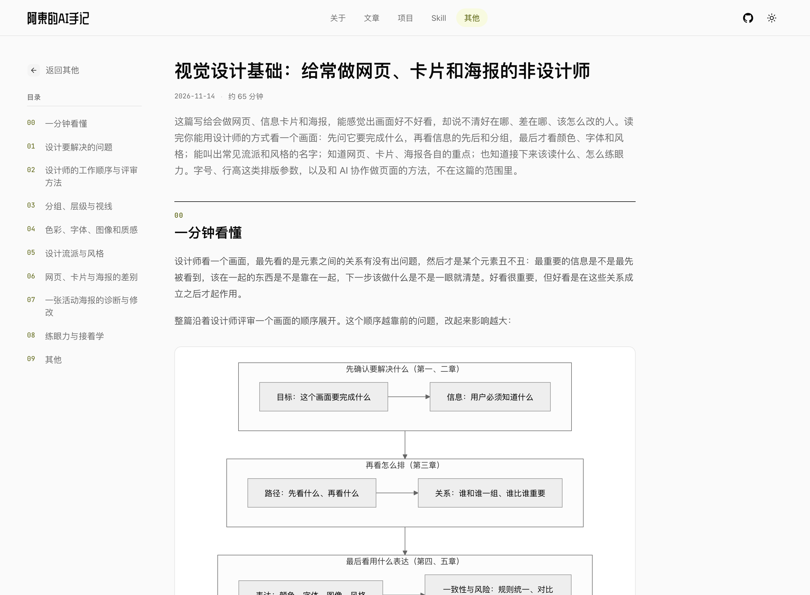

# 示范：6 份没读过的调研报告 → 一篇《视觉设计基础》学习指南

日期：2026-11-14 · 使用的 Skill：study-guide

## 给了什么

6 份 ChatGPT Deep Research 报告，合计约 9.4 万字，作者一份都还没读。它们是 [research-with-gpt 的例子](../../../research-with-gpt/examples/visual-design-basics/)跑出来的，分别讲设计思维和评审、构图版式、色彩字体图像、网页卡片海报的差别、学习材料、设计流派。报告原件和当初的调研方向见那个例子的 `output/` 目录。

读者是没系统学过设计、能感觉出画面好不好看却说不清原因的人。

## 怎么跑的

这一版是 `references/writing.md` 改成「通俗易懂、不缺专业性，把压缩的写开」之后，从 6 份原始报告重跑的：新开的 agent 只拿到报告和 skill，看不到上一版的正文和讨论。它按八步走，两次该停下给作者看的地方，这次没人在场，记下要给作者看的东西后自动继续：

1. **收料**：跑 `scripts/inventory.py` 列材料表（类型、字数、链接数、引用标记数）。5 份只有 ChatGPT 的内部引用标记、没有链接，要到第 3 步找回；
2. **定主线**：读完 6 份，拆成论点池，合并重复的（层级、分组、评语句式、诊断顺序、对比度标准），回原网页裁决冲突的（F 型是不是模板、60/30/10 算不算规则）。主线是「设计处理的是关系」，以设计师看画面的七层顺序（目标 → 信息 → 路径 → 关系 → 表达 → 一致性 → 风险）为骨架。样章选了外部作品最多的第五章「设计流派与风格」，暴露出两个问题：画廊会裁掉竖幅海报的下半部分（这一篇改成把作品图居中放进 16:10 的底图），抽引用的脚本把报告的术语表当成了来源列表（第 3 步找回链接后换成了真实标题）；
3. **补证据、收实物**：正文用到的引用按报告分 6 组，各派一个子 agent 回原网页核对。有出入的按原文改正文，找不到出处的撤掉引用。文中提到的网站、作品截图收进来；
4. **写全文**：8 章，加「一分钟看懂」、检查清单和「还不确定的」，约 2.8 万字；
5. **配图排版**：6 个自定义演示（层级对比、配色关系、字体样张、咖啡卡片两套方案、同一场讲座海报的三种风格、海报改版前后），4 张流程图，5 组网站和作品画廊；
6. **构建自检**：在 360 / 390 / 768 / 1440 四个宽度跑 `scripts/page_check.py`，都通过；
7. **作者看成品**：作者读完决定用这一版。发布前又派了一个独立 agent 按「一条引用对一句正文」抽查，补改了核对时标了「建议删」、正文却没改的 7 处引用，1 条坏链换成存档，3 条图注和正文对齐，修了一处海报文字溢出（记在 [output/核对.md](output/核对.md) 末节）；
8. **发布**：只传这一篇的目录，替换掉上一版。

## 交出了什么

- **线上页面**：https://antonailog.com/more/visual-design-basics/ ，首屏见 [shots/output.png](shots/output.png)。左栏目录，正文每个事实带可点开的来源，图表、字体样张、网站截图都在文中；
- **正文真源**：[output/guide.md](output/guide.md)。用的是 `references/components.md` 里的写法（`::fig` 等），在 GitHub 上直接看会有组件语法，完整效果以线上页面为准。第三方网站截图和自托管字体没有放进仓库；
- **提纲**：[output/提纲.md](output/提纲.md)，读者任务、叙事主线、目录、论点池的去向；
- **来源表**：[output/sources.json](output/sources.json)（309 条，正文引用了其中 177 条）、[output/sites.json](output/sites.json)（文中提到的网站和作品）；
- **核对记录**：[output/核对.md](output/核对.md)，哪些论断对上了原文、哪些和报告有出入、正文怎么改的。这份不上页面。

