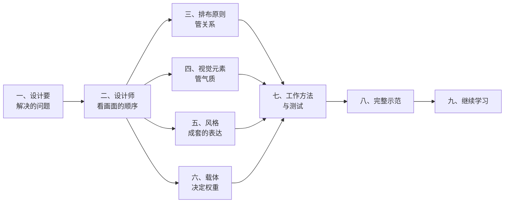
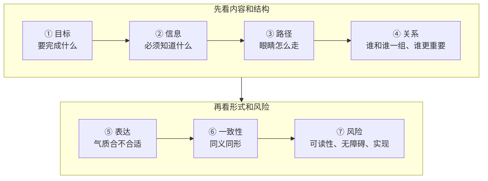
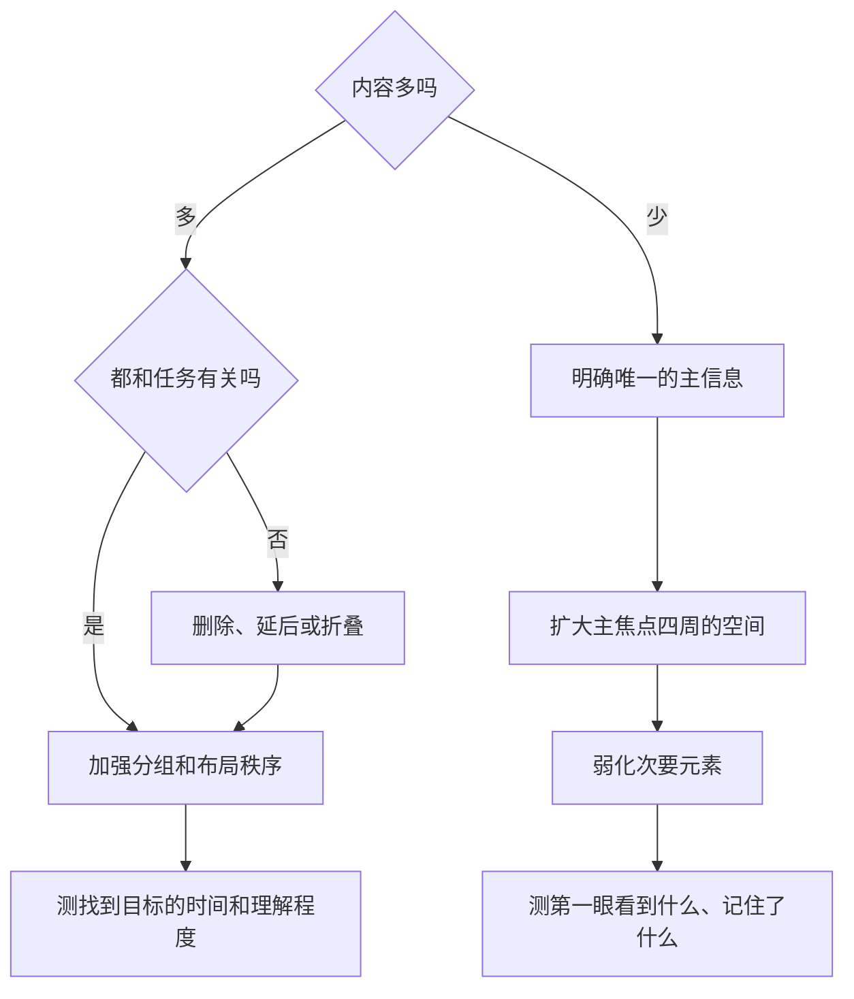
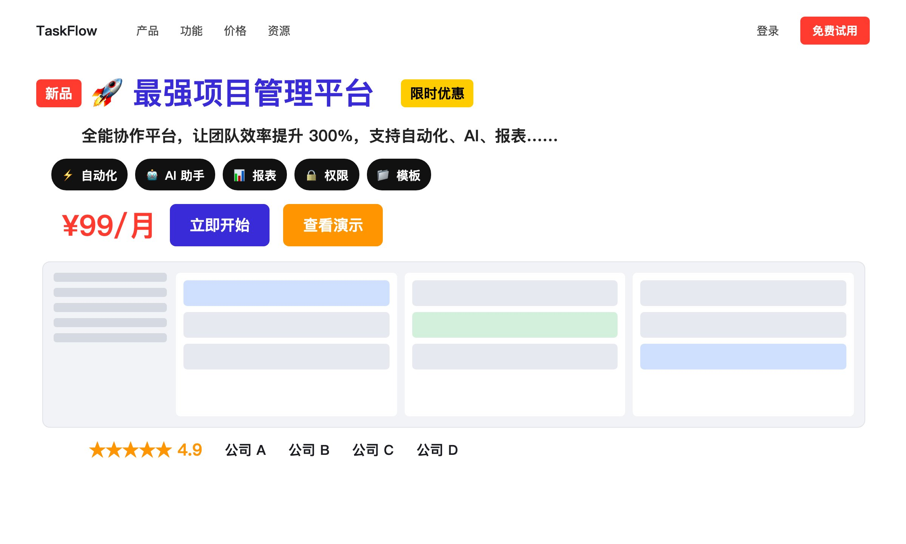
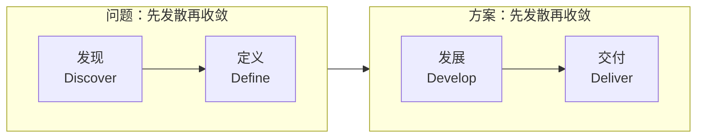
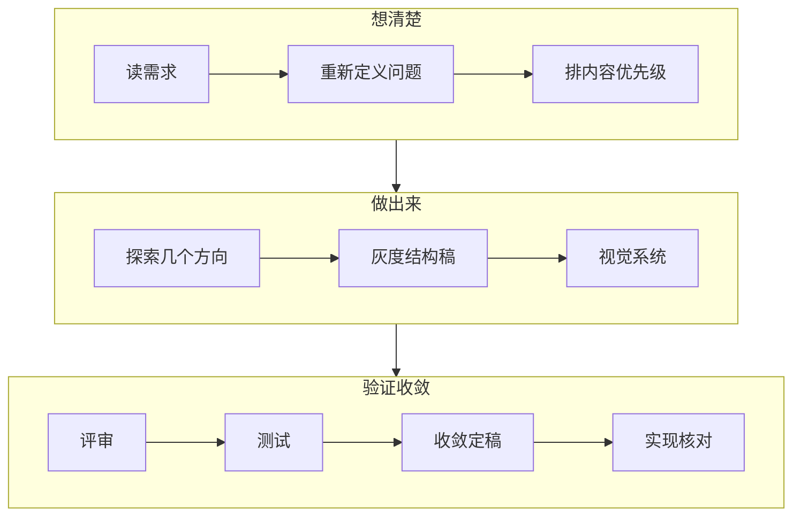
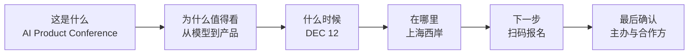
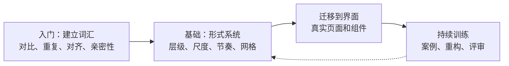

# 视觉设计入门：设计师怎么看、怎么排、怎么改

写给能感觉出画面好不好看、却说不清原因的人：设计在解决什么问题，设计师按什么顺序看一个画面，排布、色彩、字体、风格各管什么，以及怎样把一个网页、卡片或海报诊断清楚、改到位。

## 一分钟看懂

- **设计处理的是关系**：信息和看的人、信息和信息、信息和下一步行动之间的关系。「好看」是其中一个变量，评价一个画面要从它要完成的目标开始。
- **设计师看画面有固定的先后**：目标 → 信息 → 路径 → 关系 → 表达 → 一致性 → 风险。越靠前的问题影响越大，修改也越先做。
- **排布管关系，证据最强**：层级、分组、对齐、留白。==先改元素之间的关系，再考虑加装饰==。
- **视觉元素管气质，有硬标准也有经验**：色彩承担层级和语义，字体承担性格，图像承担内容，质感承担空间感。文字对比度有明确的数值标准。
- **风格是成套的表达方式**：知道风格的名字，才能准确描述想要的效果；它分历史运动、审美语言、界面手法三层。
- **载体决定权重**：网页要持续给方向，卡片要在一两秒里完成识别，海报要先在远处被认出来。
- **方法落在验证上**：评语写成「现象 + 对目标的影响 + 修改方向」，修改后用灰度、模糊、缩略图、去装饰这类低成本测试检查。



## 一、视觉设计要解决的问题

视觉传达和界面设计可以理解为有目的地组织信息、引导行为：让谁理解什么，信息以什么顺序被看到，让人形成什么判断或情绪，看完以后做什么。所以评价一个设计的标准，天然超出「看起来舒服」这一层。

### 设计处理的五组关系

意大利设计师 Massimo Vignelli 把设计分成三个方面：语义（semantics），这件东西到底要说什么、对谁说；句法（syntactics），视觉元素之间能否形成一致的关系；语用（pragmatics），最后的作品能不能被人理解。他的说法是，作品如果不能被理解，传播就失败了。[[vignelli]] 把它扩展到网页、卡片、海报，一个画面至少同时处理五组关系：

| 层次 | 设计师在问什么 | 常见失败 |
|---|---|---|
| 语义 | 这件东西要说什么、给谁看、为什么现在说 | 内容全部正确，却没有核心观点 |
| 结构 | 信息之间是什么关系，阅读顺序是什么 | 每块都很醒目，结果没有重点 |
| 表达 | 用什么视觉语言让这些关系被看出来 | 气质和主题冲突，信息密度失衡 |
| 使用 | 人能不能理解、找到、判断、行动 | 按钮看不到，状态不明确，入口难认 |
| 情境 | 在哪里、多远、什么设备上看到 | 电脑上漂亮，手机上扫不了；海报近看成立，远看失效 |

前三层对应 Vignelli 的三个方面，后两层是为数字界面和传播场景补的。

### 好看与好设计

「好看」本身有实际价值。人机交互研究反复发现，视觉美感会影响人对易用程度的判断，这被称为审美–可用性效应（aesthetic-usability effect）：Kurosu 和 Kashimura 1995 年的研究发现，人会把视觉吸引力投射到对易用性的评价上；Tractinsky 等人 2000 年的实验显示，感知到的美感和感知到的可用性高度相关。[[kurosu95,tractinsky00]] Nielsen Norman Group 在解释这个效应时同时提醒，评估设计要看用户实际做成了什么，不能只听用户说「这个页面很好看」。[[nng-aesthetic]] 换句话说，==感到顺眼，不能证明任务真的容易完成==。

### 几条经典设计主张

下面几条主张今天做网页、卡片、海报时仍然常被引用，但每条都有被误读的地方。

| 主张 | 提出者 | 核心论点 | 今天怎么用 |
|---|---|---|---|
| 形式追随功能 Form follows function | Louis Sullivan，1896 [[sullivan]] | 形式应当从事物的功能和内在性质中生长出来 | 读成「形式要有理由」。「功能」也包括品牌识别、情绪和信任，不只是按钮能不能点 |
| 语义、句法、语用 | Massimo Vignelli [[vignelli]] | 设计要同时解决意义、形式关系和理解结果 | 可以直接变成三个评审问题：说对了吗？结构一致吗？人看懂了吗？ |
| 少，但更好 Less, but better | Dieter Rams [[rams]] | 去掉不必要的部分，让设计服务用途、理解和长期价值 | 「少」是优先级纪律：减少没有目的的竞争。极简风格只是它的一种结果 |
| 给出可感知的线索 Signifiers | Don Norman [[norman]] | 用户需要能看见的线索，判断什么能操作、操作后会发生什么 | 对数字界面高度有效：一段文字能不能点，要靠样式、位置和状态让人看出来 |
| 设计的社会责任 | Victor Papanek，1971 [[papanek]] | 设计师要考虑真实需求，以及设计的社会和环境后果 | 目标正确不会自动带来好的形式，信息结构和传播质量仍要单独做好 |

Sullivan 的原话出自 1896 年讨论高层办公楼的文章，后来常被简化成「功能第一，装饰应该消失」；原文的意思是建筑的外在形式要表达它的功能和内在结构，强调的是形式和内在逻辑的一致。[[sullivan]]

### 「设计思维」的三种含义

「设计思维」这个词在业内至少有三种用法：[[kimbell11]]

- **设计师特有的认知方式**：Nigel Cross 1982 年提出「设计师的认知方式」（designerly ways of knowing），关注设计师怎样通过画草图、做模型、综合和迭代来认识问题。[[cross82]]
- **处理复杂开放问题的一般方法**：Richard Buchanan 1992 年把设计和「棘手问题」（wicked problems）联系起来，这类问题边界开放、会随解决过程变化。[[buchanan92]]
- **被组织和创新领域产品化的一套流程**：斯坦福 d.school 用共情、定义、构思、原型、测试五个模式教学，并说明可以从任一模式开始；IDEO 把它描述为整合人的需求、技术上的可能和商业上的成功。[[dschool,ideo]]

后一种用法最常见，通常写作 Design Thinking。它对视觉项目的帮助集中在三处：避免把客户给的方案（「首页要一个更大的横幅」）直接当成问题本身；把抽象判断变成可以测试的草图和原型；让产品、开发、运营和设计有共同的讨论语言。它解决不了的是视觉能力本身：会做访谈、画用户旅程、做原型，不等于会控制层级和构图。Lucy Kimbell 的综述也提醒，把设计思维当成一套通用方法，容易忽略设计实践的具体情境。[[kimbell11]]

==Design Thinking 帮你决定解决什么问题、怎么探索和验证；视觉设计能力决定怎样把答案变成清楚、有力、合适的形式。==

## 二、设计师看画面的顺序

评审一个设计最容易失败的原因，是所有人同时在评论不同层面的事：有人谈商业目标，有人谈信息结构，有人谈颜色，有人谈个人喜好。Nielsen Norman Group 把设计评审（design critique）定义为分析设计是否达到了目标，目的是改进它；Google 的设计评审实践也要求先确认要解决的问题，再讨论方案和实现。[[nng-critique,google-review]] 按同样的思路，可以把看一个画面的过程排成七层。

### 七层观察顺序



| 层 | 先问什么 | 看到问题后通常怎么改 |
|---|---|---|
| 目标 | 这个画面要完成什么 | 改需求，或重新确定重点 |
| 信息 | 看的人必须知道什么 | 删、并、重排内容 |
| 路径 | 眼睛或操作应该怎么走 | 调整首屏、入口、按钮、顺序 |
| 关系 | 哪些属于一组，谁比谁重要 | 重建层级、分组和空间关系 |
| 表达 | 气质是否适合主题和受众 | 调整视觉语言 |
| 一致性 | 同一种意义是否用同一种形式 | 收敛样式和组件规则 |
| 风险 | 可读性、无障碍、实现、文化含义有没有问题 | 修正规则，或增加验证 |

这个顺序的实际好处是：==越靠前的问题，修改成本和影响范围通常越大==。目标没定清楚时讨论按钮圆角，时间会花在一个随时可能推翻的方向上。

网页还要在视觉之后多看一层行为：状态 → 操作 → 反馈 → 容错 → 无障碍。Nielsen 的十条可用性启发式里，系统状态可见、一致性和标准、错误预防与恢复都属于这一层；WCAG 2.2 还要求键盘焦点可见、不被遮挡，可点击目标通常至少 24×24 CSS 像素。[[nng-heuristics,wcag22-new]] 这些问题只看截图发现不了。

### 把感受翻译成关系

评审会上，「我觉得不够好看」的信息量很低。设计师的习惯是：先看到关系失衡，其次才是某个元素「丑」。把感受翻译成目标和关系，问题才能讨论、才能改：

| 模糊的说法 | 可以讨论的说法 |
|---|---|
| 感觉有点乱 | 有四个元素用了差不多强度的强调，第一眼没有明确的落点 |
| 太空了 | 主信息和辅助信息之间缺一个中间层级，关键区域出现了断裂 |
| 不够高级 | 品牌想表达克制和专业，但高饱和装饰、多个视觉中心和密集边框在同时抢注意 |
| 按钮不明显 | 主按钮和次要信息的显著程度接近，扫读时分不出首要动作 |
| 看起来很普通 | 结构清楚，但缺少表达活动独特性的视觉主张，识别主要靠文字 |

### 评语的三段式

有效的评语通常由三部分组成：==观察到的现象 + 对目标的影响 + 修改方向==。例如：

> 报名按钮和主办方标志的视觉分量接近。这次的目标是提高报名，这会让主动作在扫读时被削弱。建议先让按钮成为第二视觉中心，再处理合作方信息。

这比「按钮再大一点」有效，因为它说明了为什么要改，又给设计师留了具体解法的空间。其他常用的说法：

> 我第一眼读到的是背景图，活动名称落到了第二层。如果首要目标是让人认出这是什么活动，这两者的顺序需要交换。

> 这两组信息在逻辑上属于同一个报名动作，现在被放在两个区域，用户要自己把它们联系起来。

> 这个装饰元素很醒目，但不承担信息、品牌或路径的作用，可以先拿掉，看核心结构是否更清楚。

写成书面诊断时，可以展开成六项：问题位置、观察到的现象、被破坏的原则、用户可能付出的代价、具体改法、用什么指标验证。例如：「首屏的价格、促销标签、四个功能徽章和两个按钮都是高对比，主按钮没有独占的焦点。保留一个高权重按钮，降低徽章和次要操作的显著程度。验证主按钮被第一次看到的时间、任务完成时间和点击比例。」

## 三、排布的基本原则

排布（layout）要让看的人用最少的搜索，认出四件事：哪些东西属于一组，哪个最重要，接下来该看哪里，该做什么。网格、留白、对齐都是手段，服务的目标是层级和分组。所以改排布的顺序通常是：先改分组和层级，再改对齐、留白和视线路径，最后才处理节奏和细节。这个先后是按修改的影响范围排的实务顺序，心理学并没有一份公认的「设计原则排行榜」。

### 原则一览与修改先后

下表按修改的先后排列，「页面症状」是诊断时最先看到的样子，最后一列说明每条原则背后的依据是什么性质：有的有感知实验支撑，有的是设计系统和行业实践的共识。

| 原则 | 页面症状 | 常见改法 | 依据 |
|---|---|---|---|
| 层级 Hierarchy | 标题、卖点、按钮、说明一样抢眼 | 先把信息分成一、二、三级，再让视觉差异对上信息差异 | 眼动研究：先看哪里由画面的显著程度、看的人的任务和界面类型共同决定 [[ueyes]] |
| 分组 Grouping | 标题离自己的正文，和离下一块内容一样近 | 组内间距小，组间间距明显更大；必要时加容器 | 格式塔实验：接近、共同区域都有经典实验和综述支撑 [[wagemans12,palmer92]] |
| 对比 Contrast | 每块都大、粗、亮、带底色 | 把强对比留给最重要的一两个元素，其余降一档 | 同上，显著性研究 [[ueyes]] |
| 对齐 Alignment | 卡片、文字、按钮各有一条差几像素的起始线 | 减少可见的起始线，相关内容共用一条轴线 | 2024 年仪表盘眼动实验：布局越有秩序，复杂界面里的搜索表现越好 [[dash24]] |
| 留白 Whitespace | 各处空隙差不多，局部很挤 | 先用留白表达分组，再考虑边框和底色 | 实验支持「留白表达分组」，不支持「越空越好」 [[wagemans12]] |
| 视觉重量 Visual weight | 一个大装饰图形抢走标题的注意 | 调整面积、对比、孤立程度和位置 | 设计实践里的说法，没有可靠的计算公式 |
| 一致性 Consistency | 同级卡片的标题、间距、结构各不相同 | 同级元素共用一套组件规则 | 设计系统和行业规范的共识 |
| 网格 Grid | 到处是任意宽度和任意间距 | 定好列数、沟槽、边距和断点 | 作为实现方法很成熟；「用了网格就更美」缺少实验 [[carbon]] |

修排布最常见的误区，是用「加东西」去解决关系问题：层级不清就再加颜色、阴影和字号，结果多了几个互相竞争的焦点；分组不清就给每块套一张卡片，结果页面上多出几十条边框；留白不够就统一加大内边距，组内和组间的距离一起变大，关系仍然模糊。==先改元素之间的关系，再考虑加装饰==，因为人判断「哪些属于一组」，依据的是元素之间的相对距离和区域，不是单个元素有多醒目。[[wagemans12]]

### 层级与视觉重量

视觉层级是两种顺序对得上：内容上谁更重要，和看上去谁更先被看到。设计师先定前一种，再用尺寸、明暗对比、位置、四周留白这些手段，让后一种跟着走。

层级分三档就够用，不必给每个元素单独排一个名次：

- **一级**：回答「这是什么、为什么值得看、下一步做什么」。产品页里通常是产品名、核心价值、主视觉和主要按钮。
- **二级**：给出理由，例如三项核心能力、价格、关键数字。
- **三级**：证明和细节，例如技术说明、脚注、次要链接。

一个元素有多「重」，取决于面积、和周围的对比、所在位置、四周空出多少，以及它和看的人当下任务有多相关。这些因素没有通用的权重系数：UEyes 研究用真实眼动仪记录了 62 名参与者看 1,980 张截图的注视数据，截图分网页、桌面软件、手机界面、海报四类，结果四类画面的注视位置和扫视方向各有不同的规律。[[ueyes]]

引导视线时，下面四种做法比「把重点再放大」更有效：

1. **先减少竞争，再加强焦点**。五个元素同样醒目时，继续放大按钮收效很小，先把其余四个降下去。
2. **用空间顺序串起阅读链**。产品名和核心价值紧挨着，其后是证明，按钮和价格放成一个局部组。
3. **同级信息分量相近**。三个同级功能点如果一个很大、两个很小，看的人会以为它们不是同一级。
4. **给关键元素留出孤立的空间**。四周空出来的元素自然更显眼，比加装饰更不容易让画面变复杂。

### 分组与格式塔规律

格式塔（Gestalt）心理学研究人怎样把零散的元素看成整体。它对排布最有用的地方，是把「看起来属于一起」变成可以操作的条件。百年综述的结论是：这些分组现象有大量实验支撑，但早期「视觉系统在平面图像上自动完成分组」的简单说法已经被修正，深度、表面属性和更高层的认知都会影响分组。[[wagemans12]]

| 规律 | 对排布的意义 | 证据情况 |
|---|---|---|
| 接近 Proximity | 距离近的元素更容易被看成一组 | 经典实验和现代实验都支持 [[wagemans12]] |
| 相似 Similarity | 形状、颜色、样式相似的元素容易被归为一类 | 支持充分，但会和任务、位置等因素一起起作用 [[wagemans12]] |
| 共同区域 Common region | 同一个容器、同一块底色里的元素被看成一组 | Palmer 1992 年的实验确立它是一条独立于接近、闭合的分组规律 [[palmer92]] |
| 连通 Connectedness | 用线或连续色块连起来的元素关系最强 | 有系统的实验和理论 [[wagemans12]] |
| 图形与背景 Figure-ground | 看的人要分得清哪块是对象、哪块是背景 | 长期实验支持，具体线索的作用随情境变化 [[wagemans12]] |
| 连续与闭合 Continuity, closure | 连续的轴线被看成一个结构；不完整的轮廓也能被补成整体 | 现象确实存在，直接搬成界面规则要谨慎 [[wagemans12]] |

::fig grouping

落到页面上，最常用的是一条：==组与组之间的距离，要明显大于组内元素之间的距离==。具体数值属于设计系统的选择，例如组内 8 到 16 像素、组间 32 到 48 像素可以作为起点，关键是两者的比例拉得开。

### 对齐与网格

网格（grid）是一套规定位置、宽度和间距的坐标系。网页上常见四种：列网格管横向结构；模数网格同时划分横向和纵向，适合卡片和数据面板；基线网格让不同模块的文字行共用垂直节奏；响应式网格随屏幕宽度改变列数、边距和每个元素跨几列。

成熟的设计系统会把网格写成明确的规则。IBM 的 Carbon 设计系统以 8 像素为基本单元，列、行、外边距、内边距都取它的倍数；小屏 4 列、中屏 8 列、大屏 16 列，并要求页面上有清楚可见的对齐线，横向和纵向对齐同样重要。[[carbon]] 8 像素是这套系统的选择，不是经过实验验证的审美定律。


打破网格可以制造焦点：产品主图跨出栏外半个沟槽，一个大数字横跨两栏，海报标题故意偏离主轴。前提是==局部破格，整体仍有参考系==。如果标题、图片、按钮、正文、标签各用各的轴线，破格就失去了对比的对象，看上去只是乱。

### 留白与信息密度

判断留白够不够，看的是元素之间的关系，不只看空白面积占多少。2024 年 Lewis 和 Sauro 编制的网站杂乱感问卷，把杂乱分成两类：内容杂乱，指无关的广告、视频这类不该出现的内容；设计杂乱，指文字太多、布局不合逻辑、视觉噪声太多。[[pwcq-blog]] 这项研究基于 57 个网站的 1,380 条评价数据，两类杂乱合起来解释了整体杂乱感的 44%。[[pwcq]] 这个区分对修改很实用：内容杂乱要删减或延后，设计杂乱要重组、分组、提高布局的规律性。

内容多的页面和内容少的海报，处理目标不同：

- **高密度的内容页**要保住信息量，同时降低局部的搜索成本：稳定的列、清楚的分组、重复的结构、组内紧组间松。2024 年一项仪表盘眼动实验发现，在界面复杂的条件下，布局秩序高的版本搜索表现明显更好。[[dash24]]
- **低密度的海报或营销首屏**通常只有一两个任务，均匀铺开的元素会稀释主焦点，可以用更大的空白、更明显的不对称和更少的视觉锚点。UEyes 的数据显示海报和网页的注视分布有系统差异，网页的密度策略不能原样搬到海报上。[[ueyes]]



### 视线路径与 F 型、Z 型的证据

F 型扫描来自 Nielsen Norman Group 的网页眼动研究，常被当成网页布局的模板。2017 年的复盘文章说明了它的适用条件：页面是几乎没有格式的大段文字（没有加粗、列表、小标题），用户想尽快找到信息，并且没兴趣逐字读，三个条件同时成立时才出现 F 型；缺少明确的视觉提示时，F 型就成了默认的扫读方式。[[nng-f]] 同一篇文章还列出了另外五种模式：只看标题和小标题的千层饼型（layer-cake）、跳着找特定词或数字的斑点型（spotted）、眼睛停在一处而页面滚动的标记型（marking）、跳过列表项开头重复词语的绕行型（bypassing），以及几乎看遍全页的投入型（commitment）。[[nng-f]] ==F 型描述的是缺少结构时的阅读结果，拿它当布局模板是误用==。

Z 型在平面和营销设计里很常见，适合解释元素很少、左右两端有明确锚点的首屏或海报，但它没有与 F 型同等规模的眼动证据。UEyes 的四类界面各有不同的注视规律，也说明「眼睛一定按某个字母走」这类口诀靠不住。[[ueyes]] 更稳妥的做法是直接测：给看的人一个任务，看目标元素是不是按你希望的顺序被找到。

```gallery
nng-f
ueyes
```

### 改版示范：一个产品首屏

下面是一个虚构的项目管理产品首屏。初稿把能放的东西都放进了第一屏：新品标签、标题、限时优惠、一段说明、五个功能徽章、价格、两个按钮、产品截图、评分和客户标志，标题、价格、标签和按钮都用了高对比处理。



它有三个问题：

- **层级竞争**：新品标签、标题、限时优惠、价格和两个按钮都很醒目，第一眼没有唯一的落点。
- **分组模糊**：五个功能徽章夹在价值说明和价格之间，和购买区没有明显的空间分界。
- **轴线太多**：标题、说明、徽章、价格、截图、评分各有各的起始线。

改版分五步：

1. **重排信息等级**。一级只留产品类别、核心价值、主按钮和产品截图；价格和「查看演示」降到二级；功能点和客户证明移到首屏底部或下一屏。
2. **重建分组**。类别、标题、说明组成「理解组」，两个按钮组成「行动组」，截图单独成为视觉对象；组内间距小，组间间距大。
3. **给页面一个稳定的网格**。12 列，文字占左侧 5 列，截图占右侧 6 列；窄屏时改成单列，截图放到文字下面。
4. **控制视觉重量**。主按钮保留最高的显著性，「查看演示」降成文字链接；截图面积可以大，因为它是产品本身的证明，四周不再堆高对比的徽章。
5. **把证明放到第二停留区**。客户标志和使用数字放在首屏下方，用一条细线和较大的上间距隔开，内部保持紧凑。


改版是否成功，要用任务来验证，不能只问「是不是好看了」：

| 维度 | 修改前 | 修改后 | 怎么验证 |
|---|---|---|---|
| 层级 | 约五个高权重焦点 | 一个主信息组、一个主按钮 | 看 5 秒后问「这是什么产品、下一步做什么」 |
| 分组 | 功能、价格、按钮混在一起 | 理解、行动、产品截图、证明四组 | 请人把首屏内容分组，看分法是否一致 |
| 对齐 | 多条随意的轴线 | 左文右图，共用 12 列网格 | 叠上网格检查；不同宽度截图对比 |
| 密度 | 首屏承载全部信息 | 次要功能延后 | 任务完成时间、理解是否准确 |
| 视线路径 | 多点竞争 | 核心价值 → 按钮 → 截图 → 证明 | 记录目标元素被第一次看到的先后 |

评估改版时，「看的次数变多」不能单独当成功指标。反复注视一个地方，既可能是感兴趣，也可能是没看懂、找不到。把它和任务是否完成、用了多久放在一起看，结论才可靠。

## 四、视觉元素的选择与搭配

排布决定元素之间的关系，视觉元素决定每个元素长什么样。可以把搭配压缩成一条决策链：先确定信息的先后和想要的情绪，再选一种主导的视觉语言；用色彩承担层级和语义，用字体承担性格，用图像承担内容，用质感承担空间感；最后用可读性和一致性检查收尾。

### 色相、明度与饱和度

设计软件和 CSS 里最常用的调色方式是 HSV（或 HSB、HSL）：色相（Hue）、饱和度（Saturation）、明度（Value）。这三个维度管的事不同：

| 维度 | 肉眼看到的变化 | 在画面里起什么作用 | 初学者常见的错 |
|---|---|---|---|
| 色相 | 红、黄、绿、蓝，「是哪种颜色」 | 区分类别、建立品牌识别、制造冷暖 | 同时用太多色相，每个颜色都在抢注意 |
| 饱和度 | 鲜艳的程度 | 高饱和容易成为焦点，低饱和适合大面积背景 | 整页都用高饱和色 |
| 明度 | 看起来更亮还是更暗 | 最直接地影响层级和可读性 | 只换色相、不拉开明度 |

HSV 方便调色，但它不是按人眼感受均匀划分的：同样把数值加 10，不同色相上人眼看到的变化并不一样。[[oklab]] 所以用 HSV 初选，用对比度公式或感知均匀的色彩空间（如 OKLCH）验证更可靠。包豪斯的色彩教师 Johannes Itten 把色彩训练建立在七种对比上，包括色相、明暗、冷暖、互补、饱和度和面积等（不同资料对第七种的列法略有差别）。[[itten,getty-itten]] 这个框架今天仍然有用，它提醒人：颜色之间的差别远不止色相不同。

常见的配色关系有七种。==色轮只决定颜色之间「搭不搭」，决定不了文字看不看得清==：蓝和橙是互补色，不代表橙色小字放在白底上可读，可读性看的是明度差。

::fig palettes

### 颜色角色与对比度

「60/30/10」常被当成配色规则：底色约 60%，主色约 30%，强调色约 10%。它适合当起步模板，界面里更好用的是按颜色的角色分配。Google 的 Material 3 按用途给颜色命名角色，例如 primary、surface，并让每个底色配一个前景色，primary 上的文字用 on-primary，成对使用以保证对比度。[[m3-roles]] 这样设计稿里的颜色能和 CSS 变量一一对应，深色和浅色主题也能成对切换。

文字和背景的对比度有明确的数值标准。WCAG 2.2 的要求是：[[wcag-contrast,wcag-nontext]]

| 内容 | 等级 | 最低对比度 |
|---|---|---|
| 正文 | AA | 4.5:1 |
| 大字（约 24px，或约 18.5px 粗体） | AA | 3:1 |
| 正文 | AAA | 7:1 |
| 大字 | AAA | 4.5:1 |
| 重要图标、图形、控件边框 | AA | 3:1 |
| 标志和品牌名里的文字 | — | 不作要求 |

另一条同样重要：颜色不能是传达信息的唯一方式。表单出错时只把输入框从灰变红，色弱的用户可能看不出来，要同时加图标、边框变化或文字提示。[[wcag-color]]

::fig contrast

品牌色达不到对比要求时，常见的调整顺序是：保留色相，先调明度；仍然不够，再调饱和度；再不行，单独定义一个用于文字的品牌色变体；最后才放弃这个组合。比如铜橙色 `#C85A2E` 放在白底上只有 4.24:1，做正文不够，做大标题、色块或插画没有问题。

==把截图转成灰度，是检查层级是否只靠颜色撑着的最快办法==。

::fig grayscale

### 字号层级与文字角色

页面里的文字可以按「它负责什么」分成角色：展示标题、各级标题、正文、说明、按钮。每个角色固定一组字号、行高、字重，同一用途反复复用，比每个组件临时定数字更容易保持一致。[[gf-hierarchy]]

几条和字号有关的事实：

- **同样的字号，不同字体看起来大小不同**。字号给的是尺度，字形在尺度里占多大由字体设计决定。英文看小写字母主体的高度（x-height），中文看方形字框里笔画有多饱满。换了字体、CSS 数字没动，页面像被放大了，原因就在这里。[[gf-xheight]]
- **正文字号有参考下限**。美国政府设计系统 USWDS 建议多数正文至少相当于 16px；IBM Carbon 的紧凑正文是 14px 配 18px 行高，长一点的正文是 14px 配 20px 行高。两者的前提是各自的字体和使用场景，不是「14 和 16 哪个对」的比赛。[[uswds-type,carbon-type]]
- **行长要控制**。每行太长，读到行尾很难找到下一行的开头；太短又频繁换行。一个固定宽度的容器，换了字号或字体，每行实际容纳的字数也会变。[[gf-measure]]
- **视觉层级和 HTML 标题层级分开**。一段文字需要 24px，不代表它必须用某个 h 标签：h1 到 h6 表达的是文档结构，辅助技术靠它导航；字号交给样式类。[[wai-headings]]

::fig typescale

### 字体的类型与常用字体

描述字体最常用的是两个独立的维度：笔画末端有没有装饰性的收笔（衬线 serif 还是无衬线 sans-serif），以及每个字符是否等宽（等宽 monospace 还是比例宽）。一款字体可以既是无衬线又是等宽，例如 JetBrains Mono。中文常说的黑体大致对应无衬线，宋体大致对应衬线，但中西文的分类并不完全对等。==黑体是一类字形，粗体是一种粗细==，两者不是一回事。[[w3c-fonts]]

在无衬线里，还可以按字形骨架再分：中性的新怪诞体（neo-grotesque）字形规整、性格收敛；几何体（geometric）以圆和直线为骨架，更圆、更开阔；带个性的怪诞体（grotesque）保留了一些奇特的细节。

用 AI 写网页时，最常出现的是下面几类字体，原因大多是「默认值」：

- **系统字体栈**：Tailwind CSS 默认的 `font-sans` 是一串系统字体，不加载任何字体文件，访客在 Mac 上看到的是苹果的系统字体，在 Windows 上是 Segoe UI。[[tailwind-font]]
- **Geist**：Vercel 2023 年发布的开源字体。用 Next.js 官方脚手架 create-next-app 新建项目时，默认就配好了 Geist 和 Geist Mono；2024 年 5 月以前，这个默认字体是 Inter。shadcn/ui 的 Next.js 模板也用 Geist。[[nextjs-geist,geist,shadcn]]
- **Inter**：Rasmus Andersson 2017 年公开发布的开源字体，为屏幕界面设计，x-height 大、小字号下清楚。HTTP Archive 的 2024 年网页统计里，Inter 约占全部网站的 1%，报告把它的增长归因于各种框架和组件库。[[inter,web-almanac]]

正因为太常见，这些字体也成了「AI 味」的一部分。Anthropic 2025 年 11 月发布的官方前端设计 skill 初版，就要求模型避开 Inter、Roboto、Arial 和系统字体这类泛滥的字体，也不要在多次生成中都收敛到 Space Grotesk 这类常见选择；后来的版本不再点名具体字体。[[anthropic-fd]] 这些字体本身没有问题，问题在于只用默认值，页面就很难有自己的识别度。Fontshare 上的 Satoshi、General Sans 也常出现在独立开发者的产品页上，它们可以免费商用，但不是开源许可，使用前要看许可条款。[[fontshare]]

下面的样张窗口把常见字体按类型排开，每款都是真实字体文件渲染的，可以看大标题、字重、正文、界面卡片和数字；切到「同句对照」可以把所有字体放在同一句话上比较。

::fig fonts

挑字体时有一条很稳的结构：==一种辨识度高的展示字体，配一种克制的功能字体==。展示字体只用在活动名、大数字、短口号上，日期、地址、按钮、说明回到稳定的字体。Pentagram 为纽约文化机构 92NY 做的品牌就是这样分工：和字体设计师合作重做的衬线体 92NY Didi 负责品牌气质，无衬线体 Theinhardt 负责日常信息。[[pentagram-92ny]] 展示字体如果太抢，可以只用在标志和活动名上，或者只用它的数字和字母。

字体的气质并不完全是主观感受。Wichita 州立大学的一项问卷研究让参与者用 15 对形容词评价 20 种字体，人格评价按字体家族（衬线、无衬线、等宽、手写等）明显分开；同一团队的后续实验发现，字体和文档类型越不匹配，读者对文档的评价越负面。[[font-personality,font-congruence]] 中文字体的气质也可以从结构上观察：

| 结构特征 | 常见的气质 | 适合 |
|---|---|---|
| 中性黑体（思源黑体、苹方） | 现代、中立 | 界面、正文、信息密集的页面 |
| 高对比宋体 | 优雅、编辑感、文化感 | 海报标题、展览、出版 |
| 低对比宋体（思源宋体） | 稳重、书卷气 | 长文正文、文化和食品品牌 |
| 圆体 | 亲和、轻松 | 儿童、消费、社交产品 |
| 楷体、手写感（霞鹜文楷） | 手作、人情味、文艺 | 咖啡、餐饮、文化活动 |
| 窄长展示黑体（得意黑） | 强势、年轻、有速度感 | 海报、活动标题 |

### 照片、插画、图标与图形的分工

四种图像最好按「它负责什么」来分，不按哪个更好看：

| 类型 | 最擅长传达 | 典型用途 | 风险 |
|---|---|---|---|
| 照片 | 真实感、产品质感、人物情绪、现场氛围 | 食品、旅行、人物、活动 | 来源混杂会立刻破坏统一 |
| 插画 | 概念、比喻、友好感、拍不到的场景 | 教育、品牌故事、空状态 | 风格差异比照片更明显 |
| 图标 | 功能、动作、快速扫读 | 导航、标签、元信息 | 含义不明确时容易误读 |
| 抽象图形 | 节奏、品牌识别、填充空间 | 背景、系列视觉、品牌系统 | 容易变成没有意义的装饰 |

美国政府设计系统 USWDS 明确区分了图标和插画：图标承担能快速认出的功能含义，要解释概念或讲故事就用插画；不够通用的图标要配文字。[[uswds-icons]] 让一套图像风格统一，可以把约束写成清单，所有素材都按它检查：照片统一冷暖色调、对比度、阴影软硬、镜头距离和背景复杂度；插画统一线宽、圆角、填色数量、透视和人物比例；图标尽量直接用一套成熟的图标库，不从几个库拼凑。IBM Carbon 就要求产品里的图标尺寸一致，并和文字保持固定的比例。[[carbon-icons]] 最后可以把所有素材缩到 25% 看一眼，是否还像同一套。

### 质感预算

质感显得高级，通常来自「有原因的细节」：阴影说明前后层级，颗粒模拟印刷或胶片，纹理提示真实材质，渐变暗示光的方向。显得廉价的常见原因是叠加：每张卡片同时有阴影、描边、玻璃、渐变和发光，几处阴影暗示的光源方向还互相矛盾。

可以给每个画面定一个「质感预算」：一张普通卡片只选一种主要质感，最多再配一种很弱的辅助效果。苹果的界面规范把材质定义为建立深度、层级和前后关系的手段，并建议克制使用；IBM Carbon 的普通卡片和页面处在同一平面、不加阴影，弹窗、浮层、对话框这类真正浮起来的元素才有高度。[[apple-materials,carbon-elevation]] ==加阴影之前先问：它真的离开了页面吗？==

::fig texture

### 示例：咖啡活动卡片的两套方案

把这一章的元素放到一个具体任务里：一家咖啡店的周末手冲品鉴会，卡片要发在社交平台和门店屏幕上，信息顺序是品牌 → 活动名 → 日期地点 → 行动。同样的内容可以走两个方向：现代极简适合精品手冲、线上订阅、摄影质量稳定的品牌；复古手工适合社区店、周末市集、强调手作和地方感的场景。

::fig coffee

做完可以逐条自查：缩成手机缩略图后第一眼看到什么；转成灰度后层级还在不在；强调色是不是只用在少数重要信息上；正文有没有低于 4.5:1；展示字体有没有侵入日期、地点、按钮；阴影是否对应真实的层级；拿掉所有纹理后，设计是否依然成立。

真实的品牌项目里，这些原则可以看得更清楚。Pentagram 为 Peach Coffee Roasters 做品牌时特意限制了桃色的用量，因为消费者曾误以为这家店卖桃味咖啡；为 Ben's Best Blnz 做品牌时有意避开了大麻行业惯用的绿色和叶子图案。[[pentagram-peach,pentagram-bens]]

```gallery
pentagram-peach
pentagram-92ny
pentagram-bens
pentagram-bottega
```

## 五、设计流派与风格

「高级一点」「有设计感」「像苹果」这类描述，设计师和 AI 都很难照着执行。风格名称是一套共享的词汇：说出一个风格，就同时说出了一组版式、字体、配色、图形上的约定。

### 风格的三层地图

风格词汇分属三个层级，混在一起用就会把「玻璃拟态」和「包豪斯」当成同一级的概念：

| 层级 | 它决定什么 | 典型名词 | 用来决定 |
|---|---|---|---|
| 历史运动与思想 | 为什么这样设计 | 构成主义、包豪斯、现代主义、瑞士国际主义、后现代主义 | 秩序观、对功能的态度、表达的立场 |
| 审美语言 | 画面给人的气质 | 极简、装饰艺术、粗野主义、表现主义 | 形式、情绪和文化联想 |
| 界面表现手法 | 元素怎样出现和互动 | 扁平化、拟物、玻璃拟态、卡片、Bento 网格 | 数字界面里具体怎么画 |

所以同一个界面可以同时是「瑞士式排版」「极简审美」「Material 组件」加「玻璃导航栏」，这几个词描述的是不同维度。准确描述一个想要的效果，最好同时说出这几层，例如：「国际主义的网格和信息层级，加一点后现代的超大标题和不对称构图，颜色只用黑白加一个高饱和强调色，按钮保持 Material 式的明确提示。」

### 影响最大的五个历史运动

| 运动 | 时间与背景 | 核心主张 | 怎么认出来 | 代表作 |
|---|---|---|---|---|
| 构成主义 | 1917 年俄国革命后兴起 | 设计要有行动性和社会功能，艺术家把自己重新定位成「工程师、宣传者、建造者」[[moma-constructivism]] | 对角线、红黑白、粗无衬线、文字当图形用 | El Lissitzky 设计的诗集《For the Voice》，1923 [[artic-lissitzky]] |
| 包豪斯 | 1919–1933 年的德国设计学校，想统一艺术、工艺和工业生产 | 功能优先、系统化 | 基本几何形、红黄蓝、几何无衬线体 | Herbert Bayer 为 1923 年包豪斯展览做的海报设计稿 [[harvard-bayer]] |
| 装饰艺术 Art Deco | 1920–1930 年代，1925 年巴黎博览会是关键节点 [[va-artdeco]] | 从有机装饰转向几何造型，兼顾奢华和功能 | 中轴对称、放射线、阶梯形、黑金配色 | A. M. Cassandre《Normandie》海报，1935 [[vam-cassandre]] |
| 瑞士国际主义 | 1940–1950 年代起源于瑞士，随后走向国际 [[cooper-swiss]] | 客观、清楚地组织信息 | 严格网格、左对齐、不对称、中性无衬线体、摄影 | Josef Müller-Brockmann 为苏黎世音乐厅做的系列音乐会海报 [[vam-mb]] |
| 后现代与新浪潮 | 1970–1990 年代，质疑现代主义的普遍规则 [[va-postmodern]] | 戏仿、历史引用、装饰、混杂 | 打破网格、叠层、多字体混排、高饱和荧光色 | April Greiman《Does It Make Sense?》，1986，用 Macintosh 拼贴图像和文字 [[greiman]] |

::fig movements

瑞士国际主义是今天网页最深层的默认语法之一：Bootstrap、CSS Grid、设计系统、新闻网站的大量结构原则，都继承了网格和现代主义的信息秩序。这种影响主要在组织逻辑上，并不要求视觉上照搬 1950 年代的海报。包豪斯对界面的影响也类似，更多体现在组件、设计变量和模块化网格这类系统化思维上，不意味着页面要用红黄蓝和圆形。

```gallery
artic-lissitzky
harvard-bayer
vam-cassandre
vam-mb
greiman
```

### 2016–2026 年的网页和界面风格

这十年界面风格变来变去，真正延续下来的是几个方向：更强的层级、更明确的交互提示、模块化布局、更强的品牌识别，以及在克制和表现力之间找平衡。下面九块样板用的是同一张卡片和同一个按钮：

::fig uistyles

几个转折有研究或官方规范可查：

- **纯扁平的代价**：Nielsen Norman Group 做过一组眼动实验，71 名参与者看同一批页面的两个版本，交互提示弱的版本平均多花 22% 的时间、多 25% 的注视次数；在其中一个页面上，先看标题、再把视线移到目标链接的人，提示强的版本有 86%，提示弱的版本只有 50%。[[nng-flat]] 后来的「扁平 2.0」重新加回了颜色、层级和适量阴影，Material Design 是它的一个例子。[[nng-flat2]]
- **新拟态没能普及**：它用和背景同色的软阴影做出凸起和压下的效果，看着柔和，但对比低，影响可访问性，也很难看出哪里能点。[[nng-neumorphism]]
- **玻璃材质回到了系统层面**：苹果 2025 年推出的 Liquid Glass 把这种透明材质定义为控件和导航的独立功能层，并建议不要大量铺进内容区；微软 Fluent 的 Acrylic 也主要用在菜单、弹层这类短暂出现的界面上。[[apple-liquid,fluent-acrylic]]
- **设计系统开始强调表现力**：Google 2025 年 5 月推出的 Material 3 Expressive 加入了弹性动画和强调型字体，在统一的组件体系上增加个性。[[m3-expressive]] Google 说这套设计做了 46 项研究、超过 18,000 名参与者，同时也报告了反例：去掉文字标签、把图片散乱排布时，可用性反而下降。[[m3-expressive-research]]

### 风格的选择与混搭

选风格可以按一个顺序判断：==先看任务，再看信息密度和受众，最后决定表现强度==。

| 风格 | 最适合 | 容易出问题的场景 |
|---|---|---|
| 瑞士国际主义 | 信息海报、展览、文化机构、工具类界面 | 娱乐性强的品牌，个性可能偏弱 |
| 极简 | 高端品牌、作品集、功能简单的产品 | 信息量大的后台，留白太多导致滚动过长 |
| 扁平 2.0 | 产品界面、SaaS、移动应用 | 交互提示被削弱时，找东西变慢 |
| 新拟态 | 音乐控制器、概念展示 | 表单、金融、后台、对无障碍要求高的产品 |
| 玻璃拟态 | 媒体、系统导航、内容上方的浮层 | 大段正文和复杂表格，背景一变对比就不稳 |
| 装饰艺术 | 奢侈品、活动、文化娱乐 | 企业工具、医疗、数据后台，装饰会增加扫读成本 |
| 新粗野主义 | 创意机构、音乐、时尚、实验项目 | 银行、政府、复杂交易流程 |

成功的混搭通常有明确分工：==一种风格负责结构，一种负责性格，一种负责交互==。例如瑞士网格负责信息顺序，后现代的超大标题负责记忆点，Material 组件负责按钮和状态。混搭以后可以查三个问题：阅读顺序有没有两个竞争中心；交互元素有没有两套规则；装饰有没有改变信息的含义。

避免「模板感」，关键是改系统规则，只换颜色不够。一套现成的 Bento 模板改成品牌紫色，卡片比例、标题节奏、图标形态和图片裁切都没变，看的人仍会觉得眼熟。更有效的办法是先定义自己的视觉特征：一个独特的比例、一个独特的文字处理、一个独特的图像规则、一个独特的用色规则。比如「图片一律 3:2 裁切、标题固定占两栏、照片都用正面闪光、荧光绿只用于可点的动作」，这套规则在网页、海报、社交卡片上反复出现，识别度就会慢慢形成。

同一场讲座，三种风格可以排出完全不同的第一印象：

::fig lecture

## 六、网页、卡片、海报的差别

三类载体用的是同一套原则，面对的注意力条件却完全不同：网页是主动访问、连续滚动；社交平台上的卡片是在信息流里被快速刷过；海报往往先被远远看到，看的人决定值不值得走近。

### 三种阅读方式

| 维度 | 网页 | 社交卡片 | 海报 |
|---|---|---|---|
| 典型的看法 | 滚动、扫读、点击、返回 | 快速刷过，停几秒，可能不点开 | 先远看，再走近 |
| 主要任务 | 帮人完成目标 | 争取停留，传递一个核心信息 | 远处被认出来，留下记忆点 |
| 信息容量 | 最高，可以分段展开 | 较低，必须取舍 | 中等，但远看的那一层要极简 |
| 最重要的层级 | 任务入口、导航、当前位置 | 主标题或主视觉、核心数字 | 主标题、主视觉、时间地点 |
| 留白的用途 | 区分区块、控制滚动节奏 | 保护小尺寸下的清晰度 | 加强远处的轮廓和主焦点 |

这些差别有研究支撑。网页眼动研究显示，页面上方获得的注意明显更多，但人会继续往下滚，前提是页面不断给出清楚的结构和新的价值。[[nng-scrolling]] 信息流的眼动研究发现，人的注意会在来源、标题、图片和互动按钮之间快速切换，内容彼此竞争；[[sulflow18]] 一项健康传播实验发现，图片和文字表达一致的帖子平均被看 5.3 秒，不一致的只有 3.3 秒。[[klein20]] 一项有 93 名学生参与的环保宣传海报眼动研究发现，口号通常是第一个被注视的元素。[[walker20]]

### 网页独有的问题

- **响应式**：断点应该设在内容开始放不下、变挤或结构失效的宽度，而不是对着某款手机的尺寸。比较稳的做法是先做最窄的单列布局，再慢慢拉宽，哪里出问题就在哪里加断点。[[webdev-responsive]] WCAG 的底线是：在相当于 320 CSS 像素的宽度下，普通内容不需要同时横向和纵向滚动才能读。[[wcag-reflow]]
- **交互状态**：平面作品只有一个静态状态，网页组件至少要设计默认、悬停、键盘焦点、按下、禁用、加载、成功、出错几种状态，焦点必须看得见。[[wcag22-new]]
- **首屏**：首屏要快速回答「这是什么、我能得到什么、下一步做什么」。首屏塞得越满，优先级越弱；它下面最好紧接一层可信的信息，比如亮点、讲者、名额，让人有理由继续往下滚。
- **长页面的节奏**：设计单位从「一屏」换成「一段」。每隔一两段换一种信息形态（说明、案例、数字、图片、引用），重复让人看懂结构，变化防止注意力衰减。

### 卡片的小尺寸取舍

一张卡片最好只承担一个判断：「这场活动值不值得点开」「这个数字说明了什么」。内容分成三层：第一层不放大就能读到（主结论、活动名、关键数字）；第二层帮助理解（时间、单位、比较对象）；第三层是上下文（来源、脚注、品牌署名）。数据卡片最常见的错误，是把「数据都重要」理解成「数据都一样醒目」：定一个主数字，说明文字降一级，样本量和来源放到底部。

小尺寸里避免拥挤，最有效的是减少层级数量，三层以内；每层内部的元素要表现成一个视觉组，比如「11 月 28 日 周六 14:00」是一个时间组，不让日期、星期、时间分别抢注意。

尺寸要按发布平台定。常见比例是方图 1:1、竖图 4:5、链接预览的横图约 1.91:1；Instagram 的接口文档写明图片比例可以在 4:5 到 1.91:1 之间。[[linkedin-size,ig-size]] 国内平台多用二手资料里的经验值，例如小红书笔记常用 3:4 竖图，公众号封面常用 2.35:1；这些平台没有长期稳定的官方规格，以客户端里的实际裁切预览为准。[[xhs-size,wx-cover]] 不要用一张主图让各平台自动裁切。

### 海报的远距识别与记忆点

海报可以先在很小的缩略图上设计：缩成手机屏幕上一个小矩形后仍能看出主标题和主视觉，远处的轮廓通常就清楚了。美国无障碍委员会整理的标识研究指出，在其他条件合适时，字高对可读距离的影响最大，字越高，能认出的距离越远。[[signs]] 屏幕上看得清的字号，不等于现场看得清，正式印刷前至少打一张 1:1 的局部样张。

构图上常用「一个巨物，两级支持」：一个最强的焦点（标题、人物、物体、数字或形状）负责记忆，第二层回答「什么时候、在哪里」，二维码、主办方、细节放在第三层。==「一眼记住」需要两个条件：一个明显不同的特征，而且这个特征和内容有关==。单纯夸张的装饰能吸引注意，却不一定让人记住活动本身。

### 跨载体保持一致的部分

| 要素 | 跨载体保持 | 按载体重做 |
|---|---|---|
| 活动名称 | 文字保持 | 字号、换行和位置 |
| 核心主张 | 意思保持 | 网页完整表达，卡片缩成一句，海报缩成短语 |
| 品牌色 | 主色保持 | 面积比例和对比强度 |
| 主视觉 | 视觉概念保持 | 裁切和构图 |
| 行动 | 行为目标保持 | 网页用按钮，卡片用文字引导，海报用二维码或现场指引 |
| 信息顺序 | 逻辑保持 | 必须按载体重排 |

最危险的做法是把网页截图裁成卡片，再把卡片放大成海报：三个画布看着统一，却继承了错误的阅读逻辑。更好的流程是先写一份「内容母版」，只定义事实、主张、优先级和品牌素材，不定义位置，再分别为网页、信息流和海报搭结构。第八章用一场活动完整走一遍。

## 七、从需求到定稿的工作方法

专业设计师通常不会从「用什么颜色、圆角、字体」开始。英国设计委员会（Design Council）的「双钻石」模型把过程分成发现、定义、发展、交付四个阶段，前两个阶段把问题想清楚，后两个阶段把方案做出来，每个阶段都是先发散、再收敛，并且会来回迭代。[[dc-dd]]



### 流程与每一步的判断

落到网页、卡片、海报上，可以拆成下面几步。做图只占其中一部分，大量工作是判断和取舍：



评审发现方向不对，就回到探索方向；测试发现问题本身没找准，就回到重新定义问题。

| 步骤 | 核心判断 | 典型产物 |
|---|---|---|
| 读需求 | 需求写的是问题，还是已经写死了解决方案 | 标注过的需求 |
| 重新定义问题 | 最重要的问题到底是什么 | 一句话的问题定义 |
| 排内容优先级 | 第一眼、第二眼、第三眼分别该看到什么 | 内容层级表 |
| 探索方向 | 几个方案是否代表真正不同的思路 | 方向草图 |
| 灰度结构稿 | 去掉所有装饰后是否仍然清楚 | 线框或灰度稿 |
| 视觉系统 | 每个视觉决定是否都有角色 | 高保真稿 |
| 评审 | 问题出在目标、结构还是表现层 | 评审记录 |
| 测试 | 看的人看到的是否和预期一致 | 测试结果 |
| 收敛定稿 | 还有没有互相竞争的规则 | 定稿 |
| 实现核对 | 设计意图有没有在实现中走样 | 核对清单 |

拿到一个「做一张科技大会海报，要年轻、有未来感、酷一点」的需求，设计师通常会先追问：这张海报的首要任务是让人认识活动、记住日期，还是直接报名？受众是开发者、学生、投资人还是公众？在哪里被看到，地铁灯箱、朋友圈还是会场入口？「未来感」是活动定位的一部分，还是提需求的人偏爱的风格词？看完以后最希望对方说出哪一句话？哪些信息必须出现，哪些可以放进二维码后面的页面？

Google 的设计评审经验给了一个实用的阶段划分：早期主要评审问题定义，中期评审方案，后期评审实现质量。[[google-review]] 过早讨论像素和颜色，时间会花在还没确定的方向上。

### 评审会的问题清单

开会前先把这几行写在屏幕顶上：目标用户是谁、使用场景是什么、这一版最主要解决什么、现在处在概念 / 结构 / 视觉 / 实现哪个阶段、今天要做出哪个决定。然后按顺序问：

1. **目标**：只看五秒，看的人应该记住什么？和需求一致吗？
2. **受众与情境**：这套视觉语言在和谁说话？在真实尺寸、真实设备、真实距离上成立吗？
3. **层级**：第一眼看到什么，第二眼去了哪里？有没有两个以上元素在争第一？
4. **分组**：逻辑上相关的内容，视觉上是否也在一起？
5. **行动**：下一步做什么？主次行动分得清吗？
6. **表达**：传达的是活动或产品真实的性格吗？哪些元素只是「因为空所以加上去」？
7. **一致性**：同样的意义是否用了同样的样式？有没有局部好看却破坏整体规则的元素？
8. **验证**：哪些判断目前只靠猜？哪些可以用测试、真实尺寸或数据验证？

### 五种低成本测试

很多问题不用找用户就能先查出来。下面五种测试几分钟就能做完：

| 测试 | 怎么做 | 回答什么问题 | 通过的样子 |
|---|---|---|---|
| 五秒测试 | 让人看 5 秒后移开，问「这是什么、下一步做什么」 | 第一层信息是否成立 | 多数人答得出主题和主要动作 |
| 灰度 | 截图转成灰度 | 层级是不是只靠颜色 | 去掉颜色后层级还在 |
| 模糊（模拟远看） | 把截图模糊，或站远看 | 远处能不能认出最重要的那块 | 主标题或主视觉的轮廓依然清楚 |
| 缩略图 | 缩到手机信息流里的实际大小，约 25% | 小尺寸下的第一眼和第二眼 | 还能认出标题和一个关键事实 |
| 去掉装饰 | 暂时拿掉装饰元素 | 装饰是在帮忙还是在抢戏 | 结构依然清楚；如果反而更清楚，装饰就该减 |

下面的测试台用第八章那场活动的海报初稿和改稿，切换测试看两者的差别：

::fig tests

## 八、一场活动的完整示范

把前面的方法放到一个完整的任务里走一遍。活动是虚构的：

| 项目 | 内容 |
|---|---|
| 活动名称 | NEXT / AI Product Conference 2026 |
| 副标题 | 从模型到产品，AI 产品团队的一天 |
| 时间地点 | 2026 年 12 月 12 日 10:00–18:00，上海西岸艺术中心 |
| 主视觉 | 一张生成式的金属球体图 |
| 主办与合作 | 主办 Future Product Lab，6 家合作方 |
| 行动 | 扫码报名 |
| 发布渠道 | 朋友圈和信息流的分享卡、报名网页、A3 现场海报 |

### 海报初稿的诊断

初稿的完成度不低：字体整齐，颜色统一，球体图很漂亮，没有明显「丑」的地方。专业的评审不会先问「球体换什么颜色」，而是按顺序看。

**第一轮，确认目标**。这张海报的第一任务是让目标受众在信息流里停下来，很快认出「这是 AI 产品大会」；第二任务是记住日期；第三任务是报名。

**第二轮，判断层级**。按传播优先级给所有内容排序，再和画面比较：

| 优先级 | 内容 | 理由 | 初稿里的实际层级 |
|---|---|---|---|
| A | AI Product Conference | 认出是什么活动 | 和年份差不多强 |
| A | 12 月 12 日 | 决定要不要继续关注 | 挤在一行小字里 |
| B | 从模型到产品 | 说明价值 | 小字 |
| B | 扫码报名 | 形成行动 | 和普通说明差不多 |
| C | 上海西岸艺术中心 | 行动需要的信息 | 和日期同一行 |
| D | 主办方 | 信任 | 顶部小字 |
| E | 合作方标志 | 背书 | 底部形成一块新的密集区域 |

诊断结论：==主视觉拿到了最大的视觉分量，携带的信息却最少==。问题出在信息优先级和视觉优先级错位，不在局部的美术细节。

**第三轮，检查关系**。日期和地点排在同一行，但对「能不能参加」的判断来说，日期比地点重要；二维码和「扫码报名」关系清楚，可它们离核心信息太远，读者看完主题还要再长距离地找下一步。

**第四轮，判断主视觉的作用**。这时才轮到球体：它在传达什么？如果答案只是「AI、科技、未来感」，语义就太宽了，大量技术活动都能用类似的图。有三个方向可选：保留图像，但缩小、让它服务文字层级；改造图像，让它和「从模型到产品」产生关系；去掉图像，用活动名称和信息结构本身形成记忆点。没有天然的正确答案，要判断的是：==这个视觉是在表达这场活动独特的主张，还是只在表达「这是一个科技活动」==。

**第五轮，排修改的先后**。时间只够改三处的话：先重建信息层级，让活动名成为第一视觉中心、日期成为第二识别点；再把信息和报名入口连起来，让读者从「这是什么」自然走到「什么时候」再到「我要报名」；最后降低非核心元素的竞争，缩小主视觉、收敛合作方标志。阴影、圆角、渐变这些细节不在这一轮，因为它们解决不了当前的主要问题。

### 改稿和三种载体

下面切换查看海报初稿、改稿、分享卡和报名页首屏。海报可以打开「标出第一、二、三眼」，对比两版的阅读顺序：

::fig event

改稿后的理想阅读路径：



三种载体保留同一套主色、标题的字形特征、球体这个视觉概念，信息密度和顺序各自重做：报名页完整展开议程和购票信息，一个主按钮；分享卡只做传播的钩子，名称、一句价值、日期城市，报名链接交给帖子正文；海报把远处的识别放在最前面，二维码放在阅读路径的终点。

在评审会上，对初稿的一段完整评语可以这样说：

> 这版的视觉完成度已经比较统一，现在最需要处理的是信息的分量。第一眼最强的是 3D 球体，但我们的目标是让人很快认出 AI Product Conference 和 12 月 12 日，所以视觉分量和传播优先级有些错位。建议先把活动名提为第一中心，把日期单独提一层，再把主视觉缩成陪衬。二维码本身足够清楚，可以挪到信息路径的末尾。改完以后，再判断球体还需要多强的表现力。

这段话先描述现象，再说明它为什么影响目标，指出问题所在的层次，给出方向，同时给设计师留出具体解法的空间。

## 九、继续学习的路径

对已经会做网页的人，比较高效的顺序是：先获得一套基础的视觉词汇，再系统建立形式判断，然后把判断迁移到真实界面，最后进入持续的案例分析、临摹重构、评审和修改的循环。



### 书和课程的先后

| 阶段 | 资源 | 讲什么 | 为什么适合 |
|---|---|---|---|
| 入门 | Robin Williams《写给大家看的设计书》（The Non-Designer's Design Book）[[williams]] | 对比、重复、对齐、亲密性四条原则，以及颜色和字体的基础 | 用很少的概念建立第一套能说清问题的语言，几乎不要求美术基础 |
| 入门（中文课） | 北京理工大学《视觉审美与设计赏析》，中国大学 MOOC [[mooc-bit]] | 视觉语言、形式原则、案例赏析 | 重点是「学会看」和「学会说」 |
| 随手查 | Christian Leborg《Visual Grammar》[[leborg]] | 尺寸、形式、比例、重复、对称、平衡、方向等视觉语法 | 像一本视觉语言词典，练习时查概念 |
| 基础主教材 | Ellen Lupton 与 Jennifer Cole Phillips《Graphic Design: The New Basics》[[lupton-basics]] | 色彩与质感、节奏与平衡、层级、图层、网格、格式塔 | 把零散的概念放进同一套视觉语法里 |
| 基础课程 | 加州艺术学院《Fundamentals of Graphic Design》，Coursera，4 个模块，约 8 小时 [[calarts]] | 图像、形状与颜色、构图、视觉层级、基础字体，有作业 | 有练习和明确顺序，比只读书更容易形成输出习惯 |
| 中文练习 | 常州工学院《三大构成，设计入门》，中国大学 MOOC [[mooc-czu]] | 平面构成、色彩构成、点线面、肌理，含作业 | 把「看懂」变成「做出来」 |
| 迁移到界面 | Adam Wathan 与 Steve Schoger《Refactoring UI》[[refactoring-ui]] | 视觉层级、间距、布局、颜色、界面细节 | 作者明确面向想提升设计能力的开发者 |
| 选读 | Ellen Lupton《Thinking with Type》第 3 版 [[lupton-type]] | 字体系统、网格、视觉平衡、响应式、无障碍 | 读层级、网格和格式塔相关章节即可 |

不必同时买全：一本入门书、一本基础书、一门有作业的课、一本面向界面的书，足够撑起前几个月。

### 参考作品的渠道

参考作品最好分三类看：已上线的产品，适合学习真实的界面模式；经过策展或评奖的作品，适合校准高水平的标准；设计师的作品集，适合快速扩展视觉词汇。混在一起看，容易把漂亮的概念稿和受约束的真实产品混为一谈。

```gallery
mobbin
awwwards
dandad
behance
pentagram
brandnew
typewolf
uisdc
```

| 渠道 | 收录什么 | 最适合找什么 |
|---|---|---|
| Mobbin | 已上线的 App 和网站界面，按流程和模式整理 | 登录、支付、设置、空状态、表单这类真实界面模式 |
| Awwwards | 网站、交互、动效的评选 | 落地页、品牌站、叙事型网站的视觉方向 |
| D&AD | 平面、品牌、广告、数字体验等的年度奖项 | 校准「行业顶级」的创意和执行 |
| Behance | 完整的项目案例，含过程 | 完整的视觉系统和设计过程 |
| Pentagram | 顶级设计公司的项目 | 一个概念怎样贯穿品牌的所有触点 |
| Brand New | 品牌改版评论，带前后对比 | 训练比较和表达 |
| Typewolf | 真实网站里的字体用法 | 字体在页面里的实际效果 |
| 优设网 | 中文的界面、视觉、品牌案例和教程 | 中文语境和国内互联网的视觉趋势 |

浏览时给自己一个问题，例如「第一视觉焦点是什么」「哪些元素在重复」「删掉一半装饰还剩下什么秩序」，看作品才会变成判断训练。每周认真看 3 个完整项目，每个只记四件事：它想解决什么、第一眼看到什么、秩序怎么建立、哪个决定最值得借鉴。

### 工具

| 用途 | 工具 | 说明 |
|---|---|---|
| 设计和原型 | Figma | 自动布局（Auto Layout）做卡片系统，布局参考线做页面网格 |
| 配色探索 | Adobe Color、Coolors | 生成配色关系、从图片取色；Adobe Color 能模拟色弱 |
| 对比度检查 | WebAIM Contrast Checker、Stark | 输入两种颜色看 AA、AAA 是否通过；Stark 可以在 Figma 里直接查 |
| 现代色彩 | OKLCH Color Picker | 用感知均匀的色彩空间生成明度阶梯 |
| 字体 | Google Fonts、Fontshare | 都可免费用于商业项目，具体看各自许可 |
| 实现核对 | Chrome DevTools 的网格叠加 | 把设计稿的网格和真实页面的 CSS Grid 逐项对照 |

工具越少越好：一个设计工具、一个配色工具、一个对比度检查、一个参考库，减少切换才能形成稳定的练习流程。

### 练眼力的方法

「怎么提高审美」有两类证据：设计教育里长期使用的评审、作业、速写等方法，教学上可行，但多数缺少严格的对照实验；2025 年一组预注册实验发现，看约 16 分钟的艺术知识讲解视频，就能改变人对画作的审美判断，效果能迁移到同一画家没见过的作品和风格相近的画家，但迁移不到风格不同的作品；研究对象是艺术作品，搬到界面和平面设计上要谨慎。[[art-training]]

| 方法 | 做法 | 频率 | 证据情况 |
|---|---|---|---|
| 先学一个原则，再给案例分类 | 每次只学一个概念，找 15–20 个作品，判断哪里体现了它、写一句证据，最后看专业评语校准 | 每周 3 次，每次 30–45 分钟 | 艺术审美训练有实验支持，迁移到设计要谨慎 [[art-training]] |
| 结构化对比打分 | 选 3 个解决同类问题的作品，匿名编号，按层级、分组、对比、一致性、任务适配各打分，先写理由再看作品介绍 | 每周 3 次 | 设计教育里的常用方法，严格因果证据有限 |
| 临摹重构 | 只看成图、不拿源文件，从空白画布重做，完成后叠在原图上比，写下 5 处自己看错的地方；第二天换内容做一个变体 | 每周 2 次，每次 45–90 分钟 | 教学传统，直接证据有限，要防止只学到表面 |
| 限制条件设计 | 固定内容、尺寸和素材，只允许改一个变量（比例、层级或分组），连做 3 版 | 每周 2 次 | 构成课程的常用作业 |
| 30 秒记忆速写 | 看一个作品 30 秒，关掉，用 2 分钟画出主要块面和重心，再打开对照 | 每天或每周 4 次 | 设计素描课程的基础训练 |
| 评审后立即修改 | 请人按「现象 + 影响 + 建议」提 3 条意见，24 小时内改出第二版，保留前后截图 | 每周 1 次 | 设计工作室教学的核心做法，严格因果证据有限 |

最值得坚持的组合是「对比打分 + 临摹重构 + 评审后修改」：第一种练判断，第二种练观察精度，第三种做校准。

### 四周入门安排

用一个常见任务贯穿四周：给一场线上分享会做一个报名页首屏，再配一张信息卡。目标是从「凭感觉做」走到「能判断、能解释、能修改、能实现」。每周约 10–15 小时。

| 周 | 目标 | 读和看 | 练习产出 | 通过标准 |
|---|---|---|---|---|
| 第一周 | 建立视觉词汇和基线 | 《写给大家看的设计书》四条原则；Behance、Mobbin 各看 3 个同类作品 | 先凭现有水平做一版报名卡，作为基线；标注问题、不改图；做一次临摹重构 | 能把「哪里不舒服」写成「哪些元素之间是什么关系」 |
| 第二周 | 建立形式系统 | 《New Basics》的层级、尺度、节奏、网格章节；三大构成课程 | 同一份内容排出 3 个网格方案；12 个黑白小构成；请人看并按意见改出第二版 | 同一内容能做出 3 个真正不同、各有理由的方案 |
| 第三周 | 迁移到真实界面 | 《Refactoring UI》的层级、布局、间距部分 | 把报名页拆成组件，做默认、长文本、窄屏三种状态；用 HTML/CSS 实现首屏；查一遍对比度 | 写 CSS 之前就能预测哪些布局会丢掉层级 |
| 第四周 | 完成一个小项目，留下可重复的训练模板 | 回看前三周的错误记录，不再加新资料 | 写一个简短的需求；12 个缩略草图选 3 个方向；匿名请 2–3 人选；做完高保真稿和实现 | 把第一天的基线和最终稿放在一起，写出 5 条已经能稳定判断的原则和 3 个还要练的问题 |

每周只有 5–7 小时的话，保留每周的「学一个原则、看几个案例、做一版、复盘」四个节点，把最后的项目延长到 6–8 周。时间更多时，优先加第二个重构案例和一次额外的评审，而不是再加课程：练习的效果更多取决于反馈质量和任务设计，而不只是时长。

## 检查清单

拿到一个网页、卡片或海报，按顺序过一遍：

- **目标**：只看五秒，应该记住什么？画面上最强的元素是不是它？
- **层级**：圈出最醒目的三个元素，是否正好对应最重要的三项信息？有没有两个元素在争第一？
- **分组**：组与组的距离是否明显大于组内元素之间的距离？逻辑相关的内容在视觉上是否在一起？
- **对齐**：同一区域里有没有很多差几像素的起始线？
- **密度**：杂乱来自多余的内容（该删），还是必要内容组织不好（该重排）？
- **颜色**：转成灰度后层级还在吗？正文对比度是否至少 4.5:1，大字和图标是否至少 3:1？有没有只靠颜色传达的信息？
- **字体**：展示字体是否只用在标题和少量重点上？正文字号和行长是否舒适？
- **质感**：每张卡片是否只有一种主要质感？阴影是否对应真实的层级？
- **风格**：能不能用风格名称说出这个设计在借什么？结构、性格、交互是否各有一套规则、没有打架？
- **载体**：网页在 320px 宽度下能用吗？卡片缩到信息流的实际大小还能认出标题吗？海报在预期距离能认出主题吗？
- **验证**：哪些判断还只靠猜？用五秒、灰度、模糊、缩略图、去装饰中的哪一种可以先查？

## 还不确定的

- **格式塔规律怎样精确地变成界面规则**：分组现象本身证据很强，但「共同区域一定压过接近」这类具体的优先关系，还取决于深度、任务和具体画面，没有通用的排序。
- **审美训练能否迁移到设计**：艺术知识训练改变审美判断有实验证据，但实验里连不同风格的画作都迁移不过去，迁移到界面和平面设计目前缺少直接研究；「临摹重构」「盲评」这类常用练习的效果，主要来自教学经验。
- **风格的流行与衰退**：第五章关于「持续有效」「已经衰退」「回潮」的判断，基于截至 2026 年的设计系统和行业观察，不是历史学上的定论；所谓「新表现主义」在平面设计里也没有像包豪斯那样清楚的定义。
- **各平台的图片尺寸**：小红书、微信等平台没有长期稳定、对所有内容通用的官方尺寸，发布前以客户端预览为准。
- **具体数值**：组内 8–16px、组间 32–48px、阴影透明度、颗粒强度等数字是行业里的起步参考，不是经过实验验证的最优值。
