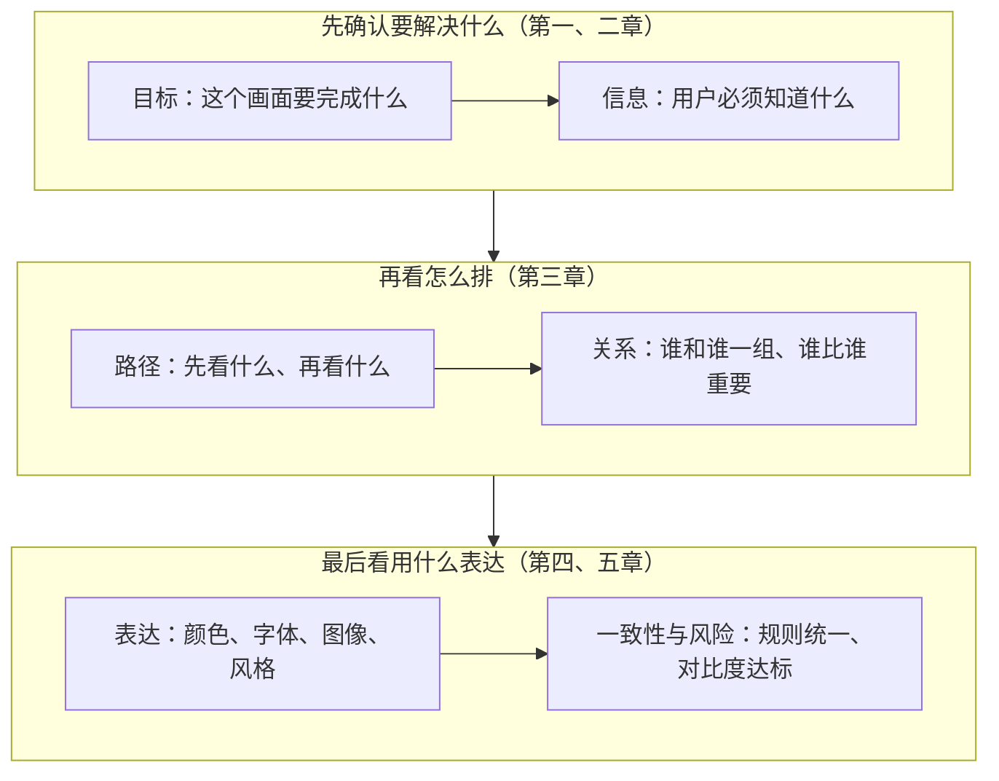
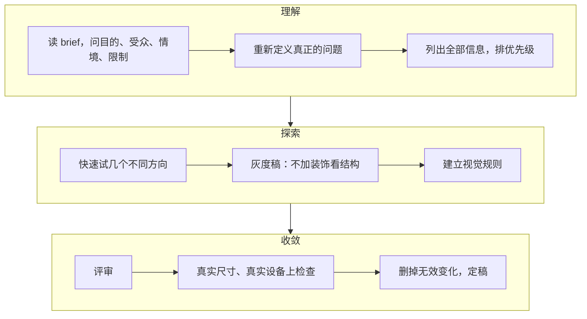
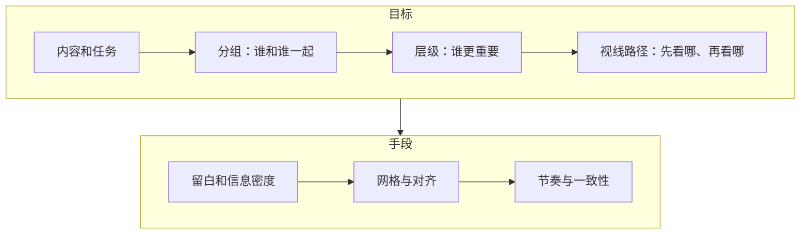
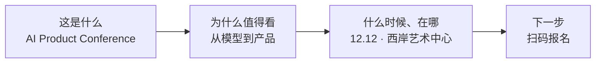

# 视觉设计基础：给常做网页、卡片和海报的非设计师

这篇写给会做网页、信息卡片和海报，能感觉出画面好不好看，却说不清好在哪、差在哪、该怎么改的人。读完你能用设计师的方式看一个画面：先问它要完成什么，再看信息的先后和分组，最后才看颜色、字体和风格；能叫出常见流派和风格的名字；知道网页、卡片、海报各自的重点；也知道接下来该读什么、怎么练眼力。字号、行高这类排版参数，以及和 AI 协作做页面的方法，不在这篇的范围里。

## 一分钟看懂

设计师看一个画面，最先看的是元素之间的关系有没有出问题，然后才是某个元素丑不丑：最重要的信息是不是最先被看到，该在一起的东西是不是靠在一起，下一步该做什么是不是一眼就清楚。好看很重要，但好看是在这些关系成立之后才起作用。

整篇沿着设计师评审一个画面的顺序展开。这个顺序越靠前的问题，改起来影响越大：



几个贯穿全篇的判断：

- **层级和分组是目标，网格、留白、对齐是手段。** 画面乱，多半是信息的轻重和分组没有理清，先改关系，再加装饰。
- **感知规律有强有弱。** 接近、共同区域这些分组规律有大量实验支持；「眼睛按 F 型或 Z 型扫」只在特定条件下成立，不能当模板。
- **颜色先按角色分，再谈比例。** 文字对比度有硬标准：普通文字至少 4.5:1。
- **风格分三个层次**：历史运动、审美气质、界面手法。混搭时让它们各管一件事。
- **三种载体的阅读方式不同**：网页被滚动着扫读，卡片在信息流里被刷过，海报先被远远看一眼。同一份内容要按载体重排，不能直接缩放。
- **练眼力要有任务和反馈**：先判断、再解释、再对照、再修改，比收藏几百张灵感图有效。

第七章拿一张活动海报从头走一遍诊断和修改，想先看完整做法可以直接跳过去。

## 一、设计要解决的问题

这一章回答两个问题：视觉传达和界面设计到底在解决什么，以及「好看」在其中处于什么位置。弄清这两点，后面所有的规则才有一个共同的出发点。

### 设计处理的五组关系

英国设计委员会（Design Council）把设计概括为用创造力解决问题的活动；美国平面设计协会（AIGA）的视觉传播教学材料把受众、目的和情境列为视觉沟通的三个基本起点。[[1-1,1-2]] 照这个思路，一个画面要回答的是：让谁理解什么，信息以什么顺序被看到，让人形成什么判断，接下来让人做什么。

意大利设计师 Massimo Vignelli 用三个词描述设计要同时处理的层面：语义（semantics），这件东西到底意味着什么，包括公司、产品、受众、竞争和使用情境；句法（syntactics），视觉语言内部的各个元素能不能形成一致的关系；语用（pragmatics），最后的结果能不能被人理解。他明确说过，作品如果不能被理解，传播就失败了。[[1-9]] 在这三层之外，做数字界面和传播物料时还要多看两层：人能不能找到、判断、行动，以及在什么设备、什么距离下看到。合起来是五组关系：

| 层次 | 设计师在问什么 | 常见的失败 |
|---|---|---|
| 语义 | 这件东西要说什么、给谁看、为什么现在说 | 内容都对，却没有核心观点 |
| 结构 | 信息之间是什么关系、阅读顺序是什么 | 每块都很醒目，结果没有重点 |
| 表达 | 用什么视觉语言让这些关系被看出来 | 气质和主题冲突，信息密度失衡 |
| 使用 | 人能不能理解、找到、判断、行动 | 看不到行动按钮，状态不明确 |
| 情境 | 在哪里、什么距离、什么设备上看到 | 电脑上漂亮、手机上没法扫读；海报近看成立、远看失效 |

Vignelli 还强调「恰当」（appropriateness）：解决方案要适合这个具体的问题、媒介、尺寸和表达条件。[[1-10]] 同一套视觉语言放到另一个场合不一定成立，这是后面讲载体和风格时会反复回到的一点。

### 「好看」在设计质量里的位置

好看确实有用。人机交互研究反复发现，视觉上的美感会影响人对易用性的主观判断，这被称为++美感可用性效应++（aesthetic-usability effect）。Tractinsky 等人的实验发现，人们感到的美感和感到的易用性高度相关；更早的 Kurosu 和 Kashimura 的研究也发现，人会把视觉吸引力投射到对易用性的判断上。[[1-3,1-4]]

这个效应同时是一个提醒：==觉得顺眼，不能证明任务真的容易完成。==研究证明的是美感影响主观评价，没有证明漂亮能弥补严重的使用问题。所以评审时要观察用户实际做了什么，而不只是听他说「这个页面很好看」。[[1-4]]

工业设计师 Dieter Rams 的「好设计十原则」里，「好设计是美的」和「好设计让产品有用」「让产品易懂」「是诚实的」「细致到每个细节」并列。[[1-11,1-12]] 审美有价值，但它要和用途、理解、诚实、细节一起成立。

### 把感受翻译成关系

在评审里说「我觉得不够好看」，对方很难据此修改。设计师的习惯是把感受翻译成目标和关系：

| 模糊的说法 | 可以讨论的说法 |
|---|---|
| 感觉有点乱 | 有四个元素用了相近强度的强调，第一眼不知道该从哪里读起 |
| 太空了 | 主信息和辅助信息之间缺少中间层级，关键区域断开了 |
| 不够高级 | 品牌想表达克制和专业，但高饱和装饰、多个视觉中心和密集边框在同时抢注意力 |
| 按钮不明显 | 主按钮和次要信息的醒目程度差不多，扫读时判断不出首要动作 |
| 看起来很普通 | 结构清楚，但缺少能表达这场活动独特之处的视觉主题，品牌识别全靠文字 |

右边每一句都指出了是哪些元素之间的什么关系出了问题，修改方向也就跟着出来了。设计师看到的首先是关系失衡，其次才是某个元素丑。这条习惯也是后面所有章节的出发点。

## 二、设计师的工作顺序与评审方法

知道设计在解决关系问题之后，下一步是设计师实际怎么推进一个任务、怎么评一个作品。这一章给出整篇的方法骨架：从 brief 到定稿的过程，评审时的观察顺序，以及怎样把意见说成对方能改的话。

### 从 brief 到定稿的推进

设计流程没有唯一的标准。英国设计委员会的「双钻模型」（Double Diamond）把过程分成发现（Discover）、定义（Define）、发展（Develop）、交付（Deliver）四段，强调发散和收敛交替进行、整个过程会反复迭代；斯坦福 d.school 和企业团队的叫法各不相同，但都包含理解问题、定义问题、产生方案、做原型、获取反馈和迭代这几类活动。[[1-5,1-15]] 双钻模型的一个用处，是提醒团队不要从一个模糊的需求直接跳到解决方案：发现阶段得到的洞察，要先整理成清楚的问题定义，再去发展方案。[[1-17]]

落到网页、卡片、海报这类工作上，可以压缩成下面这条线：



评审发现方向不对时回到「探索」，测试发现问题本身理解错了时回到「理解」，这两条回头路在实际项目里很常见。

每一步里，「做图」只占一部分时间，更多的是判断和取舍。几个关键判断：

- **理解 brief**：需求写的是一个问题，还是已经是一个解决方案？「首页需要一个更大的 Banner」只是一个方案假设，真正的问题可能是用户看不懂产品价值。[[1-5]]
- **排优先级**：用户第一眼、第二眼、第三眼应该分别得到什么？
- **探索方向**：几个方案是不是真的代表不同思路，还是同一个思路换了颜色？
- **灰度稿**：去掉颜色和装饰以后，结构是不是仍然清楚？
- **建视觉规则**：每一个视觉决定有没有承担角色？

拿到「做一张科技大会海报，要年轻、有未来感、酷一点」这样的需求，设计师通常会继续追问：这张海报的首要任务是让人知道有这个活动、记住日期，还是直接报名？受众是开发者、学生、投资人还是公众？它会出现在地铁灯箱、朋友圈，还是会场入口？「未来感」是活动定位的一部分，还是提需求的人偏爱的风格词？看完以后，最希望观众能说出哪一句话？哪些信息一定要出现，哪些可以放到二维码后面的落地页？有没有已有的品牌规范、合作方要求或制作限制？这些追问对应的就是双钻模型里的「发现」和「定义」。[[1-5,1-15]]

### 评审的观察顺序

评审最容易失败的原因，是所有人同时在评不同层面的问题：有人谈商业目标，有人谈信息结构，有人谈颜色，有人谈个人喜好。这些意见本身不冲突，放在一个会上却听起来像在吵架。

Google 的设计评审经验把设计工作分成三个阶段，各评一层：早期评问题（问题是否清楚、目标用户是否认同、值不值得投入），中期评方案（信息层级、视觉、是否用了熟悉的模式、新用户能否完成关键任务），后期评实现（成品和设计稿是否一致、文案是否清楚、无障碍和多语言是否有问题）。它特别强调，评审要从团队对「要解决什么问题」达成一致开始，否则讨论会陷进菜单、字体这类表面细节。[[1-7]] 尼尔森诺曼集团（Nielsen Norman Group，下文简称 NN/g）对设计评审（design critique）的定义也是分析设计是否达到了目标，目的在于改进。[[1-8]]

把这两条合在一起，评一个画面时可以按下面七层的顺序看。越靠前的问题，修改的成本和影响范围通常越大，所以先看前面的：

| 层次 | 先问什么 | 发现问题后通常怎么改 |
|---|---|---|
| 目标 | 这个画面要完成什么 | 改 brief，或重新确定重点 |
| 信息 | 用户必须知道什么 | 删、合并、重排内容 |
| 路径 | 眼睛或操作应该怎么走 | 调整首屏、入口、按钮、顺序 |
| 关系 | 哪些属于一组，谁比谁重要 | 重建层级、分组和空间关系 |
| 表达 | 气质是否适合主题和受众 | 调整颜色、字体、图像、风格 |
| 一致性 | 同一种意义是否用同一种形式 | 收敛样式和组件规则 |
| 风险 | 可读性、无障碍、实现、文化含义 | 修正规则，或增加验证 |

这七层也是本篇的结构：目标和信息在这一章，路径和关系在第三章，表达在第四、五章，载体带来的差别在第六章，第七章用一张海报完整走一遍。

评网页时，在视觉评审之后还要加一层行为检查：状态、操作、反馈、容错、无障碍。Jakob Nielsen 的十条可用性启发式原则覆盖了系统状态可见、和现实世界一致、一致性与标准、识别优于回忆、帮助用户从错误中恢复等方面。[[1-20]] 用这些原则做的启发式评估能较早发现明显的界面问题，但不能替代真实用户测试。[[1-21]] W3C 的无障碍标准 WCAG 2.2 还要求键盘焦点可见、焦点不被遮挡、控件有足够的对比度和点击尺寸，所以网页做得完不完整，只看截图判断不了。[[1-22]]

### 评语的写法

有效的评语通常有三部分：观察到的现象、它对目标的影响、修改方向。例如：

> 报名按钮和主办方 Logo 的醒目程度差不多。现在的目标是提高报名转化，这会让主动作在扫读时被削弱。建议先让报名按钮成为第二视觉中心，再处理合作方信息。

这比「按钮再大一点」有用，因为它说清了为什么要改，又给设计师留了具体解法的空间。[[1-8,1-24]] 再看几句可以直接借用的说法：

> 我现在第一眼读到的是背景图，活动名称排在第二。如果让人先认出活动更重要，这两者的顺序要交换。

> 这两组信息在逻辑上属于同一个报名动作，但放在两个视觉区域，用户得自己把它们联系起来。

> 这个装饰元素很醒目，但它不承担信息、品牌或引导的功能，可以先去掉，看核心结构是不是更清楚。

> 我判断不了问题出在视觉层级还是内容太多。先做一个只保留必需信息的版本，再比较。

写书面的诊断时，可以在三段之外再补两样：问题在页面上的位置，以及用什么验证改好了。完整的句式是「问题位置 + 观察到的现象 + 被破坏的原则 + 用户可能付出的代价 + 修改方法 + 验证指标」。例如：「首屏的价格、促销标签、四个功能徽章和两个按钮都是高对比，主按钮没有独占的焦点（层级）。保留一个高权重按钮，降低徽章和次要操作的醒目程度。改完后看用户第一次注意到主按钮要多久、完成任务要多久。」

### 「设计思维」一词的三种用法

「设计思维」在中文里常被混用，指的是几件不同的事。学术综述发现，设计研究领域里的「设计师式思维」（designerly thinking）和管理领域里的「设计思维」（Design Thinking）是两个不同的传统，后者通常经过了明显的简化。[[1-25,1-26]] 常见的用法有三种：

- **设计师特有的认知方式**：Nigel Cross 1982 年提出「设计师的认知方式」（designerly ways of knowing），认为设计有自己的知识和探索方式，设计师通过建模、模式形成和综合来认识问题。[[1-27,1-28]]
- **处理复杂开放问题的一般活动**：Richard Buchanan 把设计和「棘手问题」（wicked problems）联系在一起，这类问题开放、复杂，边界会不断变化。[[1-29,1-30]]
- **被组织和创新领域产品化的一套方法**：斯坦福 d.school 用共情、定义、构思、原型、测试五个模式教学，各个模式不必按固定顺序走；IDEO 把它描述为在用户想要、技术可行、商业可持续三者之间找平衡。[[1-15,1-31]]

第三种用法对做好一个画面的帮助，主要在前期：它让团队不把客户给出的方案直接当成问题，把抽象判断变成能测试的草图和原型，并让产品、开发、运营和设计有一套共同语言，减少纯审美的争论。[[1-5,1-31,1-7]] 它解决不了的是视觉能力本身：会做访谈、画用户旅程、做原型，不等于会控制层级、判断构图。Kimbell 对设计思维的批评之一，就是过度一般化忽略了设计实践的情境和专业差异。[[1-26]] 2023 年一篇对设计方法有效性的系统综述也发现，证据链的各个环节散见于不同研究，没有一项研究完整覆盖，这个领域还缺少统一的证据标准。[[1-33]]

所以可以这样分工：设计思维帮你决定解决什么问题、怎么探索和验证；视觉设计能力决定怎样把答案变成清楚、有力、合适的形式。这篇讲的主要是后者。

### 仍在使用的五条设计主张

设计史上有几条主张影响很大，今天做网页和卡片时仍会遇到。下表给出每条主张的出处和放到 2026 年来看还成不成立：

| 主张 | 提出者 | 核心意思 | 今天怎么看 |
|---|---|---|---|
| 形式追随功能 | Louis Sullivan，1896 | 形式应从事物的功能和内在性质里长出来 | 仍成立，但应读成「形式需要理由」，不是「去掉装饰」 |
| 语义、句法、语用 | Massimo Vignelli | 同时解决意义、形式关系和理解结果 | 很适合用来评审；动态界面还要补上交互和状态 |
| 少，但更好 | Dieter Rams | 去掉非必要的东西，让设计服务用途和理解 | 「少」是优先级纪律，不是一种固定的极简风格 |
| 提供示能线索 | Don Norman | 用户需要可感知的线索，知道什么能操作 | 对数字界面高度有效 |
| 设计的社会责任 | Victor Papanek | 设计师要考虑真实需求和社会、环境后果 | 重要性在上升，但道德目标不会自动产生好的形式 |

几条补充：

- **形式追随功能**：Sullivan 1896 年这句话原本讨论的是高层办公楼。后来常被简化成「功能第一，装饰应该消失」，比原文激进得多：原文主张的是外在形式要表达建筑的功能和内在结构。[[1-36]] 今天说「功能」，也不只是按钮能不能点，品牌识别、情绪和信任同样可以是设计要承担的功能。
- **少，但更好**：「少」最有价值的含义是减少没有目的的竞争。Nielsen 的「美观且极简」原则也是这个意思：无关信息会和重要信息争夺注意。[[1-44]] Google 近年对 Material 3 Expressive 的研究则提供了当代的修正：有表现力的颜色、形状和尺寸可以增强注意和情感体验，前提是核心功能、清晰度和无障碍仍然成立。[[1-40]]
- **示能线索**：Don Norman 后来专门澄清了「示能」（affordance）在界面设计中的滥用，提出用 ++signifier++（示能线索，也译「意符」）描述那些告诉用户「这里可以做什么」的可感知提示。[[1-45,1-46]] 一段文字能不能点，技术上不是问题，问题是用户能不能看出它是链接；按钮的形状、文字、位置和状态变化都在承担这个作用。第五章会讲到，扁平化风格一度把这些线索去得太干净，付出了可测量的代价。

## 三、分组、层级与视线

这一章讲七层观察顺序里的「路径」和「关系」：判断一个画面排得好不好，看的就是这两层。排布要解决的问题可以概括成一句话：让人用尽量低的搜索成本，快速认出什么属于一起、什么最重要、接下来看哪里、该做什么。[[2-1,2-2]]

几个常见概念之间是有先后的：



分组和层级是目标，留白、网格、对齐是实现它们的手段。用 CSS Grid 能得到稳定的坐标和间距系统，却不会自动产生好的信息层级。[[2-4]] 研究也发现，信息总量不变时，页面复杂度高的情况下，布局的组织秩序越高，视觉搜索的表现越好。[[2-5]] 所以改版时的优先顺序是：先解决分组和层级的错误，再处理对齐、空间和视线，最后才是节奏、细节一致和装饰。这个顺序是根据感知和人机交互研究整理出来的诊断优先级，心理学界并没有一份公认的「设计原则排行榜」。

### 感知规律和证据强度

很多排布原则来自格式塔心理学（Gestalt）：人看画面时会自动把元素组织成整体。现代综述确认，格式塔现象有丰富的实验支持，但早期「视觉系统先在平面上自动完成所有分组」的简单说法已经被修正，深度、表面属性和更晚阶段的知觉加工都会影响分组。[[2-11,2-36]] 下面按证据强弱列出和排布最相关的几条：

| 规律 | 对排布的意义 | 证据 |
|---|---|---|
| 接近 | 距离近的元素更容易被看成一组 | 强，经典和现代实验都支持[[2-11]] |
| 相似 | 形状、颜色、样式相似的元素容易被归为一类 | 强，但会和任务、位置一起起作用[[2-11]] |
| 共同区域 | 放在同一个容器里的元素容易被看成一组 | 强，Palmer 1992 年提出的独立分组原则[[2-9]] |
| 连通 | 被线条或连续色块连起来的元素组关系很强 | 强，Palmer 与 Rock 1994 年提出并演示[[2-10]] |
| 图形与背景 | 人需要分清哪块是对象、哪块是背景 | 强，但具体线索的效果受情境影响[[2-11]] |
| 连续 | 连续的轴线容易被看成一个结构 | 中到强[[2-11]] |
| 闭合 | 不完整的轮廓也可能被看成整体 | 中到强，直接转成界面规则要谨慎[[2-11]] |
| 视觉重量平衡 | 用面积和醒目程度控制画面里的竞争 | 主要是设计实践的概念，作为独立定律证据有限 |
| F 型扫描 | 某些文字页上视线偏向顶部和左侧 | 中，只在特定条件下出现[[2-25,2-26]] |
| Z 型扫描 | 元素少的营销画面可以借来构图 | 行业经验，缺少同等级的眼动证据[[2-17]] |

表里有一条对修改很重要：分组看的是元素之间的++相对关系++。加一个框、连一条线、铺一块底色，可以让本来距离不近的元素被看成一组，有时比单纯拉近距离更有力。[[2-9,2-10]] 所以布局出问题时，先调整关系，再添加装饰。

### 视觉层级的建立

++视觉层级++（visual hierarchy）是让元素的醒目程度和它的重要程度相匹配。设计师先决定内容上谁更重要，再用尺寸、局部对比、位置、周围的空间这些手段，让它更先被注意到。现代注意力研究倾向于用「优先级地图」（priority map）解释人先看什么：画面本身的显著程度、观看者当下的目标、过去的经验和对场景的了解，共同决定注意力落在哪里。[[2-3,2-24]] 这也意味着，==任何「眼睛一定先看这里」的固定口诀都要谨慎使用==，观看者带着什么任务来，会改变他先看什么。[[2-2]]

建立层级时，把内容分成三档就够了，不需要给每个元素一个独立的等级：

- **一级信息**：回答「这是什么、为什么值得继续看、下一步做什么」。产品页上通常是产品名、核心价值、主视觉和主按钮。
- **二级信息**：给出理由，比如三项核心能力、价格或关键指标。
- **三级信息**：补充证明和细节，供需要深究的人查看，比如技术说明、脚注、次要链接。

一个元素在画面里有多「重」，即++视觉重量++（visual weight），由面积、和周围的对比、位置、周围留出多少空间、它的含义有多重要、和当前任务有多相关一起决定。这是一个实用的思考框架，不是心理学公式，各因素之间没有可靠的通用权重。2023 年 CHI 会议上的 UEyes 研究收集了 62 名参与者看 1,980 张网页、桌面界面、手机界面和海报截图时的眼动数据，发现不同载体的注视模式并不相同。[[2-17]]

把这些落到具体的调整上，有四个常用做法：

1. **先减少竞争，再增强焦点。** 五个元素都很醒目时，继续放大按钮收益很小。研究显示，醒目的干扰项会抢走注意、拖慢视觉搜索。[[2-1]] 先把其余四个元素的醒目程度降下来，主焦点自然就突出了。
2. **用空间顺序建立阅读链。** 产品名和核心价值紧挨着，接着放证明，按钮和购买信息组成一个局部组。接近和共同区域会直接影响元素是否被看成一个单位。[[2-9,2-11]]
3. **同级信息给相近的视觉重量。** 三个同级功能点如果一个很大、两个很小，大小不同会改变谁先被注意到，读者也容易据此以为它们重要性不同。[[2-3]]
4. **给关键元素留出孤立的空间。** 周围的空白本身就是分隔信号，比加更多装饰更不容易让画面变复杂。[[2-11,2-6]]

视觉复杂度的研究支持这些做法。2020 年一项网站复杂度实验发现，视觉复杂度越高，搜索效率和信息回忆越差，但用户偏好会调节这个结果。[[2-6]] 所以减少同时醒目的对象，通常比继续加强主标题更有效。

::fig hierarchy

### F 型、Z 型与视线路径

提到视线路径，很多人第一反应是「F 型扫描」。这个说法来自 NN/g 早年的网页眼动研究：用户在网页上先横扫顶部，再往下横扫一段较短的距离，最后沿左侧纵向扫视，热力图像字母 F。但 NN/g 2017 年专门写文章澄清，F 型只在三个条件同时满足时出现：页面主要是缺少格式的大段文字，用户想快速完成任务，又没有兴趣逐字读。它是「没有强线索时的默认扫描方式」，好的小标题、加粗、列表会把视线引到别处。同一篇文章还列出了其他常见模式：只看各级标题的「千层蛋糕式」，跳着找链接、数字或特定词的「斑点式」，以及对内容很投入时几乎逐字阅读的「投入式」等。[[2-25,2-26]] 所以 ==F 型是要避免的情况，不是要照着排的模板==。

Z 型的证据更弱。它在平面和营销设计里很常见，可以用来解释元素很少、左右两端各有一个明确锚点的首屏或海报。截至 2026 年 11 月，我们没有找到像 NN/g 检验 F 型那样专门检验 Z 型的眼动研究；UEyes 的数据倒是显示，网页、手机界面和海报的注视模式各不相同。[[2-17]] 实用的做法是不预设任何扫描形状，直接根据任务检查：目标元素有没有按你希望的顺序被发现。

### 分组、留白与信息密度

++留白++（whitespace，也叫负空间）是元素之间没有内容的空间。留白的作用要看关系，不只看空白面积。分组最常用的规则是组内紧凑、组间宽松：同一组里的元素间距小，组与组之间的间距明显更大。比如一张卡片上，标题到副标题 12 个单位，副标题内部两行间距 4 个单位，副标题到底部按钮 16 个单位，用户自然会看到三个组。做网页时，组内 8 到 16px、组间 32 到 48px 是一个可以直接用的起点，但它只是设计系统里常见的取值，不是心理学阈值，重要的是两者的比例差异。[[2-11,2-21]] NN/g 对接近原则的解释也提醒了反面：被大片空白隔开的元素会被理解为互不相关，留白放错位置，会让相关的操作被忽略。[[6-10]]

留白不对时，常见的错误修法是统一加大 `padding`，结果组内和组间的距离一起变大，关系依旧模糊。同理，层级不清时再加颜色、阴影和字号，往往制造更多竞争；分组不清时给每块都套一张卡片，页面会多出几十条边框。[[2-9,2-10]] 这几种修法都是在加东西，而问题出在关系上。

页面「乱」可能有两种原因。2024 年，研究人员 Lewis 和 Sauro 编制了一份网站杂乱感问卷，把让人觉得乱的原因分成两类：++内容杂乱++，指页面上有不必要的内容；++设计杂乱++，指必要的内容组织得不好。[[2-38]] 这个区分对改稿很有用：碰到内容杂乱就删减或延后，碰到设计杂乱就重新分组、提高布局的规律性。

衡量一个页面杂不杂，研究者还会用算法打分。2026 年一项比较网站和地图的研究用了三种杂乱度算法：特征拥挤度（feature congestion）、子带熵和边缘密度。特征拥挤度在网站和地图上都和搜索时间正相关，几种指标和眼动的关系则随场景变化。[[2-8]] 这类分数可以当参考，判断页面好不好用仍要靠用户测试。

内容多的页面和内容少的海报，处理的方向不同：

- **信息密集的内容页**：保留信息量，降低局部的搜索成本。用稳定的列、清楚的分组、重复的结构，组内间距小、组间间距大。2024 年一项数据看板的眼动实验发现，在复杂度高的条件下，布局秩序更高的版本视觉搜索表现更好。[[2-5]]
- **信息稀少的海报和营销首屏**：通常只有一两个核心任务，元素均匀散布会稀释焦点。可以用更大的负空间、更明显的不对称、更少的视觉锚点。UEyes 研究发现海报和网页的注视分布有系统差异，网页的信息密度策略不能直接搬到海报上。[[2-17]]

内容多的时候先问一句：这些内容都和任务相关吗？不相关的删除、延后或折叠，相关的再强化分组和布局秩序。内容少的时候，明确唯一的主信息，扩大它周围的空间，弱化其余元素。两种情况最后都要验证：前者看用户找东西花多久、理解对没有，后者看第一眼落在哪里、主信息记住没有。

### 对齐与网格

++网格++（grid）是给元素建立位置、宽度、间距和对齐关系的坐标系统。网页上常见四种：

- **列网格**：管横向结构，比如 12 列或 16 列，最常用。
- **模数网格**：同时划分横向和纵向的单元，适合卡片、数据面板和重复模块。
- **基线网格**：让不同模块的文字共享同一套垂直节奏。
- **响应式网格**：随可用宽度调整列数、边距、栏间距和元素跨几列。

W3C 的 CSS Grid 本身就是一个二维网格模型，支持固定、弹性和按内容决定的轨道尺寸，也支持 `gap`、显式定位和子网格（subgrid）。[[2-4,2-32]] IBM Carbon 设计系统的 2x Grid 以 8px 为基本单位，在不同断点调整列结构，体现了设计系统的常见做法：保持间距比例和对齐逻辑稳定，让列宽随窗口变化。这是成熟的行业方案，但 8px 本身并没有成为审美定律的实验依据。[[2-21]]

一个左图右文的产品页首屏，用 12 列网格可以这样写：

```css
.hero {
  width: min(1200px, calc(100% - 48px));
  margin-inline: auto;
  display: grid;
  grid-template-columns: repeat(12, minmax(0, 1fr));
  gap: 24px;
  align-items: center;
}
.hero-copy  { grid-column: 1 / span 5; }   /* 文字占左边 5 列 */
.hero-media { grid-column: 7 / -1; }       /* 图片从第 7 列到最右 */

@media (max-width: 760px) {
  .hero { grid-template-columns: 1fr; }
  .hero-copy, .hero-media { grid-column: 1; }
}
```

窄屏时改成单列。视觉顺序和 HTML 里的源码顺序要保持一致，否则用键盘浏览的人会跳来跳去。[[2-34,2-35]]

对齐的检查方法很简单：数一数同一区域里有多少条起始线。卡片、文字、按钮各自差几个像素地对齐，页面就会显得松散；让相关内容共享同一条轴线，可见的起始线越少越好。这是设计实践里的经验做法。

在掌握网格之后，可以有意识地打破它。破格有价值的条件，是它明确服务于层级：产品主图跨出网格半个栏距制造焦点，一个引用数字跨两列打断机械的节奏，海报标题故意偏离主轴制造张力。原则是==局部破格，整体仍有参照==。如果标题、图片、按钮、正文、标签各用一条不同的轴线，破格就失去了对比对象。研究显示，复杂界面里更有秩序的布局能减轻视觉搜索负担，这支持「先建立秩序，再选择性打破」的做法。[[2-5]]

### 产品介绍页的改版

把这一章的原则落到一个具体页面上。假设一个 SaaS 产品的首屏挤满了东西：Logo、导航、「新品」标签、「最强项目管理平台」的大标题、「限时优惠」标签、三段说明、五个功能徽章、价格、两个按钮、一张产品截图、客户 Logo 和评分。标题、价格、促销标签和按钮都做成了高对比。

```text
┌───────────────────────────────────────────────────┐
│ Logo   产品 功能 价格 资源        登录   免费试用 │
│ [新品]   最强项目管理平台   [限时优惠]            │
│ 全能协作平台，让团队效率提升……                    │
│ 自动化  AI助手  报表  权限  模板                  │
│ ¥99/月     [立即开始]   [查看演示]                │
│ ┌───────────────────────────────────────────────┐ │
│ │              产品截图                         │ │
│ └───────────────────────────────────────────────┘ │
│ ★★★★★ 4.9    公司A 公司B 公司C 公司D              │
└───────────────────────────────────────────────────┘
```

对照前面的原则来诊断，这个首屏有三个问题：

- **层级竞争**：新品标签、标题、促销标签、价格和两个按钮同时高度醒目，相当于给注意力提供了好几个候选目标。[[2-1]]
- **分组模糊**：五个功能徽章夹在价值主张和价格之间，和购买区之间没有明显的空间分界。[[2-9,2-10]]
- **轴线太多**：正文、徽章、价格、按钮、截图和客户证明没有共享稳定的起始线。

改版按五步走：

1. **重新定信息等级。** 一级只留产品类别、核心价值、主按钮和主视觉；价格和「查看演示」降到二级；功能点和客户证明移到下一屏或首屏底部。同时竞争的醒目元素少了，用户更容易在短时间里回答「它是什么」「我该做什么」。[[2-6]]
2. **重新分组。** 小标签、标题、说明组成「理解组」，两个按钮组成「行动组」，产品截图是独立的视觉对象。组内间距小（12 到 20px），组间间距大（36px 以上）。
3. **给页面一个稳定的网格。** 用上一节的 12 列：文字占左 5 列，截图占右 6 列，窄屏改单列。
4. **控制视觉重量。** 主按钮保持最高的行动醒目程度，次按钮弱一级；截图可以占较大面积，因为它承担产品实物的证明，但周围不再堆高对比徽章。
5. **把证明信息放到第二停留区。** 「被 2,000+ 个团队使用」和客户 Logo 放在首屏下方，和首屏之间留较大的垂直间隔，内部保持紧凑，读者会把它看成独立的一组。

```text
┌───────────────────────────────────────────────────────────┐
│ Logo       产品 解决方案 价格                         登录 │
│  团队项目管理                                             │
│  把计划、协作和进度         ┌─────────────────────────┐   │
│  放在一个工作空间           │       产品界面          │   │
│  面向团队的项目协作平台     └─────────────────────────┘   │
│  [免费开始]  查看演示                                     │
├───────────────────────────────────────────────────────────┤
│                  被 2,000+ 个团队使用                     │
│          公司A    公司B    公司C    公司D                  │
└───────────────────────────────────────────────────────────┘
```

| 维度 | 修改前 | 修改后 | 怎么验证 |
|---|---|---|---|
| 层级 | 约五个高权重焦点 | 一个主信息组、一个主按钮 | 看 5 秒后问产品用途和主要操作 |
| 分组 | 功能、价格、按钮混在一起 | 理解、行动、产品视觉、证明四组 | 让人说出首屏分了几块 |
| 对齐 | 多条随机轴线 | 左文右图共享 12 列 | 多个宽度下截图比较 |
| 视线 | 多点竞争 | 核心价值 → 按钮 → 产品视觉 → 证明 | 看主按钮第一次被注意到要多久 |

判断改版是否成功，可以看这些具体目标：主按钮被发现的时间变短，对产品用途的回忆变准确，误点击减少，完成任务的时间变短，同时主观的杂乱感评分改善。不建议把「注视次数增加」单独当作成功指标，反复注视也可能意味着用户找不到或看不懂。

### 排布问题的检查顺序

面对一个「感觉不太对」的页面，可以按这七步检查，它们是第二章七层顺序里「信息、路径、关系」三层的具体做法：

1. **先问任务。** 用户来到这个画面，最主要要知道什么、做什么？没有这个答案，就无法判断层级合不合理。
2. **圈出最醒目的三个元素。** 看它们是不是恰好对应最重要的信息。如果第四、第五重要的信息反而最醒目，先把它们降下来。
3. **画出所有分组。** 如果你和另一个人对哪些元素属于一起意见很不一致，通常说明接近、共同区域或连通的关系有问题。
4. **数轴线。** 同一区域里有大量相差几像素的左边线、卡片宽度和按钮位置时，优先合并对齐规则。
5. **看局部密度。** 找出哪里堆着大量边框、标签、线框和密集文字，不要只看整页的空白比例。
6. **检查视线路径。** 第一个焦点之后，有没有清楚的第二步？不预设 F 型或 Z 型，按任务和页面结构去验证。
7. **最后才处理细节节奏。** 结构问题没解决时，统一 8px 间距或微调圆角通常不会带来根本改善。

练到后来，要能把「这里有点乱」说成可以检验的话：「这里同时有四个高醒目元素」「标题离自己的说明比离下一个模块还远」「同一层级用了三种卡片样式」「按钮周围没有独立的空间」「页面上有七条相近的左对齐线」。问题能这样描述，修改方法通常就清楚了。

## 四、色彩、字体、图像和质感

第三章讲怎么排，这一章讲排的是什么：颜色、字体、图像和质感怎么选、怎么搭。可以把它们的分工记成一条决策链：先定信息的轻重和想要的情绪，再选一种主导的视觉语言；用颜色承担层级，用字体承担人格，用图像承担含义，用质感暗示空间和触感，最后用可读性和一致性检查收尾。

### 色相、明度、饱和度

设计软件和 CSS 取色器里最常见的是 HSV（或 HSB）模型，它把颜色拆成三个维度：

| 维度 | 看起来是什么 | 起什么作用 | 初学者常见的错误 |
|---|---|---|---|
| 色相（Hue） | 红、黄、绿、蓝，「是哪种颜色」 | 区分类别、建立品牌识别、冷暖关系 | 同时用太多色相，每个颜色都在抢注意 |
| 饱和度（Saturation） | 鲜艳程度 | 高饱和容易成为焦点，低饱和适合大面积背景 | 整个画面都用高饱和色 |
| 明度（Value） | 亮还是暗 | 最直接影响层级和可读性 | 只换色相，没有拉开明暗 |

三个维度里，对层级影响最大的是明度。一个实用的检查：把画面截图转成灰度，如果层级消失了，说明明暗结构不够，只靠色相在区分。

HSV 很适合「调颜色」，但它不是按人眼感知均匀划分的：同样把 V 提高 10，不同颜色看起来变化的程度并不一样。[[3-11]] CIECAM16 这类现代色貌模型专门处理观看条件和感知属性。[[3-2]] 所以用 HSV 挑颜色很方便，判断能不能读清，要用后面讲的对比度来验证。

包豪斯教师 Johannes Itten 的色彩课程把色彩训练建立在七类对比上：色相对比、明暗对比、冷暖对比、互补对比、同时对比、饱和度对比和面积对比。[[3-12]] 他的「色星」把色相和明暗两极画在同一张图上。[[3-1]] 这份清单今天仍然有用，它提醒我们颜色之间的差异远不只是色相不同。

### 配色关系与颜色角色

色轮上常见的配色关系有五六种，Adobe Color 这类工具都内置了。[[3-13]] 下面的色板是演示用的，说明每种关系大致长什么样、适合什么、有什么风险：

::fig palettes

几种关系的特点：

- **单色**（一个色相的深浅变化）：最容易统一，层级清楚，但容易单调；金融、B2B、数据产品常用。
- **类似色**（色轮上相邻的颜色）：平静、连续，相邻色之间对比可能不够；常见于自然、健康、食品类品牌。
- **互补色**（色轮上相对的颜色）：张力强、焦点明确，大面积并列会刺眼；体育、零售、促销常用。
- **分裂互补**（一个颜色加上它补色两侧的颜色）：比纯互补柔和，又保留活力，三色面积失衡时会显得杂。
- **三分色**（色轮上等距的三个颜色）：色相区别清楚，很容易「彩虹化」。Adobe 的建议是选一个当主色，其余只做强调。[[3-13]]

==色轮只决定色相之间的关系，不解决可读性。==蓝和橙是互补色，不代表橙色小字放在白底上能读清，可读性看的是明暗差，和色轮上的距离无关。[[3-15,3-5]]

定了颜色关系，下一步是分配用量。常听到的「60/30/10」（主色 60%、辅色 30%、强调色 10%）可以当起步模板：大面积的基础色定整体温度，辅色建立识别和分组，强调色只给按钮、关键数字、状态和焦点。网页上更推荐的做法是按++颜色角色++分配：Google 的 Material 3 把颜色分成背景表面（surface）、主色（primary）、次要色（secondary）、第三色（tertiary）、描边（outline）等角色，每个角色还配有一个专门放在它上面的前景色，比如主色上的文字用 on-primary，背景上的文字用 on-surface。[[3-9]] 这样做的好处是，CSS 变量和设计文件能一一对应，深色和浅色主题也好切换；前提是按配好的组合使用，随意交换会直接破坏对比度。[[3-9]]

```css
:root {
  --surface: #F3E9DA;       /* 大面积背景 */
  --text-primary: #1D1A17;  /* 正文 */
  --brand-primary: #3B2417; /* 品牌主色 */
  --accent: #E8A85D;        /* 强调色：按钮、关键数字 */
  --on-accent: #1D1A17;     /* 放在强调色上的文字 */
  --outline: #816F62;       /* 描边、分隔线 */
}
```

深色和浅色主题也是成对设计的，不是简单反相。深色主题要避免纯黑背景配大面积纯白文字，经验做法是从很深的棕、蓝灰或炭灰开始。 W3C 对渐变和多色图形要求检查对比最低的那一块区域[[3-16]]，文字压在照片或半透明层上时同理，要分别测最亮和最暗的区域。

颜色服务定位的例子可以看 Pentagram 的两个项目。Peach Coffee Roasters 的品牌名叫「桃」，消费者曾误以为它卖桃味咖啡，于是团队限制了桃色的用量，新配色是桃皮橙、深靛蓝和森林绿三色并用，再用清楚的无衬线标签和留白突出咖啡信息。[[3-19]] 92NY 用定制的高对比衬线字建立纽约文化机构的气质，再用无衬线字承担日常信息，这个例子下一节讲字体时还会用到。[[3-28]]

```gallery
peach
92ny
bottega
```

### 对比度的硬标准

颜色搭配有很多经验规则，但文字和背景的对比度有硬标准。W3C 的 WCAG 2.2 是目前网页无障碍的实施基线，它的要求是：[[3-4,3-6,3-22]]

| 内容 | 等级 | 最低对比度 |
|---|---|---|
| 普通文字 | AA | 4.5:1 |
| 大号文字 | AA | 3:1 |
| 普通文字 | AAA | 7:1 |
| 大号文字 | AAA | 4.5:1 |
| 重要图标、图形、控件边界 | AA | 3:1 |
| Logo、品牌名文字 | 例外 | 无最低要求 |

「大号文字」指常规字重 18pt 或粗体 14pt 以上，在常见的 CSS 环境里约等于 24px 和 18.66px。[[3-4,3-21]]

对比度的算法是：先把颜色换算成相对亮度 L（L = 0.2126R + 0.7152G + 0.0722B，其中 R、G、B 是线性化以后的值），再用（较亮的 L + 0.05）÷（较暗的 L + 0.05）。[[3-5]] 举个例子：铜橙色 `#C85A2E` 放在白底上，对比度约 4.24:1。它达不到普通小字的 4.5:1，但达到了大号文字的 3:1。所以这个橙色可以用在色块、插画和大标题上，正文改用深色。品牌色对比度不够时，一个经验顺序是：先保留色相、调明度；还不够，再调饱和度；再不行，给它专门建一个 on-brand 的前景色（Material 的 on 色就是这种成对关系）；最后才考虑放弃这个组合。

两个容易忽视的地方：

- **颜色不同不等于图形能分辨。** W3C 的非文本对比示例里有一张饼图，每块颜色都不同，但相邻扇区之间的边界对比不到 3:1；给浅黄色扇区加一圈深色描边后，比例信息才变得可辨认。[[3-16]]
- **颜色不能是唯一的信息载体。** 输入框出错时只把边框从灰改成红，色觉障碍的用户可能看不出来，要同时加图标、文字或边框形状的变化。WCAG 1.4.1 明确规定，状态、动作和信息不能只靠颜色传达。[[3-23]]

检查对比度的工具，设计阶段用 Figma 取色器自带的对比度检查（显示 AA、AAA；色觉缺陷模拟用 Figma 官网的 Color Contrast Checker），单独核对色值用 WebAIM 的对比度检查器，网页做出来以后用 Chrome 开发者工具查具体元素。[[3-25,3-21,3-26]]

### 字体的气质

字号、行高这类排版参数这里不讲，这一节只讲字体传达的气质。字体的「性格」不完全是主观感受：跨语言研究发现，读者会给字体赋予严肃、优雅、友好、幽默等人格属性；微软的研究进一步发现，字体人格和内容人格一致时，会影响读者对内容情绪的即时判断。[[3-7,3-27]] 这种联想也受文化经验影响：一项阿拉伯文字体研究的作者推测，常出现在教材、报纸和正式证书上的字体，更容易被评价为正式、学术或庄重。[[3-8]]

可以把字体的气质拆成几个看得见的结构特征：

| 结构特征 | 常见的气质 | 适合 |
|---|---|---|
| 几何无衬线、圆形结构 | 现代、理性、科技 | 数字产品、科技活动 |
| 人文无衬线 | 友好、克制、现代 | 品牌、服务、生活方式 |
| 高对比宋体、Didone 类衬线 | 优雅、编辑感、文化 | 海报、时尚、艺术 |
| 低对比宋体 | 稳重、人文、书卷气 | 出版、文化、食品 |
| 圆体 | 亲和、轻松 | 儿童、消费、社交 |
| 手写、楷体 | 手作、人情味、文艺 | 咖啡、餐饮、文化活动 |
| 窄体、工业感展示字 | 强势、都市、运动 | 海报、音乐、赛事 |
| 等宽字 | 技术、工具、工程 | 开发者产品 |

几款可以免费商用的中文字体放在一起看，气质差别很明显：

::fig fonts

海报和卡片里最稳妥的结构，是「一种辨识度高的展示字体 + 一种克制的正文字体」。展示字体负责品牌人格，用在活动名、数字、短口号上；日期、地址、按钮、辅助说明回到稳定的字体。92NY 就是这样分工的：定制的高对比衬线字「92NY Didi」负责品牌声量，无衬线字 Theinhardt 支撑日常信息。[[3-28]] 如果整张海报都用高对比展示字，辨识度很高，阅读负担也同步提高。展示字体个性太强时，可以只用在 Logo 或活动名上，或者只用它的数字和字母，或者换一款结构相近但更平静的字体做二级标题。

### 照片、插画、图标与图形

四类图像最好按「它负责什么」来分配，不按「哪个更好看」来选：

| 类型 | 最擅长传达 | 典型用途 | 风险 |
|---|---|---|---|
| 摄影 | 真实感、产品质感、人物情绪、现场氛围 | 食品、旅行、人物、活动 | 来源混杂会立刻破坏统一 |
| 插画 | 概念、隐喻、友好感、难以拍摄的场景 | 教育、品牌故事、空状态 | 风格差异比摄影更明显 |
| 图标 | 功能、动作、快速扫读 | 导航、标签、元数据 | 含义不明确时容易误读 |
| 抽象图形 | 节奏、品牌识别、填充空间 | 背景、系列视觉、品牌系统 | 容易变成没有意义的装饰 |

美国政府网站设计系统（USWDS）明确区分图标和插画：图标承担能快速识别的功能含义，需要解释概念或讲故事时用插画；不够通用的图标要配文字。[[3-34,3-35]]

同一套视觉里的图像要统一，可以先写一张约束清单，所有素材都按它挑：

- **摄影统一五项**：冷暖色调、对比度、阴影软硬、拍摄距离、背景复杂度。同一套咖啡卡片里，不要把一张自然光的明亮俯拍和一张硬闪光的夜店风产品照放在一起。
- **插画统一六项**：线宽、圆角、填色数量、透视方式、人物比例、边缘处理。
- **图标直接选一整套成熟的图标库**，不从多个库拼凑。IBM Carbon 要求产品里的图标尺寸一致，并规定了画板、描边和像素网格的处理方式；与文字搭配时图标和文字的比例、颜色要一致。如果某个按钮的图标比其他图标粗一倍，即使都是 SVG，整体也会像临时拼起来的。[[3-36,3-38]]

最后的检查：所有素材缩到 25% 大小，还能不能看出属于同一套系统？Pentagram 的 Bottega 品牌是一个统一做得很好的例子，它把光、阴影、反射和透视当成整个品牌共同的视觉语法，具体图形各不相同，但都围绕同一个物理隐喻变化。[[3-39]]

### 质感的用量

阴影、渐变、颗粒、纹理这些质感显得精致，通常因为它们「有原因」：阴影说明前后层级，颗粒模拟印刷或胶片，纹理暗示材质，渐变制造光照方向。Apple 的界面规范把材质定义为帮助建立深度、层级和前后关系的视觉效果，对 Liquid Glass 这类材质还专门建议克制使用。[[3-20]]

判断一个元素该不该加阴影，可以先问：它真的离开了页面平面吗？IBM Carbon 的规定很清楚：普通的卡片（tile）和内容在同一平面上，不加投影；下拉菜单、弹出层这类真正浮起来的对象才有阴影。[[3-42,3-41]] 下面的参数是可以直接用的起点，属于经验建议，不是行业规范：

| 效果 | 起点 | 容易显廉价的情况 |
|---|---|---|
| 卡片轻阴影 | `0 4px 12px rgba(0,0,0,.08)` | 纯黑、透明度 30% 以上、模糊很小 |
| 浮层阴影 | `0 8px 24px rgba(0,0,0,.10)` | 所有卡片都有强阴影 |
| 渐变 | 2 到 3 个色标，角度先试 0°、45°、90°、135° | 5 种以上高饱和色、随意的角度 |
| 颗粒 | 1% 到 5% 的可见强度 | 噪点压过文字边缘 |
| 纸张纹理 | 2% 到 8% 不透明度 | 纹理的重复单元很明显 |

这些数值和成熟设计系统的阴影尺度相近：USWDS 的标准阴影从 `0 1px 4px rgba(0,0,0,.1)` 到 `0 16px 32px rgba(0,0,0,.1)`，Carbon 的浮层菜单约为 `0 2px 6px rgba(0,0,0,.2)`。[[3-40,3-41]]

显得廉价的常见原因是叠加：每张卡片同时有阴影、描边、玻璃、渐变和发光；多个阴影方向暗示互相矛盾的光源；纹理盖到了文字上。克制的方法是给质感定一个预算：一张普通卡片最多选一种主要质感，再配一种很弱的辅助效果，比如「纸张颗粒 + 无阴影」或「柔和阴影 + 纯色面」。

### 咖啡活动卡片的两套方案

把这一章的选择串起来，看一个完整的例子。假设一个叫「晨迹咖啡」（MORNING TRACE）的品牌要做周末手冲品鉴会的活动卡片，受众是 22 到 38 岁的城市用户，卡片会出现在公众号、网页、社交媒体和门店屏幕上，信息顺序是品牌感受、活动名、日期地点、行动入口（虚构的品牌）。下面是两个方向：

::fig coffee

**方案 A，现代极简**：关键词是安静、专业、精品、城市。浅色背景 `#F3E9DA`，深色文字 `#1D1A17`，品牌主色深咖 `#3B2417`，强调色琥珀 `#E8A85D`。深色文字和深咖放在浅背景上分别约 14.4:1 和 12:1，深色文字放在琥珀色按钮上约 8.4:1，都超过普通文字 4.5:1 的要求。[[3-4,3-6]] 琥珀色不要直接当文字放在浅背景上，两者对比只有约 1.7:1。 标题用思源宋体的粗字重，时间、地址、按钮用思源黑体，宋体负责编辑感和文化感，黑体负责功能信息。[[3-29]] 照片统一用自然侧光、暖白平衡、略降饱和度，画面里有咖啡、陶瓷杯和手的动作，避开高饱和的食物和复杂的店内招牌。图标用同一套线性图标，时间、地点、座位三个图标都配文字标签。[[3-34]] 质感只加 2% 到 3% 的单色颗粒，照片不再额外加投影。

**方案 B，复古手工**：关键词是社区、手作、烘焙、亲切、旧印刷。牛皮纸色背景 `#F2E2C4`，森林绿 `#315B4A`，砖红 `#B9472A`，芥末黄 `#D89A2B`。要特别注意：深棕文字 `#2B231C` 放在砖红上，对比度只有约 2.9:1，连图标的 3:1 都达不到；砖红做大色块时，上面的文字要改成白色（约 5.3:1）。[[3-5,3-22]] 标题可以用得意黑或霞鹜文楷制造印刷感和手作感，正文仍回到思源黑体。[[3-30,3-31]] 图像优先用手作过程的照片，可以叠一组一两种颜色的粗线插画（咖啡果、滤杯、烘豆机），整个系列统一线宽和填色方式。质感用约 5% 的纸纹和约 3% 的颗粒，取消阴影，让纸张、边框和印刷色来建立层级。

两套怎么选：精品手冲、商务区咖啡馆、线上订阅、价格偏高的品牌更适合方案 A；社区店、烘焙工作坊、周末市集、联名活动更适合方案 B。这是经验判断，最后要回到目标用户和品牌承诺去验证。

做完以后，用这几个问题自检：缩成手机缩略图后第一眼看到什么？转成灰度后层级还在不在？强调色是不是只强调了少量重要信息？有没有正文低于 4.5:1、重要图标低于 3:1？照片之间的光源和白平衡一致吗？有没有混用两套图标？展示字体有没有侵入日期、地点和按钮？阴影是不是对应真实的层级？去掉所有纹理，设计还成立吗？

## 五、设计流派与风格

想要一种效果却说不出来，是做设计时很常见的处境：「高级一点」「有设计感」「像苹果那样」，这些说法每个人理解都不一样。设计流派和风格的名字，就是设计师之间描述效果的共同词汇。这一章先把这些名字分成三个层次，再分别看历史上影响最大的几个运动、近十年网页和界面上流行过的风格，最后讲怎么选风格、怎么把几种风格混在一起用。

### 风格的三个层次

很多人会把「包豪斯」和「玻璃拟态」当成同一类词来用，但它们回答的是不同的问题。按回答的问题来分，风格名称可以放进三个层次：

| 层次 | 它回答什么 | 典型名称 |
|---|---|---|
| 历史运动与设计思想 | 设计应该服务什么价值、画面应该有什么秩序 | 构成主义、包豪斯、现代主义、瑞士国际主义、后现代主义 |
| 审美语言 | 画面给人什么气质 | 极简、装饰艺术、粗野主义、表现性设计、复古未来主义 |
| 界面表现手法 | 数字界面里的元素怎样出现、怎样互动 | 扁平化、拟物、玻璃材质、卡片、Bento 网格、动效 |

三个层次可以同时出现在一个页面上。一个网页可以用瑞士式的网格排版，整体是极简的气质，按钮用 Material 的组件规则，导航栏用半透明的玻璃材质，这四个词分别描述不同的维度，彼此并不冲突。

分清层次之后，描述想要的效果时，可以把四类信息都说出来：历史参照、结构规则、视觉气质、界面手法。例如：「我想要国际主义的网格和信息层级，加一点后现代的超大标题和不对称构图，颜色控制在黑白加一个高饱和强调色，按钮仍保持 Material 式的明确交互提示。」这样的描述，设计师或者 AI 都能照着执行，比「高级一点」具体得多。

### 影响最大的历史运动

今天网页和界面的很多默认做法，都能追溯到 20 世纪的几个设计运动。大致的脉络是：工业化和大众传播催生了构成主义、包豪斯和现代主义；现代主义在瑞士发展出以网格、无衬线字体和客观信息组织为特征的国际主义风格；七八十年代的后现代主义和新浪潮设计开始反抗这种高度标准化的秩序；个人电脑普及以后，代码、生成系统和动态视觉又成了新的设计材料。[[6-1,6-2,6-3,6-4]]

下面这张表先给出每个运动的时代和一眼能认出来的特征，后面再逐个讲它对今天的影响。

| 运动 | 时代 | 主张 | 一眼能认出的特征 |
|---|---|---|---|
| 构成主义 | 1917 年前后的俄国 | 设计要有社会功能和传播效率 | 对角线和斜向构图、粗重无衬线字、红黑白三色、几何块和摄影拼贴 |
| 包豪斯 | 1919–1933 年的德国 | 统一艺术、工艺和工业生产 | 几何网格、几何无衬线字、黑白加红黄蓝、圆方线等基本形 |
| 装饰艺术 | 1920–1930 年代 | 机器时代的都市、交通和消费文化 | 中轴对称、纪念碑式构图、黑金深蓝、放射线和阶梯形 |
| 瑞士国际主义 | 1950–1960 年代走向国际 | 用客观、中性的方式组织信息 | 严格的列网格、左对齐、不对称平衡、Helvetica 一类无衬线字、大面积留白 |
| 后现代与新浪潮 | 1970–1990 年代 | 质疑现代主义的普遍规则 | 网格被切断和错位、多种字体混排、高饱和撞色、拼贴和像素 |
| 后数字与生成设计 | 数字技术成为日常以后 | 把代码、算法、印刷和屏幕混合起来 | 参数化版式、可变字体、程序生成的图形、随数据变化的颜色 |

几件代表作放在一起看，差别会比文字清楚：

```gallery
lissitzky
cassandre
brockmann
bayer
greiman
```

#### 构成主义

构成主义形成于 1917 年俄国革命前后。纽约现代艺术博物馆（MoMA）把它描述为一场试图为革命后的社会建立全新视觉语言的先锋运动：艺术家把自己看作参与社会建设的「工程师」，强调作品要服务于更大的社会目的和实用目的。[[6-1]] El Lissitzky 1923 年为马雅可夫斯基诗集设计的《For the Voice》是典型例子：文字的大小、红黑对比和页边的索引标签一起承担导航功能，读者靠这些标签翻到要朗读的那首诗。[[6-12]]

今天的体育视觉、音乐节海报、运动品牌和强调速度感的网页，仍然常见构成主义式的对角线、巨型字体和少量高对比颜色。

#### 包豪斯

包豪斯是 1919 到 1933 年间的一所德国设计学校，也是一整套试图统一艺术、工艺、工业生产和现代生活的思想。Herbert Bayer 等设计师把这种思想用到平面设计、字体、摄影和展览上，Bayer 在 1920 年代探索了几何化的无衬线字体，并把摄影和排版融合在一起。[[6-15]]

包豪斯对今天界面设计的影响，更多在系统化的思路上：组件、设计 token、模块化网格，以及「形式要有功能上的理由」这类产品设计伦理，都和这条现代主义传统一脉相承。借用包豪斯并不意味着页面要用红黄蓝和圆形。

#### 装饰艺术

装饰艺术（Art Deco）在 1920 至 1930 年代随着城市化、机械、交通和消费文化一起兴盛。英国维多利亚与艾伯特博物馆（V&A）指出，它用更有棱角、更有机器时代气质的形式，取代了新艺术运动繁复的有机装饰，邮轮和高速列车是常见题材。[[6-18]] A. M. Cassandre 1935 年为诺曼底号邮轮画的海报，用仰视的中轴构图把船画成一座纪念碑。[[6-19]]

今天的高端酒店、香水、酒类、剧院和复古主题活动常借用装饰艺术，它擅长制造仪式感和奢华感。放进工具型 SaaS 或者信息密集的后台，装饰就会占掉信息的空间。

#### 瑞士国际主义

现代主义是一个很大的思想谱系，瑞士国际主义（International Typographic Style，也叫 Swiss Style）是其中对平面和信息设计影响最直接的一支。它在 1940、50 年代形成，五六十年代走向国际。美国库珀·休伊特设计博物馆把它的典型特征总结为无衬线字体、不对称布局、以网格为基础的设计和摄影。[[6-2,6-20]] Josef Müller-Brockmann 1950 年代为苏黎世音乐厅（Tonhalle）做的一系列音乐会海报是代表：抽象的几何图形占据画面，演出信息排成整齐的文字栏。[[6-21]]

这是今天网页设计最深层的默认语法之一。CSS Grid、设计系统、数据看板、新闻网站和企业官网的结构原则里，都能看到网格和现代主义信息秩序的影子。这种影响主要在组织信息的逻辑上，不要求视觉上去复制 1950 年代的瑞士海报。

#### 后现代主义与新浪潮

1970 到 1990 年间，设计师开始质疑现代主义的普遍规则和「中性视觉」。V&A 把后现代设计描述为强调戏仿、历史引用、装饰、混杂和幽默；意大利的孟菲斯小组（Memphis）用鲜艳的颜色、图案和通俗文化，有意违背传统的功能逻辑。[[6-22,6-3,6-23]]

平面设计里的新浪潮（New Wave）延续了这种反叛。Wolfgang Weingart 和 April Greiman 打破标准网格，使用斜线、重叠、像素图像、混合字体和数字工具。Greiman 1986 年的《Does It Make Sense?》是用早期 Macintosh 软件完成的折页海报，被看作数字平面设计的重要案例。[[6-24,6-25]] 今天的实验性网页、时尚网站、音乐视觉和新粗野主义（Neobrutalism），都能看到这条传统的延续。

#### 后数字与生成设计

「后数字」在设计研究里通常指数字技术已经成为日常基础设施之后，设计师自由混合代码、印刷、屏幕、算法和物理材料的做法，日内瓦艺术与设计大学（HEAD Genève）的研究项目把它和创意编程、设计师自己动手做工具联系在一起。[[6-4]] 它对品牌系统的影响尤其大：明尼阿波利斯沃克艺术中心对「后身份设计」的讨论指出，视觉身份正在从封闭、固定的系统，转向能响应外部参数（比如屏幕尺寸和使用场景）的动态系统。[[6-27]]

近两年常见的手绘、粗糙材质、超大字体、强烈颜色和人工痕迹，有时被叫作「新表现主义」。这个说法在平面设计里没有像包豪斯那样清楚统一的历史定义，更准确的叫法是表现性设计、反设计、后数字设计或新粗野主义这些相邻的趋势。

### 2016 至 2026 年的网页与界面风格

把视线拉近到最近十年的网页和界面，变化最大的是界面表现手法这一层。下表的「现状」是截至 2026 年 11 月、基于设计系统、产品实践和行业趋势资料的综合判断，属于趋势分析，不是固定的历史分类。

| 风格 | 识别特征 | 现状 |
|---|---|---|
| 极简与新极简 | 大留白、少层级、无衬线字、颜色少，产品图承担视觉中心 | 持续有效，近两年开始加入更强的字体和品牌元素 |
| 扁平化与 Flat 2.0 | 平面色块、简化图标，再用颜色、阴影和层级找回可点击提示 | 仍是基础语言，极端扁平已经衰退[[6-29]] |
| Material 与系统化 UI | 网格、卡片、明确层级、主题 token、统一组件 | 持续主流，向个性化和表现性演化[[6-9,6-30]] |
| 拟物 | 材质、物理隐喻、阴影、立体控件 | 整体退出主流，局部周期性回归[[6-6]] |
| 新拟态（Neumorphism） | 背景和控件同色，双向柔和阴影做出压入和凸起 | 高峰已过，只适合局部实验[[6-6]] |
| 玻璃材质 | 模糊背景、半透明层、边缘高光 | 2025 年后明显回潮，用途被平台规范严格限定[[6-7,6-8]] |
| 扁平品牌插画 | 圆润人物、夸张比例、纯色块、低细节 | 前几年非常普遍，作为科技公司的默认视觉已明显降温 |
| 数据密集型视觉 | 强网格、直接标注、序列色、图表优先 | 持续增长的功能型语言[[6-31,6-32]] |
| 品牌大图与编辑式网页 | 超大标题、摄影和视频、大片留白、滚动叙事 | 品牌站和发布页仍是主流[[6-33]] |
| 新粗野主义与反设计 | 黑边框、高反差、裸露网格、系统字体、刻意粗糙 | 活跃，但属于细分领域[[6-34,6-35]] |
| Bento 与模块化卡片 | 多种尺寸的矩形卡片、统一圆角、信息模块拼合 | 2026 年仍在用[[6-35]] |
| 表现性动态 UI | 可变字体、弹性动画、形变、鲜艳的动态色 | 新一轮主流趋势[[6-36,6-37]] |

表里有三条变化值得单独说明，它们也是选风格时最常踩的坑。

**扁平化的代价**：极端扁平的界面把按钮、链接做得和普通文字差不多，用户就看不出哪里能点。尼尔森诺曼集团（NN/g）2017 年做过一个 71 人的眼动实验，把同一批页面做成交互提示强和弱两个版本。提示弱的版本，用户平均多花 22% 的时间、多 25% 的注视次数；其中一组页面，强提示版本有 86% 的人先看标题、再顺着找到目标链接，弱提示版本只有 50%。[[6-5]] NN/g 在 2015 年就提出了 Flat 2.0：保留扁平的外观，但用颜色、阴影和层级把可点击的提示加回来，这项实验印证了这种做法。[[6-29]]

**新拟态为什么没能普及**：新拟态把极简和立体阴影结合得很好看，但可点击的元素和纯装饰区域用的是同一种浮雕效果，整体对比又低，用户很难分辨哪些能操作。NN/g 因此判断它难以成为通用的界面语言。[[6-6]]

**玻璃材质的回潮有边界**：Apple 2025 年推出的 Liquid Glass 把玻璃效果定义为导航和控件所在的一层，明确要求不要把它用在内容层，自定义控件上也要谨慎使用；微软 Fluent 设计系统的 Acrylic 材质主要用在菜单、弹出层这类短暂出现的界面，以及盖在内容上的辅助面板和导航面板。[[6-7,6-8,6-45]] 两家平台都把透明材质限制在特定层级，说明视觉材料要服从信息层级。

```gallery
m3e
liquidglass
acrylic
```

与此同时，设计系统本身也在变得更有个性。Google 的 Material 3 Expressive 在统一的组件体系上加入了形状库、强调型字体和物理弹簧动画，Webflow 等平台 2026 年的趋势观察也把个性、人工感、动态字体和更强的品牌表达列为重要方向，部分原因是对算法化视觉趋同的回应。[[6-9,6-38,6-28]]

### 风格的选择与混搭

选风格的顺序是先看任务，再看信息密度和受众，最后决定表现强度。同一种风格放到不同场合，效果可能相反：

| 风格 | 适合 | 容易出问题的场合和原因 |
|---|---|---|
| 瑞士国际主义 | 信息海报、展览、文化机构、工具类界面 | 娱乐性强的品牌：个性可能偏弱 |
| 极简 | 高端品牌、作品集、功能简单的产品 | 信息量大的后台：过度留白让页面过长 |
| Flat 2.0 | 产品界面、SaaS、移动应用 | 交互提示被取消时：用户找不到能点的地方[[6-5]] |
| 新拟态 | 音乐控制、概念产品、展示用的 Demo | 表单、金融、后台：对比低、可点区域难认[[6-6]] |
| 玻璃材质 | 媒体、系统导航、浮在内容上方的层 | 大段正文和复杂表格：背景一变，对比就不稳定[[6-7]] |
| 装饰艺术 | 奢侈品、活动、文化娱乐 | 企业工具、医疗、数据后台：装饰增加扫描成本 |
| 粗野主义 | 创意机构、音乐、时尚、实验项目 | 银行、政府、复杂交易流程：阅读和导航风险更高[[6-35]] |
| 品牌大图 | 发布页、汽车、时尚、电影、消费电子 | 网络差、以检索为主的页面：大图和视频拖慢加载 |

放到网页上，风格还要过几道硬指标。文字和背景的对比度、可点击目标的尺寸、颜色不能是唯一的信息载体，这些在第四章「对比度的硬标准」里细讲。另一道是性能：谷歌的 Core Web Vitals 把「良好」定为最大内容渲染（LCP）不超过 2.5 秒、交互响应（INP）不超过 200 毫秒、累计布局偏移（CLS）不超过 0.1，按第 75 百分位的页面访问来算。[[6-42,6-43]] 大视频、复杂 3D 和滚动动画都会消耗这份预算，选用这类风格时要把它们当成有成本的资源。

#### 混搭的分工

几种风格混在一起用时，比较稳的做法是让它们各管一件事：一种负责结构，一种负责性格，一种负责交互。例如国际主义管网格和信息顺序，后现代管标题和局部图形，Material 管按钮和状态。三种语言解决的是不同的问题，冲突就少。比较安全的组合有这几种：

- **现代主义结构加表现性字体**：网格、间距、正文保持稳定，只让主标题变形、放大或旋转。既保留可扫描性，又能让人记住。[[6-33]]
- **极简界面加一种强视觉材料**：整体克制，只在导航或关键控件上用玻璃这类材质，Liquid Glass 就是这个思路。[[6-7]]
- **瑞士网格加构成主义图形**：信息沿规整的列网格排列，视觉焦点处加红黑几何或对角线，适合展览、讲座和文化活动。
- **系统组件加品牌插画或摄影**：表单、按钮、导航保持熟悉的组件规则，品牌表达集中在首屏、空状态和营销区域。
- **数据界面加编辑式排版**：图表区域遵守严格的数据可视化规范，标题和摘要区域允许更大的字号和更强的表达。

判断一次混搭有没有冲突，可以问三个问题：阅读顺序上有没有两个互相竞争的中心？交互元素有没有两套视觉规则？装饰元素有没有改变信息的含义？

#### 避免模板感

套用一个现成的 Bento 模板，把颜色改成品牌紫，用户仍然会觉得眼熟，因为卡片比例、标题节奏、图标形态和图片裁切都和模板一模一样。避免模板感要改的是系统规则，只换颜色不够。一个办法是先给自己定一套「视觉 DNA」：一个独特的比例、一种独特的文字处理、一条独特的图像规则、一种独特的用色方式。例如「图片统一 3:2 裁切，标题固定占两列，所有摄影用正面闪光，荧光绿只用在可操作的元素上」。这套规则在网页、海报、社交卡片上反复出现，品牌感就会慢慢形成。

> **我的看法**：对刚开始学的人，与其记住十几种风格的全部特征，不如先熟悉两种：瑞士国际主义（管秩序）和一种你喜欢的表现性风格（管性格）。日常做网页和卡片，绝大多数情况是「国际主义的结构 + 一点表现性」，这也是上面第一种混搭。

### 同一场讲座海报的三种风格

把前面的风格落到一张具体的海报上，能看清风格到底改变了什么。假设要给一场讲座做海报：题目「设计系统之后，我们还需要风格吗？」，副标题「从包豪斯、Material Design 到生成式界面」，主讲人林之遥，2026 年 12 月 18 日 19:30，地点上海西岸艺术中心，主办方 Design Commons（虚构的活动）。下面用同样的内容做三版：

::fig lecture-styles

三版的思路分别是：

- **瑞士国际主义版**：目标气质是理性、可信、有文化机构感。12 列网格，标题占左侧 8 列，时间地点放右侧 4 列，全部左对齐；中性无衬线字（思源黑体一类）；米白背景、近黑文字，只有一个红色作为强调，图形只用一个红色圆或一条红线，不加插画。[[6-2,6-20]] 适合大学、博物馆、设计论坛；用在娱乐活动上可能过于克制。
- **构成主义版**：目标气质是激进、有行动感、视觉冲击强。一块巨大的红色楔形从左下切向右上，标题沿两个方向排列，日期放大成视觉元素；粗黑体，红黑白三色。[[6-12]] 适合艺术节、实验音乐、设计节；用在金融、医疗或商业后台，情绪太强、稳定感不足。
- **当代表现性版**：目标气质是有 2026 年数字产品感、活泼、可互动。结构仍然清楚，标题是最大的视觉主体；浅紫背景、深紫主色、荧光黄强调，日期和时间放进大圆角模块，加一两个抽象的有机形状。标题可以用可变字体，正文仍用中性字体，避免所有文字都在表现。[[6-9,6-38]] 网页化时，动画只改 `transform` 和 `opacity`，并为设置了「减少动态效果」的用户关掉非必要动画。

| 方案 | 第一印象 | 信息效率 | 最适合 |
|---|---|---|---|
| 瑞士国际主义 | 理性、文化、专业 | 很高 | 大学、博物馆、论坛 |
| 构成主义 | 强烈、激进、有行动感 | 中 | 艺术节、音乐、实验活动 |
| 当代表现性 | 数字、年轻、活泼 | 高 | 科技、设计、产品活动 |

三版内容完全相同，差别来自信息结构和视觉语气的对应关系：第一版把可信和秩序放在第一位，第二版把冲击力和立场放在第一位，第三版想让系统性和表现性同时成立。

## 六、网页、卡片与海报的差别

前面几章的原则在三种载体上都适用，但网页、信息卡片和海报面对的注意力条件很不一样，同一条原则的权重也跟着变。这一章先比较三种阅读方式，再分别讲每种载体特有的问题，最后讲同一份内容怎么跨载体保持一致。

### 三种阅读条件

网页通常是用户主动打开的，他会滚动、扫读、点击、返回、比较，一边看一边建立对页面结构的理解。NN/g 的长期眼动研究显示，网页阅读以扫读为主，页面顶部获得的注意明显更多，但只要页面不断提供清楚的结构线索和新的价值，用户会继续往下滚。[[4-1,4-2]] 社交媒体信息流里的卡片则是偶然出现的，同一屏上是一连串互不相关的内容。2018 年一项 Facebook 信息流的眼动研究和后来的手机新闻流实验都发现，帖子彼此处在竞争中，来源的可信度、标题、图片和评论都会影响用户把注意分给哪一条。[[4-3,4-4]] 海报常常先被远远地看一眼，观众先决定值不值得走近，再决定要不要细读。一项公共信息海报的眼动实验发现，口号通常最先被注视。[[4-6]]

| 维度 | 网页 | 社交卡片 | 海报 |
|---|---|---|---|
| 怎么被看 | 滚动、扫读、点击、返回 | 快速刷过，停几秒，可能不点开 | 先远看，再走近 |
| 主要任务 | 帮用户完成目标 | 争取停留，传递一个核心信息 | 远处认出主题，留下记忆点 |
| 信息容量 | 最大，可以分段展开 | 较小，必须取舍 | 中等，但远看的那一层要极简 |
| 最重要的层级 | 任务入口、导航、当前位置 | 主视觉或主标题、核心数字、行动提示 | 主标题、主视觉、时间地点 |
| 留白的用途 | 区分区块、控制滚动节奏 | 在小尺寸下保持清晰 | 让远看的轮廓和焦点更突出 |

三种载体的核心目标可以概括为：网页要持续建立方向感和操作信心，卡片要在极短时间里完成识别和筛选，海报要先在远处被认出来，再支持走近后的补充阅读。一个实用的判断方法是：删掉某个元素后，用户仍能完成这个载体的核心任务，这个元素就该降级、合并或删除。网页按每个区段判断一次，卡片对整张图判断一次，海报要在远处和近处各判断一次。

### 网页特有的问题

平面设计里没有、网页才有的问题主要有四类：首屏、响应式、交互状态和长页面的节奏。

**首屏**：因为用户会滚动，「首屏必须装下全部内容」并不成立，不过多数人也很少滚过第三屏。[[4-1]] 首屏要快速回答三个问题：这是什么，我能得到什么，我下一步能做什么。报名页的首屏通常至少要有活动名称、核心价值、时间地点和报名入口。首屏塞得越满，优先级越弱；首屏下方最好紧接着给出一个可信的第二层信息，比如活动亮点、讲者或剩余名额，让用户有继续往下看的理由。

**响应式**：谷歌的 web.dev 和 MDN 都建议，断点应该设在内容开始「放不下、太挤或结构失效」的宽度，而不是围绕具体手机型号设置。[[4-9,4-10,4-11]] 懂 CSS 的人可以先做最窄的单列布局，保持正确的源码顺序，再慢慢拉宽窗口，哪个组件先出问题（双栏卡片太窄、导航拥挤、图文失衡），就在那个宽度附近加断点。WCAG 的重排（Reflow）要求给了一条底线：在相当于 320 CSS 像素的宽度下，普通的纵向内容不应该需要同时横向和纵向滚动才能读。[[4-13]]

**交互状态**：平面作品只有一个静态状态，网页组件至少要设计默认、悬停、焦点、按下、禁用、加载、成功、错误这几种。WCAG 2.2 要求键盘焦点可见、不被完全遮挡；AA 级的目标尺寸要求是，可点击的目标通常至少 24 × 24 CSS 像素，或者满足规定的间距例外。[[4-14,4-15]] 截至 2026 年 11 月，WCAG 2.2 仍是实际的实施基线：WCAG 3.0 在 2026 年 9 月发布了新的工作草案，W3C 明确说明它尚未完成、可能继续变化，也还没有取代 WCAG 2。[[4-21,4-22]]

**长页面的节奏**：长页面的设计单位要从「一屏」换成「一个节奏段」，每段带来一个新的小标题、视觉变化、问题回答或行动入口。如果连续几屏的密度、背景、图文比例和对齐都一样，用户会觉得内容没有变化。一个常用的顺序是：首屏给出承诺，第二段解释收益，中段给证据或内容，后段处理疑虑，结尾重复主要行动入口。这是经验做法，要用滚动深度和可用性测试来验证。

### 信息卡片的取舍与尺寸

卡片的第一原则是只保留这次传播目标需要的信息。一张卡片最好只承担一个判断任务，比如「这场活动值不值得我点开」或「这个数字说明了什么」。如果一张卡同时塞进品牌介绍、完整背景、三组数据、方法说明、二维码、作者介绍和四个行动入口，小画布上的层级马上会互相打架。

把卡片上的内容分成三层：

- **第一层**：不放大也能读到，比如主结论、活动名称或关键数字。
- **第二层**：支持理解，比如时间、单位、比较对象。
- **第三层**：上下文，比如来源、脚注、二维码、品牌署名。

数据卡片最容易把「所有数据都重要」误解成「所有数据都要一样醒目」。更好的做法是选一个主数字（比如「62%」），把它的解释（「受访者表示每周至少使用一次」）做成次级文字，样本量和来源放在底部。主数字负责吸引注意，说明文字负责防止误读，来源负责可信。

图文要说同一件事。2020 年一项健康传播实验发现，图片和文字表达一致时，参与者看帖子的时间更长，知识回忆也更好。[[4-5]]

平台的图片尺寸变化很快，下面是截至 2026 年 11 月 14 日能在官方文档里查到的规格，发布前要回各平台帮助中心重新确认：

| 平台和场景 | 规格 | 依据 |
|---|---|---|
| LinkedIn 链接分享 | 1.91:1，最小 1200 × 627 px | 官方帮助中心[[4-26]] |
| LinkedIn 单图广告 | 横图 1200 × 628，方图 1200 × 1200，竖图 4:5（720 × 900） | 官方广告规格[[4-28]] |
| TikTok 图片轮播广告 | 横 1200 × 628，方 640 × 640，竖 720 × 1280；每组 2 到 35 张 | 官方广告规格[[4-30]] |
| Instagram 信息流 | 常用 1080 × 1080 方图、1080 × 1350 竖图（4:5） | 平台惯例，以客户端实际预览为准[[4-37]] |
| 小红书图文 | 截至 2026 年 11 月，在公开搜索和聚光帮助中心都没有找到适用于所有笔记的统一像素尺寸 | 以 App 当前的裁切预览为准 |

微信里的网页链接卡片、公众号封面、小程序分享卡和朋友圈图片是不同的产品面，公开规范和客户端渲染也经常变化，不宜当成一个统一数字，要分别在实际分享里检查。同一份内容要发多个平台时，以 4:5 的 1080 × 1350 为主版本，再按需派生 1:1、1.91:1 和 9:16 的版本，并用每个平台的真实预览检查裁切，不要让一张图被自动裁切到所有渠道。

在小尺寸里避免拥挤，最有效的是减少层级数量，控制在三层以内。每一层可以有多个元素，但要表现为一个视觉组：「11 月 28 日 周六 14:00」是一个时间组，不要让日期、星期、时间分别争夺注意。卡片上的留白也同样遵守组间大于组内。

| 常见错误 | 修改前 | 修改后 | 怎么验证 |
|---|---|---|---|
| 信息过多 | 一张图放完整的活动议程 | 只留主题、时间、地点、报名动作 | 缩成手机缩略图，仍能复述这四项 |
| 层级冲突 | 三个数字一样大 | 一个主数字，两个降级 | 看 3 秒后问「最重要的结论是什么」 |
| 图文脱节 | 装饰图和结论无关 | 图片直接支持文字含义 | 遮住文字后仍能猜到主题 |
| 像网页截图 | 保留了导航、段落、多个按钮 | 重新编排成一个视觉主题 | 和真实信息流里的帖子并排比较 |

### 海报的远看与近看

海报首先被看到的是整体轮廓。标识可读性的研究表明，阅读距离和字高直接相关，字越高，能认出来的距离越远，字重、字宽、字间距和明暗对比也会影响识别距离，视力较差的人还需要更大的余量。[[4-7]]

所以海报可以先在很小的缩略图上设计：缩成手机屏幕上的一个小矩形，如果仍能看出主标题和主视觉，远看的轮廓通常就比较清楚了。实际制作时，给海报设三个距离的测试：

- **远距离**：只要求认出主题。
- **中距离**：能读到活动名称和时间地点。
- **近距离**：才读说明、主办方、二维码等细节。

不同场地的观看距离不同，固定用某个字号并不能保证可读[[4-7]]；海报至少要按 100% 实际尺寸打印一张局部样张去现场看，屏幕上能读清的字号和对比，不等于现场能读清。

海报通常应该只有一个最强焦点，可以是标题、人物、物体、数字或形状，其余元素围绕它组织。如果标题、二维码、Logo、时间、地点和四张图片都用最高饱和度和最大字号，远处看到的只会是一团噪声。可以用「一个巨物，两级支持」的构图：巨物负责被记住，两级支持负责回答实际问题。例如一场设计工作坊的海报，用巨大的「看懂版式」四个字当记忆点，下面一层只放日期和地点，二维码、主办方和细节放在第三层。

2026 年一项学术海报的眼动研究发现，中等留白、适度的文字密度和有结构的间距更有利于读者投入和阅读，过于极端的版式可能妨碍注意。[[4-46]]

「一眼记住」通常要满足两个条件：有明显的差异特征（独特的图形、色块或短语），而且这个特征和内容有含义上的联系。单纯夸张的装饰可能吸引注意，却不一定让人记住活动本身。 一个实用的测试是：让人看 3 秒，移开海报，问三个问题：「是什么活动」「什么时候」「你记住了什么画面」。第三个问题没有稳定的答案，说明海报缺少记忆锚点。

### 跨载体的保持与重做

同一份内容要同时做网页、卡片和海报时，跨载体保持的是身份和含义，要按载体重做的是信息密度、比例、层级强度、行动入口和阅读顺序：

| 要素 | 保持不变 | 按载体重做 |
|---|---|---|
| 活动名称 | 文字本身 | 字号、换行、位置 |
| 核心主张 | 意思 | 网页完整表达，卡片缩成一句，海报缩成一个短语 |
| 品牌色 | 主色 | 面积比例和对比强度 |
| 主视觉 | 视觉概念 | 裁切和构图 |
| 行动入口 | 要用户做的事 | 网页用按钮，卡片用文字引导，海报用二维码或现场指引 |
| 信息顺序 | 逻辑内容 | 必须重做 |

==最危险的做法是把网页截图裁成卡片，再把卡片放大成海报。==三个画面看起来一致，却继承了错误的阅读逻辑。更好的流程是先写一份「内容母版」：只定义事实、主张、优先级和品牌素材，不定义画面位置；然后分别为网页、信息流、海报搭结构，避免「先做一版、再硬改尺寸」的惯性。

拿一场线下工作坊为例（虚构）：「看懂版式：非设计师的视觉层级工作坊」，2026 年 11 月 28 日 14:00 至 17:00，限 40 人，主打「3 小时学会用层级、对比、留白和网格诊断一个感觉不对的画面」。

- **报名网页**：信息顺序是活动是什么、能学到什么、时间地点价格、报名、课程内容、适合谁、讲师、常见问题。首屏只有一个主按钮，时间地点价格合成一个信息组；宽屏可以把报名摘要放在右侧固定栏，窄屏改成正文里的按钮；焦点、悬停、按下、禁用、加载状态单独设计。
- **社交分享卡片**：目标是让刷到的人一两秒内知道「这是一个给非设计师的版式工作坊」。主版本用 4:5，第一层只有「看懂版式」，第二层是「非设计师视觉工作坊」和日期，第三层是地点、价格和课程关键词；不放议程、不放讲师简历，只用一个强调色。帖子正文已经有报名链接时不放二维码。
- **现场海报**：目标是走廊里几米外先认出主题，走近后拿到时间地点和二维码。A2（420 × 594 mm）是常见的起点，观看距离远可以升到 A1；「看懂版式」是唯一的远距离焦点，二维码放在安静的区域，不和标题竞争；画面明确分成上、中、下三个区域。

三种载体保持同一套主色、标题字形特征、几何图形和「看懂版式」这个视觉主张，但网页展开完整的课程故事，卡片只做传播的钩子，海报把远距离识别放在最前面。

## 七、一张活动海报的诊断与修改

这一章把前面的方法完整走一遍：拿到一张「看起来没毛病」的海报初稿，按第二章的七层顺序观察，说出问题，排出修改的先后，最后给出修改稿和一段完整的评审意见。案例是虚构的。

### 初稿

活动是一场 AI 产品大会：

- 活动名称：NEXT / AI Product Conference 2026
- 副标题：从模型到产品，AI 产品团队的一天
- 时间：2026 年 12 月 12 日，10:00 至 18:00
- 地点：上海西岸艺术中心
- 主视觉：一张生成式的抽象 3D 金属球体图
- 主办方：Future Product Lab，另有 6 个合作方 Logo
- 行动入口：扫码报名
- 投放场景：朋友圈、社交媒体信息流、A3 线下海报

假设初稿的完成度不低：字体整齐，颜色统一，3D 图很漂亮，挑不出明显「丑」的地方。下面左边是初稿，右边是按本章诊断改出来的修改稿：

::fig poster-fix

### 目标和第一眼

专业的评审不会一上来就问「球体换什么颜色」，而是先确认目标：这张海报的第一任务，是让目标受众在信息流里停下来，很快认出「这是一个 AI 产品大会」；第二任务是记住日期；第三任务是去报名。

接着预测一次「五秒测试」的结果：第一眼大概会看到 3D 球体，第二眼是「NEXT / AI」，第三眼是「2026」，再往后才发现日期、地点和报名入口。第一个问题就出来了：==画面里视觉权重最大的元素，携带的信息最少。==问题的重点在于视觉权重和传播价值不匹配，而不是球体好不好看。

### 信息优先级和画面的对照

把所有内容按传播的优先级重新排一遍：

| 优先级 | 内容 | 理由 |
|---|---|---|
| A | AI Product Conference | 认出这是什么活动 |
| A | 12 月 12 日 | 决定要不要继续关注 |
| B | 从模型到产品 | 解释活动的价值 |
| B | 扫码报名 | 形成行动 |
| C | 上海西岸艺术中心 | 行动需要的信息 |
| D | 主办方 | 信任信息 |
| E | 合作方 Logo | 背书信息 |

再拿这张表和初稿对照：3D 球体是最高的视觉层级；「2026」和活动名称几乎一样强；日期只是一行小字；报名入口和普通说明文字差不多；底部六个大小不一的 Logo 又形成了一个新的高密度区域。诊断因此更准确了：==主要问题是信息优先级和视觉优先级错位，局部的美术细节不是主要矛盾。==

### 分组和距离

接下来看关系。「12/12」和「上海西岸艺术中心」排在同一行，本身没错，但用户判断能不能参加时先需要的是日期，日期的价值高于地址。二维码和「扫码报名」挨在一起，关系清楚，但它们离活动的核心信息太远，读完主题后要再跳一大段才能找到下一步。合作方 Logo 大小不一，让底部的视觉噪声上升。

这一步可以写出两条评语：

> 日期和地点现在是同一个等级，但用户判断能不能参加时先需要日期。建议把日期提升一级，地点保留为支持信息。

> 报名入口本身没有识别问题，问题是它和核心信息的距离太远，用户读完主题以后需要再去找下一步。

### 主视觉的作用

到这时才轮到讨论 3D 球体。要问的是：这个球体在传达什么？如果答案只是「AI、科技、未来感」，它的含义就很宽泛，大量技术活动都可以用类似的图。有三个方向可选：

- **保留**：缩小球体，让它服务文字的层级。
- **改造**：让图像和「从模型到产品」这个概念产生关系。
- **去掉**：让活动名称和信息结构本身成为视觉记忆点。

三个方向没有天然的对错。设计师要判断的是：这张图是在表达这场活动独特的主题，还是只在表达「科技行业」这个类别。这正是 Vignelli 说的语义层：先找到项目具体的意义，再决定形式。[[1-9]]

### 修改的先后

时间只够改三处的话，按这个顺序：

1. **P0，重建信息层级**：活动名称成为第一视觉中心，日期成为明确的第二识别点。
2. **P1，把信息和行动连起来**：让读者从「这是什么」自然走到「什么时候」，再走到「我要报名」。
3. **P2，降低非核心元素的竞争**：缩小主视觉的面积，收敛合作方 Logo 的存在感。

阴影、圆角、渐变、纹理这些细节，这时仍然不优先处理，它们解决不了当前最主要的问题。修改后，理想的阅读路径是：



| 项目 | 初稿 | 修改稿 |
|---|---|---|
| 第一视觉中心 | 抽象主视觉 | 活动名称 |
| 第二视觉中心 | 年份 | 日期 |
| 主视觉的角色 | 主角 | 概念上的支持 |
| 阅读路径 | 图像 → 名称 → 年份 → 到处找 | 活动 → 价值 → 日期地点 → 报名 |
| 报名入口 | 页面底部的附属元素 | 阅读路径的终点 |
| Logo | 形成第二个高密度区 | 降低权重 |

### 一段完整的评审意见

把前面几步的观察合起来，评审会上可以这样说：

> 这版的视觉完成度已经比较统一。我觉得现在最需要处理的是信息权重。第一眼最强的是 3D 图，但我们的传播目标是让用户快速认出 AI Product Conference 和 12 月 12 日，所以视觉权重和传播优先级有些错位。建议先把活动名提升为第一中心，把日期单独提升一层，再把主视觉缩成支持元素。二维码本身足够清楚，可以把它移到信息路径的末尾。改完以后，再判断球体还需要多强的表现力。

这段话先描述现象，再说明它为什么影响目标，指出问题在哪个层次，最后给出方向，同时给设计师留了具体解法的空间。它对应的就是第二章的评审顺序：先确认问题，再评方案。[[1-7,1-8]]

整个过程可以压成一句话带走：先问设计要完成什么，再看用户先看到什么；先判断信息关系，再判断视觉形式；先改影响目标的大问题，再改局部细节；对主观感受继续追问，直到它变成一个可以讨论、可以修改、最好还能验证的问题。

## 八、练眼力与接着学

读完前面七章，你有了一套描述和诊断的语言。这一章回答接下来怎么继续：按什么顺序读、去哪里看好作品、用哪些工具，以及怎么练眼力。

### 学习顺序与资源

对会写 HTML 和 CSS、缺的是视觉判断语言的人，效率最高的顺序是：先拿到一套基础的视觉词汇，再系统建立形式判断，然后把判断迁移到真实界面，最后进入长期的案例分析、临摹重构、评审和修改循环。这条路线比先学完整的设计史、复杂的字体技术或软件操作更划算。

| 阶段 | 首选资源 | 学完能做到 |
|---|---|---|
| 入门 | 《写给大家看的设计书》（The Non-Designer's Design Book）或中国大学 MOOC《视觉审美与设计赏析》 | 指出一个画面至少 3 个具体问题，并给出可执行的修改 |
| 基础 | 《Graphic Design: The New Basics》+ CalArts 的 Fundamentals of Graphic Design 课程 | 同一份内容做出 3 个明显不同、各有理由的方案 |
| 转向界面 | Refactoring UI + Apple 人机界面指南的布局章节 + Figma 的布局工具 | 做出一个能实现的网页首屏或卡片系统，并说清每个视觉决定 |
| 持续训练 | Mobbin、D&AD、Awwwards、Behance + 评审 | 能预测一个好案例为什么有效，并把结论用到新任务上 |

各阶段的资源：

- **《写给大家看的设计书》**：Robin Williams 著，用对比、重复、对齐、亲密性几个概念建立第一套诊断语言，几乎不要求美术基础，适合「感觉得到但说不清」的阶段。英文第 4 版由 Pearson 出版，中文版可以和英文目录对照着读。[[5-1]]
- **《视觉审美与设计赏析》**：北京理工大学在中国大学 MOOC 上的课程，以「看」为核心，教人学会欣赏和评价视觉作品，可以替代上一本作为中文入门。[[5-10]]
- **《Visual Grammar》**：Christian Leborg 著，篇幅短，像一本视觉语言词典，适合做练习时查概念，不适合当主教材。[[5-11]]
- **《Graphic Design: The New Basics》**：Ellen Lupton 和 Jennifer Cole Phillips 著，把颜色、节奏、平衡、层级、网格、格式塔等概念放进同一套视觉语法，网页、卡片、海报都用得上。[[5-2]]
- **Fundamentals of Graphic Design**：加州艺术学院（CalArts）在 Coursera 上的课，面向初学者、无先修要求，有练习和作业，比只读书更容易养成输出习惯。[[5-3]] 想继续系统学，可以接着上同一学院的平面设计专项课程。[[5-12]]
- **《三大构成，设计入门》**：常州工学院在中国大学 MOOC 上的课，讲平面构成、色彩构成和点线面，带单元作业和案例库，适合把「看懂」转换成「做出来」。[[5-13]]
- **Refactoring UI**：Adam Wathan 和 Steve Schoger 写的书，作者明确面向想提升设计能力的开发者，讲层级、间距、布局、颜色和界面细节，能直接连到前端实现，适合在基础书之后读。[[5-4,5-17]]
- **Apple 人机界面指南的 Layout 章节**：把通用的视觉原则放进真实界面的语境，按需查阅，不用通读整套指南。[[5-5]]

《Thinking with Type》（Ellen Lupton）可以选读其中关于网格、格式塔和响应式布局的章节，字号行高这类参数部分可以跳过。[[5-16]] 需要更多结构时，还可以考虑《Graphic Design School》或 Interaction Design Foundation 的付费课程，没必要一开始全部买齐。[[5-15,5-19]]

### 找参考的地方

看作品最好分三类看：已上线的产品，适合学习真实的界面模式和完整流程；经过策展或评奖的作品，适合校准高水平的标准；创作者的作品集，适合快速扩展视觉词汇。三类混在一起看，容易把漂亮的概念稿和受真实约束的产品混为一谈。[[5-21,5-22,5-23]]

```gallery
mobbin
awwwards
dandad
behance
pentagram
brandnew
typewolf
dribbble
uisdc
```

- **Mobbin**：按流程和模式整理的已上线产品界面，注册引导、账户设置、支付、搜索、空状态、表单都能找到，看界面先看这里，再去灵感网站找视觉变体。[[5-26]]
- **Awwwards**：网站设计奖项，看落地页、品牌站、叙事网站和动效；重点分析获奖理由，不要照搬高成本的动画。[[5-23]]
- **D&AD**：1962 年开始的设计与广告奖项，覆盖平面、品牌、海报、网站和数字体验，适合校准「行业顶级作品」。[[5-22]]
- **Behance**：完整的项目案例，带过程图和视觉系统。优先看 Featured 精选项目和具体领域分类，不只看首页热门。
- **Pentagram**：一家设计公司的项目库，适合逐个项目读，看同一个概念怎样贯穿品牌、网站、出版物等不同触点。[[5-34]]
- **Brand New**：品牌改版评论，多数案例带有改版前后的对照，很适合练比较。[[5-36]]
- **Typewolf**：看字体在真实网站里的使用效果。[[5-39]]
- **Dribbble**：适合快速找某种视觉处理或风格方向，不适合用来判断真实产品的可用性。[[5-25]]
- **优设网**：中文设计媒体，国内互联网的界面、视觉和运营设计案例密度高；要把它和严格策展的奖项分开使用。[[5-41]]

如果只留四个入口：界面看 Mobbin，网页视觉看 Awwwards，平面和跨媒介看 D&AD，完整项目看 Behance。浏览时给自己带一个问题，比如「这里的第一视觉焦点是什么」「哪些元素在重复」「如果删掉一半装饰，还剩下什么秩序」，浏览才会变成判断训练。一个可以长期坚持的节奏是每周看 3 个完整项目，每个只记四件事：它想解决什么，第一眼看到什么，秩序怎么建立，哪个决定最值得借用。

### 工具

工具保持一个很小的组合就够了：Figma 负责设计，Chrome 开发者工具负责检查实现，Adobe Color 或 Coolors 负责快速试配色，WebAIM 或 Stark 负责对比度检查，Mobbin 负责界面参考。工具多了不会自动提高判断，少切换反而更容易形成稳定的练习流程。

| 工具 | 用来做什么 | 费用 |
|---|---|---|
| Figma | 界面设计；Auto Layout 做可伸缩的卡片，Layout Guides 建列网格[[5-51,5-52]] | 有免费层级 |
| Adobe Color | 色轮配色、从图片取色、色觉缺陷模拟[[5-53]] | 免费 |
| Coolors | 锁定主色，快速试大量辅助色[[5-55]] | 基础功能免费 |
| WebAIM Contrast Checker | 输入两个颜色，直接看 AA、AAA 结果[[5-59]] | 免费 |
| Stark | 在 Figma 和浏览器里查对比度、模拟视力障碍[[5-56]] | 有免费层级 |
| OKLCH Color Picker | 按明度和色度调色，适合给 CSS 变量做色阶[[5-61]] | 免费 |
| Chrome 开发者工具的 Grid 叠加层 | 把设计稿的网格和真实网页的 CSS Grid 对照[[5-68]] | 免费 |
| Google Fonts | 开源字体库，可以合法用在网页上[[5-62]] | 免费 |

Figma 是目前设计师最常用的界面工具：UX Tools 2024 年的调查收集了 2,220 名受访者，Figma 在界面设计工具里的市场份额是 82.3%。[[5-48]] 其余几个小工具缺少可靠的市场份额数据，表里只说它们能做什么。 Figma 的 Layout Grid 在 2025 年更名为 Layout Guides，查旧教程时会遇到旧名字。[[5-52]]

```gallery
adobecolor
coolors
webaim
oklch
```

### 练眼力的方法与证据

「怎么练眼力」要分开看两类证据。设计学院的评审课、作业和设计素描等大量教学实践说明了设计教育一直怎么训练观察和判断，这类证据对教学可行性很有价值，但通常缺少严格的随机对照。[[5-7,5-13]] 另一类是近年的审美训练实验：一项包含 3 个预注册实验、总样本超过 630 人的研究发现，短时间的艺术知识训练可以改变人的审美判断，并能迁移到没见过但风格相近的作品上；训练本身只是一段约 16 分钟的视频，对风格不同的作品则没有迁移。[[5-8]] 它的研究对象是艺术作品，迁移到界面和平面设计时要保持谨慎。

| 方法 | 怎么做 | 证据强度 |
|---|---|---|
| 先学一个原则，再分类和解释案例 | 每次只学一个概念，找 15 到 20 个作品，先判断哪里体现了它，写一句证据，最后看专业说明校准 | 中：有审美判断的因果证据，迁移到设计有领域差异[[5-8]] |
| 结构化对比评分 | 选 3 个解决同类任务的作品，匿名编号，按层级、分组、对比、一致性、任务适配各打 1 到 5 分，先写理由再看作品介绍 | 中：设计教育支持充分，严格因果研究少[[5-7]] |
| 模仿重构 | 选一个好作品，只看成图，从空白画布重做，叠在原图上对比，写下 5 处误判；第二天换内容做一个变体 | 弱：研究范围有限，还有只复制表面形式的风险[[5-74]] |
| 限制条件设计 | 固定内容、尺寸和素材，只允许改一个变量（比例、层级或分组），连做 3 版 | 中：教学逻辑可靠，设计专项的因果证据有限[[5-13,5-76]] |
| 缩略图记忆速写 | 看一个作品 30 秒，关掉，用 2 分钟画出主要块面和重心，再打开原图找漏掉的关系 | 中：对观察能力证据较好，迁移到界面的证据弱[[5-73,5-78]] |
| 评审后立即修改 | 每周请同伴给一个作品提 3 条「现象 + 影响 + 建议」格式的反馈，24 小时内改出第二版 | 中：2025 年的设计工作室研究发现，反馈在能及时应用时影响最大[[5-7]] |

最值得坚持的组合是结构化评分、模仿重构和评审后修改：第一种练判断，第二种练观察的精度，第三种练校准。刻意练习的元分析也提醒，练习时长能解释的表现差异在不同领域相差很大，所以不要只追求练习数量，反馈质量和任务设计同样重要。[[5-76]]

### 四周入门计划

下面用一个常见的场景贯穿四周：给一场线上分享会做一个报名页首屏，再配一张信息卡。四周学不完视觉设计，这份计划的目标是从「凭感觉做」进入「能判断、能解释、能修改、能实现」。每周按 10 到 15 小时安排。

| 周 | 目标 | 关键任务 | 结束时的判断标准 |
|---|---|---|---|
| 第 1 周 | 建立视觉语言和基线 | 先凭现有水平做一张报名卡 V0；读《写给大家看的设计书》的对比、重复、对齐、亲密性；给 10 个案例记录第一焦点、分组、对比、重复；临摹重构一个喜欢的案例 | 能写出「标题和时间的视觉重量太接近，第一层级不清」这样别人能检验的描述 |
| 第 2 周 | 建立形式系统 | 读 New Basics 的层级、尺度、节奏、网格；给 5 个项目画层级树；同一份信息只改结构排 3 个网格方案；在 Figma 用 Layout Guides 做 3 套首屏线框；找同伴只看成图提 3 条反馈，改出 V2 | 同一份内容能做出 3 种真正不同的组织方案，并解释每种改变了什么 |
| 第 3 周 | 迁移到真实界面 | 读 Refactoring UI 和 Apple 的布局章节；在 Mobbin 看 5 个报名或活动页；把首屏拆成组件，做默认、长文本、窄宽度三种状态；用 HTML 和 CSS 实现，用 Grid 叠加层核对网格，做一轮对比度检查 | 写 CSS 之前就能预测哪些布局会失去层级、哪些组件在长文本和窄屏下会乱 |
| 第 4 周 | 完成一个小项目，留下可复用的训练模板 | 写一份极短的 brief；画 12 个黑白缩略图选 3 个方向；做到中等完成度后匿名给 2 到 3 人选；完成高保真首屏和信息卡并实现；把 V0 和最终稿并排 | 用同一张评分表重评 V0 和最终稿，写出 5 条已能稳定判断的原则和 3 个还需要练的问题 |

每周只有 5 到 7 小时的话，保留每周的「学习、观察、制作、复盘」四个节点，把最终项目延长到 6 到 8 周；每周有 20 小时以上，把多出的时间放在第二个重构案例和额外的同伴评审上，不要继续堆入门材料。

复盘可以一直用同一个模板，每个案例最多一页：**任务目标｜第一视觉焦点｜信息分组｜层级证据｜重复关系｜最弱环节｜修改动作｜修改后结果｜下次要验证的问题**。四周下来会得到二三十页自己的视觉判断档案，它比收藏两百张灵感截图更能反映进步。

## 检查清单

拿到一个网页、卡片或海报，按顺序检查。前面的项不通过，先别处理后面的。

**目标和信息**

- [ ] 能用一句话说出这个画面要完成什么、给谁看、看完做什么。
- [ ] 列出了全部信息，并分成一级、二级、三级；不服务目标的已经删掉或延后。

**层级和视线**

- [ ] 看 3 到 5 秒后，测试者说出的第一信息和第二信息，和你的预期一致。
- [ ] 最醒目的三个元素，正好是最重要的三条信息。
- [ ] 主要行动只有一个最醒目的入口，紧接在核心信息之后。
- [ ] 转成灰度后层级仍然成立；去掉颜色后，层级还能靠尺寸、粗细、位置区分。

**分组和对齐**

- [ ] 组与组之间的距离明显大于组内的距离；每个标题离自己的内容比离下一组近。
- [ ] 同一区域里的左对齐线尽量少；破格只出现在一两处，并且服务于焦点。
- [ ] 同一层级的元素用同一套样式。

**颜色、字体、图像、质感**

- [ ] 正文对比度至少 4.5:1，大号文字至少 3:1，重要图标和控件边界至少 3:1。
- [ ] 状态和信息不只靠颜色区分。
- [ ] 强调色只用在少数关键元素上；展示字体没有用到日期、地址、按钮这些功能信息上。
- [ ] 照片的光源和色调一致，图标来自同一套。
- [ ] 每种质感都有原因；阴影只给真正浮起来的元素。

**按载体**

- [ ] 网页：首屏能回答「这是什么、我能得到什么、下一步做什么」；只用键盘能完成主要任务，焦点始终可见；320 像素宽度下不用横向滚动；加载、成功、错误状态都有文字提示。
- [ ] 卡片：在手机信息流的实际大小下，核心标题和一个关键事实仍能认出；各平台的派生尺寸都在真实预览里检查过裁切。
- [ ] 海报：远处能认出主题，走近一半能读到时间地点，近处才看二维码和细节；按实际尺寸打印过局部样张；看 3 秒后有人能说出记住的画面。

## 还不确定的

- **扫描模式的普适性**：F 型、Z 型都只在特定条件下成立。不同载体、不同任务下人怎么看画面，UEyes 这类数据集刚开始给出系统的比较，还没有可以直接套用的规律。[[2-17]]
- **具体数值没有实验依据**：8px 间距单位、组内 8 到 16px 和组间 32 到 48px、60/30/10、质感参数，都来自设计系统和行业经验。它们是好的起点，但没有研究证明某个精确数值能普遍提升效果。[[2-21]]
- **练眼力的方法能迁移多少**：直接的因果证据来自艺术作品的审美训练，迁移到界面和平面设计还没有同等级的研究；模仿重构、盲评这类方法目前主要依靠教学经验。
- **风格趋势的判断**：第五章里「回潮」「降温」「主流」这类说法，是根据截至 2026 年 11 月的设计系统和平台趋势资料做出的判断，不是有统计数据支撑的结论，过一两年需要重新看。
- **平台尺寸**：社交平台的图片规格变化频繁，小红书、微信等平台没有公开统一的像素标准，发布前要以客户端的实际预览为准。
- **设计思维的效果**：设计方法的有效性还缺少完整的证据链；对五家大型企业的研究发现，设计思维落地并不容易，很多阻力和一般创新项目相同，另一些来自它本身的做法，比如用户导向、重新界定问题和做实验。[[1-33,1-34]]
