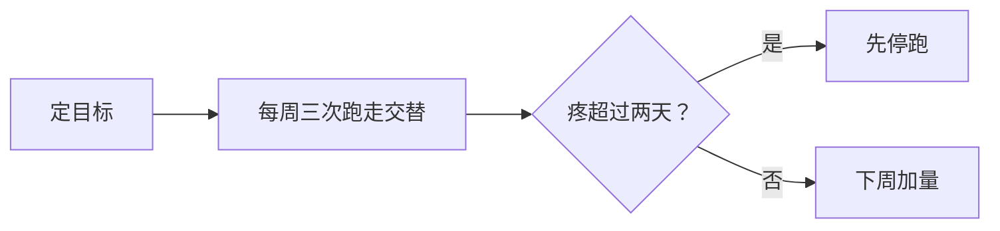

# 展示组件：模板能做什么，guide.md 里怎么写

第 2 步写展示设想、第 5 步配图排版时读。这里说明每个组件是什么、适合承载什么、怎么写；用不用、用哪个，看那一处内容要读者做什么（比较、感受、看动态、照着做），不按数量配额。

页面模板在 `assets/guide-app/`，它读**学习指南目录**（`app/` 的上一层）里的 `guide.md`、`sources.json`、`sites.json`（可选）、`videos.json`（可选）和 `img/`。下面每种写法模板都认，写错了构建会报出行号。

## 目录

1. 文章结构（标题层级）
2. 引用
3. 强调
4. 图片和信息图
5. 流程图、泳道图
6. 表格和表格卡片
7. 截图画廊
8. 提示词块（中英切换）
9. 中轴两栏（人和 AI 分工）
10. 视频
11. 自定义演示
12. 我的看法

## 1. 文章结构

```markdown
# 标题：说清这是什么、给谁            ← 只有一个，第一行
## 一分钟看懂                         ← 开头唯一一个没编号的章，显示 00
## 一、跑走交替的起步安排              ← 「一、」开头的章显示 01、02…
### 小节                              ← 进左侧目录
#### 小标题                            ← 不进目录，17px 半粗
## 检查清单                           ← 最后一个编号章之后的章，自动收进末尾的「其他」，来源列表也排在里面
```

目录在左栏常驻，读者会反复看它。标题用名词短语，像报告目录那样说清这一部分讲什么，具体到扫一眼目录就知道去哪找：「跑走交替的起步安排」比「训练方法」好用。结论写在这一节的第一段，不写进标题。

## 2. 引用

```markdown
每周跑三次、隔天跑。[[c25k]]
两份材料说法不一。[[c25k,club]]
```

`sources.json` 是来源表，一条一个来源：

```json
[{"id": "c25k", "title": "Get running with Couch to 5K", "url": "https://www.nhs.uk/…", "site": "NHS", "date": "2026-05"}]
```

页面按正文里第一次出现的顺序给引用编号 [1][2]…，悬停出卡片（来源名、网站图标、网站、日期），点了开原网页；文末自动生成来源列表，同样带网站图标。卡片和来源列表上只放来源本身，不放核对状态。没有 url 的来源照样能引，卡片上只显示名字。

网站图标由 `scripts/fetch_icons.py <学习指南目录>` 下载到 `img/favicons/`（第 3 步跑，加了新来源再跑一次）；没拿到的显示通用地球图标。引用编号会和前一个字粘在一起，不会单独掉到下一行。

## 3. 强调

| 写法 | 样子 | 适合 |
|---|---|---|
| `==文字==` | 荧光笔 | 读者容易想错、做错的地方 |
| `++文字++` | 下划线 | 术语、一般数据 |
| `**文字**` | 加粗 | 段首的条目名（「**主线**：…」） |

强调多了就等于没有：以往一篇从 108 处删到 40 处，留下的都是「和常识相反」或「容易做错」的。

## 4. 图片和信息图

```markdown

```

单独成段的图片显示成带白框的图，点一下全屏放大，Esc 或再点一下关掉。图加载失败自动不显示（不留空框）。

信息图适合说不清长什么样的抽象原则，做法见 `infographic.md`；截图、封面适合具体对象（某个网站、某个作品、某个工具界面）。

## 5. 流程图、泳道图

````markdown

````

| 内容 | 图 |
|---|---|
| 有先后、有分支的步骤 | flowchart（分支写判断条件） |
| 几个角色在一条流程里交接 | flowchart + 每个角色一个 subgraph |
| 一个概念下分多层多类 | mindmap |

timeline、gantt 在 820 宽里字只有 8–9px，读不了；按时间排的内容用表格更清楚。

节点文字太长，mermaid 会把整张图缩小；中文节点用双引号包起来。竖向超过一屏的长链可以拆成几行：外层 `flowchart TD`，每行一个 `subgraph`，里面写 `direction LR`，给每行起一个组名（`subgraph r1 ["定内容"]`），框保留着。箭头连在分组框之间时，框一旦被隐藏（`stroke:none`），箭头两头就悬空了，构建时会提醒。图里每个事实都要能在材料或来源里找到。

## 6. 表格和表格卡片

普通 markdown 表格。**5 列以上、而且至少 2 列的格子平均超过 16 字**的表，模板自动改成卡片（「首选 / 少用」这类短值列不算）：第一列（或序号 + 第二列）当卡片标题放在卡外，其余字段排成「左标签、右内容」，标签列固定 6 字宽，表头用简短的术语（「作用」「提示词」「局限」）标签才不挤；会变卡片的表头超过 5 字，构建时会提醒。

整格只有一段行内代码的格子（`` `帮我列出试穿跑鞋时要检查的五件事` ``），卡片里显示成带「复制」的提示词块，排到第二行。

其余的表，模板按内容自动定列宽（`src/components/Table.tsx`），写的时候不用管宽度：

- 一行放得下的表不换行，按内容宽显示（至少占栏宽的六成）。
- 放不下时，短列（最长的格子和表头都不超过 10 个汉字宽，英文约 18 个字母）保持一行；剩下的宽度在长列之间分，选所有行加起来最矮的分法。这是表格自动排版研究里的标准目标（给定宽度，让表格总高度最小），比浏览器默认的按比例分紧凑。最后一行只剩一两个字的格子改成均衡断行，数字和单位不拆开。
- 怎么分最常见的行高都超过 3 行，表格加宽到 1.2、1.4 倍栏宽横向滚动，首列固定（首列本身很宽时不固定），右边缘渐隐提示还有内容；还放不下就排成行块（每行一块，「表头：内容」往下排）。全是短列的宽表（多为数字表）不换行，直接横滑。
- 手机上，至少两列平均超过 10 个字的表直接排成行块；其余的表照上面算。

写表格时：

- 第一列放能代表这一行的词（名称、类型、时间）。横滑时它固定在左边，行块里它是每块的标题。
- 同一列的写法一致：都是名词短语，或都是整句。能写短语就写短语，需要整句的列放在后面；格子越短，表越整齐。
- 引用编号写在格子末尾。

## 7. 截图画廊

`sites.json` 登记网站、作品、产品（截图放 `img/sites/.jpg`；img 里带 `/` 时按学习指南目录下的相对路径取）：

```json
[{"key": "site-a", "name": "示例网站 A", "url": "https://example.com/a", "img": "site-a",
  "meta": "2025 · 某奖年度网站", "desc": "首屏只有一句话和一张大图，层级一眼就清楚"}]
```

`meta`（一行关键信息：年份、出处、成绩、数据，要有出处）和 `desc`（它在文中为什么值得看）都可选，写了就显示在截图下面。截图、封面、视频地址用 `collect_refs.py` 收：它默认截首屏，截到验证页就改用页面封面图，都拿不到就只留链接；抓到的页面标题和简介写进 `links/_refs_info.json` 给你参考，`desc` 由你按正文写。

`url` 选读者要看的那一页：字体、作品、模板这类对象，样张页、展示页、作品详情页比首页或代码仓库的文件列表有用。首屏是加载动画、要看的部分在下方时，加可选的 `shot`（只给截图用，页面不读）：`"shot": {"wait": 6000, "scroll": ".specimen"}`，`wait` 是页面加载完再等的毫秒数，`scroll` 是截图前滚到的 CSS 选择器，或往下滚的像素数。

````markdown
```gallery
site-a
site-b
site-c
```
````

横向一排三张（手机上一张多一点），点了开原站；鼠标停在画廊上滚轮 = 横向平滑滚动，滚到头交还给页面。没截图的网站显示成一行链接。介绍好例子时，多给几个通常比只给两三个更能让读者看出共性。

## 8. 提示词块（中英切换）

````markdown
```prompt
这是我这周三次跑步的记录：……请判断下周该加量、保持还是退回上一周。
```

```prompt
写一份九周跑步计划：
1. 每周三次，隔天跑。
--- en ---
Write a nine-week running plan:
1. Three runs a week, with a rest day in between.
```
````

浅强调色底、带「复制」。有 `--- en ---` 时左上角出现「中文 | English」切换，默认中文，复制跟着当前语言。材料里的英文 prompt 都写成这种双语块：中文版放前面，英文原文放 `--- en ---` 后面。文件名、命令、代码标识符（`DESIGN.md`、`setTimeout`、`$impeccable`）在中文版里保留英文。代码（JSON、TS、配置）用普通代码块，不翻。

## 9. 中轴两栏（人和 AI 分工）

内容是「每个阶段里人做什么、AI 做什么」时用：

````markdown
```stages
## 定目标
目标：把「我想开始跑步」变成九周后能检查的目标。[[c25k]]
你：说清现在能连续跑多久、每周哪几天有空、有没有旧伤。
AI：把目标拆成每周三次的计划，每次写清跑几分钟、走几分钟。
产物：一张九周计划表。
常见坑：第一周就按别人的配速跑。
## 每周复盘
……
```
````

中间一根竖线，你在左（绿点）、AI 在右（灰点），每个阶段一个序号；阶段名在序号左边，「目标」在右边。`你：` `AI：` 之后到下一个标签之前的内容（可以多段、可以带列表和提示词块）进同一张卡。其他标签（产物、常见坑……）和没标签的段落放在这一阶段竖线下面，整栏宽。手机上变成一栏，卡片左边框区分你和 AI。

## 10. 视频

```markdown
::video 热身示范 | 拉伸示范
```

名字对 `videos.json` 里的 `name`（`{"name", "url", "poster", "mp4"?, "youtube"?}`）。能嵌就嵌（mp4、YouTube），不能嵌的显示封面卡、点了开原地址。一组里横屏视频只有一条时占整栏，两条以上一行两个（手机上一行一个）；竖屏视频一行三个。既不能嵌、又没有封面图（截不到）的，写成正文里的链接更好，`::video` 会在页面上留一个灰框。

## 11. 自定义演示

```markdown
::fig pace
```

模板组件表达不了、而交互能帮读者理解的（拖动滑块看配速和心率的关系、切换参数看效果），在 `app/src/figures/` 写一个组件并在 `figures/index.tsx` 登记名字。写一个演示的成本不低，值得的时候再做。

## 12. 我的看法

```markdown
> **我的看法**：材料没说，但按你的情况……
```

AI 自己的判断（不是材料说的）放进这种引用块，和材料的说法分开。页面上就叫「我的看法」，不写「AI 补充」「不在原文里」这类给核对者看的标注。
