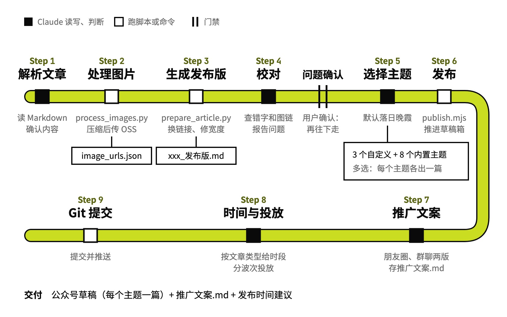

# wechat-publisher

Markdown 推成公众号草稿

## 要解决的问题

用户的公众号文章在本地用 Markdown 写。发到公众号前，每篇都要压缩图片、上传换成线上链接，把 Markdown 按主题渲染成带样式的正文，再放进草稿箱。这个 Skill 管写作流程的最后一段：从压缩图片一路做到推进草稿箱，顺带写好推广文案、给出发布时间建议。

## 运行方式



压缩上传图片、生成发布版、推送草稿箱由脚本完成，修正图片宽度、校对、写推广文案由 Claude 做；主题默认落日晚霞，用户可以多选。校对发现的问题先报给用户，用户确认后才往下发；选了几个主题，就各出一篇草稿。推进草稿箱后，Claude 按文章类型给出发布时段和分批投放建议，最后提交到文章仓库。

## 关键设计

一篇写好的 Markdown 推到公众号，要同时做到：图片都换成线上地址，正文按选定的主题排好版，发表前留给用户在后台确认。wechat-publisher 用三个脚本接力，每一步的产出落成文件交给下一步；排版样式单独放在主题样式表里，发布脚本运行时注册。

- **每一步的产出落成文件，交给下一步**：`process_images.py` 压缩图片、传到图床，写出原地址到线上地址的映射表；`prepare_article.py` 按映射表换地址，补上标题和封面字段，生成发布版；`publish.mjs` 读发布版渲染并推送。
- **只推到草稿箱，发表由用户来点**：`publish.mjs` 每个选中的主题渲染一次、推一篇草稿，最后汇总每篇的结果；正式发表前，用户在公众号后台预览确认。图床和公众号的凭据都从环境变量读，仓库里不放密钥。
- **排版样式写在主题样式表里**：默认主题落日晚霞在 `assets/themes/sunset-glow.css`：正文左对齐，标题全黑、靠字号分层级，代码块限高。`publish.mjs` 运行时把三个自定义主题注册进排版引擎，和内置主题一起供选择。
- **推广文案写得像跟朋友说话**：推完写朋友圈和群聊两版，讲清做了什么、参考了什么、解决了什么，朋友圈版按三种读者列出用得上的场景，两版都存进文章目录的推广文案文件（`SKILL.md`）。
- **发布时间和投放节奏分开定**：文章可以提前发，投放按文章类型挑时段，技术长文放周一到周四早上，工具短文放工作日午休；渠道分几波，早上群聊、中午朋友圈、下午社区（`SKILL.md`）。

```text
wechat-publisher/
├── SKILL.md                     九步流程、主题列表、推广文案和投放规则
├── scripts/
│   ├── process_images.py        压缩图片、传图床、写地址映射表
│   ├── prepare_article.py       换图片地址、加宽度和封面，生成发布版
│   └── publish.mjs              注册主题、渲染、推进草稿箱
├── assets/
│   └── themes/                  自定义主题的样式表
│       ├── sunset-glow.css      落日晚霞：默认主题，暖橙红
│       ├── ink-bamboo.css       墨竹清韵：中国风水墨绿
│       ├── starry-geek.css      星空极客：深色科技风
│       └── sunset-glow-v2.css   落日晚霞的另一版，发布时不加载
└── examples/
    └── ai-assistant-article/    例子：把一篇调研长文排成公众号文章
```

## 其他

- 前提：Python 3 和 oss2；Node.js 和全局安装的 `@wenyan-md/mcp`（`publish.mjs` 按 Homebrew 的全局模块目录加载它，装在别处要改脚本里的路径）；macOS 自带的 `sips` 压图；环境变量 `WECHAT_APP_ID`、`WECHAT_APP_SECRET`、`OSS_ACCESS_KEY_ID`、`OSS_ACCESS_KEY_SECRET`、`OSS_BUCKET`，`OSS_ENDPOINT` 可选
- 注意：`prepare_article.py` 会给所有图片加 `{width=340}`，横向插画要手动去掉才能铺满，竖图和 UI 截图保留
- 注意：首次发布可能报 IP 白名单错误（40164），要在公众号后台把当前 IP 加进白名单
- 注意：没在正文里引用的图片（例如 16:9 封面）要单独上传 OSS

---

完整指令见 [SKILL.md](SKILL.md)；安装方法见仓库首页的 [README](../../README.md)。
