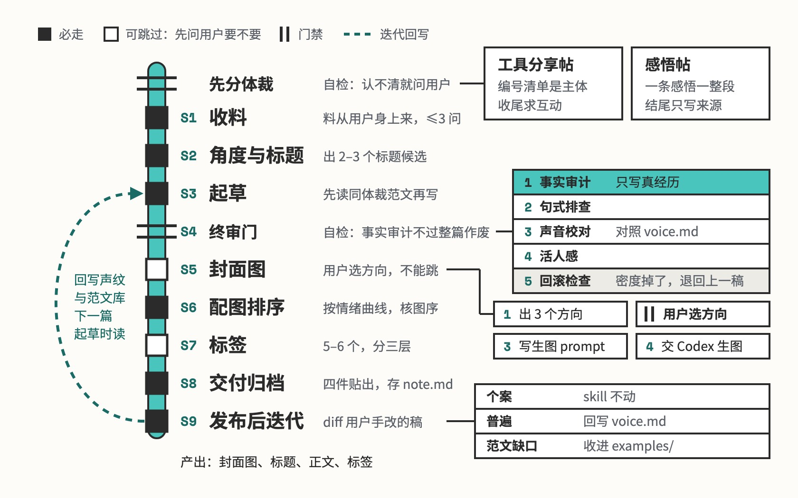

# xhs-note

写小红书笔记，含封面

## 要解决的问题

起点是给自己做的一个 Skill 写小红书推广笔记，第一稿被评「完全没有说人话」。读者是同行，看得出吹牛，稿子要像一个做工具的人在交换经验，不能像推广文案。作者的写作项目里做过对照实验，读范文起草的稿子胜过照规则起草的。后来一篇感悟帖照着工具帖的节奏写了四版，一版都没用上。

## 运行方式

开工先分体裁，看不出是工具帖还是感悟帖就问用户。起草时只读同体裁的范文、不看规则清单，写完才过四层终审，第一层事实审计不过，后面三层不用跑。封面和标签都先问要不要；发布后对比用户手改过的稿子，能在旧笔记里验证的规律才回写声纹文件，库里没有的场景就把成稿收进范文。

## 关键设计

- **范文优先，规则只做终审**：模仿一篇完整范文的呼吸，比遵守一百条规则更像本人；成稿不像时，回去再读一遍范文，不往文件里加规则
- **先分体裁，范文不混着读**：工具帖和感悟帖的节奏几乎相反，跨体裁读会互相污染
- **只写作者真经历过的事**：素材外的细节用占位或诚实模糊，编出来的质感是在透支账号信誉
- **不替作者补别人的案例和数字**：一篇播客感悟帖核了 11 条原文事实塞进正文，作者一条没留，别人的故事会把他自己的判断挤走
- **红线只留三条，都是发出去就收不回来的**：零 emoji、句号规则这类风格约定放在声纹文件里，「像不像他」和「能不能发」分开管

## 其他

- 前提：封面交给本机 Codex CLI 内置的生图，单张十分钟上下，放后台跑
- 注意：范文和声纹（`voice.md`）取自作者自己的笔记，换人用要换成自己的范文，缺范文这套方法就失效
- 注意：已有流量的笔记改标签容易被限流，标签在发布时一次定好

---

完整指令见 [SKILL.md](SKILL.md)；安装方法见仓库首页的 [README](../../README.md)。
